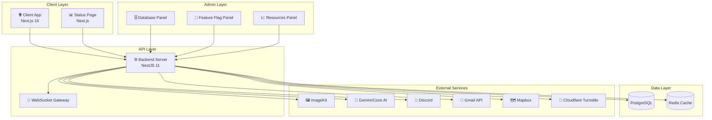
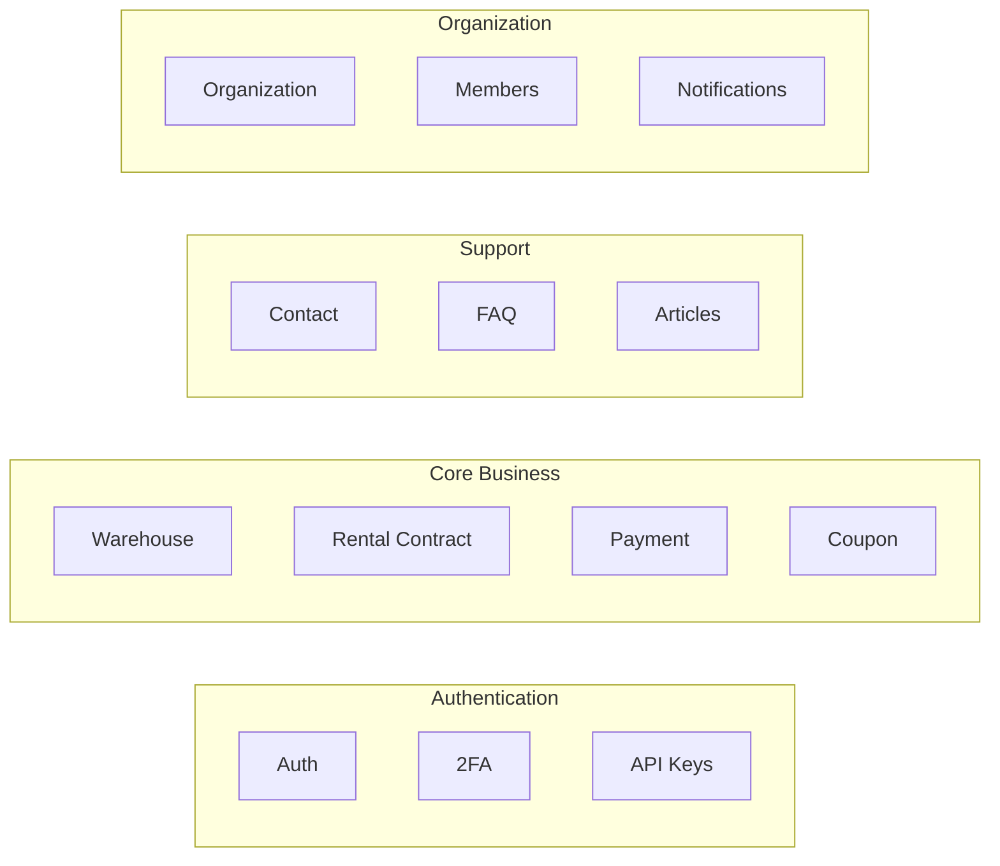

<div align="center">

# 🏭 GEN-HUB

### Nền tảng Quản lý Cho thuê Kho bãi Toàn diện

[](https://nestjs.com/)
[](https://nextjs.org/)
[](https://www.typescriptlang.org/)
[](https://www.postgresql.org/)
[](https://redis.io/)
[](https://www.prisma.io/)

**Giải pháp SaaS hiện đại cho việc quản lý kho bãi, hợp đồng thuê, thanh toán và hỗ trợ khách hàng.**

[🚀 Bắt đầu](#-cài-đặt) · [📖 Tài liệu](#-kiến-trúc-tổng-quan) · [🤝 Đóng góp](#-hướng-dẫn-đóng-góp) · [📋 Roadmap](#-roadmap)

</div>

---

## 📖 Giới thiệu

**GEN-HUB** là một nền tảng quản lý cho thuê kho bãi enterprise-grade, được thiết kế để giải quyết các bài toán phức tạp trong ngành logistics và warehousing. Hệ thống cung cấp giải pháp end-to-end từ việc quản lý warehouse template, row/rack/shelf/block configuration, đến rental contract lifecycle, payment processing và customer support automation.

### Tại sao chọn GEN-HUB?

- **🏢 Multi-Organization Support**: Hỗ trợ nhiều tổ chức với hệ thống phân quyền chi tiết
- **🌐 Internationalization**: Đa ngôn ngữ (Tiếng Việt, English) với cấu trúc i18n linh hoạt
- **🤖 AI-Powered**: Tích hợp Gemini AI và Coze AI cho auto-reply và customer support
- **📊 Real-time Monitoring**: Dashboard giám sát hệ thống với WebSocket real-time updates
- **🔒 Enterprise Security**: JWT auth, 2FA, brute-force protection, rate limiting

---

## ✨ Tính năng chính

### 🏭 Warehouse Management
- Quản lý warehouse templates với cấu trúc Row → Rack → Shelf → Block
- Hỗ trợ cold storage với temperature/humidity tracking
- Amenities management và pricing configurations

### 📋 Contract Lifecycle
- Rental contract management với multiple status flows
- Overdue level tracking (Level 1-3, Sealed, Liquidated)
- Automatic expiry warnings và renewal reminders

### 💳 Payment System
- Multiple payment methods (Balance, Transfer, Hybrid)
- Coupon system với scheduled promotions
- Deposit management và refund processing

### 👥 Organization & Users
- Multi-organization với owner/member roles
- RBAC (Role-Based Access Control) với granular permissions
- User verification, 2FA, và session management

### 🎫 Customer Support
- Contact ticket system với priority levels
- Discord integration cho staff notifications
- AI auto-reply với Coze chatbot
- Email inbound processing

### 📊 Analytics & Monitoring
- Cloudflare analytics integration
- Service health monitoring dashboard
- Database và feature flag management panels

---

## 🏗 Kiến trúc Tổng quan

GEN-HUB sử dụng kiến trúc **Monorepo** với multiple applications được tổ chức rõ ràng:



### Tech Stack

| Layer | Technology | Purpose |
|-------|------------|---------|
| **Frontend** | Next.js 16, React 19, TailwindCSS 4 | Modern SSR/SSG web application |
| **Backend** | NestJS 11, TypeScript 5.9 | Scalable server-side framework |
| **Database** | PostgreSQL 16, Prisma 7 | Relational database with type-safe ORM |
| **Cache** | Redis, ioredis | Session management, caching, rate limiting |
| **Queue** | Bull/BullMQ | Background job processing |
| **Real-time** | Socket.IO | WebSocket communication |
| **Auth** | Passport.js, JWT, Argon2 | Authentication & authorization |
| **File Storage** | ImageKit | Image upload và optimization |
| **AI** | Google Gemini, Coze | Chatbot và auto-reply |

---

## 📁 Cấu trúc thư mục

```
GEN-HUB/
├── 📂 server/                    # Backend NestJS application
│   ├── 📂 src/
│   │   ├── 📂 common/            # Shared utilities, decorators, guards
│   │   ├── 📂 i18n/              # Internationalization files (vi, en)
│   │   ├── 📂 modules/           # Feature modules (56+ modules)
│   │   │   ├── 📂 auth/          # Authentication (OAuth, JWT, 2FA)
│   │   │   ├── 📂 warehouse/     # Warehouse management
│   │   │   ├── 📂 rental-contract/ # Contract lifecycle
│   │   │   ├── 📂 payment/       # Payment processing
│   │   │   ├── 📂 organization/  # Multi-org support
│   │   │   ├── 📂 contact/       # Customer support tickets
│   │   │   ├── 📂 discord/       # Discord integration
│   │   │   ├── 📂 coze/          # AI chatbot integration
│   │   │   └── ...               # 48+ other modules
│   │   └── 📂 prisma/            # Database services
│   ├── 📂 prisma/                # Schema & migrations
│   ├── 📂 documents/             # API documentation
│   └── 📂 test/                  # E2E tests
│
├── 📂 client/                    # Frontend Next.js application
│   ├── 📂 app/                   # App router pages
│   ├── 📂 components/            # Reusable UI components
│   ├── 📂 contexts/              # React contexts
│   ├── 📂 hooks/                 # Custom hooks
│   ├── 📂 services/              # API service layer
│   ├── 📂 types/                 # TypeScript definitions
│   └── 📂 lib/                   # Utility functions
│
├── 📂 admin-panel/               # Admin dashboards
│   ├── 📂 database-panel/        # Database management UI
│   ├── 📂 feature-flag-panel/    # Feature flags management
│   └── 📂 resources-panel/       # System resources monitoring
│
├── 📂 status/                    # Status page application
│
└── 📂 .github/                   # GitHub Actions workflows
```

---

## 🚀 Cài đặt

### Yêu cầu hệ thống

- **Node.js** >= 20.x
- **npm** >= 10.x hoặc **pnpm** >= 8.x
- **PostgreSQL** >= 16
- **Redis** >= 7.x

### Clone Repository

```bash
git clone https://github.com/your-org/gen-hub.git
cd gen-hub
```

### Cài đặt Dependencies

```bash
# Server
cd server
npm install

# Client
cd ../client
npm install

# Admin Panels (optional)
cd ../admin-panel/database-panel && npm install
cd ../feature-flag-panel && npm install
cd ../resources-panel && npm install

# Status Page (optional)
cd ../../status && npm install
```

### Khởi tạo Database

```bash
cd server

# Generate Prisma client
npm run prisma:generate

# Run migrations
npm run prisma:migrate:dev

# Seed initial data (optional)
npm run prisma:seed
```

---

## ⚙️ Environment Configuration

### Server Environment (`.env`)

Tạo file `server/.env` từ template:

```bash
cp server/.env.example server/.env
```

#### Core Configuration

| Variable | Description | Default |
|----------|-------------|---------|
| `PORT` | Server port | `4000` |
| `NODE_ENV` | Environment mode | `development` |
| `DATABASE_URL` | PostgreSQL connection string | Required |
| `REDIS_URL` | Redis connection string | Required |

#### Authentication

| Variable | Description | Example |
|----------|-------------|---------|
| `JWT_ACCESS_SECRET` | Access token secret | Random 256-bit string |
| `JWT_REFRESH_SECRET` | Refresh token secret | Random 256-bit string |
| `JWT_ACCESS_EXPIRATION` | Access token TTL | `15m` |
| `JWT_REFRESH_EXPIRATION` | Refresh token TTL | `7d` |

#### External Services

| Variable | Description | Required |
|----------|-------------|----------|
| `GOOGLE_CLIENT_ID` | Google OAuth client ID | For Gmail/OAuth |
| `IMAGEKIT_PUBLIC_KEY` | ImageKit public key | For image upload |
| `IMAGEKIT_PRIVATE_KEY` | ImageKit private key | For image upload |
| `GEMINI_API_KEYS` | Google Gemini API keys (comma-separated) | For AI features |
| `DISCORD_BOT_TOKEN` | Discord bot token | For Discord integration |

> 📘 **Chi tiết đầy đủ**: Xem file `server/.env.example` để biết toàn bộ 100+ environment variables.

### Client Environment (`.env.local`)

```bash
cp client/.env.example client/.env.local
```

| Variable | Description |
|----------|-------------|
| `NEXT_PUBLIC_API_URL` | Backend API URL |
| `NEXT_PUBLIC_MAPBOX_TOKEN` | Mapbox access token |
| `NEXT_PUBLIC_CLOUDFLARE_TURNSTILE_SITEKEY` | Captcha site key |

---

## 🏃 Chạy Project

### Development Mode

```bash
# Terminal 1: Start Backend
cd server
npm run dev

# Terminal 2: Start Frontend
cd client
npm run dev
```

Truy cập:
- **Client**: http://localhost:3000
- **Server API**: http://localhost:4000
- **Swagger Docs**: http://localhost:4000/api

### Admin Panels (Optional)

```bash
# Database Panel
cd admin-panel/database-panel && npm run dev  # Port 3600

# Feature Flag Panel
cd admin-panel/feature-flag-panel && npm run dev  # Port 3700

# Resources Panel
cd admin-panel/resources-panel && npm run dev  # Port 3800

# Status Page
cd status && npm run dev  # Port 3500
```

### Production Build

```bash
# Server
cd server
npm run build
npm run start:prod

# Client
cd client
npm run build
npm run start
```

### Prisma Studio

Xem và quản lý database trực quan:

```bash
cd server
npm run prisma:studio
```

---

## 🧪 Testing

```bash
cd server

# Unit tests
npm run test

# E2E tests
npm run test:e2e

# Test coverage
npm run test:cov

# Watch mode
npm run test:watch
```

---

## 📚 API Documentation

GEN-HUB cung cấp documentation tự động thông qua **Swagger**:

- **Development**: http://localhost:4000/api
- **Production**: https://api.gen-hub.dev/api

### API Modules Overview



Chi tiết API documentation có tại `server/documents/API-docs.md`.

---

## 🤝 Hướng dẫn Đóng góp

Chúng tôi hoan nghênh mọi đóng góp từ cộng đồng! Vui lòng tuân theo quy trình sau:

### 1. Fork & Clone

```bash
git clone https://github.com/your-username/gen-hub.git
cd gen-hub
```

### 2. Tạo Branch

```bash
git checkout -b feature/amazing-feature
```

### 3. Commit Convention

Sử dụng [Conventional Commits](https://www.conventionalcommits.org/):

```bash
feat: add new warehouse template API
fix: resolve contract renewal calculation bug
docs: update README installation guide
refactor: optimize Redis caching layer
test: add e2e tests for payment module
```

### 4. Code Style

```bash
# Format code
cd server && npm run format
cd client && npm run lint

# Lint check
npm run lint
```

### 5. Pull Request

1. Push changes lên fork của bạn
2. Tạo Pull Request vào branch `main`
3. Mô tả rõ ràng changes và lý do
4. Link related issues (if any)

### Code Review Checklist

- [ ] Code follows project conventions
- [ ] Tests added/updated
- [ ] Documentation updated
- [ ] No breaking changes (or documented)
- [ ] Prisma migrations included (if DB changes)

---

## 📄 Giấy phép

Dự án này được phát hành dưới giấy phép **UNLICENSED** (Private). Xem file [LICENSE](./LICENSE) để biết thêm chi tiết.

> ⚠️ **Lưu ý**: Đây là dự án private, không được phép sử dụng, sao chép hoặc phân phối mà không có sự cho phép.

---

## 🗺 Roadmap

### Phase 1: Core Platform ✅
- [x] Multi-organization support
- [x] Warehouse template management
- [x] Rental contract lifecycle
- [x] Payment integration
- [x] User authentication (JWT, OAuth, 2FA)

### Phase 2: Automation 🚧
- [x] AI-powered auto-reply (Gemini, Coze)
- [x] Discord integration
- [x] Email inbound processing
- [ ] Automated inventory tracking
- [ ] Smart pricing suggestions

### Phase 3: Analytics 📊
- [x] Cloudflare analytics
- [x] System monitoring dashboard
- [ ] Business intelligence reports
- [ ] Revenue forecasting
- [ ] Customer behavior analytics

### Phase 4: Mobile & Expansion 📱
- [ ] React Native mobile app
- [ ] Multi-tenant SaaS model
- [ ] API marketplace
- [ ] Third-party integrations

---

## 💬 Liên hệ & Hỗ trợ

- **Email**: support@gen-hub.dev
- **Documentation**: https://docs.gen-hub.dev
- **Issue Tracker**: [GitHub Issues](https://github.com/your-org/gen-hub/issues)

---

<div align="center">

**Made with ❤️ by GEN-HUB Team**

[](https://github.com/your-org/gen-hub)

</div>
