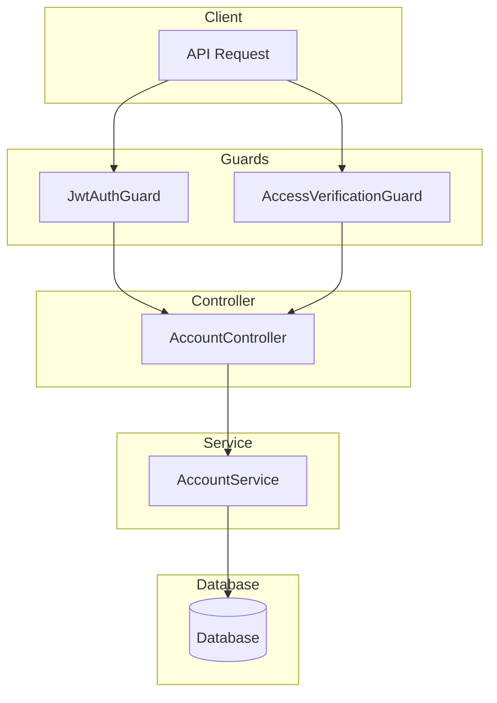

# Account Module Documentation

## Tổng Quan

Module `account` quản lý thông tin cá nhân của người dùng, bao gồm xem thông tin, cập nhật hồ sơ, đổi mật khẩu, tải dữ liệu cá nhân (GDPR) và xóa tài khoản.

---

## Kiến Trúc



---

## API Endpoints

> [!TIP]
> Tất cả các API đều hỗ trợ header `Accept-Language` để chọn ngôn ngữ phản hồi.
> - **vi** - Tiếng Việt (mặc định)
> - **en** - English

### 1. GET /account/profile - Lấy thông tin tài khoản

**Mô tả:** Lấy thông tin chi tiết tài khoản đang đăng nhập bao gồm thông tin cá nhân, danh sách roles được gán và tất cả permissions (từ roles và được gán trực tiếp).

**Xác thực:** Bearer Token (JWT)

**Headers:**
```http
Authorization: Bearer <access_token>
Accept-Language: vi
```

**Response (200 OK):**
```json
{
  "code": "account.get_profile_success",
  "message": "Lấy thông tin tài khoản thành công",
  "success": true,
  "data": {
    "user": {
      "id": "550e8400-e29b-41d4-a716-446655440000",
      "name": "Nguyễn Văn A",
      "email": "user@example.com",
      "email_confirmed": true,
      "is_verified": true,
      "two_factor_enabled": false,
      "language": "vi",
      "created_at": "2026-01-01T00:00:00.000Z"
    },
    "roles": [
      {
        "id": "550e8400-e29b-41d4-a716-446655440001",
        "name": "Admin",
        "description": "Quản trị viên hệ thống"
      }
    ],
    "permissions": [
      {
        "id": "550e8400-e29b-41d4-a716-446655440002",
        "name": "Quản lý người dùng",
        "key": "user.manage",
        "description": "Quyền quản lý người dùng",
        "source": "role",
        "roles": [
          {
            "id": "550e8400-e29b-41d4-a716-446655440001",
            "name": "Admin"
          }
        ]
      }
    ]
  }
}
```

---

### 2. PATCH /account/profile - Cập nhật thông tin tài khoản

**Mô tả:** Cập nhật một phần thông tin tài khoản (name, language). Chỉ các trường được gửi trong request body mới được cập nhật.

**Xác thực:** Bearer Token (JWT)

**Headers:**
```http
Authorization: Bearer <access_token>
Content-Type: application/json
Accept-Language: vi
```

**Request Body Schema:**

| Field | Type | Required | Description |
|-------|------|----------|-------------|
| `name` | string | Optional | Tên người dùng (min 2 ký tự) |
| `language` | string | Optional | Ngôn ngữ (vi, en) |

**Request Body Examples:**

<details>
<summary><b>Ví dụ 1: Cập nhật tên</b></summary>

```json
{
  "name": "Nguyễn Văn B"
}
```
</details>

<details>
<summary><b>Ví dụ 2: Cập nhật ngôn ngữ</b></summary>

```json
{
  "language": "en"
}
```
</details>

<details>
<summary><b>Ví dụ 3: Cập nhật tất cả</b></summary>

```json
{
  "name": "Nguyễn Văn B",
  "language": "en"
}
```
</details>

**Response (200 OK):**
```json
{
  "code": "account.update_profile_success",
  "message": "Cập nhật thông tin tài khoản thành công",
  "success": true,
  "data": null
}
```

---

### 3. POST /account/change-password - Thay đổi mật khẩu

**Mô tả:** Thay đổi mật khẩu tài khoản. Yêu cầu nhập mật khẩu hiện tại để xác thực. Có thể chọn đăng xuất tất cả thiết bị khác sau khi đổi mật khẩu.

**Xác thực:** Bearer Token (JWT)

**Headers:**
```http
Authorization: Bearer <access_token>
Content-Type: application/json
Accept-Language: vi
```

**Request Body Schema:**

| Field | Type | Required | Description |
|-------|------|----------|-------------|
| `current_password` | string | Yes | Mật khẩu hiện tại |
| `new_password` | string | Yes | Mật khẩu mới (min 8 ký tự, 1 hoa, 1 thường, 1 số, 1 ký tự đặc biệt) |
| `confirm_password` | string | Yes | Nhập lại mật khẩu mới (phải khớp new_password) |
| `logout_all_devices` | boolean | Optional | Đăng xuất tất cả thiết bị khác (default: false) |

**Request Body Examples:**

<details>
<summary><b>Ví dụ 1: Đổi mật khẩu thông thường</b></summary>

```json
{
  "current_password": "Password@123",
  "new_password": "NewPassword@456",
  "confirm_password": "NewPassword@456"
}
```
</details>

<details>
<summary><b>Ví dụ 2: Đổi mật khẩu và đăng xuất hết</b></summary>

```json
{
  "current_password": "Password@123",
  "new_password": "NewPassword@456",
  "confirm_password": "NewPassword@456",
  "logout_all_devices": true
}
```
</details>

**Response (200 OK):**
```json
{
  "code": "account.change_password_success",
  "message": "Thay đổi mật khẩu thành công",
  "success": true,
  "data": null
}
```

---

### 4. GET /account/download-data - Tải xuống dữ liệu cá nhân

**Mô tả:** Tải xuống toàn bộ dữ liệu cá nhân của tài khoản dưới dạng JSON. Yêu cầu xác thực quyền truy cập thông qua header `X-Access-Verification-Token` (token cấp 2).

**Xác thực:** Bearer Token (JWT) + Access Verification Token

**Headers:**
```http
Authorization: Bearer <access_token>
X-Access-Verification-Token: <verification_token>
Accept-Language: vi
```

**Response (200 OK):**
```json
{
  "code": "account.download_data_success",
  "message": "Tải dữ liệu thành công",
  "success": true,
  "data": {
    "data": {
      // Toàn bộ dữ liệu user object
    },
    "filename": "user-data-uuid-2026-01-21.json"
  }
}
```

---

### 5. DELETE /account/delete-account - Xóa tài khoản

**Mô tả:** Xóa tài khoản người dùng (soft delete). Yêu cầu xác thực quyền truy cập thông qua `X-Access-Verification-Token` và nhập chuỗi xác nhận.

**Xác thực:** Bearer Token (JWT) + Access Verification Token

**Headers:**
```http
Authorization: Bearer <access_token>
X-Access-Verification-Token: <verification_token>
Content-Type: application/json
Accept-Language: vi
```

**Request Body Schema:**

| Field | Type | Required | Description |
|-------|------|----------|-------------|
| `confirmation` | string | Yes | Chuỗi xác nhận: "XÓA TÀI KHOẢN" (vi) hoặc "DELETE ACCOUNT" (en) |
| `reason` | string | Optional | Lý do xóa tài khoản (max 500 ký tự) |

**Request Body Examples:**

<details>
<summary><b>Ví dụ 1: Xóa (Tiếng Việt)</b></summary>

```json
{
  "confirmation": "XÓA TÀI KHOẢN",
  "reason": "Không còn sử dụng dịch vụ"
}
```
</details>

<details>
<summary><b>Ví dụ 2: Xóa (English)</b></summary>

```json
{
  "confirmation": "DELETE ACCOUNT",
  "reason": "No longer using the service"
}
```
</details>

**Response (200 OK):**
```json
{
  "code": "account.delete_account_success",
  "message": "Xóa tài khoản thành công",
  "success": true,
  "data": null
}
```

---

## Error Responses

<details>
<summary><b>401 Unauthorized</b></summary>

```json
{
  "code": "error.unauthorized",
  "message": "Yêu cầu xác thực quyền truy cập",
  "success": false
}
```
</details>

<details>
<summary><b>403 Forbidden (Khi verify token sai)</b></summary>

```json
{
  "code": "error.forbidden",
  "message": "Token xác thực không hợp lệ hoặc đã hết hạn",
  "success": false
}
```
</details>

<details>
<summary><b>422 Unprocessable Entity (Validation Error)</b></summary>

```json
{
  "code": "error.validation",
  "message": "Dữ liệu đầu vào không hợp lệ",
  "success": false,
  "errors": [
    { "field": "new_password", "message": "Mật khẩu phải có ít nhất 8 ký tự..." }
  ]
}
```
</details>

---

## Validation Rules

### Password Requirements
- Ít nhất 8 ký tự
- Chứa ít nhất 1 chữ hoa
- Chứa ít nhất 1 chữ thường
- Chứa ít nhất 1 số
- Chứa ít nhất 1 ký tự đặc biệt (`@$!%*?&_`)

### Delete Account Confirmation
- Phải nhập chính xác chuỗi "XÓA TÀI KHOẢN" hoặc "DELETE ACCOUNT" tùy logic backend (thường chấp nhận 1 trong 2).

---

## Files Trong Module

| File | Mô tả |
|------|-------|
| `account.controller.ts` | Controller xử lý HTTP requests |
| `account.service.ts` | Logic xử lý nghiệp vụ chính |
| `account.repository.ts` | Tương tác với Database |
| `dto/delete-account.dto.ts` | DTO cho API xóa tài khoản |
| `../auth/dto/update-profile.dto.ts` | DTO cập nhật thông tin (dùng chung với Auth) |
| `../auth/dto/change-password.dto.ts` | DTO đổi mật khẩu (dùng chung với Auth) |
