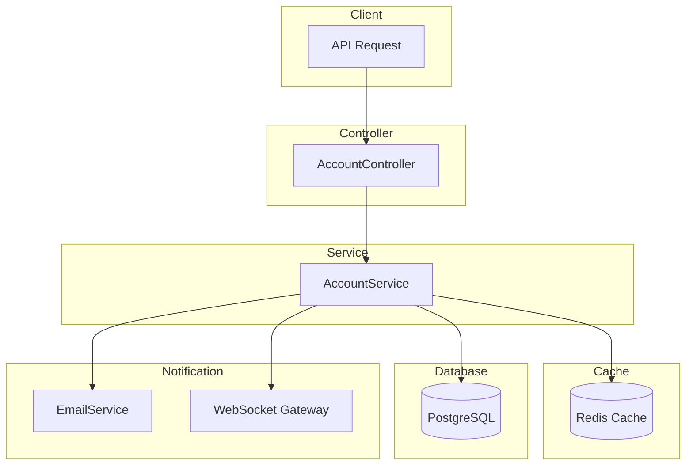

# Account Module Documentation

## Tổng Quan

Module `account` quản lý thông tin tài khoản người dùng đang đăng nhập trong hệ thống GEN-HUB. Module cung cấp các chức năng:

1. **Xem thông tin tài khoản** - Bao gồm thông tin cá nhân, roles và permissions
2. **Cập nhật thông tin** - Cho phép thay đổi tên và ngôn ngữ
3. **Thay đổi mật khẩu** - Đổi mật khẩu với xác thực và tùy chọn đăng xuất tất cả thiết bị

---

## Kiến Trúc



---

## API Endpoints

> [!TIP]
> Tất cả các API đều hỗ trợ header `Accept-Language` để chọn ngôn ngữ phản hồi.
>
> - **vi** - Tiếng Việt (mặc định)
> - **en** - English

### 1. GET /account/profile - Lấy thông tin tài khoản

**Mô tả:** Lấy thông tin chi tiết tài khoản đang đăng nhập bao gồm thông tin cá nhân, danh sách roles được gán và tất cả permissions (từ roles và được gán trực tiếp).

**Xác thực:** Bearer Token (JWT)

**Headers:**

```http
GET /account/profile HTTP/1.1
Host: api.gen-hub.dev
Authorization: Bearer <access_token>
Accept: application/json
Accept-Language: vi
```

**Response (200 OK):**

```json
{
  "code": "account.get_profile_success",
  "message": "Lấy thông tin tài khoản thành công",
  "success": true,
  "data": {
    "user": {
      "id": "550e8400-e29b-41d4-a716-446655440000",
      "name": "Nguyễn Văn A",
      "email": "user@example.com",
      "email_confirmed": true,
      "is_verified": true,
      "two_factor_enabled": false,
      "language": "vi",
      "created_at": "2026-01-01T00:00:00.000Z"
    },
    "roles": [
      {
        "id": "550e8400-e29b-41d4-a716-446655440001",
        "name": "Admin",
        "description": "Quản trị viên hệ thống"
      }
    ],
    "permissions": [
      {
        "id": "550e8400-e29b-41d4-a716-446655440002",
        "name": "Quản lý người dùng",
        "key": "user.manage",
        "description": "Quyền quản lý người dùng",
        "source": "role",
        "roles": [
          { "id": "550e8400-e29b-41d4-a716-446655440001", "name": "Admin" }
        ]
      },
      {
        "id": "550e8400-e29b-41d4-a716-446655440003",
        "name": "Xem báo cáo",
        "key": "report.view",
        "description": "Quyền xem báo cáo",
        "source": "permission",
        "roles": []
      }
    ]
  }
}
```

**Response Schema:**

| Field                          | Type              | Description                                                          |
| ------------------------------ | ----------------- | -------------------------------------------------------------------- |
| `data.user.id`                 | string (uuid)     | ID người dùng                                                        |
| `data.user.name`               | string            | Tên người dùng                                                       |
| `data.user.email`              | string            | Email đăng nhập                                                      |
| `data.user.email_confirmed`    | boolean           | Trạng thái xác nhận email                                            |
| `data.user.is_verified`        | boolean           | Trạng thái xác minh tài khoản                                        |
| `data.user.two_factor_enabled` | boolean           | Trạng thái bật 2FA                                                   |
| `data.user.language`           | string            | Ngôn ngữ (vi, en)                                                    |
| `data.user.created_at`         | string (datetime) | Thời gian tạo tài khoản                                              |
| `data.roles`                   | array             | Danh sách roles được gán                                             |
| `data.permissions`             | array             | Danh sách permissions (từ roles và gán trực tiếp)                    |
| `data.permissions[].source`    | string            | Nguồn permission: `role` (từ role) hoặc `permission` (gán trực tiếp) |

**Error Responses:**

<details>
<summary><b>401 Unauthorized</b></summary>

```json
// Không có token
{
  "code": "error.unauthorized.token_missing",
  "message": "Không có quyền truy cập",
  "success": false
}

// Token hết hạn
{
  "code": "error.unauthorized.token_expired",
  "message": "Token đã hết hạn",
  "success": false
}

// Token không hợp lệ
{
  "code": "error.unauthorized.token_invalid",
  "message": "Token không hợp lệ",
  "success": false
}

// Token không đúng định dạng
{
  "code": "error.unauthorized.token_malformed",
  "message": "Token không đúng định dạng",
  "success": false
}
```

</details>

---

### 2. PATCH /account/profile - Cập nhật thông tin tài khoản

**Mô tả:** Cập nhật một phần thông tin tài khoản (name, language). Chỉ các trường được gửi trong request body mới được cập nhật, các trường khác giữ nguyên.

**Xác thực:** Bearer Token (JWT)

**Headers:**

```http
PATCH /account/profile HTTP/1.1
Host: api.gen-hub.dev
Authorization: Bearer <access_token>
Content-Type: application/json
Accept-Language: vi
```

**Request Body Schema:**

| Field      | Type   | Required | Description           |
| ---------- | ------ | -------- | --------------------- |
| `name`     | string | Optional | Tên mới (min 2 ký tự) |
| `language` | string | Optional | Ngôn ngữ (vi, en)     |

**Request Body Examples:**

<details>
<summary><b>Ví dụ 1: Cập nhật tên</b></summary>

```json
{
  "name": "Nguyễn Văn B"
}
```

</details>

<details>
<summary><b>Ví dụ 2: Cập nhật ngôn ngữ</b></summary>

```json
{
  "language": "en"
}
```

</details>

<details>
<summary><b>Ví dụ 3: Cập nhật tất cả</b></summary>

```json
{
  "name": "Nguyễn Văn B",
  "language": "en"
}
```

</details>

**Response (200 OK):**

```json
{
  "code": "account.update_profile_success",
  "message": "Cập nhật thông tin tài khoản thành công",
  "success": true,
  "data": null
}
```

**Error Responses:**

<details>
<summary><b>401 Unauthorized</b></summary>

```json
// Không có token
{
  "code": "error.unauthorized.token_missing",
  "message": "Không có quyền truy cập",
  "success": false
}

// Token hết hạn
{
  "code": "error.unauthorized.token_expired",
  "message": "Token đã hết hạn",
  "success": false
}

// Token không hợp lệ
{
  "code": "error.unauthorized.token_invalid",
  "message": "Token không hợp lệ",
  "success": false
}

// Token không đúng định dạng
{
  "code": "error.unauthorized.token_malformed",
  "message": "Token không đúng định dạng",
  "success": false
}
```

</details>

<details>
<summary><b>422 Unprocessable Entity</b></summary>

```json
{
  "code": "error.validation",
  "message": "Dữ liệu đầu vào không hợp lệ",
  "success": false,
  "errors": [
    { "field": "name", "message": "Tên phải có ít nhất 2 ký tự" },
    { "field": "language", "message": "Ngôn ngữ không hợp lệ" }
  ]
}
```

</details>

---

### 3. POST /account/change-password - Thay đổi mật khẩu

**Mô tả:** Thay đổi mật khẩu tài khoản. Yêu cầu nhập mật khẩu hiện tại để xác thực. Có thể chọn đăng xuất tất cả thiết bị khác sau khi đổi mật khẩu. Sau khi đổi mật khẩu thành công, hệ thống sẽ gửi email thông báo.

**Xác thực:** Bearer Token (JWT)

**Headers:**

```http
POST /account/change-password HTTP/1.1
Host: api.gen-hub.dev
Authorization: Bearer <access_token>
Content-Type: application/json
Accept-Language: vi
```

**Request Body Schema:**

| Field                | Type    | Required | Description                                                                   |
| -------------------- | ------- | -------- | ----------------------------------------------------------------------------- |
| `current_password`   | string  | Required | Mật khẩu hiện tại                                                             |
| `new_password`       | string  | Required | Mật khẩu mới (min 8 ký tự, phải có chữ hoa, chữ thường, số và ký tự đặc biệt) |
| `confirm_password`   | string  | Required | Xác nhận mật khẩu mới (phải trùng với new_password)                           |
| `logout_all_devices` | boolean | Optional | Đăng xuất tất cả thiết bị khác (default: false)                               |

**Request Body Examples:**

<details>
<summary><b>Ví dụ 1: Đổi mật khẩu cơ bản</b></summary>

```json
{
  "current_password": "Password@123",
  "new_password": "NewPassword@456",
  "confirm_password": "NewPassword@456"
}
```

</details>

<details>
<summary><b>Ví dụ 2: Đổi mật khẩu và đăng xuất tất cả thiết bị</b></summary>

```json
{
  "current_password": "Password@123",
  "new_password": "NewPassword@456",
  "confirm_password": "NewPassword@456",
  "logout_all_devices": true
}
```

</details>

**Response (200 OK):**

```json
{
  "code": "account.change_password_success",
  "message": "Thay đổi mật khẩu thành công",
  "success": true,
  "data": null
}
```

**Error Responses:**

<details>
<summary><b>401 Unauthorized</b></summary>

```json
// Không có token
{
  "code": "error.unauthorized.token_missing",
  "message": "Không có quyền truy cập",
  "success": false
}

// Token hết hạn
{
  "code": "error.unauthorized.token_expired",
  "message": "Token đã hết hạn",
  "success": false
}

// Token không hợp lệ
{
  "code": "error.unauthorized.token_invalid",
  "message": "Token không hợp lệ",
  "success": false
}

// Token không đúng định dạng
{
  "code": "error.unauthorized.token_malformed",
  "message": "Token không đúng định dạng",
  "success": false
}

// Mật khẩu hiện tại không đúng
{
  "code": "auth.change_password.incorrect_current_password",
  "message": "Mật khẩu hiện tại không đúng",
  "success": false
}
```

</details>

<details>
<summary><b>400 Bad Request</b></summary>

```json
// Tài khoản không có mật khẩu (đăng ký bằng OAuth)
{
  "code": "error.bad_request",
  "message": "Tài khoản không có mật khẩu",
  "success": false
}

// Mật khẩu xác nhận không khớp
{
  "code": "auth.change_password.password_mismatch",
  "message": "Mật khẩu xác nhận không khớp",
  "success": false
}
```

</details>

<details>
<summary><b>422 Unprocessable Entity</b></summary>

```json
{
  "code": "error.validation",
  "message": "Dữ liệu đầu vào không hợp lệ",
  "success": false,
  "errors": [
    { "field": "current_password", "message": "Mật khẩu hiện tại là bắt buộc" },
    { "field": "new_password", "message": "Mật khẩu phải có ít nhất 8 ký tự" },
    {
      "field": "new_password",
      "message": "Mật khẩu phải chứa ít nhất 1 chữ hoa, 1 chữ thường, 1 số và 1 ký tự đặc biệt"
    }
  ]
}
```

</details>

---

## WebSocket Events

Khi thông tin tài khoản được thay đổi, server sẽ emit các event qua WebSocket để thông báo realtime.

### Event Types

| Action           | Event Name         | Description                          |
| ---------------- | ------------------ | ------------------------------------ |
| Profile Updated  | `profile:updated`  | Thông tin tài khoản đã được cập nhật |
| Password Changed | `password:changed` | Mật khẩu đã được thay đổi            |
| Token Revoked    | `token:revoked`    | Tất cả phiên đăng nhập đã bị thu hồi |

### profile:updated Event Payload

```typescript
interface ProfileUpdatedEvent {
  /** Các trường đã được cập nhật */
  updatedFields: string[];
  /** Thông tin user mới */
  user: {
    id: string;
    name: string;
    email: string;
    language?: string;
  };
  /** Thời điểm event */
  timestamp: string;
}
```

**Ví dụ:**

```json
{
  "updatedFields": ["name", "language"],
  "user": {
    "id": "550e8400-e29b-41d4-a716-446655440000",
    "name": "Nguyễn Văn B",
    "email": "user@example.com",
    "language": "en"
  },
  "timestamp": "2026-01-21T06:00:00.000Z"
}
```

### password:changed Event Payload

```typescript
interface PasswordChangedEvent {
  /** Thông báo */
  message: string;
  /** Thời điểm event */
  timestamp: string;
}
```

**Ví dụ:**

```json
{
  "message": "Mật khẩu đã được thay đổi",
  "timestamp": "2026-01-21T06:00:00.000Z"
}
```

### token:revoked Event Payload

```typescript
interface TokenRevokedEvent {
  /** Lý do thu hồi */
  reason: 'password_changed' | 'logout_all' | 'admin_action';
  /** Thông báo */
  message: string;
  /** Thời điểm event */
  timestamp: string;
}
```

**Ví dụ:**

```json
{
  "reason": "password_changed",
  "message": "Tất cả phiên đăng nhập đã bị thu hồi do đổi mật khẩu",
  "timestamp": "2026-01-21T06:00:00.000Z"
}
```

### Cách sử dụng ở Frontend

```typescript
// Sử dụng Socket.IO client
import { io } from 'socket.io-client';

const socket = io('wss://api.gen-hub.dev');

// Subscribe profile events
socket.on('profile:updated', (payload) => {
  console.log('Profile updated:', payload.updatedFields);
  // Cập nhật UI với thông tin mới
  updateUserProfile(payload.user);
});

socket.on('password:changed', (payload) => {
  console.log('Password changed at:', payload.timestamp);
  // Hiển thị thông báo
  showNotification(payload.message);
});

socket.on('token:revoked', (payload) => {
  console.log('Token revoked:', payload.reason);
  // Đăng xuất và redirect đến trang login
  logout();
  showAlert(payload.message);
});
```

---

## Caching Strategy

### Redis Cache

Thông tin profile được cache trong Redis để tăng hiệu năng:

| Cache Key               | TTL    | Description                          |
| ----------------------- | ------ | ------------------------------------ |
| `user:{userId}:profile` | 5 phút | Thông tin user, roles và permissions |

**Cache Invalidation:**

- Khi cập nhật profile → Invalidate cache
- Khi thay đổi roles/permissions → Invalidate cache

---

## Validation Rules

### Name

- Độ dài tối thiểu: 2 ký tự
- Kiểu dữ liệu: string

### Language

- Giá trị cho phép: `vi`, `en`
- Case-insensitive (tự động normalize về lowercase)

### Password

- Độ dài tối thiểu: 8 ký tự
- Phải chứa:
  - Ít nhất 1 chữ hoa (A-Z)
  - Ít nhất 1 chữ thường (a-z)
  - Ít nhất 1 số (0-9)
  - Ít nhất 1 ký tự đặc biệt (@$!%\*?&\_)

---

## Files trong Module

| File                                                                                                    | Mô tả                    |
| ------------------------------------------------------------------------------------------------------- | ------------------------ |
| [account.module.ts](file:///e:/STUDY/Demo/gen-hub/server/src/modules/account/account.module.ts)         | NestJS module definition |
| [account.controller.ts](file:///e:/STUDY/Demo/gen-hub/server/src/modules/account/account.controller.ts) | REST API endpoints       |
| [account.service.ts](file:///e:/STUDY/Demo/gen-hub/server/src/modules/account/account.service.ts)       | Business logic           |

### DTOs sử dụng

| DTO                 | Location                                                                                                   | Description           |
| ------------------- | ---------------------------------------------------------------------------------------------------------- | --------------------- |
| `UpdateProfileDto`  | [update-profile.dto.ts](file:///e:/STUDY/Demo/gen-hub/server/src/modules/auth/dto/update-profile.dto.ts)   | DTO cập nhật profile  |
| `ChangePasswordDto` | [change-password.dto.ts](file:///e:/STUDY/Demo/gen-hub/server/src/modules/auth/dto/change-password.dto.ts) | DTO thay đổi mật khẩu |

---

## Security Considerations

> [!IMPORTANT]
>
> - Mật khẩu được hash bằng **Argon2id** với cấu hình bảo mật cao
> - Có thể đăng xuất tất cả thiết bị khi đổi mật khẩu để bảo vệ tài khoản
> - Email thông báo được gửi tự động khi đổi mật khẩu thành công
> - Rate limiting được áp dụng để ngăn chặn brute force

> [!CAUTION]
>
> - Không nên log mật khẩu dưới bất kỳ hình thức nào
> - Token bị thu hồi khi logout_all_devices = true
