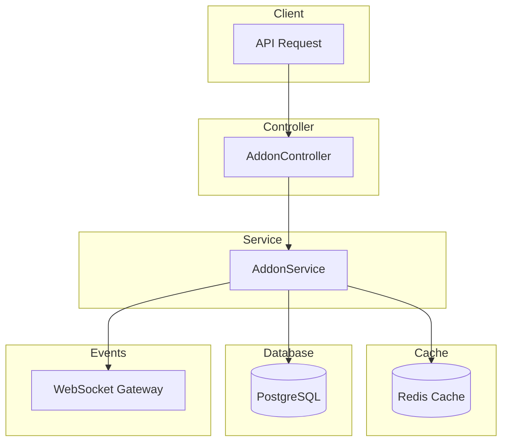

# Addon Module Documentation

## Tổng Quan

Module `addon` quản lý các dịch vụ bổ sung (addons) trong hệ thống GEN-HUB. Addon là các dịch vụ bổ trợ như bảo hiểm, hỗ trợ kỹ thuật, v.v. có thể được gán cho các tier hoặc gói dịch vụ.

---

## Kiến Trúc



---

## API Endpoints

> [!TIP]
> Tất cả các API đều hỗ trợ header `Accept-Language` để chọn ngôn ngữ phản hồi.
>
> - **vi** - Tiếng Việt (mặc định)
> - **en** - English

### 1. POST /addons - Tạo addon mới

**Mô tả:** Tạo một addon mới trong hệ thống. Addon là các dịch vụ bổ sung như bảo hiểm, hỗ trợ kỹ thuật, v.v.

**Xác thực:** Bearer Token (JWT)

**Quyền yêu cầu:** `addon.create`

**Headers:**

```http
Authorization: Bearer <access_token>
Content-Type: application/json
Accept-Language: vi
```

**Request Body Schema:**

| Field                | Type    | Required | Description                          |
| -------------------- | ------- | -------- | ------------------------------------ |
| `name`               | string  | Required | Tên addon (max 255 ký tự)            |
| `description`        | string  | Optional | Mô tả addon                          |
| `price`              | number  | Required | Giá tiền (>= 0)                      |
| `is_monthly_payment` | boolean | Optional | Trả phí hàng tháng (default: false)  |
| `is_active`          | boolean | Optional | Trạng thái hoạt động (default: true) |

**Request Body Examples:**

<details>
<summary><b>Ví dụ 1: Addon cơ bản</b></summary>

```json
{
  "name": "Bảo hiểm kho hàng",
  "description": "Dịch vụ bảo hiểm hàng hóa trong kho",
  "price": 500000,
  "is_active": true
}
```

</details>

<details>
<summary><b>Ví dụ 2: Addon trả phí hàng tháng</b></summary>

```json
{
  "name": "Hỗ trợ kỹ thuật 24/7",
  "description": "Hỗ trợ kỹ thuật chuyên nghiệp 24/7 qua hotline và chat",
  "price": 1500000,
  "is_monthly_payment": true,
  "is_active": true
}
```

</details>

<details>
<summary><b>Ví dụ 3: Addon tối thiểu</b></summary>

```json
{
  "name": "Dịch vụ vệ sinh",
  "price": 200000
}
```

</details>

**Response (201 Created):**

```json
{
  "code": "addon.create.success",
  "message": "Tạo addon thành công",
  "success": true,
  "data": {
    "id": "550e8400-e29b-41d4-a716-446655440001",
    "name": "Bảo hiểm kho hàng",
    "description": "Dịch vụ bảo hiểm hàng hóa trong kho",
    "price": 500000,
    "is_monthly_payment": false,
    "is_active": true,
    "created_at": "2026-01-21T07:00:00.000Z",
    "updated_at": null,
    "created_by": "550e8400-e29b-41d4-a716-446655440000"
  }
}
```

**Error Responses:**

<details>
<summary><b>409 Conflict - Tên addon đã tồn tại</b></summary>

```json
{
  "code": "addon.errors.name_exists",
  "message": "Tên addon đã tồn tại",
  "success": false
}
```

</details>

<details>
<summary><b>401 Unauthorized</b></summary>

```json
// Không có token
{
  "code": "error.unauthorized.token_missing",
  "message": "Không có quyền truy cập",
  "success": false
}

// Token hết hạn
{
  "code": "error.unauthorized.token_expired",
  "message": "Token đã hết hạn",
  "success": false
}
```

</details>

<details>
<summary><b>403 Forbidden</b></summary>

```json
{
  "code": "error.forbidden.no_permission",
  "message": "Không có quyền thực hiện thao tác này",
  "success": false
}
```

</details>

<details>
<summary><b>422 Unprocessable Entity</b></summary>

```json
{
  "code": "error.validation",
  "message": "Dữ liệu đầu vào không hợp lệ",
  "success": false,
  "errors": [
    { "field": "name", "message": "Tên addon không được để trống" },
    { "field": "price", "message": "Giá không được để trống" }
  ]
}
```

</details>

---

### 2. GET /addons - Lấy danh sách addon

**Mô tả:** Lấy danh sách addon có hỗ trợ phân trang và lọc theo từ khóa, trạng thái, loại addon.

**Xác thực:** Bearer Token (JWT)

**Quyền yêu cầu:** `addon.list`

**Query Parameters:**

| Parameter       | Type          | Required | Description                              |
| --------------- | ------------- | -------- | ---------------------------------------- |
| `limit`         | number        | Optional | Số lượng bản ghi mỗi trang (default: 10) |
| `offset`        | number        | Optional | Vị trí bắt đầu (default: 0)              |
| `keywords`      | string        | Optional | Từ khóa tìm kiếm theo tên hoặc mô tả     |
| `is_active`     | boolean       | Optional | Lọc theo trạng thái hoạt động            |
| `addon_type_id` | string (UUID) | Optional | Lọc theo ID loại addon                   |

**Request:**

```http
GET /addons?limit=10&offset=0&is_active=true&keywords=bảo%20hiểm HTTP/1.1
Host: api.gen-hub.dev
Authorization: Bearer <access_token>
Accept-Language: vi
```

**Response (200 OK):**

```json
{
  "code": "addon.list.success",
  "message": "Lấy danh sách addon thành công",
  "success": true,
  "data": {
    "items": [
      {
        "id": "550e8400-e29b-41d4-a716-446655440001",
        "name": "Bảo hiểm kho hàng",
        "description": "Dịch vụ bảo hiểm hàng hóa trong kho",
        "price": 500000,
        "is_monthly_payment": false,
        "is_active": true,
        "created_at": "2026-01-21T07:00:00.000Z"
      },
      {
        "id": "550e8400-e29b-41d4-a716-446655440002",
        "name": "Bảo hiểm hàng hóa vận chuyển",
        "description": "Bảo hiểm hàng hóa trong quá trình vận chuyển",
        "price": 300000,
        "is_monthly_payment": false,
        "is_active": true,
        "created_at": "2026-01-20T10:00:00.000Z"
      }
    ],
    "total": 25,
    "limit": 10,
    "offset": 0,
    "hasMore": true
  }
}
```

---

### 3. GET /addons/active - Lấy danh sách addon đang hoạt động

**Mô tả:** Lấy danh sách tất cả addon đang hoạt động (is_active = true, is_deleted = false) với phân trang. API này không yêu cầu xác thực và có thể được sử dụng công khai.

**Xác thực:** Không yêu cầu

**Headers:**
```http
Accept-Language: vi
```

**Query Parameters:**

| Parameter       | Type          | Required | Default | Description                              |
| --------------- | ------------- | -------- | ------- | ---------------------------------------- |
| `limit`         | number        | Optional | 10      | Số lượng bản ghi mỗi trang (min: 1)      |
| `offset`        | number        | Optional | 0       | Vị trí bắt đầu (min: 0)                  |
| `addon_type_id` | string (UUID) | Optional | -       | Lọc theo ID loại addon                   |

**Request Examples:**

```http
# Lấy 10 addon active đầu tiên
GET /addons/active HTTP/1.1

# Lấy với phân trang
GET /addons/active?limit=20&offset=40 HTTP/1.1

# Lọc theo loại addon
GET /addons/active?addon_type_id=550e8400-e29b-41d4-a716-446655440002 HTTP/1.1

# Kết hợp phân trang và filter
GET /addons/active?limit=10&offset=0&addon_type_id=550e8400-e29b-41d4-a716-446655440002 HTTP/1.1
```

**Response (200 OK):**

```json
{
  "code": "addon.list.success",
  "message": "Lấy danh sách addon active thành công",
  "success": true,
  "data": {
    "items": [
      {
        "id": "550e8400-e29b-41d4-a716-446655440001",
        "name": "Bảo hiểm kho hàng",
        "description": "Dịch vụ bảo hiểm hàng hóa trong kho",
        "price": 500000,
        "is_monthly_payment": false,
        "is_active": true
      },
      {
        "id": "550e8400-e29b-41d4-a716-446655440002",
        "name": "Hỗ trợ kỹ thuật 24/7",
        "description": "Hỗ trợ kỹ thuật chuyên nghiệp 24/7",
        "price": 1500000,
        "is_monthly_payment": true,
        "is_active": true
      }
    ],
    "total": 25,
    "limit": 10,
    "offset": 0
  }
}
```

---

### 4. GET /addons/:id - Lấy chi tiết addon

**Mô tả:** Lấy thông tin chi tiết của một addon theo ID.

**Xác thực:** Bearer Token (JWT)

**Quyền yêu cầu:** `addon.read`

**Path Parameters:**

| Parameter | Type             | Description  |
| --------- | ---------------- | ------------ |
| `id`      | string (UUID v4) | ID của addon |

**Request:**

```http
GET /addons/550e8400-e29b-41d4-a716-446655440001 HTTP/1.1
Host: api.gen-hub.dev
Authorization: Bearer <access_token>
Accept-Language: vi
```

**Response (200 OK):**

```json
{
  "code": "addon.read.success",
  "message": "Lấy chi tiết addon thành công",
  "success": true,
  "data": {
    "id": "550e8400-e29b-41d4-a716-446655440001",
    "name": "Bảo hiểm kho hàng",
    "description": "Dịch vụ bảo hiểm hàng hóa trong kho",
    "price": 500000,
    "is_monthly_payment": false,
    "is_active": true,
    "created_at": "2026-01-21T07:00:00.000Z",
    "updated_at": null,
    "created_by": "550e8400-e29b-41d4-a716-446655440000",
    "updated_by": null
  }
}
```

**Error Response (404 Not Found):**

```json
{
  "code": "addon.errors.not_found",
  "message": "Không tìm thấy addon",
  "success": false
}
```

---

### 5. PUT /addons/:id - Cập nhật addon

**Mô tả:** Cập nhật thông tin addon theo ID. Chỉ các trường được gửi trong request body mới được cập nhật.

**Xác thực:** Bearer Token (JWT)

**Quyền yêu cầu:** `addon.update`

**Path Parameters:**

| Parameter | Type             | Description  |
| --------- | ---------------- | ------------ |
| `id`      | string (UUID v4) | ID của addon |

**Request Body Examples:**

<details>
<summary><b>Ví dụ 1: Cập nhật giá</b></summary>

```json
{
  "price": 750000
}
```

</details>

<details>
<summary><b>Ví dụ 2: Thay đổi trạng thái</b></summary>

```json
{
  "is_active": false
}
```

</details>

<details>
<summary><b>Ví dụ 3: Cập nhật toàn bộ</b></summary>

```json
{
  "name": "Bảo hiểm kho hàng Premium",
  "description": "Dịch vụ bảo hiểm hàng hóa cao cấp với mức đền bù tối đa 1 tỷ VNĐ",
  "price": 1000000,
  "is_monthly_payment": true,
  "is_active": true
}
```

</details>

**Response (200 OK):**

```json
{
  "code": "addon.update.success",
  "message": "Cập nhật addon thành công",
  "success": true,
  "data": {
    "id": "550e8400-e29b-41d4-a716-446655440001",
    "name": "Bảo hiểm kho hàng Premium",
    "description": "Dịch vụ bảo hiểm hàng hóa cao cấp với mức đền bù tối đa 1 tỷ VNĐ",
    "price": 1000000,
    "is_monthly_payment": true,
    "is_active": true,
    "updated_at": "2026-01-21T09:00:00.000Z",
    "updated_by": "550e8400-e29b-41d4-a716-446655440000"
  }
}
```

---

### 6. DELETE /addons/delete/many - Xóa nhiều addon

**Mô tả:** Xóa nhiều addon cùng lúc (soft delete).

**Xác thực:** Bearer Token (JWT)

**Quyền yêu cầu:** `addon.delete`

**Request Body:**

```json
{
  "ids": [
    "550e8400-e29b-41d4-a716-446655440001",
    "550e8400-e29b-41d4-a716-446655440002",
    "550e8400-e29b-41d4-a716-446655440003"
  ]
}
```

**Response (200 OK):**

```json
{
  "code": "addon.delete.success",
  "message": "Xóa nhiều addon thành công",
  "success": true,
  "data": null
}
```

---

### 7. DELETE /addons/:id - Xóa addon

**Mô tả:** Xóa một addon theo ID (soft delete). Addon bị xóa sẽ không hiển thị trong danh sách nhưng vẫn được lưu trong database.

**Xác thực:** Bearer Token (JWT)

**Quyền yêu cầu:** `addon.delete`

**Path Parameters:**

| Parameter | Type             | Description          |
| --------- | ---------------- | -------------------- |
| `id`      | string (UUID v4) | ID của addon cần xóa |

**Request:**

```http
DELETE /addons/550e8400-e29b-41d4-a716-446655440001 HTTP/1.1
Host: api.gen-hub.dev
Authorization: Bearer <access_token>
Accept-Language: vi
```

**Response (200 OK):**

```json
{
  "code": "addon.delete.success",
  "message": "Xóa addon thành công",
  "success": true,
  "data": null
}
```

**Error Response (404 Not Found):**

```json
{
  "code": "addon.errors.not_found",
  "message": "Không tìm thấy addon",
  "success": false
}
```

---

## WebSocket Events

Khi addon được thay đổi, server sẽ emit các event qua WebSocket để thông báo cho clients.

### Event Types

| Action      | Event Name          | Mô tả                  |
| ----------- | ------------------- | ---------------------- |
| Create      | `addon:created`     | Addon mới được tạo     |
| Update      | `addon:updated`     | Addon đã được cập nhật |
| Delete      | `addon:deleted`     | Addon đã bị xóa        |
| Delete Many | `addon:deletedMany` | Nhiều addon đã bị xóa  |

### Event Payload Examples

**addon:created**

```json
{
  "addonId": "550e8400-e29b-41d4-a716-446655440001",
  "name": "Bảo hiểm kho hàng",
  "createdBy": "550e8400-e29b-41d4-a716-446655440000",
  "timestamp": "2026-01-21T07:00:00.000Z"
}
```

**addon:updated**

```json
{
  "addonId": "550e8400-e29b-41d4-a716-446655440001",
  "name": "Bảo hiểm kho hàng Premium",
  "updatedFields": ["name", "description", "price"],
  "updatedBy": "550e8400-e29b-41d4-a716-446655440000",
  "timestamp": "2026-01-21T09:00:00.000Z"
}
```

**addon:deleted**

```json
{
  "addonId": "550e8400-e29b-41d4-a716-446655440001",
  "name": "Bảo hiểm kho hàng",
  "deletedBy": "550e8400-e29b-41d4-a716-446655440000",
  "timestamp": "2026-01-21T10:00:00.000Z"
}
```

**addon:deletedMany**

```json
{
  "addonIds": [
    "550e8400-e29b-41d4-a716-446655440001",
    "550e8400-e29b-41d4-a716-446655440002"
  ],
  "deletedBy": "550e8400-e29b-41d4-a716-446655440000",
  "timestamp": "2026-01-21T10:00:00.000Z"
}
```

---

## Validation Rules

### Name

- Không được để trống
- Phải là chuỗi
- Tối đa 255 ký tự
- Phải duy nhất trong hệ thống

### Price

- Không được để trống
- Phải là số
- Phải >= 0

### Boolean Fields

- `is_monthly_payment`: Phải là boolean (true/false)
- `is_active`: Phải là boolean (true/false)

### Query Parameters

- `limit`: Số nguyên dương (>= 1)
- `offset`: Số nguyên không âm (>= 0)
- `addon_type_id`: UUID v4 hợp lệ

---

## Caching Strategy

Module sử dụng Redis cache với pattern **Cache Aside**:

| Cache Key                              | TTL  | Mô tả                                        |
| -------------------------------------- | ---- | -------------------------------------------- |
| `addon:{id}`                           | 300s | Cache chi tiết addon                         |
| `addon:list:{query}`                   | 60s  | Cache danh sách addon                         |
| `addon:active:<limit>:<offset>`        | 60s  | Cache danh sách addon active (có phân trang)  |
| `addon:active:type:{id}:<limit>:<offset>` | 60s  | Cache addon active theo type (có phân trang) |

Cache được invalidate khi:

- Tạo addon mới
- Cập nhật addon
- Xóa addon

---

## Files Trong Module

| File                            | Mô tả                              |
| ------------------------------- | ---------------------------------- |
| `addon.controller.ts`           | Controller xử lý HTTP requests     |
| `addon.service.ts`              | Business logic và cache management |
| `addon.repository.ts`           | Data access layer với Prisma       |
| `addon.module.ts`               | NestJS module configuration        |
| `dto/create-addon.dto.ts`       | DTO tạo addon                      |
| `dto/update-addon.dto.ts`       | DTO cập nhật addon                 |
| `dto/query-addon.dto.ts`        | DTO query parameters               |
| `interfaces/addon.interface.ts` | TypeScript interfaces              |

---

## Quyền (Permissions)

| Permission     | Mô tả                                    | Endpoint |
| -------------- | ---------------------------------------- | -------- |
| `addon.create` | Tạo addon mới                            | `POST /addons` |
| `addon.list`   | Xem danh sách addon                      | `GET /addons` |
| -              | Xem danh sách addon đang hoạt động (public) | `GET /addons/active` |
| `addon.read`   | Xem chi tiết addon                       | `GET /addons/:id` |
| `addon.update` | Cập nhật addon                           | `PUT /addons/:id` |
| `addon.delete` | Xóa addon                                | `DELETE /addons/:id`, `DELETE /addons/delete/many` |

> [!NOTE]
> API `GET /addons/active` không yêu cầu xác thực và có thể được sử dụng công khai.
