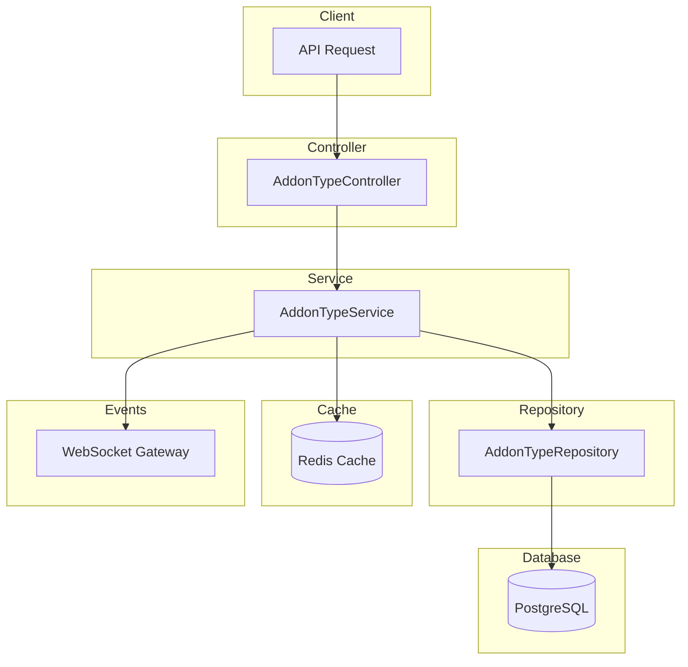

# Addon Type Module Documentation

## Tổng Quan

Module `addon-type` quản lý các loại addon trong hệ thống GEN-HUB. Addon Type được sử dụng để phân loại các addon theo nhóm chức năng như bảo mật, tiện ích, tích hợp bên thứ ba, v.v.

---

## Kiến Trúc



---

## API Endpoints

> [!TIP]
> Tất cả các API đều hỗ trợ header `Accept-Language` để chọn ngôn ngữ phản hồi.
> - **vi** - Tiếng Việt (mặc định)
> - **en** - English

### 1. POST /addon-types - Tạo loại addon mới

**Mô tả:** Tạo một loại addon mới trong hệ thống. Loại addon được sử dụng để phân loại các addon theo nhóm chức năng.

**Xác thực:** Bearer Token (JWT)

**Quyền yêu cầu:** `addon-type.create`

**Headers:**
```http
Authorization: Bearer <access_token>
Content-Type: application/json
Accept-Language: vi
```

**Request Body Schema:**

| Field | Type | Required | Description |
|-------|------|----------|-------------|
| `name` | string | Required | Tên loại addon (max 255 ký tự) |
| `description` | string | Optional | Mô tả chi tiết về loại addon |
| `is_active` | boolean | Optional | Trạng thái hoạt động (mặc định: true) |

**Request Body Examples:**

<details>
<summary><b>Ví dụ 1: Loại addon bảo mật</b></summary>

```json
{
  "name": "Bảo mật",
  "description": "Các addon liên quan đến bảo mật hệ thống",
  "is_active": true
}
```
</details>

<details>
<summary><b>Ví dụ 2: Loại addon tiện ích</b></summary>

```json
{
  "name": "Tiện ích",
  "description": "Các addon tiện ích mở rộng chức năng",
  "is_active": true
}
```
</details>

<details>
<summary><b>Ví dụ 3: Loại addon tích hợp (không hoạt động)</b></summary>

```json
{
  "name": "Tích hợp",
  "description": "Các addon tích hợp với dịch vụ bên ngoài",
  "is_active": false
}
```
</details>

**Response (201 Created):**

```json
{
  "code": "addon-type.created",
  "message": "Đã tạo loại addon thành công",
  "success": true,
  "data": {
    "id": "550e8400-e29b-41d4-a716-446655440000",
    "name": "Bảo mật",
    "description": "Các addon liên quan đến bảo mật hệ thống",
    "is_active": true,
    "created_at": "2026-01-22T07:00:00.000Z",
    "updated_at": "2026-01-22T07:00:00.000Z",
    "created_by": "550e8400-e29b-41d4-a716-446655440001"
  }
}
```

**Error Responses:**

<details>
<summary><b>401 Unauthorized</b></summary>

```json
// Không có token
{
  "code": "error.unauthorized.token_missing",
  "message": "Không có quyền truy cập",
  "success": false
}

// Token hết hạn
{
  "code": "error.unauthorized.token_expired",
  "message": "Token đã hết hạn",
  "success": false
}

// Token không hợp lệ
{
  "code": "error.unauthorized.token_invalid",
  "message": "Token không hợp lệ",
  "success": false
}
```
</details>

<details>
<summary><b>403 Forbidden</b></summary>

```json
// Không có quyền thực hiện
{
  "code": "error.forbidden.no_permission",
  "message": "Không có quyền thực hiện thao tác này",
  "success": false
}

// Tài khoản bị khóa
{
  "code": "error.forbidden.account_banned",
  "message": "Tài khoản đã bị khóa",
  "success": false
}
```
</details>

<details>
<summary><b>409 Conflict</b></summary>

```json
{
  "code": "addon-type.name_exists",
  "message": "Tên loại addon đã tồn tại",
  "success": false
}
```
</details>

<details>
<summary><b>422 Unprocessable Entity</b></summary>

```json
{
  "code": "error.validation",
  "message": "Dữ liệu đầu vào không hợp lệ",
  "success": false,
  "errors": [
    { "field": "name", "message": "Tên loại addon không được để trống" },
    { "field": "name", "message": "Tên loại addon không được quá 255 ký tự" }
  ]
}
```
</details>

---

### 2. GET /addon-types - Lấy danh sách loại addon

**Mô tả:** Lấy danh sách loại addon với hỗ trợ phân trang, lọc theo trạng thái và tìm kiếm theo từ khóa.

**Xác thực:** Bearer Token (JWT)

**Quyền yêu cầu:** `addon-type.list`

**Headers:**
```http
Authorization: Bearer <access_token>
Accept-Language: vi
```

**Query Parameters:**

| Parameter | Type | Required | Default | Description |
|-----------|------|----------|---------|-------------|
| `limit` | number | Optional | 10 | Số lượng bản ghi mỗi trang (min: 1) |
| `offset` | number | Optional | 0 | Vị trí bắt đầu (min: 0) |
| `keywords` | string | Optional | - | Từ khóa tìm kiếm theo tên hoặc mô tả |
| `is_active` | boolean | Optional | - | Lọc theo trạng thái hoạt động (true/false) |

**Request Examples:**

```http
# Lấy 10 loại addon đầu tiên
GET /addon-types HTTP/1.1

# Lấy với phân trang
GET /addon-types?limit=20&offset=40 HTTP/1.1

# Tìm kiếm loại addon
GET /addon-types?keywords=bảo mật HTTP/1.1

# Lọc loại addon đang hoạt động
GET /addon-types?is_active=true HTTP/1.1

# Kết hợp nhiều điều kiện
GET /addon-types?limit=10&offset=0&keywords=tiện ích&is_active=true HTTP/1.1
```

**Response (200 OK):**

```json
{
  "code": "addon-type.list",
  "message": "Lấy danh sách loại addon thành công",
  "success": true,
  "data": {
    "items": [
      {
        "id": "550e8400-e29b-41d4-a716-446655440000",
        "name": "Bảo mật",
        "description": "Các addon liên quan đến bảo mật",
        "is_active": true,
        "created_at": "2026-01-22T07:00:00.000Z",
        "updated_at": "2026-01-22T07:00:00.000Z"
      },
      {
        "id": "550e8400-e29b-41d4-a716-446655440002",
        "name": "Tiện ích",
        "description": "Các addon tiện ích mở rộng",
        "is_active": true,
        "created_at": "2026-01-21T07:00:00.000Z",
        "updated_at": "2026-01-21T07:00:00.000Z"
      }
    ],
    "total": 50,
    "limit": 10,
    "offset": 0,
    "hasMore": true
  }
}
```

**Error Responses:**

<details>
<summary><b>401 Unauthorized</b></summary>

```json
{
  "code": "error.unauthorized.token_missing",
  "message": "Không có quyền truy cập",
  "success": false
}
```
</details>

<details>
<summary><b>403 Forbidden</b></summary>

```json
{
  "code": "error.forbidden.no_permission",
  "message": "Không có quyền thực hiện thao tác này",
  "success": false
}
```
</details>

---

### 3. GET /addon-types/active - Lấy danh sách loại addon đang hoạt động

**Mô tả:** Lấy danh sách tất cả loại addon có trạng thái is_active = true và is_deleted = false với phân trang. API này không yêu cầu xác thực và có thể được sử dụng công khai.

**Xác thực:** Không yêu cầu

**Headers:**
```http
Accept-Language: vi
```

**Query Parameters:**

| Parameter | Type | Required | Default | Description |
|-----------|------|----------|---------|-------------|
| `limit` | number | Optional | 10 | Số lượng bản ghi mỗi trang (min: 1) |
| `offset` | number | Optional | 0 | Vị trí bắt đầu (min: 0) |

**Request Examples:**

```http
# Lấy 10 loại addon active đầu tiên
GET /addon-types/active HTTP/1.1

# Lấy với phân trang
GET /addon-types/active?limit=20&offset=40 HTTP/1.1
```

**Response (200 OK):**

```json
{
  "code": "addon-type.active",
  "message": "Lấy danh sách loại addon thành công",
  "success": true,
  "data": {
    "items": [
      {
        "id": "550e8400-e29b-41d4-a716-446655440000",
        "name": "Bảo mật",
        "description": "Các addon liên quan đến bảo mật",
        "is_active": true
      },
      {
        "id": "550e8400-e29b-41d4-a716-446655440001",
        "name": "Tiện ích",
        "description": "Các addon tiện ích mở rộng",
        "is_active": true
      },
      {
        "id": "550e8400-e29b-41d4-a716-446655440002",
        "name": "Tích hợp",
        "description": "Các addon tích hợp bên ngoài",
        "is_active": true
      }
    ],
    "total": 25,
    "limit": 10,
    "offset": 0
  }
}
```

---

### 4. GET /addon-types/:id - Lấy chi tiết loại addon

**Mô tả:** Lấy thông tin chi tiết của một loại addon theo ID.

**Xác thực:** Bearer Token (JWT)

**Quyền yêu cầu:** `addon-type.read`

**Headers:**
```http
Authorization: Bearer <access_token>
Accept-Language: vi
```

**Path Parameters:**

| Parameter | Type | Required | Description |
|-----------|------|----------|-------------|
| `id` | string (UUID) | Required | ID của loại addon cần lấy thông tin |

**Request Example:**

```http
GET /addon-types/550e8400-e29b-41d4-a716-446655440000 HTTP/1.1
Authorization: Bearer <access_token>
```

**Response (200 OK):**

```json
{
  "code": "addon-type.read",
  "message": "Lấy chi tiết loại addon thành công",
  "success": true,
  "data": {
    "id": "550e8400-e29b-41d4-a716-446655440000",
    "name": "Bảo mật",
    "description": "Các addon liên quan đến bảo mật hệ thống",
    "is_active": true,
    "created_at": "2026-01-22T07:00:00.000Z",
    "updated_at": "2026-01-22T07:00:00.000Z",
    "created_by": "550e8400-e29b-41d4-a716-446655440001",
    "updated_by": null
  }
}
```

**Error Responses:**

<details>
<summary><b>404 Not Found</b></summary>

```json
{
  "code": "addon-type.not_found",
  "message": "Không tìm thấy loại addon",
  "success": false
}
```
</details>

---

### 5. PUT /addon-types/:id - Cập nhật loại addon

**Mô tả:** Cập nhật thông tin loại addon theo ID. Chỉ các trường được gửi trong request body mới được cập nhật.

**Xác thực:** Bearer Token (JWT)

**Quyền yêu cầu:** `addon-type.update`

**Headers:**
```http
Authorization: Bearer <access_token>
Content-Type: application/json
Accept-Language: vi
```

**Path Parameters:**

| Parameter | Type | Required | Description |
|-----------|------|----------|-------------|
| `id` | string (UUID) | Required | ID của loại addon cần cập nhật |

**Request Body Schema:**

| Field | Type | Required | Description |
|-------|------|----------|-------------|
| `name` | string | Optional | Tên loại addon (max 255 ký tự) |
| `description` | string | Optional | Mô tả chi tiết |
| `is_active` | boolean | Optional | Trạng thái hoạt động |

**Request Body Examples:**

<details>
<summary><b>Ví dụ 1: Cập nhật tên</b></summary>

```json
{
  "name": "Bảo mật nâng cao"
}
```
</details>

<details>
<summary><b>Ví dụ 2: Cập nhật trạng thái</b></summary>

```json
{
  "is_active": false
}
```
</details>

<details>
<summary><b>Ví dụ 3: Cập nhật mô tả</b></summary>

```json
{
  "description": "Các addon bảo mật cao cấp cho doanh nghiệp"
}
```
</details>

<details>
<summary><b>Ví dụ 4: Cập nhật toàn bộ</b></summary>

```json
{
  "name": "Bảo mật Pro",
  "description": "Các addon bảo mật chuyên nghiệp",
  "is_active": true
}
```
</details>

**Response (200 OK):**

```json
{
  "code": "addon-type.updated",
  "message": "Đã cập nhật loại addon thành công",
  "success": true,
  "data": {
    "id": "550e8400-e29b-41d4-a716-446655440000",
    "name": "Bảo mật Pro",
    "description": "Các addon bảo mật chuyên nghiệp",
    "is_active": true,
    "created_at": "2026-01-22T07:00:00.000Z",
    "updated_at": "2026-01-23T07:00:00.000Z",
    "updated_by": "550e8400-e29b-41d4-a716-446655440002"
  }
}
```

**Error Responses:**

<details>
<summary><b>404 Not Found</b></summary>

```json
{
  "code": "addon-type.not_found",
  "message": "Không tìm thấy loại addon",
  "success": false
}
```
</details>

<details>
<summary><b>409 Conflict</b></summary>

```json
{
  "code": "addon-type.name_exists",
  "message": "Tên loại addon đã tồn tại",
  "success": false
}
```
</details>

<details>
<summary><b>422 Unprocessable Entity</b></summary>

```json
{
  "code": "error.validation",
  "message": "Dữ liệu đầu vào không hợp lệ",
  "success": false,
  "errors": [
    { "field": "name", "message": "Tên loại addon không được quá 255 ký tự" }
  ]
}
```
</details>

---

### 6. DELETE /addon-types/:id - Xóa loại addon

**Mô tả:** Xóa mềm (soft delete) một loại addon theo ID. Loại addon bị xóa sẽ không hiển thị trong danh sách nhưng vẫn được lưu trong database.

**Xác thực:** Bearer Token (JWT)

**Quyền yêu cầu:** `addon-type.delete`

**Headers:**
```http
Authorization: Bearer <access_token>
Accept-Language: vi
```

**Path Parameters:**

| Parameter | Type | Required | Description |
|-----------|------|----------|-------------|
| `id` | string (UUID) | Required | ID của loại addon cần xóa |

**Request Example:**

```http
DELETE /addon-types/550e8400-e29b-41d4-a716-446655440000 HTTP/1.1
Authorization: Bearer <access_token>
```

**Response (200 OK):**

```json
{
  "code": "addon-type.deleted",
  "message": "Đã xóa loại addon thành công",
  "success": true
}
```

**Error Responses:**

<details>
<summary><b>404 Not Found</b></summary>

```json
{
  "code": "addon-type.not_found",
  "message": "Không tìm thấy loại addon",
  "success": false
}
```
</details>

---

### 7. DELETE /addon-types/delete/many - Xóa nhiều loại addon

**Mô tả:** Xóa mềm (soft delete) nhiều loại addon cùng lúc theo danh sách ID.

**Xác thực:** Bearer Token (JWT)

**Quyền yêu cầu:** `addon-type.delete`

**Headers:**
```http
Authorization: Bearer <access_token>
Content-Type: application/json
Accept-Language: vi
```

**Request Body Schema:**

| Field | Type | Required | Description |
|-------|------|----------|-------------|
| `ids` | string[] (UUID) | Required | Mảng ID các loại addon cần xóa |

**Request Body Examples:**

<details>
<summary><b>Ví dụ 1: Xóa 2 loại addon</b></summary>

```json
{
  "ids": [
    "550e8400-e29b-41d4-a716-446655440000",
    "550e8400-e29b-41d4-a716-446655440001"
  ]
}
```
</details>

<details>
<summary><b>Ví dụ 2: Xóa nhiều loại addon</b></summary>

```json
{
  "ids": [
    "550e8400-e29b-41d4-a716-446655440000",
    "550e8400-e29b-41d4-a716-446655440001",
    "550e8400-e29b-41d4-a716-446655440002",
    "550e8400-e29b-41d4-a716-446655440003"
  ]
}
```
</details>

**Response (200 OK):**

```json
{
  "code": "addon-type.deletedMany",
  "message": "Đã xóa các loại addon thành công",
  "success": true
}
```

**Error Responses:**

<details>
<summary><b>404 Not Found</b></summary>

```json
{
  "code": "addon-type.not_found",
  "message": "Không tìm thấy loại addon",
  "success": false
}
```
</details>

<details>
<summary><b>422 Unprocessable Entity</b></summary>

```json
{
  "code": "error.validation",
  "message": "Dữ liệu đầu vào không hợp lệ",
  "success": false,
  "errors": [
    { "field": "ids", "message": "Danh sách ID không được để trống" }
  ]
}
```
</details>

---

## Caching Strategy

Module sử dụng Redis caching với pattern **Cache Aside**:

| Cache Key Pattern | TTL | Description |
|-------------------|-----|-------------|
| `addon-type:detail:<id>` | 300s | Cache chi tiết loại addon |
| `addon-type:list:*` | 300s | Cache danh sách loại addon (theo query params) |
| `addon-type:active:<limit>:<offset>` | 300s | Cache danh sách loại addon đang hoạt động (có phân trang) |

### Cache Invalidation

Cache được tự động invalidate khi:
- Tạo loại addon mới → Xóa cache list + active
- Cập nhật loại addon → Xóa cache detail + list + active
- Xóa loại addon → Xóa cache detail + list + active

---

## WebSocket Events

Khi loại addon được thay đổi, server sẽ emit các event qua WebSocket để thông báo cho clients.

### Event Types

| Action | Event Name | Description |
|--------|------------|-------------|
| Create | `addonType:created` | Loại addon mới đã được tạo |
| Update | `addonType:updated` | Loại addon đã được cập nhật |
| Delete | `addonType:deleted` | Loại addon đã bị xóa |
| Delete Many | `addonType:deletedMany` | Nhiều loại addon đã bị xóa |

### Event Payload Examples

**addonType:created**
```json
{
  "addonTypeId": "550e8400-e29b-41d4-a716-446655440000",
  "name": "Bảo mật",
  "createdBy": "550e8400-e29b-41d4-a716-446655440001",
  "timestamp": "2026-01-22T07:00:00.000Z"
}
```

**addonType:updated**
```json
{
  "addonTypeId": "550e8400-e29b-41d4-a716-446655440000",
  "name": "Bảo mật Pro",
  "updatedFields": ["name", "description"],
  "updatedBy": "550e8400-e29b-41d4-a716-446655440001",
  "timestamp": "2026-01-22T08:00:00.000Z"
}
```

**addonType:deleted**
```json
{
  "addonTypeId": "550e8400-e29b-41d4-a716-446655440000",
  "name": "Bảo mật",
  "deletedBy": "550e8400-e29b-41d4-a716-446655440001",
  "timestamp": "2026-01-22T09:00:00.000Z"
}
```

**addonType:deletedMany**
```json
{
  "addonTypeIds": [
    "550e8400-e29b-41d4-a716-446655440000",
    "550e8400-e29b-41d4-a716-446655440001"
  ],
  "deletedBy": "550e8400-e29b-41d4-a716-446655440002",
  "timestamp": "2026-01-22T10:00:00.000Z"
}
```

### Frontend Usage

```typescript
import { io } from 'socket.io-client';

const socket = io('wss://api.gen-hub.dev');

// Subscribe addon type events
socket.on('addonType:created', (payload) => {
  console.log('New addon type created:', payload.name);
  // Refresh addon type list
});

socket.on('addonType:updated', (payload) => {
  console.log('Addon type updated:', payload.addonTypeId);
  // Update local state
});

socket.on('addonType:deleted', (payload) => {
  console.log('Addon type deleted:', payload.addonTypeId);
  // Remove from local state
});

socket.on('addonType:deletedMany', (payload) => {
  console.log('Multiple addon types deleted:', payload.addonTypeIds);
  // Remove from local state
});
```

---

## Validation Rules

### Name
- **Required**
- Kiểu dữ liệu: string
- Độ dài tối đa: 255 ký tự
- Unique (không trùng với loại addon khác)

### Description
- **Optional**
- Kiểu dữ liệu: string

### Is Active
- **Optional**
- Kiểu dữ liệu: boolean
- Mặc định: true

---

## Quyền Hạn (Permissions)

| Permission | Description | Endpoint |
|------------|-------------|----------|
| `addon-type.create` | Tạo loại addon mới | `POST /addon-types` |
| `addon-type.list` | Xem danh sách loại addon | `GET /addon-types` |
| - | Xem danh sách loại addon đang hoạt động (public) | `GET /addon-types/active` |
| `addon-type.read` | Xem chi tiết loại addon | `GET /addon-types/:id` |
| `addon-type.update` | Cập nhật loại addon | `PUT /addon-types/:id` |
| `addon-type.delete` | Xóa loại addon | `DELETE /addon-types/:id`, `DELETE /addon-types/delete/many` |

> [!NOTE]
> API `GET /addon-types/active` không yêu cầu xác thực và có thể được sử dụng công khai.

---

## Files Trong Module

| File | Mô tả |
|------|-------|
| `addon-type.module.ts` | Module definition và providers |
| `addon-type.controller.ts` | API endpoints với Swagger decorators |
| `addon-type.service.ts` | Business logic, caching, logging |
| `addon-type.repository.ts` | Database operations với Prisma |
| `dto/create-addon-type.dto.ts` | DTO cho tạo loại addon |
| `dto/update-addon-type.dto.ts` | DTO cho cập nhật loại addon |
| `dto/query-addon-type.dto.ts` | DTO cho query parameters |
| `types/addon-type.type.ts` | TypeScript interfaces |
| `constants/addon-type-cache-keys.helper.ts` | Cache key helpers |
