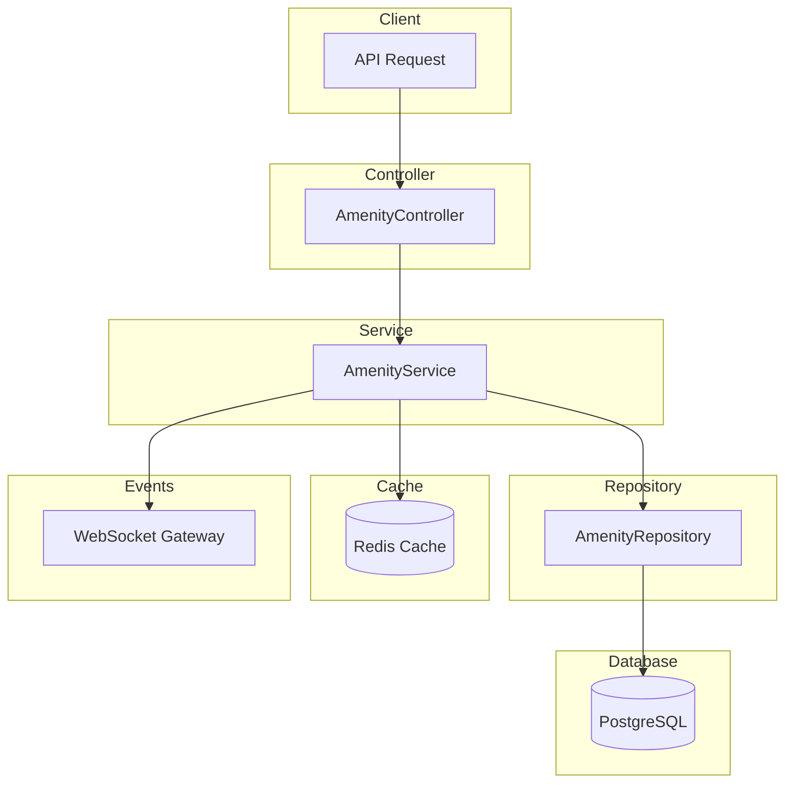

# Amenity Module Documentation

## Tổng Quan

Module `amenity` quản lý các tiện ích và hạ tầng có thể áp dụng cho warehouse template trong hệ thống GEN-HUB. Các tiện ích bao gồm WiFi, hệ thống điều hòa, PCCC, camera an ninh, v.v.

---

## Kiến Trúc



---

## API Endpoints

> [!TIP]
> Tất cả các API đều hỗ trợ header `Accept-Language` để chọn ngôn ngữ phản hồi.
> - **vi** - Tiếng Việt (mặc định)
> - **en** - English

### 1. POST /amenities - Tạo tiện ích mới

**Mô tả:** Tạo một tiện ích mới trong hệ thống. Tiện ích có thể được áp dụng cho các warehouse template.

**Xác thực:** Bearer Token (JWT)

**Quyền yêu cầu:** `amenity.create`

**Headers:**
```http
Authorization: Bearer <access_token>
Content-Type: application/json
Accept-Language: vi
```

**Request Body Schema:**

| Field | Type | Required | Description |
|-------|------|----------|-------------|
| `name` | string | Required | Tên tiện ích (max 255 ký tự) |
| `description` | string | Optional | Mô tả chi tiết về tiện ích |
| `is_active` | boolean | Optional | Trạng thái hoạt động (mặc định: true) |

**Request Body Examples:**

<details>
<summary><b>Ví dụ 1: Tạo tiện ích cơ bản</b></summary>

```json
{
  "name": "WiFi"
}
```
</details>

<details>
<summary><b>Ví dụ 2: Tạo tiện ích đầy đủ</b></summary>

```json
{
  "name": "Hệ thống điều hòa",
  "description": "Hệ thống điều hòa trung tâm, duy trì nhiệt độ ổn định 20-25°C",
  "is_active": true
}
```
</details>

<details>
<summary><b>Ví dụ 3: Tạo tiện ích không hoạt động</b></summary>

```json
{
  "name": "Hệ thống PCCC",
  "description": "Hệ thống phòng cháy chữa cháy tự động",
  "is_active": false
}
```
</details>

**Response (201 Created):**

```json
{
  "code": "amenity.create.success",
  "message": "Tạo tiện ích thành công",
  "success": true,
  "data": {
    "id": "550e8400-e29b-41d4-a716-446655440000",
    "name": "WiFi",
    "description": "Internet tốc độ cao",
    "is_active": true,
    "is_deleted": false,
    "created_at": "2026-01-21T07:00:00.000Z",
    "updated_at": "2026-01-21T07:00:00.000Z",
    "created_by": "550e8400-e29b-41d4-a716-446655440001",
    "updated_by": null
  }
}
```

**Error Responses:**

<details>
<summary><b>401 Unauthorized</b></summary>

```json
// Không có token
{
  "code": "error.unauthorized.token_missing",
  "message": "Không có quyền truy cập",
  "success": false
}

// Token hết hạn
{
  "code": "error.unauthorized.token_expired",
  "message": "Token đã hết hạn",
  "success": false
}

// Token không hợp lệ
{
  "code": "error.unauthorized.token_invalid",
  "message": "Token không hợp lệ",
  "success": false
}
```
</details>

<details>
<summary><b>403 Forbidden</b></summary>

```json
// Không có quyền thực hiện
{
  "code": "error.forbidden.no_permission",
  "message": "Không có quyền thực hiện thao tác này",
  "success": false
}

// Tài khoản bị khóa
{
  "code": "error.forbidden.account_banned",
  "message": "Tài khoản đã bị khóa",
  "success": false
}
```
</details>

<details>
<summary><b>409 Conflict</b></summary>

```json
{
  "code": "amenity.errors.name_exists",
  "message": "Tên tiện ích đã tồn tại",
  "success": false
}
```
</details>

<details>
<summary><b>422 Unprocessable Entity</b></summary>

```json
{
  "code": "error.validation",
  "message": "Dữ liệu đầu vào không hợp lệ",
  "success": false,
  "errors": [
    { "field": "name", "message": "Tên tiện ích không được để trống" },
    { "field": "name", "message": "Tên tiện ích không được quá 255 ký tự" }
  ]
}
```
</details>

---

### 2. GET /amenities - Lấy danh sách tiện ích

**Mô tả:** Lấy danh sách tiện ích với phân trang và bộ lọc. Hỗ trợ tìm kiếm theo từ khóa và lọc theo trạng thái hoạt động.

**Xác thực:** Bearer Token (JWT)

**Quyền yêu cầu:** `amenity.list`

**Headers:**
```http
Authorization: Bearer <access_token>
Accept-Language: vi
```

**Query Parameters:**

| Parameter | Type | Required | Default | Description |
|-----------|------|----------|---------|-------------|
| `limit` | number | Optional | 10 | Số lượng bản ghi mỗi trang (min: 1) |
| `offset` | number | Optional | 0 | Vị trí bắt đầu (min: 0) |
| `keywords` | string | Optional | - | Từ khóa tìm kiếm (tên, mô tả) |
| `is_active` | boolean | Optional | - | Lọc theo trạng thái hoạt động |

**Request Examples:**

```http
# Lấy 10 tiện ích đầu tiên
GET /amenities HTTP/1.1

# Lấy tiện ích với phân trang
GET /amenities?limit=20&offset=40 HTTP/1.1

# Tìm kiếm tiện ích
GET /amenities?keywords=WiFi HTTP/1.1

# Lọc tiện ích đang hoạt động
GET /amenities?is_active=true HTTP/1.1

# Kết hợp nhiều điều kiện
GET /amenities?limit=10&offset=0&keywords=điều hòa&is_active=true HTTP/1.1
```

**Response (200 OK):**

```json
{
  "code": "amenity.list.success",
  "message": "Lấy danh sách tiện ích thành công",
  "success": true,
  "data": {
    "items": [
      {
        "id": "550e8400-e29b-41d4-a716-446655440000",
        "name": "WiFi",
        "description": "Internet tốc độ cao",
        "is_active": true,
        "is_deleted": false,
        "created_at": "2026-01-21T07:00:00.000Z",
        "updated_at": "2026-01-21T07:00:00.000Z",
        "created_by": "550e8400-e29b-41d4-a716-446655440001",
        "updated_by": null
      },
      {
        "id": "550e8400-e29b-41d4-a716-446655440002",
        "name": "Hệ thống điều hòa",
        "description": "Điều hòa trung tâm VRV",
        "is_active": true,
        "is_deleted": false,
        "created_at": "2026-01-20T07:00:00.000Z",
        "updated_at": "2026-01-20T07:00:00.000Z",
        "created_by": "550e8400-e29b-41d4-a716-446655440001",
        "updated_by": null
      }
    ],
    "total": 25,
    "limit": 10,
    "offset": 0
  }
}
```

**Error Responses:**

<details>
<summary><b>401 Unauthorized</b></summary>

```json
{
  "code": "error.unauthorized.token_missing",
  "message": "Không có quyền truy cập",
  "success": false
}
```
</details>

<details>
<summary><b>403 Forbidden</b></summary>

```json
{
  "code": "error.forbidden.no_permission",
  "message": "Không có quyền thực hiện thao tác này",
  "success": false
}
```
</details>

---

### 3. GET /amenities/:id - Lấy chi tiết tiện ích

**Mô tả:** Lấy thông tin chi tiết của một tiện ích theo ID.

**Xác thực:** Bearer Token (JWT)

**Quyền yêu cầu:** `amenity.read`

**Headers:**
```http
Authorization: Bearer <access_token>
Accept-Language: vi
```

**Path Parameters:**

| Parameter | Type | Required | Description |
|-----------|------|----------|-------------|
| `id` | string (UUID) | Required | ID của tiện ích cần lấy thông tin |

**Request Example:**

```http
GET /amenities/550e8400-e29b-41d4-a716-446655440000 HTTP/1.1
Authorization: Bearer <access_token>
```

**Response (200 OK):**

```json
{
  "code": "amenity.get.success",
  "message": "Lấy chi tiết tiện ích thành công",
  "success": true,
  "data": {
    "id": "550e8400-e29b-41d4-a716-446655440000",
    "name": "WiFi",
    "description": "Internet tốc độ cao",
    "is_active": true,
    "is_deleted": false,
    "created_at": "2026-01-21T07:00:00.000Z",
    "updated_at": "2026-01-21T07:00:00.000Z",
    "created_by": "550e8400-e29b-41d4-a716-446655440001",
    "updated_by": null
  }
}
```

**Error Responses:**

<details>
<summary><b>404 Not Found</b></summary>

```json
{
  "code": "amenity.errors.not_found",
  "message": "Không tìm thấy tiện ích",
  "success": false
}
```
</details>

---

### 4. PUT /amenities/:id - Cập nhật tiện ích

**Mô tả:** Cập nhật thông tin của một tiện ích. Chỉ các trường được gửi trong request body mới được cập nhật.

**Xác thực:** Bearer Token (JWT)

**Quyền yêu cầu:** `amenity.update`

**Headers:**
```http
Authorization: Bearer <access_token>
Content-Type: application/json
Accept-Language: vi
```

**Path Parameters:**

| Parameter | Type | Required | Description |
|-----------|------|----------|-------------|
| `id` | string (UUID) | Required | ID của tiện ích cần cập nhật |

**Request Body Schema:**

| Field | Type | Required | Description |
|-------|------|----------|-------------|
| `name` | string | Optional | Tên tiện ích (max 255 ký tự) |
| `description` | string | Optional | Mô tả chi tiết |
| `is_active` | boolean | Optional | Trạng thái hoạt động |

**Request Body Examples:**

<details>
<summary><b>Ví dụ 1: Cập nhật tên</b></summary>

```json
{
  "name": "WiFi 5G"
}
```
</details>

<details>
<summary><b>Ví dụ 2: Cập nhật mô tả</b></summary>

```json
{
  "description": "Internet tốc độ cao 1Gbps, hỗ trợ WiFi 6"
}
```
</details>

<details>
<summary><b>Ví dụ 3: Bật/tắt trạng thái</b></summary>

```json
{
  "is_active": false
}
```
</details>

<details>
<summary><b>Ví dụ 4: Cập nhật đầy đủ</b></summary>

```json
{
  "name": "Hệ thống điều hòa VRV",
  "description": "Hệ thống điều hòa VRV tiết kiệm năng lượng, duy trì nhiệt độ 18-28°C",
  "is_active": true
}
```
</details>

**Response (200 OK):**

```json
{
  "code": "amenity.update.success",
  "message": "Cập nhật tiện ích thành công",
  "success": true,
  "data": {
    "id": "550e8400-e29b-41d4-a716-446655440000",
    "name": "WiFi 5G",
    "description": "Internet tốc độ cao 1Gbps",
    "is_active": true,
    "is_deleted": false,
    "created_at": "2026-01-21T07:00:00.000Z",
    "updated_at": "2026-01-23T07:00:00.000Z",
    "created_by": "550e8400-e29b-41d4-a716-446655440001",
    "updated_by": "550e8400-e29b-41d4-a716-446655440002"
  }
}
```

**Error Responses:**

<details>
<summary><b>404 Not Found</b></summary>

```json
{
  "code": "amenity.errors.not_found",
  "message": "Không tìm thấy tiện ích",
  "success": false
}
```
</details>

<details>
<summary><b>409 Conflict</b></summary>

```json
{
  "code": "amenity.errors.name_exists",
  "message": "Tên tiện ích đã tồn tại",
  "success": false
}
```
</details>

<details>
<summary><b>422 Unprocessable Entity</b></summary>

```json
{
  "code": "error.validation",
  "message": "Dữ liệu đầu vào không hợp lệ",
  "success": false,
  "errors": [
    { "field": "name", "message": "Tên tiện ích không được quá 255 ký tự" }
  ]
}
```
</details>

---

### 5. DELETE /amenities/:id - Xóa tiện ích

**Mô tả:** Xóa mềm (soft delete) một tiện ích theo ID. Các mapping liên quan đến tiện ích này cũng sẽ bị xóa mềm.

**Xác thực:** Bearer Token (JWT)

**Quyền yêu cầu:** `amenity.delete`

**Headers:**
```http
Authorization: Bearer <access_token>
Accept-Language: vi
```

**Path Parameters:**

| Parameter | Type | Required | Description |
|-----------|------|----------|-------------|
| `id` | string (UUID) | Required | ID của tiện ích cần xóa |

**Request Example:**

```http
DELETE /amenities/550e8400-e29b-41d4-a716-446655440000 HTTP/1.1
Authorization: Bearer <access_token>
```

**Response (200 OK):**

```json
{
  "code": "amenity.delete.success",
  "message": "Xóa tiện ích thành công",
  "success": true,
  "data": null
}
```

**Error Responses:**

<details>
<summary><b>404 Not Found</b></summary>

```json
{
  "code": "amenity.errors.not_found",
  "message": "Không tìm thấy tiện ích",
  "success": false
}
```
</details>

---

### 6. DELETE /amenities/delete/many - Xóa nhiều tiện ích

**Mô tả:** Xóa mềm (soft delete) nhiều tiện ích cùng lúc theo danh sách ID. Các mapping liên quan cũng sẽ bị xóa mềm.

**Xác thực:** Bearer Token (JWT)

**Quyền yêu cầu:** `amenity.delete`

**Headers:**
```http
Authorization: Bearer <access_token>
Content-Type: application/json
Accept-Language: vi
```

**Request Body Schema:**

| Field | Type | Required | Description |
|-------|------|----------|-------------|
| `ids` | string[] (UUID) | Required | Mảng ID các tiện ích cần xóa |

**Request Body Examples:**

<details>
<summary><b>Ví dụ 1: Xóa 2 tiện ích</b></summary>

```json
{
  "ids": [
    "550e8400-e29b-41d4-a716-446655440000",
    "550e8400-e29b-41d4-a716-446655440001"
  ]
}
```
</details>

<details>
<summary><b>Ví dụ 2: Xóa nhiều tiện ích</b></summary>

```json
{
  "ids": [
    "550e8400-e29b-41d4-a716-446655440000",
    "550e8400-e29b-41d4-a716-446655440001",
    "550e8400-e29b-41d4-a716-446655440002",
    "550e8400-e29b-41d4-a716-446655440003",
    "550e8400-e29b-41d4-a716-446655440004"
  ]
}
```
</details>

**Response (200 OK):**

```json
{
  "code": "amenity.delete.success",
  "message": "Xóa nhiều tiện ích thành công",
  "success": true,
  "data": null
}
```

**Error Responses:**

<details>
<summary><b>404 Not Found</b></summary>

```json
{
  "code": "amenity.errors.not_found",
  "message": "Không tìm thấy tiện ích",
  "success": false
}
```
</details>

<details>
<summary><b>422 Unprocessable Entity</b></summary>

```json
{
  "code": "error.validation",
  "message": "Dữ liệu đầu vào không hợp lệ",
  "success": false,
  "errors": [
    { "field": "ids", "message": "Danh sách ID không được để trống" }
  ]
}
```
</details>

---

## Caching Strategy

Module sử dụng Redis caching với pattern **Cache Aside**:

| Cache Key Pattern | TTL | Description |
|-------------------|-----|-------------|
| `amenity:detail:<id>` | 300s | Cache chi tiết tiện ích |
| `amenity:list:*` | 300s | Cache danh sách tiện ích (theo query params) |

### Cache Invalidation

Cache được tự động invalidate khi:
- Tạo tiện ích mới → Xóa cache list
- Cập nhật tiện ích → Xóa cache detail + list
- Xóa tiện ích → Xóa cache detail + list

---

## WebSocket Events

Khi tiện ích được thay đổi, server sẽ emit các event qua WebSocket để thông báo cho clients.

### Event Types

| Action | Event Name | Description |
|--------|------------|-------------|
| Create | `amenity:created` | Tiện ích mới đã được tạo |
| Update | `amenity:updated` | Tiện ích đã được cập nhật |
| Delete | `amenity:deleted` | Tiện ích đã bị xóa |
| Delete Many | `amenity:deletedMany` | Nhiều tiện ích đã bị xóa |

### Event Payload Examples

**amenity:created**
```json
{
  "amenityId": "550e8400-e29b-41d4-a716-446655440000",
  "name": "WiFi",
  "createdBy": "550e8400-e29b-41d4-a716-446655440001",
  "timestamp": "2026-01-21T07:00:00.000Z"
}
```

**amenity:updated**
```json
{
  "amenityId": "550e8400-e29b-41d4-a716-446655440000",
  "name": "WiFi 5G",
  "updatedFields": ["name", "description"],
  "updatedBy": "550e8400-e29b-41d4-a716-446655440001",
  "timestamp": "2026-01-21T08:00:00.000Z"
}
```

**amenity:deleted**
```json
{
  "amenityId": "550e8400-e29b-41d4-a716-446655440000",
  "name": "WiFi",
  "deletedBy": "550e8400-e29b-41d4-a716-446655440001",
  "timestamp": "2026-01-21T09:00:00.000Z"
}
```

**amenity:deletedMany**
```json
{
  "amenityIds": [
    "550e8400-e29b-41d4-a716-446655440000",
    "550e8400-e29b-41d4-a716-446655440001"
  ],
  "deletedBy": "550e8400-e29b-41d4-a716-446655440002",
  "timestamp": "2026-01-21T10:00:00.000Z"
}
```

### Frontend Usage

```typescript
import { io } from 'socket.io-client';

const socket = io('wss://api.gen-hub.dev');

// Subscribe amenity events
socket.on('amenity:created', (payload) => {
  console.log('New amenity created:', payload.name);
  // Refresh amenity list
});

socket.on('amenity:updated', (payload) => {
  console.log('Amenity updated:', payload.amenityId);
  // Update local state
});

socket.on('amenity:deleted', (payload) => {
  console.log('Amenity deleted:', payload.amenityId);
  // Remove from local state
});
```

---

## Validation Rules

### Name
- **Required**
- Kiểu dữ liệu: string
- Độ dài tối đa: 255 ký tự
- Unique (không trùng với tiện ích khác)

### Description
- **Optional**
- Kiểu dữ liệu: string

### Is Active
- **Optional**
- Kiểu dữ liệu: boolean
- Mặc định: true

---

## Quyền Hạn (Permissions)

| Permission | Description |
|------------|-------------|
| `amenity.create` | Tạo tiện ích mới |
| `amenity.list` | Xem danh sách tiện ích |
| `amenity.read` | Xem chi tiết tiện ích |
| `amenity.update` | Cập nhật tiện ích |
| `amenity.delete` | Xóa tiện ích |

---

## Files Trong Module

| File | Mô tả |
|------|-------|
| `amenity.module.ts` | Module definition và providers |
| `amenity.controller.ts` | API endpoints với Swagger decorators |
| `amenity.service.ts` | Business logic, caching, logging |
| `amenity.repository.ts` | Database operations với Prisma |
| `dto/create-amenity.dto.ts` | DTO cho tạo tiện ích |
| `dto/update-amenity.dto.ts` | DTO cho cập nhật tiện ích |
| `dto/query-amenity.dto.ts` | DTO cho query parameters |
| `types/amenity.type.ts` | TypeScript interfaces |
| `constants/amenity-cache-keys.helper.ts` | Cache key helpers |
