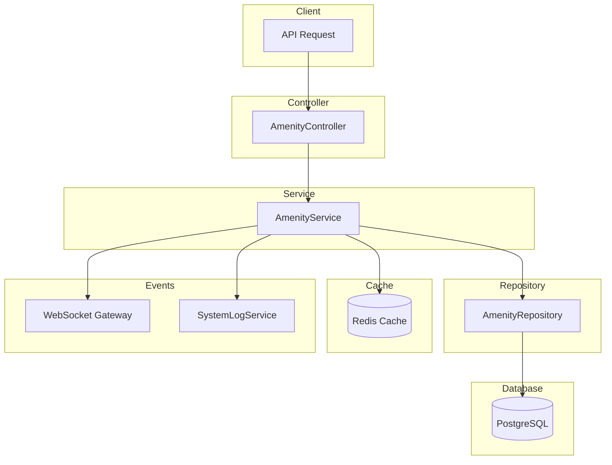

# Amenity Module Documentation

## Tổng Quan

Module `amenity` quản lý các tiện ích và hạ tầng (amenities) trong hệ thống GEN-HUB. Tiện ích có thể được áp dụng cho các warehouse template để mô tả các tiện nghi đi kèm như WiFi, điều hòa, hệ thống PCCC, v.v.

**Các tính năng chính:**

- CRUD tiện ích với soft delete
- Tìm kiếm và lọc theo trạng thái
- Cache với Redis cho hiệu suất cao
- WebSocket events real-time
- Audit log cho mọi thay đổi

---

## Kiến Trúc



---

## API Endpoints

> [!TIP]
> Tất cả các API đều hỗ trợ header `Accept-Language` để chọn ngôn ngữ phản hồi.
>
> - **vi** - Tiếng Việt (mặc định)
> - **en** - English

### 1. POST /amenities - Tạo tiện ích mới

**Mô tả:** Tạo một tiện ích mới trong hệ thống.

**Xác thực:** Bearer Token (JWT)

**Quyền yêu cầu:** `amenity.create`

**Headers:**

```http
POST /amenities HTTP/1.1
Host: api.gen-hub.dev
Authorization: Bearer <access_token>
Content-Type: application/json
Accept-Language: vi
```

**Request Body Schema:**

| Field         | Type    | Required | Description                          |
| ------------- | ------- | -------- | ------------------------------------ |
| `name`        | string  | Yes      | Tên tiện ích (max 255 ký tự)         |
| `description` | string  | No       | Mô tả tiện ích                       |
| `is_active`   | boolean | No       | Trạng thái hoạt động (default: true) |

**Request Body Examples:**

<details>
<summary><b>Ví dụ 1: Tạo tiện ích cơ bản</b></summary>

```json
{
  "name": "WiFi"
}
```

</details>

<details>
<summary><b>Ví dụ 2: Tạo tiện ích đầy đủ</b></summary>

```json
{
  "name": "Hệ thống điều hòa",
  "description": "Hệ thống điều hòa trung tâm, duy trì nhiệt độ ổn định 20-25°C",
  "is_active": true
}
```

</details>

**Response (201 Created):**

```json
{
  "code": "amenity.create.success",
  "message": "Tạo tiện ích thành công",
  "success": true,
  "data": {
    "id": "550e8400-e29b-41d4-a716-446655440000",
    "name": "WiFi",
    "description": null,
    "is_active": true,
    "is_deleted": false,
    "created_at": "2026-01-21T07:00:00.000Z",
    "updated_at": "2026-01-21T07:00:00.000Z",
    "created_by": "550e8400-e29b-41d4-a716-446655440001",
    "updated_by": null
  }
}
```

**Error Responses:**

<details>
<summary><b>401 Unauthorized</b></summary>

```json
// Không có token
{
  "code": "error.unauthorized.token_missing",
  "message": "Không có quyền truy cập",
  "success": false
}

// Token hết hạn
{
  "code": "error.unauthorized.token_expired",
  "message": "Token đã hết hạn",
  "success": false
}

// Token không hợp lệ
{
  "code": "error.unauthorized.token_invalid",
  "message": "Token không hợp lệ",
  "success": false
}
```

</details>

<details>
<summary><b>403 Forbidden</b></summary>

```json
// Không có quyền thực hiện
{
  "code": "error.forbidden.no_permission",
  "message": "Không có quyền thực hiện thao tác này",
  "success": false
}

// Tài khoản bị khóa
{
  "code": "error.forbidden.account_banned",
  "message": "Tài khoản đã bị khóa",
  "success": false
}
```

</details>

<details>
<summary><b>409 Conflict</b></summary>

```json
{
  "code": "amenity.errors.name_exists",
  "message": "Tên tiện ích đã tồn tại",
  "success": false
}
```

</details>

<details>
<summary><b>422 Unprocessable Entity</b></summary>

```json
{
  "code": "error.validation",
  "message": "Dữ liệu đầu vào không hợp lệ",
  "success": false,
  "errors": [{ "field": "name", "message": "Tên tiện ích không được để trống" }]
}
```

</details>

---

### 2. GET /amenities - Lấy danh sách tiện ích

**Mô tả:** Lấy danh sách tiện ích với phân trang và bộ lọc.

**Xác thực:** Bearer Token (JWT)

**Quyền yêu cầu:** `amenity.list`

**Headers:**

```http
GET /amenities?limit=10&offset=0 HTTP/1.1
Host: api.gen-hub.dev
Authorization: Bearer <access_token>
Accept-Language: vi
```

**Query Parameters:**

| Param       | Type    | Required | Default | Description                         |
| ----------- | ------- | -------- | ------- | ----------------------------------- |
| `limit`     | number  | No       | 10      | Số lượng bản ghi mỗi trang (1-1000) |
| `offset`    | number  | No       | 0       | Vị trí bắt đầu                      |
| `keywords`  | string  | No       | -       | Từ khóa tìm kiếm (tên, mô tả)       |
| `is_active` | boolean | No       | -       | Lọc theo trạng thái hoạt động       |

**Response (200 OK):**

```json
{
  "code": "amenity.list.success",
  "message": "Lấy danh sách tiện ích thành công",
  "success": true,
  "data": {
    "items": [
      {
        "id": "550e8400-e29b-41d4-a716-446655440000",
        "name": "WiFi",
        "description": "Internet tốc độ cao",
        "is_active": true,
        "is_deleted": false,
        "created_at": "2026-01-21T07:00:00.000Z",
        "updated_at": "2026-01-21T07:00:00.000Z",
        "created_by": "550e8400-e29b-41d4-a716-446655440001",
        "updated_by": null
      },
      {
        "id": "550e8400-e29b-41d4-a716-446655440002",
        "name": "Điều hòa",
        "description": "Hệ thống điều hòa trung tâm",
        "is_active": true,
        "is_deleted": false,
        "created_at": "2026-01-21T06:00:00.000Z",
        "updated_at": "2026-01-21T06:00:00.000Z",
        "created_by": "550e8400-e29b-41d4-a716-446655440001",
        "updated_by": null
      }
    ],
    "total": 25,
    "limit": 10,
    "offset": 0
  }
}
```

**Error Responses:**

<details>
<summary><b>401 Unauthorized</b></summary>

```json
{
  "code": "error.unauthorized.token_missing",
  "message": "Không có quyền truy cập",
  "success": false
}
```

</details>

<details>
<summary><b>403 Forbidden</b></summary>

```json
{
  "code": "error.forbidden.no_permission",
  "message": "Không có quyền thực hiện thao tác này",
  "success": false
}
```

</details>

---

### 3. GET /amenities/:id - Lấy chi tiết tiện ích

**Mô tả:** Lấy thông tin chi tiết của một tiện ích theo ID.

**Xác thực:** Bearer Token (JWT)

**Quyền yêu cầu:** `amenity.read`

**Headers:**

```http
GET /amenities/550e8400-e29b-41d4-a716-446655440000 HTTP/1.1
Host: api.gen-hub.dev
Authorization: Bearer <access_token>
Accept-Language: vi
```

**Path Parameters:**

| Param | Type | Required | Description     |
| ----- | ---- | -------- | --------------- |
| `id`  | UUID | Yes      | ID của tiện ích |

**Response (200 OK):**

```json
{
  "code": "amenity.get.success",
  "message": "Lấy chi tiết tiện ích thành công",
  "success": true,
  "data": {
    "id": "550e8400-e29b-41d4-a716-446655440000",
    "name": "WiFi",
    "description": "Internet tốc độ cao",
    "is_active": true,
    "is_deleted": false,
    "created_at": "2026-01-21T07:00:00.000Z",
    "updated_at": "2026-01-21T07:00:00.000Z",
    "created_by": "550e8400-e29b-41d4-a716-446655440001",
    "updated_by": null
  }
}
```

**Error Responses:**

<details>
<summary><b>404 Not Found</b></summary>

```json
{
  "code": "amenity.errors.not_found",
  "message": "Không tìm thấy tiện ích",
  "success": false
}
```

</details>

---

### 4. PUT /amenities/:id - Cập nhật tiện ích

**Mô tả:** Cập nhật thông tin của một tiện ích. Chỉ các trường được gửi trong request body mới được cập nhật.

**Xác thực:** Bearer Token (JWT)

**Quyền yêu cầu:** `amenity.update`

**Headers:**

```http
PUT /amenities/550e8400-e29b-41d4-a716-446655440000 HTTP/1.1
Host: api.gen-hub.dev
Authorization: Bearer <access_token>
Content-Type: application/json
Accept-Language: vi
```

**Path Parameters:**

| Param | Type | Required | Description                  |
| ----- | ---- | -------- | ---------------------------- |
| `id`  | UUID | Yes      | ID của tiện ích cần cập nhật |

**Request Body Schema:**

| Field         | Type    | Required | Description                      |
| ------------- | ------- | -------- | -------------------------------- |
| `name`        | string  | No       | Tên tiện ích mới (max 255 ký tự) |
| `description` | string  | No       | Mô tả tiện ích mới               |
| `is_active`   | boolean | No       | Trạng thái hoạt động mới         |

**Request Body Examples:**

<details>
<summary><b>Ví dụ 1: Cập nhật tên</b></summary>

```json
{
  "name": "WiFi 5G"
}
```

</details>

<details>
<summary><b>Ví dụ 2: Bật/tắt trạng thái</b></summary>

```json
{
  "is_active": false
}
```

</details>

<details>
<summary><b>Ví dụ 3: Cập nhật đầy đủ</b></summary>

```json
{
  "name": "Hệ thống điều hòa VRV",
  "description": "Hệ thống điều hòa VRV tiết kiệm năng lượng",
  "is_active": true
}
```

</details>

**Response (200 OK):**

```json
{
  "code": "amenity.update.success",
  "message": "Cập nhật tiện ích thành công",
  "success": true,
  "data": {
    "id": "550e8400-e29b-41d4-a716-446655440000",
    "name": "WiFi 5G",
    "description": "Internet tốc độ cao 1Gbps",
    "is_active": true,
    "is_deleted": false,
    "created_at": "2026-01-21T07:00:00.000Z",
    "updated_at": "2026-01-21T08:00:00.000Z",
    "created_by": "550e8400-e29b-41d4-a716-446655440001",
    "updated_by": "550e8400-e29b-41d4-a716-446655440001"
  }
}
```

**Error Responses:**

<details>
<summary><b>404 Not Found</b></summary>

```json
{
  "code": "amenity.errors.not_found",
  "message": "Không tìm thấy tiện ích",
  "success": false
}
```

</details>

<details>
<summary><b>409 Conflict</b></summary>

```json
{
  "code": "amenity.errors.name_exists",
  "message": "Tên tiện ích đã tồn tại",
  "success": false
}
```

</details>

---

### 5. DELETE /amenities/delete/many - Xóa nhiều tiện ích

**Mô tả:** Xóa mềm (soft delete) nhiều tiện ích cùng lúc. Các mapping liên quan cũng sẽ bị xóa mềm.

**Xác thực:** Bearer Token (JWT)

**Quyền yêu cầu:** `amenity.delete`

**Headers:**

```http
DELETE /amenities/delete/many HTTP/1.1
Host: api.gen-hub.dev
Authorization: Bearer <access_token>
Content-Type: application/json
Accept-Language: vi
```

**Request Body Schema:**

| Field | Type     | Required | Description                                     |
| ----- | -------- | -------- | ----------------------------------------------- |
| `ids` | string[] | Yes      | Danh sách UUID của tiện ích cần xóa (ít nhất 1) |

**Request Body Example:**

```json
{
  "ids": [
    "550e8400-e29b-41d4-a716-446655440000",
    "550e8400-e29b-41d4-a716-446655440001"
  ]
}
```

**Response (200 OK):**

```json
{
  "code": "amenity.delete.success",
  "message": "Xóa nhiều tiện ích thành công",
  "success": true,
  "data": null
}
```

**Error Responses:**

<details>
<summary><b>404 Not Found</b></summary>

```json
{
  "code": "amenity.errors.not_found",
  "message": "Không tìm thấy tiện ích",
  "success": false
}
```

</details>

<details>
<summary><b>422 Unprocessable Entity</b></summary>

```json
{
  "code": "error.validation",
  "message": "Dữ liệu đầu vào không hợp lệ",
  "success": false,
  "errors": [{ "field": "ids", "message": "Danh sách ID không được để trống" }]
}
```

</details>

---

### 6. DELETE /amenities/:id - Xóa tiện ích

**Mô tả:** Xóa mềm (soft delete) một tiện ích theo ID. Các mapping liên quan cũng sẽ bị xóa mềm.

**Xác thực:** Bearer Token (JWT)

**Quyền yêu cầu:** `amenity.delete`

**Headers:**

```http
DELETE /amenities/550e8400-e29b-41d4-a716-446655440000 HTTP/1.1
Host: api.gen-hub.dev
Authorization: Bearer <access_token>
Accept-Language: vi
```

**Path Parameters:**

| Param | Type | Required | Description             |
| ----- | ---- | -------- | ----------------------- |
| `id`  | UUID | Yes      | ID của tiện ích cần xóa |

**Response (200 OK):**

```json
{
  "code": "amenity.delete.success",
  "message": "Xóa tiện ích thành công",
  "success": true,
  "data": null
}
```

**Error Responses:**

<details>
<summary><b>404 Not Found</b></summary>

```json
{
  "code": "amenity.errors.not_found",
  "message": "Không tìm thấy tiện ích",
  "success": false
}
```

</details>

---

## WebSocket Events

Khi tiện ích được thay đổi, server sẽ emit các event qua WebSocket để thông báo cho clients.

### Event Types

| Action      | Event Name            | Mô tả                  |
| ----------- | --------------------- | ---------------------- |
| Create      | `amenity:created`     | Tiện ích mới được tạo  |
| Update      | `amenity:updated`     | Tiện ích được cập nhật |
| Delete      | `amenity:deleted`     | Tiện ích bị xóa        |
| Delete Many | `amenity:deletedMany` | Nhiều tiện ích bị xóa  |

### Event Payload Examples

**amenity:created**

```json
{
  "amenityId": "550e8400-e29b-41d4-a716-446655440000",
  "name": "WiFi",
  "createdBy": "550e8400-e29b-41d4-a716-446655440001",
  "timestamp": "2026-01-21T07:00:00.000Z"
}
```

**amenity:updated**

```json
{
  "amenityId": "550e8400-e29b-41d4-a716-446655440000",
  "name": "WiFi 5G",
  "updatedFields": ["name", "description"],
  "updatedBy": "550e8400-e29b-41d4-a716-446655440001",
  "timestamp": "2026-01-21T08:00:00.000Z"
}
```

**amenity:deleted**

```json
{
  "amenityId": "550e8400-e29b-41d4-a716-446655440000",
  "name": "WiFi",
  "deletedBy": "550e8400-e29b-41d4-a716-446655440001",
  "timestamp": "2026-01-21T09:00:00.000Z"
}
```

**amenity:deletedMany**

```json
{
  "amenityIds": [
    "550e8400-e29b-41d4-a716-446655440000",
    "550e8400-e29b-41d4-a716-446655440001"
  ],
  "deletedBy": "550e8400-e29b-41d4-a716-446655440002",
  "timestamp": "2026-01-21T09:00:00.000Z"
}
```

### Cách sử dụng ở Frontend

```typescript
import { io } from 'socket.io-client';

const socket = io('wss://api.gen-hub.dev');

socket.on('amenity:created', (payload) => {
  console.log('New amenity:', payload.name);
  // Refresh list hoặc add to local state
});

socket.on('amenity:updated', (payload) => {
  console.log('Amenity updated:', payload.amenityId);
  // Update local state
});

socket.on('amenity:deleted', (payload) => {
  console.log('Amenity deleted:', payload.amenityId);
  // Remove from local state
});

socket.on('amenity:deletedMany', (payload) => {
  console.log('Amenities deleted:', payload.amenityIds);
  // Remove multiple from local state
});
```

---

## Validation Rules

### Name

- Bắt buộc, không được để trống
- Phải là chuỗi (string)
- Tối đa 255 ký tự
- Phải là duy nhất trong hệ thống

### Description

- Không bắt buộc
- Phải là chuỗi (string) nếu có

### is_active

- Không bắt buộc
- Phải là boolean nếu có
- Mặc định: `true`

### Query Parameters

- `limit`: Số nguyên dương >= 1
- `offset`: Số nguyên >= 0
- `keywords`: Chuỗi (string)
- `is_active`: Boolean (`true` hoặc `false`)

---

## Caching Strategy

Module sử dụng Redis cache với pattern **Cache Aside**:

| Cache Key Pattern | TTL  | Mô tả                         |
| ----------------- | ---- | ----------------------------- |
| `amenity:{id}`    | 300s | Cache chi tiết tiện ích       |
| `amenity:list:*`  | 60s  | Cache danh sách có phân trang |

**Invalidation:**

- Khi tạo mới: Xóa tất cả cache list
- Khi cập nhật: Xóa cache item + tất cả cache list
- Khi xóa: Xóa cache item + tất cả cache list

---

## Files Trong Module

| File                              | Mô tả                              |
| --------------------------------- | ---------------------------------- |
| `amenity.controller.ts`           | Controller xử lý HTTP requests     |
| `amenity.service.ts`              | Business logic và cache management |
| `amenity.repository.ts`           | Data access layer (Prisma)         |
| `amenity.module.ts`               | NestJS module definition           |
| `dto/create-amenity.dto.ts`       | DTO tạo tiện ích                   |
| `dto/update-amenity.dto.ts`       | DTO cập nhật tiện ích              |
| `dto/query-amenity.dto.ts`        | DTO query parameters               |
| `interfaces/amenity.interface.ts` | TypeScript interfaces              |

---

## Permissions

| Permission       | Mô tả                  |
| ---------------- | ---------------------- |
| `amenity.create` | Tạo tiện ích mới       |
| `amenity.list`   | Xem danh sách tiện ích |
| `amenity.read`   | Xem chi tiết tiện ích  |
| `amenity.update` | Cập nhật tiện ích      |
| `amenity.delete` | Xóa tiện ích           |
