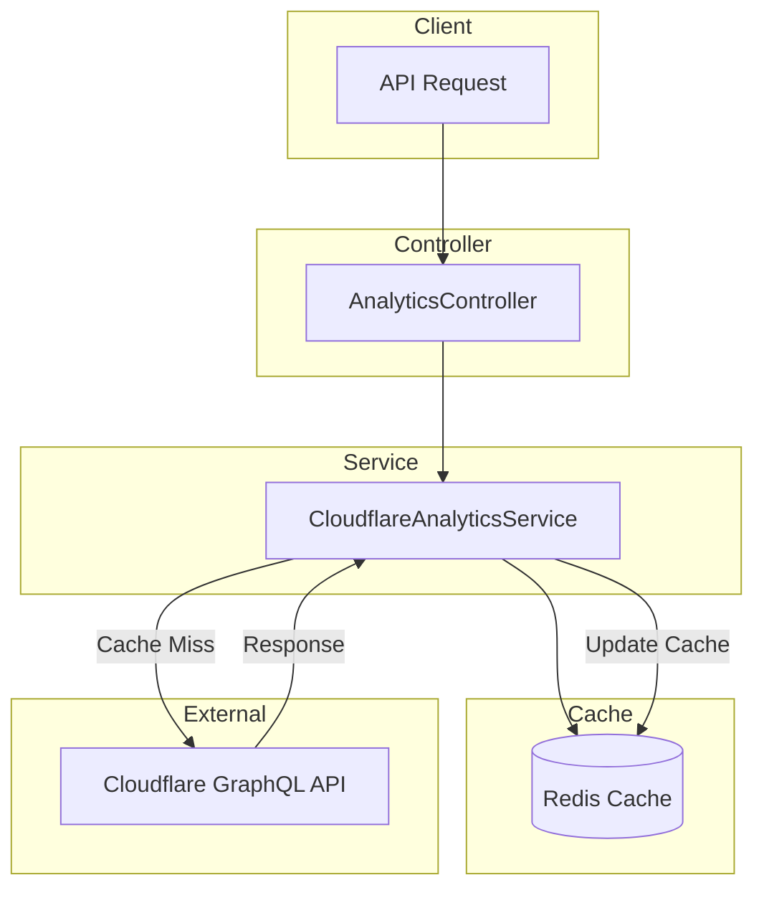

# Analytics Module Documentation

## Tổng Quan

Module `analytics` cung cấp khả năng thống kê traffic của website thông qua tích hợp với **Cloudflare GraphQL API**. Module này giúp theo dõi các chỉ số quan trọng về hiệu suất và bảo mật của ứng dụng.

Dữ liệu được quản lý theo cơ chế **Caching** để tối ưu hóa hiệu suất và giảm số lượng request tới Cloudflare API (tránh rate limits).

---

## Kiến Trúc



---

## API Endpoints

> [!TIP]
> API này là **Public**, không yêu cầu xác thực (Authorization header). Tuy nhiên, nên có các biện pháp rate limiting ở tầng gateway để tránh lạm dụng.

### 1. GET /analytics/traffic - Lấy thống kê traffic

**Mô tả:** Lấy dữ liệu thống kê traffic tổng hợp từ Cloudflare trong khoảng thời gian từ `CLOUDFLARE_START_ANALYTICS_DATE` đến hiện tại. Dữ liệu bao gồm số lượng requests, băng thông sử dụng, các mối đe dọa bị chặn, và số lượng người dùng truy cập.

**Xác thực:** Không yêu cầu (Public)

**Request:**
```http
GET /analytics/traffic HTTP/1.1
Host: api.gen-hub.dev
Accept: application/json
```

**Response (200 OK):**

```json
{
  "code": "analytics.traffic_success",
  "message": "ok",
  "success": true,
  "data": {
    "requests": {
      "all": 15420,
      "cached": 12500,
      "uncached": 2920
    },
    "bandwidth": {
      "all": 524288000,
      "cached": 419430400,
      "uncached": 104857600
    },
    "threats": {
      "all": 5
    },
    "pageviews": {
      "all": 8500
    },
    "uniques": {
      "all": 3200
    },
    "period": {
      "startDate": "2024-01-01",
      "endDate": "2024-01-31"
    }
  }
}
```

**Chi tiết Fields:**

| Field | Type | Description |
|-------|------|-------------|
| `requests.all` | number | Tổng số requests tới server |
| `requests.cached` | number | Số requests được phục vụ từ Cloudflare Cache (CDN) |
| `requests.uncached` | number | Số requests đi thẳng về Origin Server |
| `bandwidth.all` | number | Tổng băng thông sử dụng (bytes) |
| `bandwidth.cached` | number | Băng thông được cache (bytes) |
| `bandwidth.uncached` | number | Băng thông từ Origin Server (bytes) |
| `threats.all` | number | Tổng số requests bị xác định là mối đe dọa (WAF, DDoS, etc.) |
| `pageviews.all` | number | Tổng số lượt xem trang (HTML requests) |
| `uniques.all` | number | Số lượng địa chỉ IP duy nhất truy cập |
| `period.startDate` | string | Ngày bắt đầu thống kê (YYYY-MM-DD) |
| `period.endDate` | string | Ngày kết thúc thống kê (YYYY-MM-DD) |

**Error Responses:**

<details>
<summary><b>500 Internal Server Error</b></summary>

```json
{
  "code": "analytics.error",
  "message": "Không thể lấy dữ liệu thống kê",
  "success": false,
  "errors": [
    "Failed to fetch data from Cloudflare"
  ]
}
```
</details>

---

## Cấu Hình Môi Trường

Module sử dụng các biến môi trường sau để kết nối với Cloudflare và cấu hình cache:

| Biến môi trường | Bắt buộc | Mô tả |
|-----------------|----------|-------|
| `CLOUDFLARE_EMAIL` | ✅ Yes | Email tài khoản Cloudflare |
| `CLOUDFLARE_API_KEY` | ✅ Yes | Global API Key hoặc API Token có quyền đọc Analytics |
| `CLOUDFLARE_ZONE_ID` | ✅ Yes | Zone ID của domain cần thống kê |
| `CLOUDFLARE_START_ANALYTICS_DATE` | ❌ No | Ngày bắt đầu thống kê (Default: 2024-01-01). Format: YYYY-MM-DD |
| `REDIS_ANALYTICS_CACHE_TTL` | ❌ No | Thời gian cache dữ liệu trong Redis (giây). Default: 300 (5 phút) |

> [!WARNING]
> Cloudflare GraphQL API có giới hạn truy vấn tối đa trong vòng **365 ngày**. Service sẽ tự động điều chỉnh `startDate` nếu khoảng thời gian vượt quá giới hạn này.

---

## Files Trong Module

| File | Mô tả |
|------|-------|
| `analytics.controller.ts` | Xử lý HTTP request, định nghĩa Swagger documentation |
| `cloudflare-analytics.service.ts` | Service chính xử lý logic gọi GraphQL API của Cloudflare và caching |
| `analytics.module.ts` | Đăng ký controller và providers |
| `types/analytics.type.ts` | Định nghĩa các interfaces cho dữ liệu analytics |
| `constants/analytics-cache.helper.ts` | Helper function tạo cache keys |
