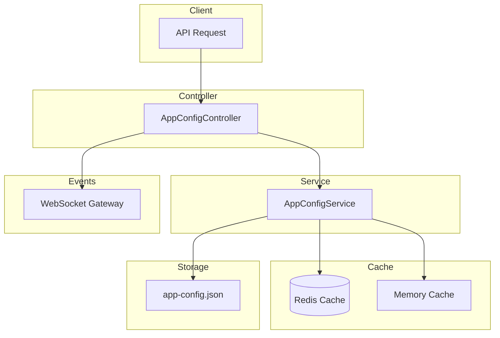

# App Config Module Documentation

## Tổng Quan

Module `app-config` quản lý cấu hình động của ứng dụng GEN-HUB. Cấu hình được lưu trữ và quản lý theo pattern **Cache Aside** với 3 lớp:

1. **Redis Cache** - Distributed caching cho multi-instance
2. **Memory Cache** - Fast access trong process
3. **File Persistence** - `app-config.json` cho durability

---

## Kiến Trúc



---

## API Endpoints

### 1. GET /config - Lấy cấu hình ứng dụng

**Mô tả:** API công khai để lấy toàn bộ cấu hình ứng dụng bao gồm thông tin thương hiệu, bảng màu giao diện và cấu hình phân trang.

**Xác thực:** Không yêu cầu (Public)

**Request:**
```http
GET /config HTTP/1.1
Host: api.gen-hub.dev
Accept: application/json
```

**Response (200 OK):**
```json
{
  "code": "config.get_success",
  "message": "Lấy cấu hình thành công",
  "success": true,
  "data": {
    "brandName": "GEN-HUB",
    "supportEmail": "support@gen-hub.dev",
    "supportPhone": "0783 504 540",
    "colors": {
      "primary": "#0F766E",
      "primaryLight": "#14B8A6",
      "primaryDark": "#0D5A52",
      "gray900": "#1E293B",
      "gray700": "#334155",
      "gray500": "#64748B",
      "gray300": "#CBD5E1",
      "gray100": "#F1F5F9",
      "background": "#F8FAFC",
      "cardSurface": "#FFFFFF",
      "sidebarBg": "#F1F5F9",
      "success": "#10B981",
      "warning": "#F59E0B",
      "error": "#EF4444",
      "info": "#0EA5E9",
      "border": "#E2E8F0",
      "shadow": "rgba(0, 0, 0, 0.04)"
    },
    "pagination": {
      "defaultLimit": 10,
      "defaultOffset": 0,
      "maxLimit": 100,
      "minLimit": 1
    },
    "enableAiAutoReply": true
  }
}
```

---

### 2. PATCH /config - Cập nhật cấu hình ứng dụng

**Mô tả:** Cập nhật một phần hoặc toàn bộ cấu hình ứng dụng. Chỉ các trường được gửi trong request body mới được cập nhật, các trường khác giữ nguyên.

**Xác thực:** Bearer Token (JWT)

**Quyền yêu cầu:** `config.update`

**Headers:**
```http
Authorization: Bearer <access_token>
Content-Type: application/json
```

**Request Body Schema:**

| Field | Type | Required | Description |
|-------|------|----------|-------------|
| `brandName` | string | Optional | Tên thương hiệu (max 100 ký tự) |
| `supportEmail` | string | Optional | Email hỗ trợ (max 255 ký tự) |
| `supportPhone` | string | Optional | Số điện thoại hỗ trợ (max 20 ký tự) |
| `colors` | object | Optional | Bảng màu giao diện |
| `colors.primary` | string | Optional | Màu chính (hex color) |
| `colors.primaryLight` | string | Optional | Màu chính sáng (hex color) |
| `colors.primaryDark` | string | Optional | Màu chính tối (hex color) |
| `colors.gray900` | string | Optional | Màu xám 900 (hex color) |
| `colors.gray700` | string | Optional | Màu xám 700 (hex color) |
| `colors.gray500` | string | Optional | Màu xám 500 (hex color) |
| `colors.gray300` | string | Optional | Màu xám 300 (hex color) |
| `colors.gray100` | string | Optional | Màu xám 100 (hex color) |
| `colors.background` | string | Optional | Màu nền trang (hex color) |
| `colors.cardSurface` | string | Optional | Màu bề mặt card (hex color) |
| `colors.sidebarBg` | string | Optional | Màu nền sidebar (hex color) |
| `colors.success` | string | Optional | Màu thành công (hex color) |
| `colors.warning` | string | Optional | Màu cảnh báo (hex color) |
| `colors.error` | string | Optional | Màu lỗi (hex color) |
| `colors.info` | string | Optional | Màu thông tin (hex color) |
| `colors.border` | string | Optional | Màu viền (hex color) |
| `colors.shadow` | string | Optional | Màu bóng đổ |
| `pagination` | object | Optional | Cấu hình phân trang |
| `pagination.defaultLimit` | number | Optional | Số lượng item mặc định mỗi trang (1-1000) |
| `pagination.defaultOffset` | number | Optional | Vị trí bắt đầu mặc định (min: 0) |
| `pagination.maxLimit` | number | Optional | Số lượng item tối đa mỗi trang (1-1000) |
| `pagination.minLimit` | number | Optional | Số lượng item tối thiểu mỗi trang (min: 1) |
| `enableAiAutoReply` | boolean | Optional | Bật/tắt AI tự động phản hồi |

**Request Body Examples:**

<details>
<summary><b>Ví dụ 1: Cập nhật thông tin thương hiệu</b></summary>

```json
{
  "brandName": "GEN-HUB Pro",
  "supportEmail": "support@gen-hub.dev",
  "supportPhone": "0783 504 540"
}
```
</details>

<details>
<summary><b>Ví dụ 2: Cập nhật bảng màu</b></summary>

```json
{
  "colors": {
    "primary": "#6366F1",
    "primaryLight": "#818CF8",
    "primaryDark": "#4F46E5",
    "success": "#22C55E",
    "warning": "#EAB308",
    "error": "#DC2626",
    "info": "#3B82F6"
  }
}
```
</details>

<details>
<summary><b>Ví dụ 3: Cập nhật cấu hình phân trang</b></summary>

```json
{
  "pagination": {
    "defaultLimit": 20,
    "maxLimit": 200,
    "minLimit": 5
  }
}
```
</details>

<details>
<summary><b>Ví dụ 4: Bật/tắt AI tự động phản hồi</b></summary>

```json
{
  "enableAiAutoReply": true
}
```
</details>

**Response (200 OK):** Trả về toàn bộ cấu hình sau khi cập nhật

```json
{
  "code": "config.update_success",
  "message": "Cập nhật cấu hình thành công",
  "success": true,
  "data": {
    "brandName": "GEN-HUB Pro",
    "supportEmail": "support@gen-hub.dev",
    "supportPhone": "0783 504 540",
    "colors": {
      "primary": "#0F766E",
      "primaryLight": "#14B8A6",
      "primaryDark": "#0D5A52",
      "gray900": "#1E293B",
      "gray700": "#334155",
      "gray500": "#64748B",
      "gray300": "#CBD5E1",
      "gray100": "#F1F5F9",
      "background": "#F8FAFC",
      "cardSurface": "#FFFFFF",
      "sidebarBg": "#F1F5F9",
      "success": "#10B981",
      "warning": "#F59E0B",
      "error": "#EF4444",
      "info": "#0EA5E9",
      "border": "#E2E8F0",
      "shadow": "rgba(0, 0, 0, 0.04)"
    },
    "pagination": {
      "defaultLimit": 10,
      "defaultOffset": 0,
      "maxLimit": 100,
      "minLimit": 1
    },
    "enableAiAutoReply": true
  }
}
```

**Error Responses:**

<details>
<summary><b>401 Unauthorized</b></summary>

```json
// Không có token
{
  "code": "error.unauthorized.token_missing",
  "message": "Không có quyền truy cập",
  "success": false
}

// Token hết hạn
{
  "code": "error.unauthorized.token_expired",
  "message": "Token đã hết hạn",
  "success": false
}

// Token không hợp lệ
{
  "code": "error.unauthorized.token_invalid",
  "message": "Token không hợp lệ",
  "success": false
}

// Token không đúng định dạng
{
  "code": "error.unauthorized.token_malformed",
  "message": "Token không đúng định dạng",
  "success": false
}
```
</details>

<details>
<summary><b>403 Forbidden</b></summary>

```json
// Không có quyền thực hiện
{
  "code": "error.forbidden.no_permission",
  "message": "Không có quyền thực hiện thao tác này",
  "success": false
}

// Tài khoản bị khóa
{
  "code": "error.forbidden.account_banned",
  "message": "Tài khoản đã bị khóa",
  "success": false
}

// Tài khoản chưa xác minh
{
  "code": "error.forbidden.account_not_verified",
  "message": "Tài khoản chưa được xác minh. Vui lòng xác minh email để tiếp tục.",
  "success": false
}

// Tài khoản không tồn tại
{
  "code": "error.forbidden.account_not_found",
  "message": "Tài khoản không tồn tại",
  "success": false
}
```
</details>

<details>
<summary><b>422 Unprocessable Entity</b></summary>

```json
{
  "code": "error.validation",
  "message": "Dữ liệu đầu vào không hợp lệ",
  "success": false,
  "errors": [
    { "field": "brandName", "message": "Tên thương hiệu không được quá 100 ký tự" },
    { "field": "colors.primary", "message": "Mã màu không hợp lệ" }
  ]
}
```
</details>

---

### 3. POST /config/reset - Reset cấu hình về mặc định

**Mô tả:** Khôi phục toàn bộ cấu hình ứng dụng về giá trị mặc định được định nghĩa trong biến môi trường (.env). Thao tác này sẽ ghi đè tất cả các tùy chỉnh hiện tại.

**Xác thực:** Bearer Token (JWT)

**Quyền yêu cầu:** `config.reset`

**Headers:**
```http
Authorization: Bearer <access_token>
```

**Request:** Không có body

**Response (200 OK):** Trả về toàn bộ cấu hình sau khi reset về giá trị mặc định

```json
{
  "code": "config.reset_success",
  "message": "Reset cấu hình thành công",
  "success": true,
  "data": {
    "brandName": "GEN-HUB",
    "supportEmail": "support@gen-hub.dev",
    "supportPhone": "0783 504 540",
    "colors": {
      "primary": "#0F766E",
      "primaryLight": "#14B8A6",
      "primaryDark": "#0D5A52",
      "gray900": "#1E293B",
      "gray700": "#334155",
      "gray500": "#64748B",
      "gray300": "#CBD5E1",
      "gray100": "#F1F5F9",
      "background": "#F8FAFC",
      "cardSurface": "#FFFFFF",
      "sidebarBg": "#F1F5F9",
      "success": "#10B981",
      "warning": "#F59E0B",
      "error": "#EF4444",
      "info": "#0EA5E9",
      "border": "#E2E8F0",
      "shadow": "rgba(0, 0, 0, 0.04)"
    },
    "pagination": {
      "defaultLimit": 10,
      "defaultOffset": 0,
      "maxLimit": 100,
      "minLimit": 1
    },
    "enableAiAutoReply": true
  }
}
```

**Error Responses:**

<details>
<summary><b>401 Unauthorized</b></summary>

```json
// Không có token
{
  "code": "error.unauthorized.token_missing",
  "message": "Không có quyền truy cập",
  "success": false
}

// Token hết hạn
{
  "code": "error.unauthorized.token_expired",
  "message": "Token đã hết hạn",
  "success": false
}

// Token không hợp lệ
{
  "code": "error.unauthorized.token_invalid",
  "message": "Token không hợp lệ",
  "success": false
}

// Token không đúng định dạng
{
  "code": "error.unauthorized.token_malformed",
  "message": "Token không đúng định dạng",
  "success": false
}
```
</details>

<details>
<summary><b>403 Forbidden</b></summary>

```json
// Không có quyền thực hiện
{
  "code": "error.forbidden.no_permission",
  "message": "Không có quyền thực hiện thao tác này",
  "success": false
}

// Tài khoản bị khóa
{
  "code": "error.forbidden.account_banned",
  "message": "Tài khoản đã bị khóa",
  "success": false
}

// Tài khoản chưa xác minh
{
  "code": "error.forbidden.account_not_verified",
  "message": "Tài khoản chưa được xác minh. Vui lòng xác minh email để tiếp tục.",
  "success": false
}

// Tài khoản không tồn tại
{
  "code": "error.forbidden.account_not_found",
  "message": "Tài khoản không tồn tại",
  "success": false
}
```
</details>

---

### 4. POST /config/reload - Reload cấu hình từ file

**Mô tả:** Đọc lại cấu hình từ file `app-config.json` trên server và cập nhật vào bộ nhớ. Hữu ích khi cần đồng bộ cấu hình sau khi chỉnh sửa file trực tiếp trên server. Thao tác này sẽ invalidate Redis cache và force reload từ file.

**Xác thực:** Bearer Token (JWT)

**Quyền yêu cầu:** `config.reload`

**Headers:**
```http
Authorization: Bearer <access_token>
```

**Request:** Không có body

**Response (200 OK):** Trả về toàn bộ cấu hình sau khi reload từ file

```json
{
  "code": "config.reload_success",
  "message": "Reload cấu hình thành công",
  "success": true,
  "data": {
    "brandName": "GEN-HUB",
    "supportEmail": "support@gen-hub.dev",
    "supportPhone": "0783 504 540",
    "colors": {
      "primary": "#0F766E",
      "primaryLight": "#14B8A6",
      "primaryDark": "#0D5A52",
      "gray900": "#1E293B",
      "gray700": "#334155",
      "gray500": "#64748B",
      "gray300": "#CBD5E1",
      "gray100": "#F1F5F9",
      "background": "#F8FAFC",
      "cardSurface": "#FFFFFF",
      "sidebarBg": "#F1F5F9",
      "success": "#10B981",
      "warning": "#F59E0B",
      "error": "#EF4444",
      "info": "#0EA5E9",
      "border": "#E2E8F0",
      "shadow": "rgba(0, 0, 0, 0.04)"
    },
    "pagination": {
      "defaultLimit": 10,
      "defaultOffset": 0,
      "maxLimit": 100,
      "minLimit": 1
    },
    "enableAiAutoReply": true
  }
}
```

**Error Responses:**

<details>
<summary><b>401 Unauthorized</b></summary>

```json
// Không có token
{
  "code": "error.unauthorized.token_missing",
  "message": "Không có quyền truy cập",
  "success": false
}

// Token hết hạn
{
  "code": "error.unauthorized.token_expired",
  "message": "Token đã hết hạn",
  "success": false
}

// Token không hợp lệ
{
  "code": "error.unauthorized.token_invalid",
  "message": "Token không hợp lệ",
  "success": false
}

// Token không đúng định dạng
{
  "code": "error.unauthorized.token_malformed",
  "message": "Token không đúng định dạng",
  "success": false
}
```
</details>

<details>
<summary><b>403 Forbidden</b></summary>

```json
// Không có quyền thực hiện
{
  "code": "error.forbidden.no_permission",
  "message": "Không có quyền thực hiện thao tác này",
  "success": false
}

// Tài khoản bị khóa
{
  "code": "error.forbidden.account_banned",
  "message": "Tài khoản đã bị khóa",
  "success": false
}

// Tài khoản chưa xác minh
{
  "code": "error.forbidden.account_not_verified",
  "message": "Tài khoản chưa được xác minh. Vui lòng xác minh email để tiếp tục.",
  "success": false
}

// Tài khoản không tồn tại
{
  "code": "error.forbidden.account_not_found",
  "message": "Tài khoản không tồn tại",
  "success": false
}
```
</details>

---

## Cấu Hình Mặc Định

Các giá trị mặc định được lấy từ biến môi trường hoặc hardcoded defaults:

| Biến môi trường | Mặc định | Mô tả |
|-----------------|----------|-------|
| `BRAND_NAME` | GEN-HUB | Tên thương hiệu |
| `SUPPORT_EMAIL` | support@gen-hub.com | Email hỗ trợ |
| `SUPPORT_PHONE` | 1900-xxxx | Số điện thoại hỗ trợ |
| `COLOR_PRIMARY` | #0F766E | Màu chính |
| `COLOR_PRIMARY_LIGHT` | #14B8A6 | Màu chính sáng |
| `COLOR_PRIMARY_DARK` | #0D5A52 | Màu chính tối |
| `COLOR_GRAY_900` | #1E293B | Màu xám 900 |
| `COLOR_GRAY_700` | #334155 | Màu xám 700 |
| `COLOR_GRAY_500` | #64748B | Màu xám 500 |
| `COLOR_GRAY_300` | #CBD5E1 | Màu xám 300 |
| `COLOR_GRAY_100` | #F1F5F9 | Màu xám 100 |
| `COLOR_BACKGROUND` | #F8FAFC | Màu nền |
| `COLOR_CARD_SURFACE` | #FFFFFF | Màu bề mặt card |
| `COLOR_SIDEBAR_BG` | #F1F5F9 | Màu nền sidebar |
| `COLOR_SUCCESS` | #10B981 | Màu thành công |
| `COLOR_WARNING` | #F59E0B | Màu cảnh báo |
| `COLOR_ERROR` | #EF4444 | Màu lỗi |
| `COLOR_INFO` | #0EA5E9 | Màu thông tin |
| `COLOR_BORDER` | #E2E8F0 | Màu viền |
| `COLOR_SHADOW` | rgba(0, 0, 0, 0.04) | Màu bóng đổ |
| `DEFAULT_LIMIT` | 10 | Số lượng item mặc định mỗi trang |
| `DEFAULT_OFFSET` | 0 | Vị trí bắt đầu mặc định |
| `MAX_LIMIT` | 100 | Số lượng item tối đa mỗi trang |
| `MIN_LIMIT` | 1 | Số lượng item tối thiểu mỗi trang |
| `ENABLE_AI_AUTO_REPLY` | true | Bật AI tự động phản hồi |
| `REDIS_APP_CONFIG_CACHE_TTL` | 300 | TTL cho Redis cache (giây) |

---

## Websocket Events

Khi cấu hình được thay đổi, server sẽ emit các event qua WebSocket để thông báo cho clients. Frontend có thể subscribe để nhận config mới realtime mà **không cần gọi lại API**.

### Event Types

| Action | Event Name | Mô tả |
|--------|------------|-------|
| Update | `config:updated` | Cấu hình đã được cập nhật bởi admin |
| Reset | `config:reset` | Cấu hình đã được reset về giá trị mặc định |
| Reload | `config:reloaded` | Cấu hình đã được reload từ file trên server |

### Event Payload Schema

```typescript
interface ConfigChangedEvent {
  /** Loại hành động: 'updated' | 'reset' | 'reloaded' */
  action: 'updated' | 'reset' | 'reloaded';
  /** Dữ liệu config mới */
  data: {
    brandName: string;
    supportEmail: string;
    supportPhone: string;
    colors: {
      primary: string;
      primaryLight: string;
      primaryDark: string;
      gray900: string;
      gray700: string;
      gray500: string;
      gray300: string;
      gray100: string;
      background: string;
      cardSurface: string;
      sidebarBg: string;
      success: string;
      warning: string;
      error: string;
      info: string;
      border: string;
      shadow: string;
    };
    pagination: {
      defaultLimit: number;
      defaultOffset: number;
      maxLimit: number;
      minLimit: number;
    };
    enableAiAutoReply: boolean;
  };
  /** ID của user thực hiện thao tác */
  updatedBy?: string;
  /** Thời điểm event được emit (ISO 8601) */
  timestamp: string;
}
```

### Ví dụ Event Payload

```json
{
  "action": "updated",
  "data": {
    "brandName": "GEN-HUB Pro",
    "supportEmail": "support@gen-hub.dev",
    "supportPhone": "0783 504 540",
    "colors": {
      "primary": "#6366F1",
      "primaryLight": "#818CF8",
      "primaryDark": "#4F46E5",
      "gray900": "#1E293B",
      "gray700": "#334155",
      "gray500": "#64748B",
      "gray300": "#CBD5E1",
      "gray100": "#F1F5F9",
      "background": "#F8FAFC",
      "cardSurface": "#FFFFFF",
      "sidebarBg": "#F1F5F9",
      "success": "#10B981",
      "warning": "#F59E0B",
      "error": "#EF4444",
      "info": "#0EA5E9",
      "border": "#E2E8F0",
      "shadow": "rgba(0, 0, 0, 0.04)"
    },
    "pagination": {
      "defaultLimit": 10,
      "defaultOffset": 0,
      "maxLimit": 100,
      "minLimit": 1
    },
    "enableAiAutoReply": true
  },
  "updatedBy": "550e8400-e29b-41d4-a716-446655440000",
  "timestamp": "2026-01-20T06:00:00.000Z"
}
```

### Cách sử dụng ở Frontend

```typescript
// Sử dụng Socket.IO client
import { io } from 'socket.io-client';

const socket = io('wss://api.gen-hub.dev');

// Subscribe các config events - KHÔNG cần gọi lại API
socket.on('config:updated', (payload) => {
  console.log('Config updated by:', payload.updatedBy);
  // Sử dụng config mới trực tiếp từ payload
  applyConfig(payload.data);
});

socket.on('config:reset', (payload) => {
  console.log('Config reset at:', payload.timestamp);
  applyConfig(payload.data);
});

socket.on('config:reloaded', (payload) => {
  console.log('Config reloaded from file');
  applyConfig(payload.data);
});

function applyConfig(config: IAppConfig) {
  // Cập nhật theme colors
  document.documentElement.style.setProperty('--color-primary', config.colors.primary);
  // Cập nhật các settings khác...
}
```

### Use Cases

1. **Real-time UI Theme Update**: Khi admin thay đổi màu sắc, tất cả users đang online sẽ thấy theme mới ngay lập tức **mà không cần refresh**
2. **Zero-latency Config Sync**: Frontend nhận config mới trực tiếp qua WebSocket, không cần gọi API
3. **Admin Dashboard**: Hiển thị notification khi có admin khác thay đổi config

---

## Validation Rules

### Colors
- Tất cả các trường màu (trừ `shadow`) phải là hex color hợp lệ (e.g., `#FFFFFF`)
- `shadow` có thể là bất kỳ string CSS color nào

### Pagination
- `defaultLimit`: 1 - 1000
- `defaultOffset`: >= 0
- `maxLimit`: 1 - 1000
- `minLimit`: >= 1

### Strings
- `brandName`: max 100 ký tự
- `supportEmail`: max 255 ký tự
- `supportPhone`: max 20 ký tự

---

## Files Trong Module

| File | Mô tả |
|------|-------|
| [app-config.module.ts](https://github.com/ZombieGenZ/gen-hub/blob/master/server/src/common/config/app-config.module.ts) | NestJS module definition |
| [app-config.controller.ts](https://github.com/ZombieGenZ/gen-hub/blob/master/server/src/common/config/app-config.controller.ts) | REST API endpoints |
| [app-config.service.ts](https://github.com/ZombieGenZ/gen-hub/blob/master/server/src/common/config/app-config.service.ts) | Business logic và caching |
| [app-config.dto.ts](https://github.com/ZombieGenZ/gen-hub/blob/master/server/src/common/config/app-config.dto.ts) | DTOs với validation |
| [types/app-config.type.ts](https://github.com/ZombieGenZ/gen-hub/blob/master/server/src/common/config/types/app-config.type.ts) | TypeScript interfaces |
| [helpers/cache-keys.helper.ts](https://github.com/ZombieGenZ/gen-hub/blob/master/server/src/common/config/helpers/cache-keys.helper.ts) | Redis cache key helper |

---

## Permissions

| Permission | Mô tả |
|------------|-------|
| `config.update` | Cập nhật cấu hình ứng dụng |
| `config.reset` | Reset cấu hình về mặc định |
| `config.reload` | Reload cấu hình từ file |
