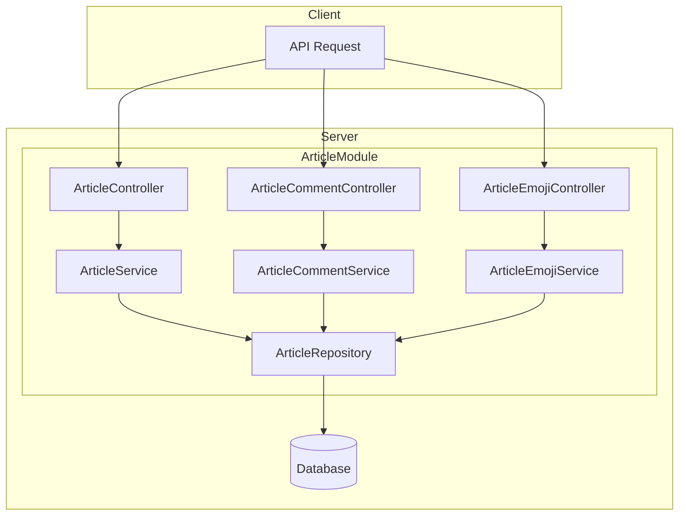

# Article Module Documentation

## Tổng Quan

Module `article` quản lý toàn bộ hệ thống bài viết (CMS) của GEN-HUB, bao gồm quản lý bài viết, bình luận (comments), và cảm xúc (emotions/reactions).

Module này cung cấp các tính năng:
- **Articles**: CRUD bài viết, quản lý trạng thái, loại bài viết, SEO.
- **Comments**: Hệ thống bình luận đa cấp, có moderation (approve/reject).
- **Reactions**: Hệ thống cảm xúc (Like, Heart, etc.) hỗ trợ cả user và guest.

---

## Kiến Trúc



---

## API Endpoints

### 1. Articles

| Method | Endpoint | Mô tả | Auth | Quyền |
|:---:|:---|:---|:---:|:---|
| `POST` | `/articles` | Tạo bài viết mới | ✅ | `article.create` |
| `GET` | `/articles` | Lấy danh sách bài viết (Admin) | ✅ | `article.list` |
| `GET` | `/articles/public` | Lấy danh sách bài viết công khai | ❌ | - |
| `GET` | `/articles/:id` | Lấy chi tiết bài viết (Admin) | ✅ | `article.read` |
| `PUT` | `/articles/:id` | Cập nhật bài viết | ✅ | `article.update` |
| `DELETE` | `/articles/:id` | Xóa bài viết (Soft delete) | ✅ | `article.delete` |
| `DELETE` | `/articles/delete/many` | Xóa nhiều bài viết | ✅ | `article.delete` |
| `POST` | `/articles/:id/view` | Tăng lượt xem | ❌ | - |
| `POST` | `/articles/:id/share` | Tăng lượt chia sẻ | ❌ | - |
| `GET` | `/articles/:id/history` | Xem lịch sử chỉnh sửa | ✅ | `article.read` |
| `POST` | `/articles/:id/generate-seo` | Tạo SEO tự động (AI) | ✅ | `article.update` |

### 2. Comments

| Method | Endpoint | Mô tả | Auth | Quyền |
|:---:|:---|:---|:---:|:---|
| `GET` | `/articles/:id/comments` | Lấy danh sách bình luận | ❌ | - |
| `POST` | `/articles/:id/comments` | Tạo bình luận mới | ⚠️ | - |
| `PUT` | `/articles/:id/comments/:cid` | Cập nhật bình luận (User) | ✅ | `article.read` |
| `DELETE` | `/articles/:id/comments/:cid` | Xóa bình luận (User) | ✅ | `article.read` |
| `POST` | `/articles/:id/comments/:cid/approve` | Duyệt bình luận (Admin) | ✅ | `article.admin` |
| `POST` | `/articles/:id/comments/:cid/reject` | Từ chối bình luận (Admin) | ✅ | `article.admin` |
| `PUT` | `/admin/articles/:id/comments/:cid` | Admin sửa bình luận | ✅ | `article.admin` |
| `DELETE` | `/admin/articles/:id/comments/:cid` | Admin xóa bình luận | ✅ | `article.admin` |

### 3. Reactions

| Method | Endpoint | Mô tả | Auth | Quyền |
|:---:|:---|:---|:---:|:---|
| `GET` | `/articles/emojis` | Lấy danh sách emoji | ❌ | - |
| `POST` | `/articles/:id/reactions` | Thả/Bỏ reaction (Toggle) | ⚠️ | - |
| `DELETE` | `/articles/:id/reactions/:emojiId` | Bỏ reaction (Explicit) | ⚠️ | - |
| `GET` | `/articles/:id/reactions` | Lấy thống kê reaction | ❌ | - |
| `DELETE` | `/admin/articles/:id/reactions/:rid` | Admin xóa reaction | ✅ | `article.admin` |

*(Chú thích: ⚠️ - Có thể dùng Auth hoặc Guest)*

---

## Chi Tiết Request Body

### 1. CreateArticleDto

```json
{
  "title": "Tiêu đề bài viết",
  "slug": "tieu-de-bai-viet",
  "excerpt": "Mô tả ngắn...",
  "content": "<p>Nội dung bài viết...</p>",
  "thumbnail": "https://example.com/image.jpg",
  "type": "BLOG", 
  "status": "DRAFT",
  "category_ids": ["uuid-1", "uuid-2"],
  "tags": ["tag1", "tag2"],
  "seo_title": "SEO Title",
  "seo_description": "SEO Description",
  "seo_keywords": ["keyword1", "keyword2"],
  "allow_comments": true,
  "is_featured": false
}
```

**Enum Reference:**
- `ArticleType`: `BLOG`, `GUIDE`, `NEWS`, `ANNOUNCEMENT`
- `ArticleStatus`: `DRAFT`, `PUBLISHED`, `ARCHIVED`, `HIDDEN`

### 2. CreateCommentDto

```json
{
  "content": "Nội dung bình luận",
  "parent_id": "uuid-parent-comment", // Optional
  "guest_info": { // Optional (nếu user chưa đăng nhập)
    "name": "Guest Name",
    "email": "guest@example.com"
  }
}
```

### 3. CreateReactionDto

```json
{
  "emoji": "heart", // Code của emoji
  "guest_identifier": "guest-session-id" // Optional
}
```

---

## Cấu Hình Môi Trường

Module sử dụng các biến môi trường sau cho tính năng caching và AI generation:

```env
# Cache Configuration
REDIS_ARTICLE_KEY_PREFIX=article
REDIS_ARTICLE_LIST_KEY_PREFIX=article:list
REDIS_ARTICLE_CACHE_TTL=300
REDIS_ARTICLE_COMMENT_KEY_PREFIX=article:comment
REDIS_ARTICLE_EMOJI_KEY_PREFIX=article:emoji

# Feature Flags
AUTO_APPROVE_COMMENTS=true # Tự động duyệt comment mới
```

## Validation Rules

- **Title**: Bắt buộc, tối đa 255 ký tự.
- **Slug**: Bắt buộc, unique, format slug (a-z, 0-9, -).
- **Content**: Bắt buộc (trừ khi type khác yêu cầu).
- **Status**: Default là `DRAFT`.
- **Comment Content**: Tối đa 1000 ký tự, không được để trống.
