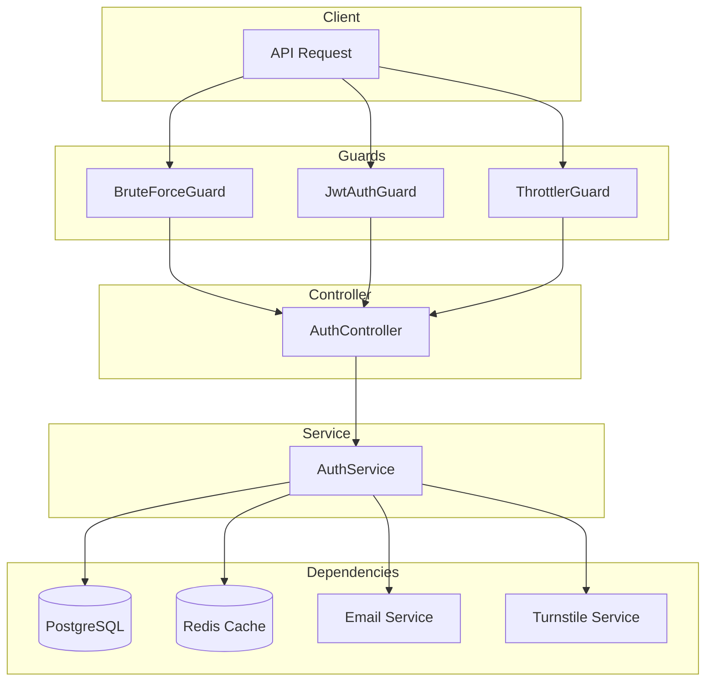

# Auth Module Documentation

## Tổng Quan

Module `auth` quản lý toàn bộ quy trình xác thực của ứng dụng GEN-HUB. Module hỗ trợ:

1. **Đăng ký / Đăng nhập** - Email + Password
2. **JWT Authentication** - Access Token + Refresh Token
3. **Email Verification** - Xác thực email sau đăng ký
4. **Password Recovery** - Quên mật khẩu qua email
5. **Panel Login** - Đăng nhập các admin panels với quyền riêng
6. **Access Verification** - Xác thực quyền truy cập cho thao tác nhạy cảm

> [!NOTE]
> Xác thực 2 yếu tố (2FA) được quản lý bởi module `two-factor` riêng biệt.

---

## Kiến Trúc



---

## Token Flow

### Access Token
- **Thời hạn:** 15 phút (mặc định)
- **Sử dụng:** Xác thực API requests
- **Lưu trữ:** Client-side (memory/secure storage)

### Refresh Token
- **Thời hạn:** 7 ngày (mặc định)
- **Sử dụng:** Lấy Access Token mới
- **Lưu trữ:** HttpOnly Cookie hoặc Secure Storage
- **Đặc điểm:** Rotation - token cũ bị vô hiệu khi lấy token mới

### Access Verification Token
- **Thời hạn:** 5 phút
- **Sử dụng:** Xác thực quyền truy cập để thực hiện các thao tác nhạy cảm (bật/tắt 2FA, thay đổi mật khẩu, xóa tài khoản...)
- **Flow:** Verify Access (bằng password/2FA/backup code) → Access Verification Token → Thao tác nhạy cảm

---

## API Endpoints

### 1. POST /auth/register - Đăng ký tài khoản

**Mô tả:** Tạo tài khoản mới với email và mật khẩu. Sau khi đăng ký thành công, hệ thống sẽ gửi email xác thực.

**Xác thực:** Không yêu cầu (Public)

**Rate Limit:** 5 requests/phút

**Request:**
```http
POST /auth/register HTTP/1.1
Host: api.gen-hub.dev
Content-Type: application/json
Accept-Language: vi

{
  "name": "Nguyễn Văn A",
  "email": "user@example.com",
  "password": "Password@123",
  "language": "vi",
  "turnstileToken": "0.abc123..."
}
```

**Request Body Schema:**

| Field | Type | Required | Description |
|-------|------|----------|-------------|
| `name` | string | ✅ | Tên người dùng (min 2 ký tự) |
| `email` | string | ✅ | Email hợp lệ |
| `password` | string | ✅ | Mật khẩu (min 8 ký tự, chữ hoa, chữ thường, số, ký tự đặc biệt) |
| `language` | string | ❌ | Ngôn ngữ (vi, en). Mặc định: vi |
| `turnstileToken` | string | ❌ | Cloudflare Turnstile token |

**Response (201 Created):**
```json
{
  "code": "auth.register_success",
  "message": "Đăng ký tài khoản thành công",
  "success": true,
  "data": {
    "id": "550e8400-e29b-41d4-a716-446655440000",
    "name": "Nguyễn Văn A",
    "email": "user@example.com",
    "email_verified": false,
    "language": "vi",
    "created_at": "2026-01-21T08:00:00.000Z"
  },
  "authorization": {
    "access_token": "eyJhbGciOiJIUzI1NiIsInR5cCI6IkpXVCJ9...",
    "refresh_token": "eyJhbGciOiJIUzI1NiIsInR5cCI6IkpXVCJ9..."
  }
}
```

**Error Responses:**

<details>
<summary><b>409 Conflict</b></summary>

```json
{
  "code": "auth.register.email_exists",
  "message": "Email đã được sử dụng",
  "success": false
}
```
</details>

<details>
<summary><b>422 Unprocessable Entity</b></summary>

```json
{
  "code": "error.validation",
  "message": "Dữ liệu đầu vào không hợp lệ",
  "success": false,
  "errors": [
    { "field": "email", "message": "Email không hợp lệ" },
    { "field": "password", "message": "Mật khẩu phải có ít nhất 8 ký tự" }
  ]
}
```
</details>

<details>
<summary><b>429 Too Many Requests</b></summary>

```json
{
  "code": "error.too_many_requests",
  "message": "Quá nhiều yêu cầu. Vui lòng thử lại sau.",
  "success": false
}
```
</details>

---

### 2. POST /auth/login - Đăng nhập

**Mô tả:** Đăng nhập bằng email và mật khẩu. Nếu tài khoản đã bật 2FA, sẽ trả về temp_token để xác thực 2 yếu tố.

**Xác thực:** Không yêu cầu (Public)

**Rate Limit:** 10 requests/phút

**Brute Force Protection:** ✅ Có

**Request:**
```http
POST /auth/login HTTP/1.1
Host: api.gen-hub.dev
Content-Type: application/json
Accept-Language: vi

{
  "email": "user@example.com",
  "password": "Password@123",
  "turnstileToken": "0.abc123..."
}
```

**Response (200 OK) - Login thành công:**
```json
{
  "code": "auth.login_success",
  "message": "Đăng nhập thành công",
  "success": true,
  "data": {
    "id": "550e8400-e29b-41d4-a716-446655440000",
    "name": "Nguyễn Văn A",
    "email": "user@example.com",
    "email_verified": true,
    "avatar": null,
    "language": "vi"
  },
  "authorization": {
    "access_token": "eyJhbGciOiJIUzI1NiIsInR5cCI6IkpXVCJ9...",
    "refresh_token": "eyJhbGciOiJIUzI1NiIsInR5cCI6IkpXVCJ9..."
  }
}
```

**Response (200 OK) - Yêu cầu 2FA:**
```json
{
  "code": "auth.login_2fa_required",
  "message": "Yêu cầu xác thực 2 yếu tố",
  "success": true,
  "data": {
    "requires_2fa": true,
    "temp_token": "temp_abc123..."
  }
}
```

**Error Responses:**

<details>
<summary><b>401 Unauthorized</b></summary>

```json
{
  "code": "auth.login.invalid_credentials",
  "message": "Thông tin đăng nhập không chính xác",
  "success": false
}
```
</details>

<details>
<summary><b>403 Forbidden</b></summary>

```json
// Tài khoản bị khóa
{
  "code": "auth.login.account_banned",
  "message": "Tài khoản đã bị khóa",
  "success": false
}

// Tài khoản chưa xác minh
{
  "code": "auth.login.account_not_verified",
  "message": "Tài khoản chưa được xác minh",
  "success": false
}
```
</details>

<details>
<summary><b>422 Unprocessable Entity</b></summary>

```json
{
  "code": "error.validation",
  "message": "Dữ liệu đầu vào không hợp lệ",
  "success": false,
  "errors": [
    { "field": "email", "message": "Email là bắt buộc" }
  ]
}
```
</details>

---

### 3. POST /auth/login/database-panel - Đăng nhập Database Panel

**Mô tả:** Đăng nhập vào Database Panel. Yêu cầu tài khoản có quyền `database.admin`.

**Xác thực:** Không yêu cầu (Public)

**Quyền yêu cầu:** `database.admin`

**Rate Limit:** 10 requests/phút

**Request:** Tương tự `/auth/login`

**Response (200 OK):**
```json
{
  "code": "auth.login_database_panel_success",
  "message": "Đăng nhập Database Panel thành công",
  "success": true,
  "data": { ... },
  "authorization": {
    "access_token": "...",
    "refresh_token": "..."
  }
}
```

**Error Response (403 Forbidden):**
```json
{
  "code": "auth.panel_login.database_permission_denied",
  "message": "Bạn không có quyền truy cập Database Panel. Vui lòng liên hệ quản trị viên để được cấp quyền database.admin.",
  "success": false
}
```

---

### 4. POST /auth/login/feature-flag-panel - Đăng nhập Feature Flag Panel

**Mô tả:** Đăng nhập vào Feature Flag Panel. Yêu cầu tài khoản có quyền `featureflag.admin`.

**Xác thực:** Không yêu cầu (Public)

**Quyền yêu cầu:** `featureflag.admin`

**Rate Limit:** 10 requests/phút

**Request:** Tương tự `/auth/login`

**Error Response (403 Forbidden):**
```json
{
  "code": "auth.panel_login.feature_flag_permission_denied",
  "message": "Bạn không có quyền truy cập Feature Flag Panel. Vui lòng liên hệ quản trị viên để được cấp quyền featureflag.admin.",
  "success": false
}
```

---

### 5. POST /auth/login/resources-panel - Đăng nhập Resources Panel

**Mô tả:** Đăng nhập vào Resources Panel. Yêu cầu tài khoản có quyền `resources.admin`.

**Xác thực:** Không yêu cầu (Public)

**Quyền yêu cầu:** `resources.admin`

**Rate Limit:** 10 requests/phút

**Request:** Tương tự `/auth/login`

**Error Response (403 Forbidden):**
```json
{
  "code": "auth.panel_login.resources_permission_denied",
  "message": "Bạn không có quyền truy cập Resources Panel. Vui lòng liên hệ quản trị viên để được cấp quyền resources.admin.",
  "success": false
}
```

---

### 6. POST /auth/login/admin-panel - Đăng nhập Admin Panel

**Mô tả:** Đăng nhập vào Admin Panel. Yêu cầu 1 trong các quyền: `database.admin`, `featureflag.admin`, `resources.admin`, hoặc `systemlogs.admin`.

**Xác thực:** Không yêu cầu (Public)

**Quyền yêu cầu:** Một trong: `database.admin`, `featureflag.admin`, `resources.admin`, `systemlogs.admin`

**Rate Limit:** 10 requests/phút

**Request:** Tương tự `/auth/login`

**Error Response (403 Forbidden):**
```json
{
  "code": "auth.panel_login.admin_permission_denied",
  "message": "Bạn không có quyền truy cập Admin Panel. Vui lòng liên hệ quản trị viên để được cấp quyền database.admin, featureflag.admin, resources.admin hoặc systemlogs.admin.",
  "success": false
}
```

---

### 7. POST /auth/refresh - Làm mới Access Token

**Mô tả:** Sử dụng Refresh Token để lấy Access Token mới.

**Xác thực:** Không yêu cầu (Public)

**Rate Limit:** 20 requests/phút

**Request:**
```http
POST /auth/refresh HTTP/1.1
Host: api.gen-hub.dev
Content-Type: application/json
Accept-Language: vi

{
  "refresh_token": "eyJhbGciOiJIUzI1NiIsInR5cCI6IkpXVCJ9..."
}
```

**Response (200 OK):**
```json
{
  "code": "auth.refresh_token_success",
  "message": "Làm mới token thành công",
  "success": true,
  "data": null,
  "authorization": {
    "access_token": "eyJhbGciOiJIUzI1NiIsInR5cCI6IkpXVCJ9...",
    "refresh_token": "eyJhbGciOiJIUzI1NiIsInR5cCI6IkpXVCJ9..."
  }
}
```

**Error Responses:**

<details>
<summary><b>401 Unauthorized</b></summary>

```json
// Token không hợp lệ
{
  "code": "auth.refresh_token.invalid",
  "message": "Refresh token không hợp lệ",
  "success": false
}

// Token hết hạn
{
  "code": "auth.refresh_token.expired",
  "message": "Refresh token đã hết hạn",
  "success": false
}
```
</details>

---

### 8. POST /auth/logout - Đăng xuất

**Mô tả:** Đăng xuất khỏi thiết bị hiện tại bằng cách vô hiệu hóa Refresh Token.

**Xác thực:** Bearer Token (JWT)

**Request:**
```http
POST /auth/logout HTTP/1.1
Host: api.gen-hub.dev
Authorization: Bearer <access_token>
Content-Type: application/json
Accept-Language: vi

{
  "refresh_token": "eyJhbGciOiJIUzI1NiIsInR5cCI6IkpXVCJ9..."
}
```

**Response (200 OK):**
```json
{
  "code": "auth.logout_success",
  "message": "Đăng xuất thành công",
  "success": true,
  "data": null
}
```

**Error Responses:**

<details>
<summary><b>401 Unauthorized</b></summary>

```json
{
  "code": "error.unauthorized.token_missing",
  "message": "Không có quyền truy cập",
  "success": false
}
```
</details>

---

### 9. POST /auth/logout-all - Đăng xuất tất cả thiết bị

**Mô tả:** Đăng xuất khỏi tất cả thiết bị bằng cách vô hiệu hóa tất cả Refresh Token của user.

**Xác thực:** Bearer Token (JWT)

**Request:**
```http
POST /auth/logout-all HTTP/1.1
Host: api.gen-hub.dev
Authorization: Bearer <access_token>
Accept-Language: vi
```

**Response (200 OK):**
```json
{
  "code": "auth.logout_all_success",
  "message": "Đã đăng xuất khỏi tất cả thiết bị",
  "success": true,
  "data": null
}
```

---

### 10. POST /auth/verify-email - Xác thực email

**Mô tả:** Xác thực email bằng token được gửi qua email khi đăng ký.

**Xác thực:** Không yêu cầu (Public)

**Request:**
```http
POST /auth/verify-email HTTP/1.1
Host: api.gen-hub.dev
Content-Type: application/json
Accept-Language: vi

{
  "token": "abc123def456ghi789..."
}
```

**Response (200 OK):**
```json
{
  "code": "auth.verify_email_success",
  "message": "Xác thực email thành công",
  "success": true,
  "data": null
}
```

**Error Responses:**

<details>
<summary><b>400 Bad Request</b></summary>

```json
// Token không hợp lệ
{
  "code": "auth.verification.invalid_token",
  "message": "Mã xác thực không hợp lệ",
  "success": false
}

// Token hết hạn
{
  "code": "auth.verification.token_expired",
  "message": "Mã xác thực đã hết hạn",
  "success": false
}

// Đã xác thực
{
  "code": "auth.verification.already_verified",
  "message": "Tài khoản đã được xác thực",
  "success": false
}
```
</details>

---

### 11. POST /auth/resend-verification - Gửi lại email xác thực

**Mô tả:** Gửi lại email xác thực cho tài khoản chưa được xác minh.

**Xác thực:** Bearer Token (JWT)

**Rate Limit:** 3 requests/phút

**Request:**
```http
POST /auth/resend-verification HTTP/1.1
Host: api.gen-hub.dev
Authorization: Bearer <access_token>
Accept-Language: vi
```

**Response (200 OK):**
```json
{
  "code": "auth.resend_verification_success",
  "message": "Đã gửi lại mã xác thực",
  "success": true,
  "data": null
}
```

---

### 12. POST /auth/verify-access - Xác thực quyền truy cập

**Mô tả:** Xác thực quyền để thực hiện các thao tác nhạy cảm (thay đổi mật khẩu, bật/tắt 2FA, xóa tài khoản...).

**Xác thực:** Bearer Token (JWT)

**Rate Limit:** 5 requests/phút

**Request:**
```http
POST /auth/verify-access HTTP/1.1
Host: api.gen-hub.dev
Authorization: Bearer <access_token>
Content-Type: application/json
Accept-Language: vi

{
  "password": "Password@123"
}
```

Hoặc với 2FA:
```json
{
  "two_factor_code": "123456"
}
```

Hoặc với backup code:
```json
{
  "backup_code": "ABCD1234"
}
```

**Response (200 OK):**
```json
{
  "code": "auth.verify_access_success",
  "message": "Xác thực quyền truy cập thành công",
  "success": true,
  "data": {
    "access_verification_token": "avt_abc123..."
  }
}
```

**Error Responses:**

<details>
<summary><b>400 Bad Request</b></summary>

```json
// Mật khẩu sai
{
  "code": "auth.access_verification.invalid_password",
  "message": "Mật khẩu không chính xác",
  "success": false
}

// Mã 2FA sai
{
  "code": "auth.access_verification.invalid_2fa_code",
  "message": "Mã 2FA không chính xác",
  "success": false
}

// Mã backup không hợp lệ
{
  "code": "auth.access_verification.invalid_backup_code",
  "message": "Mã backup không hợp lệ hoặc đã được sử dụng",
  "success": false
}
```
</details>

---

### 13. POST /auth/forgot-password - Yêu cầu đặt lại mật khẩu

**Mô tả:** Gửi email hướng dẫn đặt lại mật khẩu nếu email tồn tại trong hệ thống.

**Xác thực:** Không yêu cầu (Public)

**Rate Limit:** 3 requests/phút

**Request:**
```http
POST /auth/forgot-password HTTP/1.1
Host: api.gen-hub.dev
Content-Type: application/json
Accept-Language: vi

{
  "email": "user@example.com",
  "turnstileToken": "0.abc123..."
}
```

**Response (200 OK):**
```json
{
  "code": "auth.forgot_password_sent",
  "message": "Nếu email tồn tại, chúng tôi đã gửi hướng dẫn đặt lại mật khẩu",
  "success": true,
  "data": null
}
```

> [!NOTE]
> API luôn trả về 200 OK để tránh leak thông tin về sự tồn tại của email trong hệ thống.

---

### 14. POST /auth/verify-forgot-password-token - Kiểm tra token đặt lại mật khẩu

**Mô tả:** Kiểm tra xem token đặt lại mật khẩu có hợp lệ hay không trước khi cho phép user nhập mật khẩu mới.

**Xác thực:** Không yêu cầu (Public)

**Request:**
```http
POST /auth/verify-forgot-password-token HTTP/1.1
Host: api.gen-hub.dev
Content-Type: application/json
Accept-Language: vi

{
  "token": "abc123def456ghi789..."
}
```

**Response (200 OK) - Token hợp lệ:**
```json
{
  "code": "auth.verify_forgot_password_token_success",
  "message": "Mã đặt lại mật khẩu hợp lệ",
  "success": true,
  "data": {
    "valid": true
  }
}
```

**Response (200 OK) - Token không hợp lệ:**
```json
{
  "code": "auth.forgot_password.invalid_token",
  "message": "Mã đặt lại mật khẩu không hợp lệ",
  "success": false,
  "data": {
    "valid": false
  }
}
```

---

### 15. POST /auth/reset-password - Đặt lại mật khẩu mới

**Mô tả:** Đặt mật khẩu mới sử dụng token từ email quên mật khẩu.

**Xác thực:** Không yêu cầu (Public)

**Rate Limit:** 3 requests/phút

**Request:**
```http
POST /auth/reset-password HTTP/1.1
Host: api.gen-hub.dev
Content-Type: application/json
Accept-Language: vi

{
  "token": "abc123def456ghi789...",
  "new_password": "NewPassword@123",
  "confirm_password": "NewPassword@123",
  "logout_all_devices": true
}
```

**Request Body Schema:**

| Field | Type | Required | Description |
|-------|------|----------|-------------|
| `token` | string | ✅ | Token từ email quên mật khẩu |
| `new_password` | string | ✅ | Mật khẩu mới (min 8 ký tự, chữ hoa, chữ thường, số, ký tự đặc biệt) |
| `confirm_password` | string | ✅ | Xác nhận mật khẩu mới |
| `logout_all_devices` | boolean | ❌ | Đăng xuất khỏi tất cả thiết bị. Mặc định: false |

**Response (200 OK):**
```json
{
  "code": "auth.reset_password_success",
  "message": "Đặt lại mật khẩu thành công",
  "success": true,
  "data": null
}
```

**Error Responses:**

<details>
<summary><b>400 Bad Request</b></summary>

```json
// Token không hợp lệ
{
  "code": "auth.forgot_password.invalid_token",
  "message": "Mã đặt lại mật khẩu không hợp lệ",
  "success": false
}

// Token hết hạn
{
  "code": "auth.forgot_password.token_expired",
  "message": "Mã đặt lại mật khẩu đã hết hạn",
  "success": false
}

// Mật khẩu không khớp
{
  "code": "auth.reset_password.password_mismatch",
  "message": "Mật khẩu xác nhận không khớp",
  "success": false
}
```
</details>

---

## Security Features

### Brute Force Protection

Hệ thống có cơ chế bảo vệ chống brute force attack:
- Theo dõi số lần đăng nhập thất bại theo IP và email
- Lock tạm thời sau nhiều lần thất bại liên tiếp
- Exponential backoff cho thời gian lock

### Rate Limiting

| Endpoint | Limit | Window |
|----------|-------|--------|
| Register | 5 | 1 phút |
| Login | 10 | 1 phút |
| Refresh | 20 | 1 phút |
| Forgot Password | 3 | 1 phút |
| Reset Password | 3 | 1 phút |
| Resend Verification | 3 | 1 phút |
| Verify Access | 5 | 1 phút |

### Password Requirements

- Độ dài tối thiểu: 8 ký tự
- Phải chứa: chữ hoa, chữ thường, số, ký tự đặc biệt (@$!%*?&_)
- Regex pattern: `^(?=.*[a-z])(?=.*[A-Z])(?=.*\d)(?=.*[@$!%*?&_])[A-Za-z\d@$!%*?&_]{8,}$`

---

## Files Trong Module

| File | Mô tả |
|------|-------|
| [auth.module.ts](file:///c:/Users/pc/Desktop/document/PRO219/Project/GEN-HUB/server/src/modules/auth/auth.module.ts) | NestJS module definition |
| [auth.controller.ts](file:///c:/Users/pc/Desktop/document/PRO219/Project/GEN-HUB/server/src/modules/auth/auth.controller.ts) | REST API endpoints |
| [auth.service.ts](file:///c:/Users/pc/Desktop/document/PRO219/Project/GEN-HUB/server/src/modules/auth/auth.service.ts) | Business logic |
| [dto/](file:///c:/Users/pc/Desktop/document/PRO219/Project/GEN-HUB/server/src/modules/auth/dto) | DTOs với validation |
| [strategies/](file:///c:/Users/pc/Desktop/document/PRO219/Project/GEN-HUB/server/src/modules/auth/strategies) | Passport strategies |

---

## Permissions

| Permission | Mô tả |
|------------|-------|
| `database.admin` | Truy cập Database Panel |
| `featureflag.admin` | Truy cập Feature Flag Panel |
| `resources.admin` | Truy cập Resources Panel |
| `systemlogs.admin` | Truy cập System Logs Panel |
