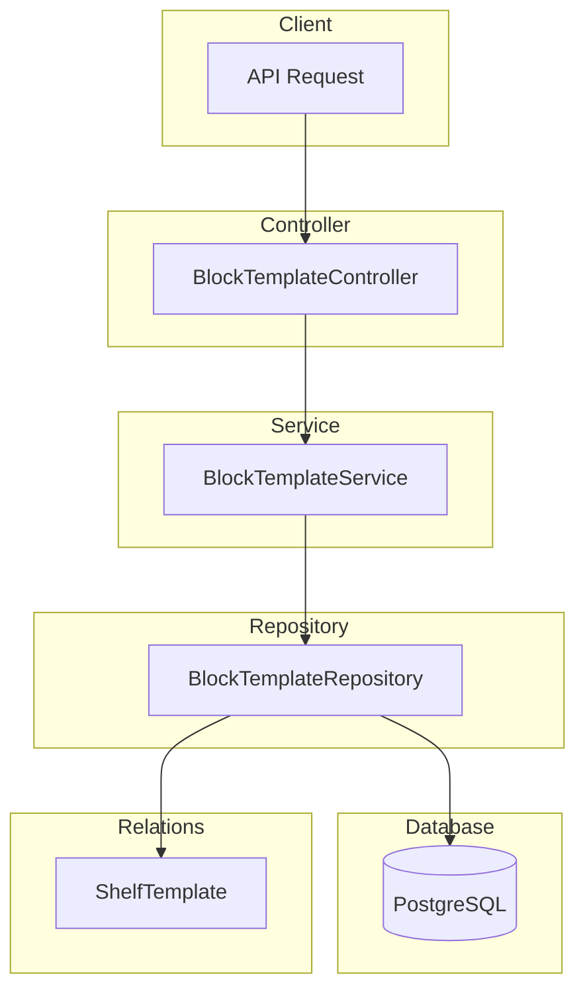

# Block Template Module Documentation

## Tổng Quan

Module `block-template` quản lý các ô (blocks) trong tầng kệ của template kho hàng. Ô là đơn vị nhỏ nhất trong cấu trúc kho hàng, là nơi chứa hàng hóa trực tiếp.

**Cấu trúc phân cấp:**

```
Warehouse Template → Row → Rack → Shelf → Block
(Kho)              (Dãy) (Kệ)  (Tầng)  (Ô)
```

---

## Kiến Trúc



---

## API Endpoints

> [!TIP]
> Tất cả các API đều hỗ trợ header `Accept-Language` để chọn ngôn ngữ phản hồi.
>
> - **vi** - Tiếng Việt (mặc định)
> - **en** - English

Base URL: `/warehouse-templates/:warehouseTemplateId/rows/:rowId/racks/:rackId/shelves/:shelfId/blocks`

### 1. POST / - Tạo ô mới

**Mô tả:** Tạo một ô mới trong tầng kệ với đầy đủ thông tin bao gồm vị trí, sức chứa, chiều cao.

**Xác thực:** Bearer Token (JWT)

**Quyền yêu cầu:** `block-template.create`

**Headers:**

```http
Authorization: Bearer <access_token>
Content-Type: application/json
Accept-Language: vi
```

**Request Body Schema:**

| Field                 | Type    | Required | Description                          |
| --------------------- | ------- | -------- | ------------------------------------ |
| `name`                | string  | ✅       | Tên ô (max 255 ký tự)                |
| `code`                | string  | ✅       | Mã ô (max 50 ký tự, unique)          |
| `description`         | string  | Optional | Mô tả ô                              |
| `max_weight_capacity` | number  | Optional | Khả năng chịu tải tối đa (kg)        |
| `height`              | number  | Optional | Chiều cao (cm)                       |
| `position_x`          | number  | Optional | Vị trí X trên layout                 |
| `position_y`          | number  | Optional | Vị trí Y trên layout                 |
| `is_active`           | boolean | Optional | Trạng thái hoạt động (default: true) |

**Request Body Examples:**

<details>
<summary><b>Ví dụ 1: Ô cơ bản</b></summary>

```json
{
  "name": "Ô 1",
  "code": "BLOCK-1"
}
```

</details>

<details>
<summary><b>Ví dụ 2: Ô đầy đủ thông tin</b></summary>

```json
{
  "name": "Ô Premium A1",
  "code": "BLOCK-PREM-A1",
  "description": "Ô chứa hàng cao cấp, kiểm soát nhiệt độ",
  "max_weight_capacity": 500,
  "height": 120,
  "position_x": 10,
  "position_y": 5,
  "is_active": true
}
```

</details>

**Response (201 Created):**

```json
{
  "code": "block-template.success.created",
  "message": "Tạo ô thành công",
  "success": true,
  "data": {
    "id": "550e8400-e29b-41d4-a716-446655440099",
    "name": "Ô 1",
    "code": "BLOCK-1",
    "description": null,
    "max_weight_capacity": null,
    "height": null,
    "position_x": null,
    "position_y": null,
    "is_active": true,
    "shelf_template_id": "550e8400-e29b-41d4-a716-446655440003",
    "created_at": "2026-01-24T00:00:00.000Z",
    "updated_at": "2026-01-24T00:00:00.000Z"
  }
}
```

**Error Responses:**

<details>
<summary><b>404 Not Found - Tầng không tồn tại</b></summary>

```json
{
  "code": "block-template.errors.shelf_template_not_found",
  "message": "Không tìm thấy tầng",
  "success": false
}
```

</details>

<details>
<summary><b>409 Conflict - Mã ô đã tồn tại</b></summary>

```json
{
  "code": "block-template.errors.code_exists",
  "message": "Mã ô đã tồn tại trong tầng này",
  "success": false
}
```

</details>

<details>
<summary><b>401 Unauthorized</b></summary>

```json
// Không có token
{
  "code": "error.unauthorized.token_missing",
  "message": "Không có quyền truy cập",
  "success": false
}

// Token hết hạn
{
  "code": "error.unauthorized.token_expired",
  "message": "Token đã hết hạn",
  "success": false
}
```

</details>

<details>
<summary><b>403 Forbidden</b></summary>

```json
{
  "code": "error.forbidden.no_permission",
  "message": "Không có quyền thực hiện thao tác này",
  "success": false
}
```

</details>

<details>
<summary><b>422 Unprocessable Entity</b></summary>

```json
{
  "code": "error.validation",
  "message": "Dữ liệu đầu vào không hợp lệ",
  "success": false,
  "errors": [
    { "field": "name", "message": "Tên ô không được để trống" },
    { "field": "code", "message": "Mã ô không được để trống" }
  ]
}
```

</details>

---

### 2. GET / - Lấy danh sách ô

**Mô tả:** Lấy danh sách các ô trong tầng kệ có hỗ trợ phân trang và lọc.

**Xác thực:** Bearer Token (JWT)

**Quyền yêu cầu:** `block-template.list`

**Query Parameters:**

| Param       | Type    | Default | Description                       |
| ----------- | ------- | ------- | --------------------------------- |
| `limit`     | number  | 10      | Số lượng bản ghi tối đa           |
| `offset`    | number  | 0       | Số bản ghi bỏ qua                 |
| `keywords`  | string  | -       | Từ khóa tìm kiếm (tên, mã, mô tả) |
| `is_active` | boolean | -       | Lọc theo trạng thái hoạt động     |

**Request:**

```http
GET /warehouse-templates/550e8400-e29b-41d4-a716-446655440000/rows/550e8400-e29b-41d4-a716-446655440001/racks/550e8400-e29b-41d4-a716-446655440002/shelves/550e8400-e29b-41d4-a716-446655440003/blocks?limit=10&offset=0&is_active=true HTTP/1.1
Host: api.gen-hub.dev
Authorization: Bearer <access_token>
Accept-Language: vi
```

**Response (200 OK):**

```json
{
  "code": "block-template.success.fetched",
  "message": "Lấy dữ liệu ô thành công",
  "success": true,
  "data": {
    "items": [
      {
        "id": "550e8400-e29b-41d4-a716-446655440099",
        "name": "Ô 1",
        "code": "BLOCK-1",
        "description": null,
        "max_weight_capacity": 500,
        "height": 120,
        "is_active": true
      },
      {
        "id": "550e8400-e29b-41d4-a716-446655440098",
        "name": "Ô 2",
        "code": "BLOCK-2",
        "description": "Ô chứa hàng nhẹ",
        "max_weight_capacity": 300,
        "height": 100,
        "is_active": true
      }
    ],
    "total": 50,
    "limit": 10,
    "offset": 0
  }
}
```

---

### 3. GET /:id - Lấy chi tiết ô

**Mô tả:** Lấy thông tin chi tiết của một ô trong tầng kệ.

**Xác thực:** Bearer Token (JWT)

**Quyền yêu cầu:** `block-template.read`

**Request:**

```http
GET /warehouse-templates/550e8400-e29b-41d4-a716-446655440000/rows/550e8400-e29b-41d4-a716-446655440001/racks/550e8400-e29b-41d4-a716-446655440002/shelves/550e8400-e29b-41d4-a716-446655440003/blocks/550e8400-e29b-41d4-a716-446655440099 HTTP/1.1
Host: api.gen-hub.dev
Authorization: Bearer <access_token>
Accept-Language: vi
```

**Response (200 OK):**

```json
{
  "code": "block-template.success.fetched",
  "message": "Lấy dữ liệu ô thành công",
  "success": true,
  "data": {
    "id": "550e8400-e29b-41d4-a716-446655440099",
    "name": "Ô 1",
    "code": "BLOCK-1",
    "description": "Ô chứa hàng cao cấp",
    "max_weight_capacity": 500,
    "height": 120,
    "position_x": 10,
    "position_y": 5,
    "is_active": true,
    "shelf_template_id": "550e8400-e29b-41d4-a716-446655440003",
    "created_at": "2026-01-24T00:00:00.000Z",
    "updated_at": "2026-01-24T00:00:00.000Z"
  }
}
```

**Error Responses:**

<details>
<summary><b>404 Not Found</b></summary>

```json
{
  "code": "block-template.errors.not_found",
  "message": "Không tìm thấy ô",
  "success": false
}
```

</details>

---

### 4. PUT /:id - Cập nhật ô

**Mô tả:** Cập nhật một phần hoặc toàn bộ thông tin của ô. Chỉ các trường được gửi trong request body mới được cập nhật.

**Xác thực:** Bearer Token (JWT)

**Quyền yêu cầu:** `block-template.update`

**Request Body Examples:**

<details>
<summary><b>Cập nhật thông tin cơ bản</b></summary>

```json
{
  "name": "Ô 1 (Updated)",
  "description": "Mô tả cập nhật"
}
```

</details>

<details>
<summary><b>Cập nhật sức chứa</b></summary>

```json
{
  "max_weight_capacity": 750,
  "height": 150
}
```

</details>

<details>
<summary><b>Cập nhật vị trí</b></summary>

```json
{
  "position_x": 15,
  "position_y": 8
}
```

</details>

<details>
<summary><b>Thay đổi trạng thái</b></summary>

```json
{
  "is_active": false
}
```

</details>

**Response (200 OK):**

```json
{
  "code": "block-template.success.updated",
  "message": "Cập nhật ô thành công",
  "success": true,
  "data": {
    "id": "550e8400-e29b-41d4-a716-446655440099",
    "name": "Ô 1 (Updated)",
    "code": "BLOCK-1",
    "description": "Mô tả cập nhật",
    "max_weight_capacity": 750,
    "height": 150,
    "position_x": 15,
    "position_y": 8,
    "is_active": true,
    "updated_at": "2026-01-24T00:00:00.000Z"
  }
}
```

---

### 5. DELETE /delete/many - Xóa nhiều ô

**Mô tả:** Xóa mềm nhiều ô cùng lúc.

**Xác thực:** Bearer Token (JWT)

**Quyền yêu cầu:** `block-template.delete`

**Request:**

```http
DELETE /warehouse-templates/.../blocks/delete/many HTTP/1.1
Host: api.gen-hub.dev
Authorization: Bearer <access_token>
Content-Type: application/json
Accept-Language: vi

{
  "ids": [
    "550e8400-e29b-41d4-a716-446655440099",
    "550e8400-e29b-41d4-a716-446655440098"
  ]
}
```

**Response (200 OK):**

```json
{
  "code": "block-template.success.deleted",
  "message": "Xóa ô thành công",
  "success": true,
  "data": null
}
```

---

### 6. DELETE /:id - Xóa ô

**Mô tả:** Xóa mềm một ô.

**Xác thực:** Bearer Token (JWT)

**Quyền yêu cầu:** `block-template.delete`

**Request:**

```http
DELETE /warehouse-templates/.../blocks/550e8400-e29b-41d4-a716-446655440099 HTTP/1.1
Host: api.gen-hub.dev
Authorization: Bearer <access_token>
Accept-Language: vi
```

**Response (200 OK):**

```json
{
  "code": "block-template.success.deleted",
  "message": "Xóa ô thành công",
  "success": true,
  "data": null
}
```

---

## Quyền (Permissions)

| Permission Key          | Description     |
| ----------------------- | --------------- |
| `block-template.create` | Tạo ô mới       |
| `block-template.list`   | Xem danh sách ô |
| `block-template.read`   | Xem chi tiết ô  |
| `block-template.update` | Cập nhật ô      |
| `block-template.delete` | Xóa ô           |

---

## Validation Rules

### Tên ô (name)

- Bắt buộc
- Phải là chuỗi
- Tối đa 255 ký tự

### Mã ô (code)

- Bắt buộc
- Phải là chuỗi
- Tối đa 50 ký tự
- Unique trong cùng tầng kệ

### Khả năng chịu tải (max_weight_capacity)

- Phải là số
- Giá trị >= 0

### Chiều cao (height)

- Phải là số
- Giá trị >= 0

---

## Files Trong Module

| File                               | Mô tả                          |
| ---------------------------------- | ------------------------------ |
| `block-template.controller.ts`     | Controller xử lý HTTP requests |
| `block-template.service.ts`        | Business logic                 |
| `block-template.repository.ts`     | Data access layer              |
| `block-template.module.ts`         | Module definition              |
| `dto/create-block-template.dto.ts` | DTO tạo mới ô                  |
| `dto/update-block-template.dto.ts` | DTO cập nhật ô                 |
| `dto/query-block-template.dto.ts`  | DTO query với filters          |

---

## I18n Keys

### Success Messages

- `block-template.success.created` - Tạo ô thành công
- `block-template.success.updated` - Cập nhật ô thành công
- `block-template.success.deleted` - Xóa ô thành công
- `block-template.success.fetched` - Lấy dữ liệu ô thành công

### Error Messages

- `block-template.errors.not_found` - Không tìm thấy ô
- `block-template.errors.shelf_template_not_found` - Không tìm thấy tầng
- `block-template.errors.code_exists` - Mã ô đã tồn tại trong tầng này
- `block-template.errors.create_failed` - Không thể tạo ô
- `block-template.errors.update_failed` - Không thể cập nhật ô
- `block-template.errors.delete_failed` - Không thể xóa ô
- `block-template.errors.position_out_of_bounds` - Vị trí ô vượt quá giới hạn kho

### Validation Messages

- `block-template.validation.name_required` - Tên ô không được để trống
- `block-template.validation.name_string` - Tên ô phải là chuỗi
- `block-template.validation.name_max_length` - Tên ô không được quá 255 ký tự
- `block-template.validation.code_required` - Mã ô không được để trống
- `block-template.validation.code_string` - Mã ô phải là chuỗi
- `block-template.validation.code_max_length` - Mã ô không được quá 50 ký tự
- `block-template.validation.description_string` - Mô tả phải là chuỗi
- `block-template.validation.max_weight_capacity_number` - Khả năng chịu tải tối đa phải là số
- `block-template.validation.max_weight_capacity_min` - Khả năng chịu tải tối đa phải >= 0
- `block-template.validation.height_number` - Chiều cao phải là số
- `block-template.validation.height_min` - Chiều cao phải >= 0
- `block-template.validation.is_active_boolean` - Trạng thái active phải là boolean
