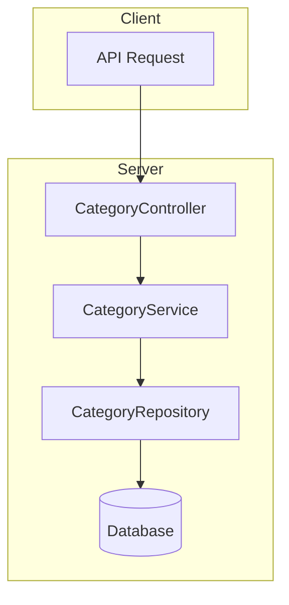

# Category Module Documentation

## Tổng Quan

Module `category` quản lý hệ thống phân loại (categories/topics) cho bài viết trong GEN-HUB.

Module này cung cấp các tính năng:
- **Quản lý danh mục**: CRUD danh mục, phân cấp (parent/child).
- **Trạng thái**: Kích hoạt/Vô hiệu hóa danh mục.
- **Multilingual**: Hỗ trợ đa ngôn ngữ cho tên và mô tả danh mục (thông qua `I18nLang`).

---

## Kiến Trúc



---

## API Endpoints

| Method | Endpoint | Mô tả | Auth | Quyền |
|:---:|:---|:---|:---:|:---|
| `POST` | `/categories` | Tạo danh mục mới | ✅ | `category.create` |
| `GET` | `/categories` | Lấy danh sách danh mục (Admin - Filter/Pagination) | ✅ | `category.list` |
| `GET` | `/categories/active` | Lấy danh mục đang hoạt động (Tree view) | ❌ | - |
| `GET` | `/categories/:id` | Lấy chi tiết danh mục | ✅ | `category.read` |
| `PUT` | `/categories/:id` | Cập nhật danh mục | ✅ | `category.update` |
| `DELETE` | `/categories/:id` | Xóa danh mục (Soft delete) | ✅ | `category.delete` |
| `DELETE` | `/categories/delete/many` | Xóa nhiều danh mục | ✅ | `category.delete` |

*(Chú thích: ✅ - Yêu cầu Auth, ❌ - Public)*

---

## Chi Tiết Request Body

### 1. CreateCategoryDto

```json
{
  "name": "Công nghệ",
  "slug": "cong-nghe", // Optional, will be generated from name if empty
  "description": "Tin tức công nghệ mới nhất",
  "parent_id": null, // UUID hoặc null
  "order": 1, // Thứ tự hiển thị
  "is_active": true
}
```

### 2. UpdateCategoryDto

```json
{
  "name": "Công nghệ (Updated)",
  "slug": "cong-nghe-updated",
  "parent_id": "uuid-parent"
}
```

### 3. QueryCategoryDto (Query Params)

- `limit`: Số lượng item (Default: 10)
- `offset`: Vị trí bắt đầu (Default: 0)
- `keywords`: Tìm kiếm theo tên hoặc slug
- `is_active`: Lọc theo trạng thái (true/false)

---

## Data Structure Example

### Category Tree Structure (GET /categories/active)

```json
[
  {
    "id": "uuid-root-1",
    "name": "Công nghệ",
    "slug": "cong-nghe",
    "children": [
      {
        "id": "uuid-child-1",
        "name": "NodeJS",
        "slug": "nodejs",
        "parent_id": "uuid-root-1"
      }
    ]
  }
]
```

## Validation Rules

- **Name**: Bắt buộc, tối đa 255 ký tự.
- **Slug**: Unique, format slug (a-z, 0-9, -).
- **Parent ID**: Phải là UUID hợp lệ và tồn tại. Không được circular dependency (A là cha của B, B là cha của A).
- **Is Active**: Boolean.
