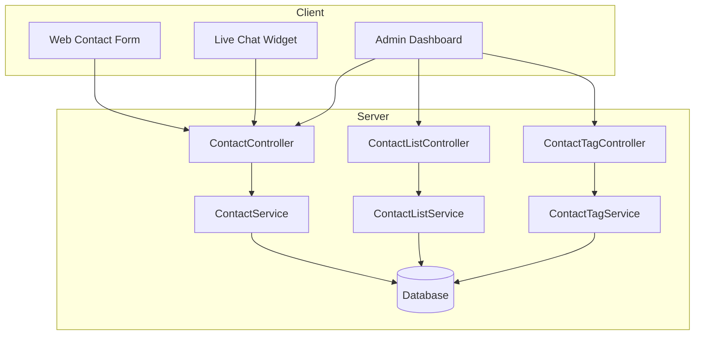

# Contact Module Documentation

## Tổng Quan

Module `contact` cung cấp giải pháp toàn diện cho việc quản lý liên hệ và hỗ trợ khách hàng (Customer Support) trong GEN-HUB.

Hệ thống bao gồm 3 phân hệ chính:
1.  **Contact (Tickets & Chat)**: Quản lý yêu cầu hỗ trợ qua form và Live Chat thời gian thực.
2.  **Contact List (Filtering)**: Filter/Firewall chặn hoặc cho phép (Blacklist/Whitelist) dựa trên Email, Domain, IP, Location.
3.  **Contact Tags**: Hệ thống nhãn dán để phân loại và quản lý ticket hiệu quả.

---

## Kiến Trúc



---

## 1. Contact API (Tickets & Chat)

### Public Endpoints

| Method | Endpoint | Mô tả |
|:---:|:---|:---|
| `POST` | `/contact` | Gửi yêu cầu liên hệ từ form |
| `POST` | `/contact/chat/start` | Bắt đầu phiên Live Chat (Guest) |
| `POST` | `/contact/chat/:sessionId/message` | Gửi tin nhắn trong phiên Chat |
| `GET` | `/contact/chat/:sessionId` | Lấy lịch sử đoạn chat |

### Admin Endpoints

| Method | Endpoint | Mô tả | Quyền |
|:---:|:---|:---|:---:|
| `GET` | `/admin/contacts` | Danh sách Ticket (Filter nâng cao) | `contact.list` |
| `GET` | `/admin/contacts/priority` | Danh sách Ticket ưu tiên | `contact.list` |
| `GET` | `/admin/contacts/skipped` | Danh sách Ticket Spam/Skipped | `contact.list` |
| `GET` | `/admin/contacts/:id` | Chi tiết Ticket | `contact.read` |
| `GET` | `/admin/contacts/:id/messages` | Nội dung trao đổi của Ticket | `contact.read` |
| `PATCH` | `/admin/contacts/:id` | Cập nhật Ticket (Status, Assign) | `contact.update` |
| `POST` | `/admin/contacts/:id/reply` | Staff trả lời Ticket (Gửi mail) | `contact.reply` |
| `POST` | `/admin/contacts/:id/close` | Đóng Ticket | `contact.update` |
| `POST` | `/admin/contacts/:id/reopen` | Mở lại Ticket | `contact.update` |
| `DELETE` | `/admin/contacts/:id` | Xóa Ticket | `contact.delete` |

---

## 2. Contact List API (Blacklist/Whitelist)

Quản lý danh sách chặn/cho phép để lọc spam hoặc ưu tiên khách hàng VIP.

| Method | Endpoint | Mô tả | Quyền |
|:---:|:---|:---|:---:|
| `GET` | `/admin/contact-list` | Danh sách quy tắc | `contact-list.list` |
| `POST` | `/admin/contact-list` | Tạo quy tắc thủ công | `contact-list.create` |
| `*` | `/admin/contact-list/email/*` | Quick Action cho Email | `contact-list.create` |
| `*` | `/admin/contact-list/domain/*` | Quick Action cho Domain | `contact-list.create` |
| `*` | `/admin/contact-list/ip/*` | Quick Action cho IP | `contact-list.create` |
| `*` | `/admin/contact-list/region/*` | Quick Action cho Location | `contact-list.create` |

---

## 3. Contact Tags API

Quản lý nhãn dán cho ticket (Ví dụ: VIP, Bug, Feature Request).

| Method | Endpoint | Mô tả | Quyền |
|:---:|:---|:---|:---:|
| `GET` | `/admin/contact-tags` | Danh sách Tag | `contact-tag.list` |
| `POST` | `/admin/contact-tags` | Tạo Tag mới | `contact-tag.create` |
| `PUT` | `/admin/contact-tags/:id` | Cập nhật Tag | `contact-tag.update` |
| `DELETE` | `/admin/contact-tags/:id` | Xóa Tag | `contact-tag.delete` |

---

## Data Structures

### CreateContactDto

```json
{
  "name": "Guest Name",
  "email": "user@example.com",
  "phone": "0912345678",
  "subject": "Cần hỗ trợ thanh toán",
  "message": "Tôi không thể thanh toán qua Visa...",
  "type": "SUPPORT" // SUPPORT, SALES, PARTNERSHIP
}
```

### StartChatDto

```json
{
  "name": "Guest",
  "email": "guest@gmail.com",
  "connect_agent_id": null // Optional: Yêu cầu chat với agent cụ thể
}
```

### ReplyContactDto

```json
{
  "message": "Chào bạn, chúng tôi đã kiểm tra...",
  "attachments": ["url1", "url2"],
  "cc": ["manager@example.com"],
  "bcc": []
}
```

---

## Validation & Rules

1.  **Anti-Spam**:
    *   Hệ thống tự động kiểm tra Email/IP/Domain với Blacklist trước khi tạo Ticket.
    *   Nếu bị chặn -> Ticket có thể bị từ chối hoặc đánh dấu `is_skipped`.

2.  **Live Chat**:
    *   Session ID (UUID) được tạo khi bắt đầu chat.
    *   Sử dụng Token để xác thực Guest khi gửi tin nhắn tiếp theo.

3.  **Tags**:
    *   Màu sắc tag nên dùng mã HEX (VD: #FF0000).
