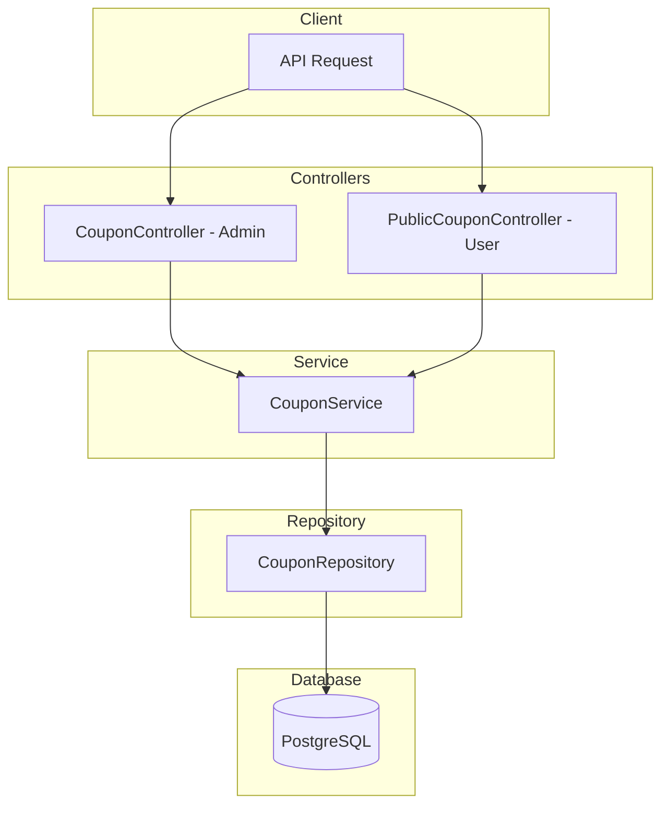

# Coupon Module Documentation

## Tổng Quan

Module `coupon` quản lý hệ thống mã giảm giá cho ứng dụng GEN-HUB. Hỗ trợ nhiều loại giảm giá (phần trăm, số tiền cố định, tháng miễn phí) với các điều kiện áp dụng linh hoạt.

### Tính năng chính:

- **Giảm giá linh hoạt**: Theo phần trăm, số tiền cố định, hoặc tháng miễn phí
- **Điều kiện đa dạng**: Số kho tối thiểu, giá trị đơn hàng, thời gian thuê
- **Target cụ thể**: Áp dụng cho kho, row, addon, bảo hiểm hoặc user cụ thể
- **Tặng kèm**: Hỗ trợ tặng addon/bảo hiểm khi sử dụng coupon
- **Lưu coupon**: User có thể lưu coupon để sử dụng sau

---

## Kiến Trúc



---

## API Endpoints

> [!TIP]
> Tất cả các API đều hỗ trợ header `Accept-Language` để chọn ngôn ngữ phản hồi.
>
> - **vi** - Tiếng Việt (mặc định)
> - **en** - English

---

## Admin APIs (`/coupons`)

### 1. POST /coupons - Tạo coupon mới

**Mô tả:** Tạo mã giảm giá mới với các điều kiện áp dụng.

**Xác thực:** Bearer Token (JWT)

**Quyền yêu cầu:** `coupon.create`

**Request Body Schema:**

| Field                         | Type     | Required | Description                           |
| ----------------------------- | -------- | -------- | ------------------------------------- |
| `name`                        | string   | ✅       | Tên coupon (max 255 ký tự)            |
| `code`                        | string   | ✅       | Mã coupon (max 50 ký tự, unique)      |
| `discount_type`               | enum     | ✅       | PERCENT, AMOUNT, FREE_MONTHS          |
| `discount_value`              | number   | ✅       | Giá trị giảm                          |
| `coupon_type`                 | enum     | ❌       | PUBLIC (mặc định), PRIVATE            |
| `description`                 | string   | ❌       | Mô tả                                 |
| `is_unlimited_discount`       | boolean  | ❌       | Không giới hạn giảm giá (PERCENT)     |
| `max_discount_amount`         | number   | ❌       | Giá trị giảm tối đa (PERCENT)         |
| `require_min_warehouses`      | boolean  | ❌       | Yêu cầu số kho tối thiểu              |
| `min_warehouses`              | number   | ❌       | Số kho tối thiểu                      |
| `require_min_rows`            | boolean  | ❌       | Yêu cầu số row tối thiểu              |
| `min_rows`                    | number   | ❌       | Số row tối thiểu                      |
| `require_min_order_amount`    | boolean  | ❌       | Yêu cầu giá trị đơn tối thiểu         |
| `min_order_amount`            | number   | ❌       | Giá trị đơn tối thiểu                 |
| `require_min_rental_duration` | boolean  | ❌       | Yêu cầu thời gian thuê tối thiểu      |
| `min_rental_duration_value`   | number   | ❌       | Giá trị thời gian thuê tối thiểu      |
| `min_rental_duration_unit`    | enum     | ❌       | HOUR, DAY, WEEK, MONTH, YEAR          |
| `is_permanent`                | boolean  | ❌       | Coupon vĩnh viễn                      |
| `starts_at`                   | datetime | ❌       | Thời gian bắt đầu                     |
| `ends_at`                     | datetime | ❌       | Thời gian kết thúc                    |
| `max_usage`                   | number   | ❌       | Số lượng tối đa (0 = không giới hạn)  |
| `is_public`                   | boolean  | ❌       | Coupon công khai                      |
| `apply_for_first_rental`      | boolean  | ❌       | Áp dụng cho thuê lần đầu              |
| `apply_for_renewal`           | boolean  | ❌       | Áp dụng cho gia hạn                   |
| `apply_for_all_warehouses`    | boolean  | ❌       | Áp dụng cho tất cả kho                |
| `apply_for_all_rows`          | boolean  | ❌       | Áp dụng cho tất cả row                |
| `apply_for_all_addons`        | boolean  | ❌       | Áp dụng cho tất cả addon              |
| `apply_for_all_insurances`    | boolean  | ❌       | Áp dụng cho tất cả bảo hiểm           |
| `target_user_ids`             | string[] | ❌       | Danh sách user được áp dụng (PRIVATE) |
| `target_warehouse_ids`        | string[] | ❌       | Danh sách kho được áp dụng            |
| `target_row_ids`              | string[] | ❌       | Danh sách row được áp dụng            |
| `target_addon_ids`            | string[] | ❌       | Danh sách addon được áp dụng          |
| `target_insurance_ids`        | string[] | ❌       | Danh sách bảo hiểm được áp dụng       |
| `is_unlimited_stack`          | boolean  | ❌       | Có thể stack vô hạn coupon khác       |
| `max_stack_count`             | number   | ❌       | Số coupon tối đa có thể stack         |
| `has_gift_addons`             | boolean  | ❌       | Có tặng kèm addon                     |
| `gift_addon_ids`              | string[] | ❌       | Danh sách addon tặng kèm              |
| `has_gift_insurances`         | boolean  | ❌       | Có tặng kèm bảo hiểm                  |
| `gift_insurance_ids`          | string[] | ❌       | Danh sách bảo hiểm tặng kèm           |
| `is_active`                   | boolean  | ❌       | Trạng thái hoạt động                  |

**Request Examples:**

<details>
<summary><b>Ví dụ 1: Giảm giá theo phần trăm</b></summary>

```json
{
  "name": "Khuyến mãi Tết 2025",
  "description": "Giảm 20% cho đơn hàng đầu tiên",
  "code": "TET2025",
  "discount_type": "PERCENT",
  "discount_value": 20,
  "is_unlimited_discount": false,
  "max_discount_amount": 500000,
  "is_permanent": false,
  "starts_at": "2025-01-01T00:00:00.000Z",
  "ends_at": "2025-02-28T23:59:59.999Z",
  "max_usage": 100,
  "is_public": true,
  "is_active": true
}
```

</details>

<details>
<summary><b>Ví dụ 2: Giảm số tiền cố định</b></summary>

```json
{
  "name": "Ưu đãi cuối tuần",
  "code": "WEEKEND200K",
  "discount_type": "AMOUNT",
  "discount_value": 200000,
  "require_min_order_amount": true,
  "min_order_amount": 1000000,
  "is_public": true,
  "is_active": true
}
```

</details>

<details>
<summary><b>Ví dụ 3: Coupon riêng tư cho VIP</b></summary>

```json
{
  "name": "VIP Customer Discount",
  "code": "VIP50",
  "coupon_type": "PRIVATE",
  "discount_type": "PERCENT",
  "discount_value": 50,
  "is_unlimited_discount": true,
  "is_permanent": true,
  "target_user_ids": ["550e8400-e29b-41d4-a716-446655440000"],
  "is_active": true
}
```

</details>

**Response (201 Created):**

```json
{
  "code": "coupon.create.success",
  "message": "Tạo coupon thành công",
  "success": true,
  "data": {
    "id": "550e8400-e29b-41d4-a716-446655440000",
    "name": "Khuyến mãi Tết 2025",
    "code": "TET2025",
    "discount_type": "PERCENT",
    "discount_value": 20,
    "is_active": true,
    "created_at": "2025-01-01T00:00:00.000Z"
  }
}
```

---

### 2. GET /coupons - Lấy danh sách coupon

**Mô tả:** Lấy danh sách tất cả coupon với phân trang và bộ lọc.

**Xác thực:** Bearer Token (JWT)

**Quyền yêu cầu:** `coupon.list`

**Query Parameters:**

| Parameter   | Type    | Description                        |
| ----------- | ------- | ---------------------------------- |
| `limit`     | number  | Số bản ghi mỗi trang (default: 10) |
| `offset`    | number  | Vị trí bắt đầu (default: 0)        |
| `keywords`  | string  | Từ khóa tìm kiếm (tên, mã coupon)  |
| `is_active` | boolean | Lọc theo trạng thái hoạt động      |
| `is_public` | boolean | Lọc theo trạng thái công khai      |

**Response (200 OK):**

```json
{
  "code": "coupon.list.success",
  "message": "Lấy danh sách coupon thành công",
  "success": true,
  "data": {
    "items": [
      {
        "id": "550e8400-e29b-41d4-a716-446655440000",
        "name": "Khuyến mãi Tết 2025",
        "code": "TET2025",
        "discount_type": "PERCENT",
        "discount_value": 20,
        "max_usage": 100,
        "current_usage": 25,
        "is_active": true,
        "starts_at": "2025-01-01T00:00:00.000Z",
        "ends_at": "2025-02-28T23:59:59.999Z"
      }
    ],
    "total": 50,
    "limit": 10,
    "offset": 0
  }
}
```

---

### 3. GET /coupons/:id - Lấy chi tiết coupon

**Mô tả:** Lấy thông tin chi tiết của một coupon theo ID.

**Xác thực:** Bearer Token (JWT)

**Quyền yêu cầu:** `coupon.read`

**Response (200 OK):** Trả về đầy đủ thông tin coupon bao gồm tất cả điều kiện và targets.

---

### 4. PUT /coupons/:id - Cập nhật coupon

**Mô tả:** Cập nhật thông tin coupon theo ID.

**Xác thực:** Bearer Token (JWT)

**Quyền yêu cầu:** `coupon.update`

**Request Body:** Tương tự CreateCouponDto, chỉ gửi các trường cần cập nhật.

---

### 5. DELETE /coupons/delete/many - Xóa nhiều coupon

**Mô tả:** Xóa nhiều coupon cùng lúc.

**Xác thực:** Bearer Token (JWT)

**Quyền yêu cầu:** `coupon.delete`

**Request Body:**

```json
{
  "ids": [
    "550e8400-e29b-41d4-a716-446655440001",
    "550e8400-e29b-41d4-a716-446655440002"
  ]
}
```

---

### 6. DELETE /coupons/:id - Xóa coupon

**Mô tả:** Xóa một coupon theo ID.

**Xác thực:** Bearer Token (JWT)

**Quyền yêu cầu:** `coupon.delete`

---

## Public APIs (`/public/coupons`)

### 1. GET /public/coupons - Lấy danh sách coupon công khai

**Mô tả:** Lấy danh sách các coupon đang hoạt động và công khai.

**Xác thực:** Không yêu cầu (Public)

**Query Parameters:**

| Parameter  | Type   | Description          |
| ---------- | ------ | -------------------- |
| `limit`    | number | Số bản ghi mỗi trang |
| `offset`   | number | Vị trí bắt đầu       |
| `keywords` | string | Từ khóa tìm kiếm     |

---

### 2. GET /public/coupons/saved - Lấy coupon đã lưu

**Mô tả:** Lấy danh sách các coupon mà user đã lưu.

**Xác thực:** Bearer Token (JWT)

---

### 3. POST /public/coupons/applicable - Lấy coupon có thể áp dụng

**Mô tả:** Kiểm tra và trả về danh sách các coupon có thể áp dụng cho đơn hàng.

**Xác thực:** Bearer Token (JWT)

**Request Body:**

```json
{
  "warehouse_template_ids": ["uuid"],
  "row_template_ids": ["uuid"],
  "addon_ids": ["uuid"],
  "rental_duration_tier_id": "uuid",
  "type": "NEW_CONTRACT"
}
```

---

### 4. POST /public/coupons/validate - Kiểm tra mã coupon

**Mô tả:** Kiểm tra một mã coupon cụ thể có thể áp dụng cho đơn hàng.

**Xác thực:** Bearer Token (JWT)

**Request Body:**

```json
{
  "code": "TET2025",
  "warehouse_template_ids": ["uuid"],
  "row_template_ids": ["uuid"],
  "rental_duration_tier_id": "uuid",
  "type": "NEW_CONTRACT"
}
```

**Response (200 OK - Valid):**

```json
{
  "code": "coupon.validate.success",
  "message": "Coupon hợp lệ",
  "success": true,
  "data": {
    "id": "550e8400-e29b-41d4-a716-446655440000",
    "name": "Khuyến mãi Tết 2025",
    "code": "TET2025",
    "discount_type": "PERCENT",
    "discount_value": 20,
    "estimated_discount": 200000,
    "is_valid": true
  }
}
```

**Response (200 OK - Invalid):**

```json
{
  "code": "coupon.validate.failed",
  "message": "Coupon đã hết hạn",
  "success": true,
  "data": {
    "is_valid": false,
    "error": "Coupon đã hết hạn",
    "error_code": "coupon.errors.expired"
  }
}
```

---

### 5. POST /public/coupons/:id/save - Lưu coupon

**Mô tả:** Lưu một coupon vào tài khoản để sử dụng sau.

**Xác thực:** Bearer Token (JWT)

---

### 6. DELETE /public/coupons/:id/save - Bỏ lưu coupon

**Mô tả:** Xóa coupon đã lưu khỏi danh sách.

**Xác thực:** Bearer Token (JWT)

---

## Error Responses

<details>
<summary><b>401 Unauthorized</b></summary>

```json
// Không có token
{
  "code": "error.unauthorized.token_missing",
  "message": "Không có quyền truy cập",
  "success": false
}

// Token hết hạn
{
  "code": "error.unauthorized.token_expired",
  "message": "Token đã hết hạn",
  "success": false
}
```

</details>

<details>
<summary><b>403 Forbidden</b></summary>

```json
{
  "code": "error.forbidden.no_permission",
  "message": "Không có quyền thực hiện thao tác này",
  "success": false
}
```

</details>

<details>
<summary><b>404 Not Found</b></summary>

```json
{
  "code": "coupon.errors.not_found",
  "message": "Không tìm thấy coupon",
  "success": false
}
```

</details>

<details>
<summary><b>409 Conflict</b></summary>

```json
// Mã coupon đã tồn tại
{
  "code": "coupon.errors.code_exists",
  "message": "Mã coupon đã tồn tại",
  "success": false
}

// Coupon đã được lưu
{
  "code": "coupon.errors.already_saved",
  "message": "Coupon đã được lưu",
  "success": false
}
```

</details>

<details>
<summary><b>422 Validation Error</b></summary>

```json
{
  "code": "error.validation",
  "message": "Dữ liệu đầu vào không hợp lệ",
  "success": false,
  "errors": [
    { "field": "code", "message": "Mã coupon không được để trống" },
    {
      "field": "discount_value",
      "message": "Giá trị giảm giá phải lớn hơn hoặc bằng 0"
    }
  ]
}
```

</details>

---

## Validation Rules

### Discount Types

- **PERCENT**: Giá trị từ 1-100, có thể set `max_discount_amount`
- **AMOUNT**: Giá trị số tiền cố định
- **FREE_MONTHS**: Số tháng miễn phí

### Conditional Requirements

- Khi `is_permanent = false`: phải có `starts_at` và `ends_at`
- Khi `require_min_warehouses = true`: phải có `min_warehouses`
- Khi `require_min_rental_duration = true`: phải có `min_rental_duration_value` và `min_rental_duration_unit`
- Khi `coupon_type = PRIVATE`: phải có `target_user_ids`
- Khi `apply_for_all_warehouses = false`: phải có `target_warehouse_ids`

---

## Files Trong Module

| File                                                                                                               | Mô tả                     |
| ------------------------------------------------------------------------------------------------------------------ | ------------------------- |
| [coupon.module.ts](file:///e:/STUDY/Demo/gen-hub/server/src/modules/coupon/coupon.module.ts)                       | NestJS module definition  |
| [coupon.controller.ts](file:///e:/STUDY/Demo/gen-hub/server/src/modules/coupon/coupon.controller.ts)               | Admin API endpoints       |
| [public-coupon.controller.ts](file:///e:/STUDY/Demo/gen-hub/server/src/modules/coupon/public-coupon.controller.ts) | Public/User API endpoints |
| [coupon.service.ts](file:///e:/STUDY/Demo/gen-hub/server/src/modules/coupon/coupon.service.ts)                     | Business logic            |
| [coupon.repository.ts](file:///e:/STUDY/Demo/gen-hub/server/src/modules/coupon/coupon.repository.ts)               | Database operations       |
| [dto/](file:///e:/STUDY/Demo/gen-hub/server/src/modules/coupon/dto)                                                | DTOs với validation       |

---

## Permissions

| Permission      | Mô tả                |
| --------------- | -------------------- |
| `coupon.create` | Tạo coupon mới       |
| `coupon.list`   | Xem danh sách coupon |
| `coupon.read`   | Xem chi tiết coupon  |
| `coupon.update` | Cập nhật coupon      |
| `coupon.delete` | Xóa coupon           |
