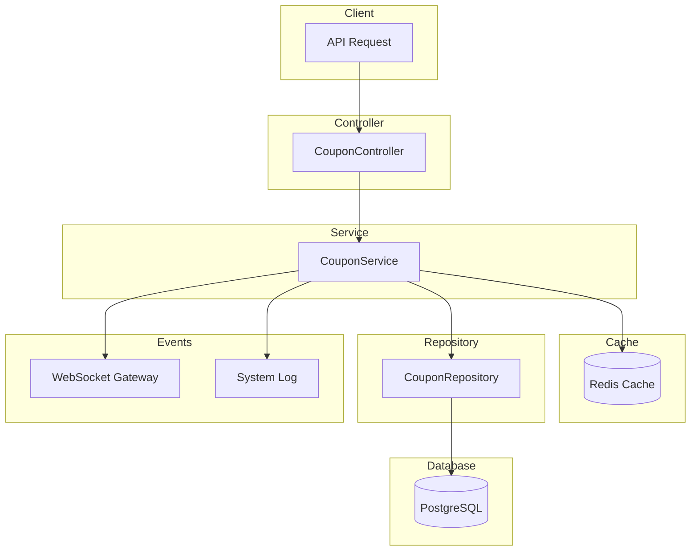

# Coupon Module Documentation

## Tổng Quan

Module `coupon` quản lý các mã giảm giá (coupon) trong hệ thống GEN-HUB. Module này cho phép admin tạo, quản lý và theo dõi các coupon với nhiều loại giảm giá khác nhau (phần trăm, số tiền cố định, tháng miễn phí) và các điều kiện áp dụng phức tạp.

Module sử dụng **Cache-Aside Pattern** với Redis để tối ưu hiệu năng và hỗ trợ WebSocket để thông báo realtime khi có thay đổi.

---

## Kiến Trúc



---

## API Endpoints

> [!TIP]
> Tất cả các API đều hỗ trợ header `Accept-Language` để chọn ngôn ngữ phản hồi.
> - **vi** - Tiếng Việt (mặc định)
> - **en** - English

### 1. POST /coupons - Tạo coupon mới

**Mô tả:** Tạo mã giảm giá mới với các điều kiện áp dụng. Hỗ trợ giảm giá theo phần trăm, số tiền cố định hoặc tháng miễn phí. Có thể cấu hình điều kiện sử dụng như số kho tối thiểu, thời gian thuê, giá trị đơn hàng.

**Xác thực:** Bearer Token (JWT)

**Quyền yêu cầu:** `coupon.create`

**Headers:**
```http
Authorization: Bearer <access_token>
Content-Type: application/json
Accept-Language: vi
```

**Request Body Schema:**

| Field | Type | Required | Description |
|-------|------|----------|-------------|
| `name` | string | Yes | Tên coupon (max 255 ký tự) |
| `description` | string | Optional | Mô tả coupon |
| `code` | string | Yes | Mã coupon (unique, max 50 ký tự) |
| `coupon_type` | enum | Optional | Loại coupon: `PUBLIC` hoặc `PRIVATE` (default: `PUBLIC`) |
| `discount_type` | enum | Yes | Loại giảm giá: `PERCENT`, `AMOUNT`, `FREE_MONTHS` |
| `discount_value` | number | Yes | Giá trị giảm giá (1-100 nếu PERCENT, >0 nếu AMOUNT/FREE_MONTHS) |
| `require_min_warehouses` | boolean | Optional | Yêu cầu số kho tối thiểu (default: false) |
| `min_warehouses` | number | Conditional | Số kho tối thiểu (required nếu `require_min_warehouses = true`) |
| `require_min_rows` | boolean | Optional | Yêu cầu số row tối thiểu (default: false) |
| `min_rows` | number | Conditional | Số row tối thiểu (required nếu `require_min_rows = true`) |
| `require_min_order_amount` | boolean | Optional | Yêu cầu đơn hàng tối thiểu (default: false) |
| `min_order_amount` | number | Conditional | Giá trị đơn hàng tối thiểu (required nếu `require_min_order_amount = true`) |
| `require_min_rental_duration` | boolean | Optional | Yêu cầu thời gian thuê tối thiểu (default: false) |
| `min_rental_duration_value` | number | Conditional | Giá trị thời gian thuê tối thiểu (required nếu `require_min_rental_duration = true`) |
| `min_rental_duration_unit` | enum | Conditional | Đơn vị: `HOUR`, `DAY`, `WEEK`, `MONTH`, `YEAR` (required nếu `require_min_rental_duration = true`) |
| `is_unlimited_discount` | boolean | Optional | Không giới hạn giảm giá (chỉ cho PERCENT, default: false) |
| `max_discount_amount` | number | Conditional | Giá trị giảm tối đa (required nếu `discount_type = PERCENT` và `is_unlimited_discount = false`) |
| `is_permanent` | boolean | Optional | Coupon vĩnh viễn (default: false) |
| `starts_at` | date-time | Conditional | Thời gian bắt đầu (required nếu `is_permanent = false`) |
| `ends_at` | date-time | Conditional | Thời gian kết thúc (required nếu `is_permanent = false`) |
| `max_usage` | number | Optional | Số lượng sử dụng tối đa (0 = không giới hạn, default: 0) |
| `is_public` | boolean | Optional | Coupon công khai (default: false) |
| `apply_for_first_rental` | boolean | Optional | Áp dụng cho thuê lần đầu (default: true) |
| `apply_for_renewal` | boolean | Optional | Áp dụng cho gia hạn (default: true) |
| `apply_for_all_warehouses` | boolean | Optional | Áp dụng cho tất cả kho (default: true) |
| `target_warehouse_ids` | array | Conditional | Danh sách ID warehouse template (required nếu `apply_for_all_warehouses = false`) |
| `apply_for_all_rows` | boolean | Optional | Áp dụng cho tất cả row (default: true) |
| `target_row_ids` | array | Conditional | Danh sách ID row template (required nếu `apply_for_all_rows = false`) |
| `apply_for_all_addons` | boolean | Optional | Áp dụng cho tất cả addon (default: true) |
| `target_addon_ids` | array | Conditional | Danh sách ID addon (required nếu `apply_for_all_addons = false`) |
| `apply_for_all_insurances` | boolean | Optional | Áp dụng cho tất cả bảo hiểm (default: true) |
| `target_insurance_ids` | array | Conditional | Danh sách ID bảo hiểm (required nếu `apply_for_all_insurances = false`) |
| `target_user_ids` | array | Conditional | Danh sách ID user (required nếu `coupon_type = PRIVATE`) |
| `is_unlimited_stack` | boolean | Optional | Có thể áp dụng chung với vô hạn coupon khác (default: false) |
| `max_stack_count` | number | Conditional | Số coupon tối đa có thể áp dụng chung (required nếu `is_unlimited_stack = false`) |
| `has_gift_addons` | boolean | Optional | Có tặng kèm addon (default: false) |
| `gift_addon_ids` | array | Conditional | Danh sách ID addon được tặng (required nếu `has_gift_addons = true`) |
| `has_gift_insurances` | boolean | Optional | Có tặng kèm bảo hiểm (default: false) |
| `gift_insurance_ids` | array | Conditional | Danh sách ID bảo hiểm được tặng (required nếu `has_gift_insurances = true`) |
| `is_active` | boolean | Optional | Trạng thái hoạt động (default: true) |

**Request Body Examples:**

<details>
<summary><b>Ví dụ 1: Giảm giá theo phần trăm</b></summary>

```json
{
  "name": "Khuyến mãi Tết 2025",
  "description": "Giảm 20% cho đơn hàng đầu tiên",
  "code": "TET2025",
  "discount_type": "PERCENT",
  "discount_value": 20,
  "is_unlimited_discount": false,
  "max_discount_amount": 500000,
  "is_permanent": false,
  "starts_at": "2025-01-01T00:00:00.000Z",
  "ends_at": "2025-02-28T23:59:59.999Z",
  "max_usage": 100,
  "is_public": true,
  "apply_for_first_rental": true,
  "apply_for_renewal": false,
  "apply_for_all_warehouses": true,
  "apply_for_all_rows": true,
  "apply_for_all_addons": true,
  "apply_for_all_insurances": true,
  "is_active": true
}
```
</details>

<details>
<summary><b>Ví dụ 2: Giảm số tiền cố định</b></summary>

```json
{
  "name": "Ưu đãi cuối tuần",
  "description": "Giảm 200.000đ cho đơn hàng từ 1.000.000đ",
  "code": "WEEKEND200K",
  "discount_type": "AMOUNT",
  "discount_value": 200000,
  "require_min_order_amount": true,
  "min_order_amount": 1000000,
  "is_permanent": false,
  "starts_at": "2025-01-01T00:00:00.000Z",
  "ends_at": "2025-12-31T23:59:59.999Z",
  "max_usage": 0,
  "is_public": true,
  "is_active": true
}
```
</details>

<details>
<summary><b>Ví dụ 3: Coupon riêng tư cho user cụ thể</b></summary>

```json
{
  "name": "VIP Customer Discount",
  "description": "Ưu đãi đặc biệt cho khách hàng VIP",
  "code": "VIP50",
  "coupon_type": "PRIVATE",
  "discount_type": "PERCENT",
  "discount_value": 50,
  "is_unlimited_discount": true,
  "is_permanent": true,
  "max_usage": 0,
  "is_public": false,
  "target_user_ids": ["550e8400-e29b-41d4-a716-446655440000"],
  "is_active": true
}
```
</details>

<details>
<summary><b>Ví dụ 4: Coupon với nhiều điều kiện</b></summary>

```json
{
  "name": "Ưu đãi thuê dài hạn",
  "description": "Giảm 30% cho thuê từ 6 tháng trở lên, ít nhất 2 kho",
  "code": "LONGTERM30",
  "discount_type": "PERCENT",
  "discount_value": 30,
  "is_unlimited_discount": false,
  "max_discount_amount": 1000000,
  "require_min_warehouses": true,
  "min_warehouses": 2,
  "require_min_rental_duration": true,
  "min_rental_duration_value": 6,
  "min_rental_duration_unit": "MONTH",
  "is_permanent": false,
  "starts_at": "2025-01-01T00:00:00.000Z",
  "ends_at": "2025-06-30T23:59:59.999Z",
  "is_public": true,
  "is_active": true
}
```
</details>

<details>
<summary><b>Ví dụ 5: Coupon tặng kèm addon</b></summary>

```json
{
  "name": "Tặng kèm bảo vệ",
  "description": "Thuê kho được tặng dịch vụ bảo vệ 24/7",
  "code": "FREEGUARD",
  "discount_type": "PERCENT",
  "discount_value": 0,
  "is_permanent": false,
  "starts_at": "2025-01-01T00:00:00.000Z",
  "ends_at": "2025-12-31T23:59:59.999Z",
  "has_gift_addons": true,
  "gift_addon_ids": ["550e8400-e29b-41d4-a716-446655440001"],
  "is_public": true,
  "is_active": true
}
```
</details>

**Response (201 Created):**

```json
{
  "code": "coupon.create.success",
  "message": "Tạo coupon thành công",
  "success": true,
  "data": {
    "id": "550e8400-e29b-41d4-a716-446655440000",
    "name": "Khuyến mãi Tết 2025",
    "description": "Giảm 20% cho đơn hàng đầu tiên",
    "code": "TET2025",
    "coupon_type": "PUBLIC",
    "discount_type": "PERCENT",
    "discount_value": 20,
    "require_min_warehouses": false,
    "min_warehouses": null,
    "require_min_rows": false,
    "min_rows": null,
    "require_min_order_amount": false,
    "min_order_amount": null,
    "require_min_rental_duration": false,
    "min_rental_duration_value": null,
    "min_rental_duration_unit": null,
    "is_unlimited_discount": false,
    "max_discount_amount": 500000,
    "is_permanent": false,
    "starts_at": "2025-01-01T00:00:00.000Z",
    "ends_at": "2025-02-28T23:59:59.999Z",
    "max_usage": 100,
    "current_usage": 0,
    "is_public": true,
    "apply_for_first_rental": true,
    "apply_for_renewal": false,
    "schedule_id": null,
    "is_active": true,
    "created_at": "2025-01-01T00:00:00.000Z",
    "updated_at": null,
    "created_by": "550e8400-e29b-41d4-a716-446655440099"
  }
}
```

**Error Responses:**

<details>
<summary><b>409 Conflict - Mã coupon đã tồn tại</b></summary>

```json
{
  "code": "coupon.errors.code_exists",
  "message": "Mã coupon đã tồn tại",
  "success": false
}
```
</details>

<details>
<summary><b>401 Unauthorized</b></summary>

Xem [Error Responses](#error-responses) chung
</details>

<details>
<summary><b>403 Forbidden</b></summary>

Xem [Error Responses](#error-responses) chung
</details>

<details>
<summary><b>422 Unprocessable Entity - Validation Error</b></summary>

```json
{
  "code": "error.validation",
  "message": "Dữ liệu đầu vào không hợp lệ",
  "success": false,
  "errors": [
    { "field": "code", "message": "Mã coupon đã tồn tại" },
    { "field": "discount_value", "message": "Giá trị giảm giá phải từ 1 đến 100 cho loại PERCENT" }
  ]
}
```
</details>

---

### 2. GET /coupons - Lấy danh sách coupon (Admin)

**Mô tả:** Lấy danh sách tất cả coupon với phân trang và bộ lọc. Hỗ trợ tìm kiếm theo tên, mã coupon và lọc theo trạng thái.

**Xác thực:** Bearer Token (JWT)

**Quyền yêu cầu:** `coupon.list`

**Headers:**
```http
Authorization: Bearer <access_token>
Accept-Language: vi
```

**Query Parameters:**

| Parameter | Type | Required | Description |
|-----------|------|----------|-------------|
| `limit` | number | Optional | Số lượng bản ghi mỗi trang (default: 10, min: 1) |
| `offset` | number | Optional | Vị trí bắt đầu (default: 0, min: 0) |
| `keywords` | string | Optional | Từ khóa tìm kiếm (tên, mô tả, mã coupon) |
| `is_active` | boolean | Optional | Lọc theo trạng thái hoạt động |
| `is_public` | boolean | Optional | Lọc theo trạng thái công khai |

**Response (200 OK):**

```json
{
  "code": "coupon.list.success",
  "message": "Lấy danh sách coupon thành công",
  "success": true,
  "data": {
    "items": [
      {
        "id": "550e8400-e29b-41d4-a716-446655440000",
        "name": "Khuyến mãi Tết 2025",
        "description": "Giảm 20% cho đơn hàng đầu tiên",
        "code": "TET2025",
        "coupon_type": "PUBLIC",
        "discount_type": "PERCENT",
        "discount_value": 20,
        "max_discount_amount": 500000,
        "max_usage": 100,
        "current_usage": 25,
        "is_public": true,
        "is_active": true,
        "starts_at": "2025-01-01T00:00:00.000Z",
        "ends_at": "2025-02-28T23:59:59.999Z",
        "created_at": "2025-01-01T00:00:00.000Z"
      }
    ],
    "total": 50,
    "limit": 10,
    "offset": 0,
    "hasMore": true
  }
}
```

**Error Responses:**

<details>
<summary><b>401 Unauthorized</b></summary>

Xem [Error Responses](#error-responses) chung
</details>

<details>
<summary><b>403 Forbidden</b></summary>

Xem [Error Responses](#error-responses) chung
</details>

---

### 3. GET /coupons/:id - Lấy chi tiết coupon

**Mô tả:** Lấy thông tin chi tiết của một coupon theo ID. Bao gồm tất cả các điều kiện áp dụng, danh sách target và thống kê sử dụng.

**Xác thực:** Bearer Token (JWT)

**Quyền yêu cầu:** `coupon.read`

**Headers:**
```http
Authorization: Bearer <access_token>
Accept-Language: vi
```

**Path Parameters:**

| Parameter | Type | Description |
|-----------|------|-------------|
| `id` | string (UUID) | ID của coupon |

**Response (200 OK):**

```json
{
  "code": "coupon.read.success",
  "message": "Lấy chi tiết coupon thành công",
  "success": true,
  "data": {
    "id": "550e8400-e29b-41d4-a716-446655440000",
    "name": "Khuyến mãi Tết 2025",
    "description": "Giảm 20% cho đơn hàng đầu tiên",
    "code": "TET2025",
    "coupon_type": "PUBLIC",
    "discount_type": "PERCENT",
    "discount_value": 20,
    "require_min_warehouses": false,
    "min_warehouses": null,
    "require_min_rows": false,
    "min_rows": null,
    "require_min_order_amount": false,
    "min_order_amount": null,
    "require_min_rental_duration": false,
    "min_rental_duration_value": null,
    "min_rental_duration_unit": null,
    "is_unlimited_discount": false,
    "max_discount_amount": 500000,
    "is_permanent": false,
    "starts_at": "2025-01-01T00:00:00.000Z",
    "ends_at": "2025-02-28T23:59:59.999Z",
    "max_usage": 100,
    "current_usage": 25,
    "is_public": true,
    "apply_for_first_rental": true,
    "apply_for_renewal": false,
    "is_active": true,
    "created_at": "2025-01-01T00:00:00.000Z",
    "updated_at": "2025-01-15T10:30:00.000Z"
  }
}
```

**Error Responses:**

<details>
<summary><b>404 Not Found</b></summary>

```json
{
  "code": "coupon.errors.not_found",
  "message": "Không tìm thấy coupon",
  "success": false
}
```
</details>

<details>
<summary><b>401 Unauthorized</b></summary>

Xem [Error Responses](#error-responses) chung
</details>

<details>
<summary><b>403 Forbidden</b></summary>

Xem [Error Responses](#error-responses) chung
</details>

---

### 4. PUT /coupons/:id - Cập nhật coupon

**Mô tả:** Cập nhật thông tin coupon theo ID. Có thể cập nhật một phần hoặc toàn bộ thông tin. Không thể thay đổi mã coupon nếu đã có người sử dụng.

**Xác thực:** Bearer Token (JWT)

**Quyền yêu cầu:** `coupon.update`

**Headers:**
```http
Authorization: Bearer <access_token>
Content-Type: application/json
Accept-Language: vi
```

**Path Parameters:**

| Parameter | Type | Description |
|-----------|------|-------------|
| `id` | string (UUID) | ID của coupon |

**Request Body:** Tương tự như `CreateCouponDto` nhưng tất cả các trường đều optional (chỉ gửi các trường muốn thay đổi)

**Request Body Examples:**

<details>
<summary><b>Ví dụ 1: Cập nhật giá trị giảm giá</b></summary>

```json
{
  "discount_value": 25,
  "max_discount_amount": 600000
}
```
</details>

<details>
<summary><b>Ví dụ 2: Gia hạn thời gian hiệu lực</b></summary>

```json
{
  "ends_at": "2025-03-31T23:59:59.999Z"
}
```
</details>

<details>
<summary><b>Ví dụ 3: Thay đổi trạng thái</b></summary>

```json
{
  "is_active": false
}
```
</details>

<details>
<summary><b>Ví dụ 4: Cập nhật điều kiện áp dụng</b></summary>

```json
{
  "require_min_warehouses": true,
  "min_warehouses": 3
}
```
</details>

**Response (200 OK):** Trả về thông tin coupon sau khi cập nhật

```json
{
  "code": "coupon.update.success",
  "message": "Cập nhật coupon thành công",
  "success": true,
  "data": {
    "id": "550e8400-e29b-41d4-a716-446655440000",
    "name": "Khuyến mãi Tết 2025",
    "description": "Giảm 20% cho đơn hàng đầu tiên",
    "code": "TET2025",
    "coupon_type": "PUBLIC",
    "discount_type": "PERCENT",
    "discount_value": 25,
    "max_discount_amount": 600000,
    "is_active": true,
    "updated_at": "2025-01-20T10:30:00.000Z",
    "updated_by": "550e8400-e29b-41d4-a716-446655440099"
  }
}
```

**Error Responses:**

<details>
<summary><b>404 Not Found</b></summary>

```json
{
  "code": "coupon.errors.not_found",
  "message": "Không tìm thấy coupon",
  "success": false
}
```
</details>

<details>
<summary><b>401 Unauthorized</b></summary>

Xem [Error Responses](#error-responses) chung
</details>

<details>
<summary><b>403 Forbidden</b></summary>

Xem [Error Responses](#error-responses) chung
</details>

<details>
<summary><b>422 Unprocessable Entity - Validation Error</b></summary>

Xem [Error Responses](#error-responses) chung
</details>

---

### 5. DELETE /coupons/delete/many - Xóa nhiều coupon

**Mô tả:** Xóa nhiều coupon cùng lúc theo danh sách ID. Coupon đã được sử dụng sẽ được soft delete.

**Xác thực:** Bearer Token (JWT)

**Quyền yêu cầu:** `coupon.delete`

**Headers:**
```http
Authorization: Bearer <access_token>
Content-Type: application/json
Accept-Language: vi
```

**Request Body:**

```json
{
  "ids": [
    "550e8400-e29b-41d4-a716-446655440001",
    "550e8400-e29b-41d4-a716-446655440002",
    "550e8400-e29b-41d4-a716-446655440003"
  ]
}
```

**Response (200 OK):**

```json
{
  "code": "coupon.delete.success",
  "message": "Xóa nhiều coupon thành công",
  "success": true,
  "data": null
}
```

**Error Responses:**

<details>
<summary><b>404 Not Found</b></summary>

```json
{
  "code": "coupon.errors.not_found",
  "message": "Không tìm thấy coupon",
  "success": false
}
```
</details>

<details>
<summary><b>401 Unauthorized</b></summary>

Xem [Error Responses](#error-responses) chung
</details>

<details>
<summary><b>403 Forbidden</b></summary>

Xem [Error Responses](#error-responses) chung
</details>

<details>
<summary><b>422 Unprocessable Entity - Validation Error</b></summary>

Xem [Error Responses](#error-responses) chung
</details>

---

### 6. DELETE /coupons/:id - Xóa coupon

**Mô tả:** Xóa một coupon theo ID. Coupon đã được sử dụng sẽ được soft delete để giữ lịch sử.

**Xác thực:** Bearer Token (JWT)

**Quyền yêu cầu:** `coupon.delete`

**Headers:**
```http
Authorization: Bearer <access_token>
Accept-Language: vi
```

**Path Parameters:**

| Parameter | Type | Description |
|-----------|------|-------------|
| `id` | string (UUID) | ID của coupon |

**Response (200 OK):**

```json
{
  "code": "coupon.delete.success",
  "message": "Xóa coupon thành công",
  "success": true,
  "data": null
}
```

**Error Responses:**

<details>
<summary><b>404 Not Found</b></summary>

```json
{
  "code": "coupon.errors.not_found",
  "message": "Không tìm thấy coupon",
  "success": false
}
```
</details>

<details>
<summary><b>401 Unauthorized</b></summary>

Xem [Error Responses](#error-responses) chung
</details>

<details>
<summary><b>403 Forbidden</b></summary>

Xem [Error Responses](#error-responses) chung
</details>

---

## Error Responses

### 401 Unauthorized

```json
// Không có token
{
  "code": "error.unauthorized.token_missing",
  "message": "Không có quyền truy cập",
  "success": false
}

// Token hết hạn
{
  "code": "error.unauthorized.token_expired",
  "message": "Token đã hết hạn",
  "success": false
}

// Token không hợp lệ
{
  "code": "error.unauthorized.token_invalid",
  "message": "Token không hợp lệ",
  "success": false
}

// Token không đúng định dạng
{
  "code": "error.unauthorized.token_malformed",
  "message": "Token không đúng định dạng",
  "success": false
}
```

### 403 Forbidden

```json
// Không có quyền thực hiện
{
  "code": "error.forbidden.no_permission",
  "message": "Không có quyền thực hiện thao tác này",
  "success": false
}

// Tài khoản bị khóa
{
  "code": "error.forbidden.account_banned",
  "message": "Tài khoản đã bị khóa",
  "success": false
}

// Tài khoản chưa xác minh
{
  "code": "error.forbidden.account_not_verified",
  "message": "Tài khoản chưa được xác minh. Vui lòng xác minh email để tiếp tục.",
  "success": false
}

// Tài khoản không tồn tại
{
  "code": "error.forbidden.account_not_found",
  "message": "Tài khoản không tồn tại",
  "success": false
}
```

### 422 Unprocessable Entity - Validation Error

```json
{
  "code": "error.validation",
  "message": "Dữ liệu đầu vào không hợp lệ",
  "success": false,
  "errors": [
    { "field": "code", "message": "Mã coupon đã tồn tại" },
    { "field": "discount_value", "message": "Giá trị giảm giá phải từ 1 đến 100 cho loại PERCENT" },
    { "field": "min_warehouses", "message": "Số kho tối thiểu phải lớn hơn 0" }
  ]
}
```

---

## Validation Rules

### Discount Type & Value

- **PERCENT**: `discount_value` phải từ 1-100
- **AMOUNT**: `discount_value` phải > 0
- **FREE_MONTHS**: `discount_value` phải > 0

### Conditional Fields

- Nếu `require_min_warehouses = true` → `min_warehouses` bắt buộc và phải >= 1
- Nếu `require_min_rows = true` → `min_rows` bắt buộc và phải >= 1
- Nếu `require_min_order_amount = true` → `min_order_amount` bắt buộc và phải > 0
- Nếu `require_min_rental_duration = true` → `min_rental_duration_value` và `min_rental_duration_unit` bắt buộc
- Nếu `discount_type = PERCENT` và `is_unlimited_discount = false` → `max_discount_amount` bắt buộc và phải > 0
- Nếu `is_permanent = false` → `starts_at` và `ends_at` bắt buộc, và `starts_at` phải < `ends_at`
- Nếu `coupon_type = PRIVATE` → `target_user_ids` bắt buộc và phải có ít nhất 1 phần tử
- Nếu `apply_for_all_warehouses = false` → `target_warehouse_ids` bắt buộc
- Nếu `apply_for_all_rows = false` → `target_row_ids` bắt buộc
- Nếu `apply_for_all_addons = false` → `target_addon_ids` bắt buộc
- Nếu `apply_for_all_insurances = false` → `target_insurance_ids` bắt buộc
- Nếu `is_unlimited_stack = false` → `max_stack_count` bắt buộc và phải >= 1
- Nếu `has_gift_addons = true` → `gift_addon_ids` bắt buộc
- Nếu `has_gift_insurances = true` → `gift_insurance_ids` bắt buộc

### String Lengths

- `name`: max 255 ký tự
- `description`: không giới hạn
- `code`: max 50 ký tự, unique (khi `is_deleted = false`)

### Date Validation

- `starts_at` phải trước `ends_at`
- Cả hai phải là ISO 8601 date-time format

---

## Caching Strategy

Module sử dụng **Cache-Aside Pattern** với Redis:

- **List Cache**: TTL 60 giây (có thể config qua env)
- **Item Cache**: TTL 300 giây (có thể config qua env)
- Cache được invalidate khi:
  - Tạo coupon mới
  - Cập nhật coupon
  - Xóa coupon

Cache keys format:
- Item: `coupon:{id}`
- List: `coupon:list:{filters_json}`

---

## Permissions

| Permission | Mô tả |
|------------|-------|
| `coupon.create` | Tạo coupon mới |
| `coupon.list` | Xem danh sách coupon |
| `coupon.read` | Xem chi tiết coupon |
| `coupon.update` | Cập nhật coupon |
| `coupon.delete` | Xóa coupon |

---

## Files Trong Module

| File | Mô tả |
|------|-------|
| [coupon.module.ts](../../src/modules/coupon/coupon.module.ts) | NestJS module definition |
| [coupon.controller.ts](../../src/modules/coupon/coupon.controller.ts) | REST API endpoints |
| [coupon.service.ts](../../src/modules/coupon/coupon.service.ts) | Business logic và caching |
| [coupon.repository.ts](../../src/modules/coupon/repositories/coupon.repository.ts) | Database operations |
| [dto/create-coupon.dto.ts](../../src/modules/coupon/dto/create-coupon.dto.ts) | DTOs với validation |
| [dto/update-coupon.dto.ts](../../src/modules/coupon/dto/update-coupon.dto.ts) | Update DTO |
| [dto/query-coupon.dto.ts](../../src/modules/coupon/dto/query-coupon.dto.ts) | Query DTO |
| [interfaces/coupon.interface.ts](../../src/modules/coupon/interfaces/coupon.interface.ts) | TypeScript interfaces |
| [constants/coupon-cache-keys.helper.ts](../../src/modules/coupon/constants/coupon-cache-keys.helper.ts) | Redis cache key helper |
