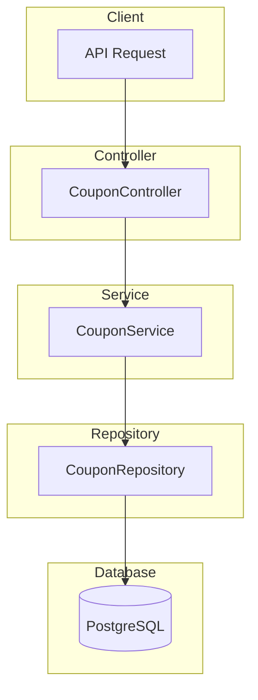

# Coupon Module Documentation

## Tổng Quan

Module `coupon` quản lý mã giảm giá trong hệ thống GEN-HUB. Hỗ trợ các loại giảm giá đa dạng: theo phần trăm, số tiền cố định, hoặc tháng miễn phí. Có thể cấu hình nhiều điều kiện áp dụng như số kho tối thiểu, thời gian thuê, giá trị đơn hàng.

---

## Kiến Trúc



---

## API Endpoints

> [!TIP]
> Tất cả các API đều hỗ trợ header `Accept-Language` để chọn ngôn ngữ phản hồi.
> - **vi** - Tiếng Việt (mặc định)
> - **en** - English

### 1. POST /coupons - Tạo coupon mới

**Mô tả:** Tạo mã giảm giá mới với các điều kiện áp dụng. Hỗ trợ giảm giá theo phần trăm, số tiền cố định hoặc tháng miễn phí.

**Xác thực:** Bearer Token (JWT)

**Quyền yêu cầu:** `coupon.create`

**Headers:**
```http
Authorization: Bearer <access_token>
Content-Type: application/json
Accept-Language: vi
```

**Request Body Schema:**

| Field | Type | Required | Description |
|-------|------|----------|-------------|
| `name` | string | ✅ | Tên coupon (max 255 ký tự) |
| `description` | string | ❌ | Mô tả coupon |
| `code` | string | ✅ | Mã coupon (max 50 ký tự, unique) |
| `coupon_type` | enum | ❌ | `PUBLIC` \| `PRIVATE` (default: PUBLIC) |
| `discount_type` | enum | ✅ | `PERCENT` \| `AMOUNT` \| `FREE_MONTHS` |
| `discount_value` | number | ✅ | Giá trị giảm (1-100 cho PERCENT) |
| `require_min_warehouses` | boolean | ❌ | Yêu cầu số kho tối thiểu |
| `min_warehouses` | number | Conditional | Số kho tối thiểu (khi require_min_warehouses=true) |
| `require_min_rows` | boolean | ❌ | Yêu cầu số row tối thiểu |
| `min_rows` | number | Conditional | Số row tối thiểu (khi require_min_rows=true) |
| `require_min_order_amount` | boolean | ❌ | Yêu cầu đơn hàng tối thiểu |
| `min_order_amount` | number | Conditional | Giá trị đơn hàng tối thiểu |
| `require_min_rental_duration` | boolean | ❌ | Yêu cầu thời gian thuê tối thiểu |
| `min_rental_duration_value` | number | Conditional | Giá trị thời gian thuê tối thiểu |
| `min_rental_duration_unit` | enum | Conditional | `HOUR` \| `DAY` \| `WEEK` \| `MONTH` \| `YEAR` |
| `is_unlimited_discount` | boolean | ❌ | Không giới hạn giảm giá (cho PERCENT) |
| `max_discount_amount` | number | Conditional | Giá trị giảm tối đa (khi PERCENT và không unlimited) |
| `is_permanent` | boolean | ❌ | Coupon vĩnh viễn |
| `starts_at` | datetime | Conditional | Thời gian bắt đầu (khi không permanent) |
| `ends_at` | datetime | Conditional | Thời gian kết thúc (khi không permanent) |
| `max_usage` | number | ❌ | Số lượng sử dụng tối đa (0 = không giới hạn) |
| `is_public` | boolean | ❌ | Coupon công khai |
| `apply_for_first_rental` | boolean | ❌ | Áp dụng cho thuê lần đầu |
| `apply_for_renewal` | boolean | ❌ | Áp dụng cho gia hạn |
| `apply_for_all_warehouses` | boolean | ❌ | Áp dụng cho tất cả kho |
| `apply_for_all_rows` | boolean | ❌ | Áp dụng cho tất cả row |
| `apply_for_all_addons` | boolean | ❌ | Áp dụng cho tất cả addon |
| `apply_for_all_insurances` | boolean | ❌ | Áp dụng cho tất cả bảo hiểm |
| `target_user_ids` | string[] | Conditional | ID user được áp dụng (khi PRIVATE) |
| `target_warehouse_ids` | string[] | Conditional | ID warehouse được áp dụng |
| `target_row_ids` | string[] | Conditional | ID row được áp dụng |
| `target_addon_ids` | string[] | Conditional | ID addon được áp dụng |
| `target_insurance_ids` | string[] | Conditional | ID bảo hiểm được áp dụng |
| `is_active` | boolean | ❌ | Trạng thái hoạt động |
| `is_unlimited_stack` | boolean | ❌ | Có thể áp dụng chung với vô hạn coupon khác |
| `max_stack_count` | number | Conditional | Số coupon tối đa có thể áp dụng chung |
| `has_gift_addons` | boolean | ❌ | Có tặng kèm addon |
| `gift_addon_ids` | string[] | Conditional | ID addon được tặng kèm |
| `has_gift_insurances` | boolean | ❌ | Có tặng kèm bảo hiểm |
| `gift_insurance_ids` | string[] | Conditional | ID bảo hiểm được tặng kèm |

**Request Body Examples:**

<details>
<summary><b>Ví dụ 1: Giảm giá theo phần trăm</b></summary>

```json
{
  "name": "Khuyến mãi Tết 2025",
  "description": "Giảm 20% cho đơn hàng đầu tiên",
  "code": "TET2025",
  "discount_type": "PERCENT",
  "discount_value": 20,
  "is_unlimited_discount": false,
  "max_discount_amount": 500000,
  "is_permanent": false,
  "starts_at": "2025-01-01T00:00:00.000Z",
  "ends_at": "2025-02-28T23:59:59.999Z",
  "max_usage": 100,
  "is_public": true,
  "apply_for_first_rental": true,
  "apply_for_renewal": false,
  "apply_for_all_warehouses": true,
  "apply_for_all_rows": true,
  "apply_for_all_addons": true,
  "apply_for_all_insurances": true,
  "is_active": true
}
```
</details>

<details>
<summary><b>Ví dụ 2: Giảm số tiền cố định</b></summary>

```json
{
  "name": "Ưu đãi cuối tuần",
  "description": "Giảm 200.000đ cho đơn hàng từ 1.000.000đ",
  "code": "WEEKEND200K",
  "discount_type": "AMOUNT",
  "discount_value": 200000,
  "require_min_order_amount": true,
  "min_order_amount": 1000000,
  "is_permanent": false,
  "starts_at": "2025-01-01T00:00:00.000Z",
  "ends_at": "2025-12-31T23:59:59.999Z",
  "max_usage": 0,
  "is_public": true,
  "is_active": true
}
```
</details>

<details>
<summary><b>Ví dụ 3: Coupon riêng tư cho user cụ thể</b></summary>

```json
{
  "name": "VIP Customer Discount",
  "description": "Ưu đãi đặc biệt cho khách hàng VIP",
  "code": "VIP50",
  "coupon_type": "PRIVATE",
  "discount_type": "PERCENT",
  "discount_value": 50,
  "is_unlimited_discount": true,
  "is_permanent": true,
  "max_usage": 0,
  "is_public": false,
  "target_user_ids": ["550e8400-e29b-41d4-a716-446655440000"],
  "is_active": true
}
```
</details>

<details>
<summary><b>Ví dụ 4: Coupon với nhiều điều kiện</b></summary>

```json
{
  "name": "Ưu đãi thuê dài hạn",
  "description": "Giảm 30% cho thuê từ 6 tháng trở lên, ít nhất 2 kho",
  "code": "LONGTERM30",
  "discount_type": "PERCENT",
  "discount_value": 30,
  "is_unlimited_discount": false,
  "max_discount_amount": 1000000,
  "require_min_warehouses": true,
  "min_warehouses": 2,
  "require_min_rental_duration": true,
  "min_rental_duration_value": 6,
  "min_rental_duration_unit": "MONTH",
  "is_permanent": false,
  "starts_at": "2025-01-01T00:00:00.000Z",
  "ends_at": "2025-06-30T23:59:59.999Z",
  "is_public": true,
  "is_active": true
}
```
</details>

<details>
<summary><b>Ví dụ 5: Coupon tặng kèm addon</b></summary>

```json
{
  "name": "Tặng kèm bảo vệ",
  "description": "Thuê kho được tặng dịch vụ bảo vệ 24/7",
  "code": "FREEGUARD",
  "discount_type": "PERCENT",
  "discount_value": 0,
  "is_permanent": false,
  "starts_at": "2025-01-01T00:00:00.000Z",
  "ends_at": "2025-12-31T23:59:59.999Z",
  "has_gift_addons": true,
  "gift_addon_ids": ["550e8400-e29b-41d4-a716-446655440001"],
  "is_public": true,
  "is_active": true
}
```
</details>

**Response (201 Created):**

```json
{
  "code": "coupon.create.success",
  "message": "Tạo coupon thành công",
  "success": true,
  "data": {
    "id": "550e8400-e29b-41d4-a716-446655440000",
    "name": "Khuyến mãi Tết 2025",
    "description": "Giảm 20% cho đơn hàng đầu tiên",
    "code": "TET2025",
    "coupon_type": "PUBLIC",
    "discount_type": "PERCENT",
    "discount_value": 20,
    "require_min_warehouses": false,
    "min_warehouses": null,
    "require_min_rows": false,
    "min_rows": null,
    "require_min_order_amount": false,
    "min_order_amount": null,
    "require_min_rental_duration": false,
    "min_rental_duration_value": null,
    "min_rental_duration_unit": null,
    "is_unlimited_discount": false,
    "max_discount_amount": 500000,
    "is_permanent": false,
    "starts_at": "2025-01-01T00:00:00.000Z",
    "ends_at": "2025-02-28T23:59:59.999Z",
    "max_usage": 100,
    "current_usage": 0,
    "is_public": true,
    "apply_for_first_rental": true,
    "apply_for_renewal": false,
    "schedule_id": null,
    "is_active": true,
    "created_at": "2025-01-01T00:00:00.000Z",
    "updated_at": null,
    "created_by": "550e8400-e29b-41d4-a716-446655440099"
  }
}
```

**Error Responses:**

<details>
<summary><b>409 Conflict - Mã coupon đã tồn tại</b></summary>

```json
{
  "code": "coupon.errors.code_exists",
  "message": "Mã coupon đã tồn tại",
  "success": false
}
```
</details>

<details>
<summary><b>401 Unauthorized</b></summary>

```json
// Không có token
{
  "code": "error.unauthorized.token_missing",
  "message": "Không có quyền truy cập",
  "success": false
}

// Token hết hạn
{
  "code": "error.unauthorized.token_expired",
  "message": "Token đã hết hạn",
  "success": false
}

// Token không hợp lệ
{
  "code": "error.unauthorized.token_invalid",
  "message": "Token không hợp lệ",
  "success": false
}
```
</details>

<details>
<summary><b>403 Forbidden</b></summary>

```json
// Không có quyền thực hiện
{
  "code": "error.forbidden.no_permission",
  "message": "Không có quyền thực hiện thao tác này",
  "success": false
}

// Tài khoản bị khóa
{
  "code": "error.forbidden.account_banned",
  "message": "Tài khoản đã bị khóa",
  "success": false
}
```
</details>

<details>
<summary><b>422 Unprocessable Entity</b></summary>

```json
{
  "code": "error.validation",
  "message": "Dữ liệu đầu vào không hợp lệ",
  "success": false,
  "errors": [
    { "field": "name", "message": "Tên coupon không được để trống" },
    { "field": "discount_value", "message": "Giá trị giảm giá phải từ 1-100%" }
  ]
}
```
</details>

---

### 2. GET /coupons - Lấy danh sách coupon (Admin)

**Mô tả:** Lấy danh sách tất cả coupon với phân trang và bộ lọc.

**Xác thực:** Bearer Token (JWT)

**Quyền yêu cầu:** `coupon.list` (xem coupon do mình tạo) hoặc `coupon.list.all` (xem tất cả coupon)

**Query Parameters:**

| Parameter | Type | Required | Description | Example |
|-----------|------|----------|-------------|---------|
| `limit` | number | ❌ | Số lượng bản ghi mỗi trang | 10 |
| `offset` | number | ❌ | Vị trí bắt đầu | 0 |
| `keywords` | string | ❌ | Từ khóa tìm kiếm (tên, mã coupon) | TET |
| `is_active` | boolean | ❌ | Lọc theo trạng thái hoạt động | true |
| `is_public` | boolean | ❌ | Lọc theo trạng thái công khai | true |

**Request:**
```http
GET /coupons?limit=10&offset=0&keywords=TET&is_active=true HTTP/1.1
Host: api.gen-hub.dev
Authorization: Bearer <access_token>
Accept-Language: vi
```

**Response (200 OK):**

```json
{
  "code": "coupon.list.success",
  "message": "Lấy danh sách coupon thành công",
  "success": true,
  "data": {
    "items": [
      {
        "id": "550e8400-e29b-41d4-a716-446655440000",
        "name": "Khuyến mãi Tết 2025",
        "description": "Giảm 20% cho đơn hàng đầu tiên",
        "code": "TET2025",
        "coupon_type": "PUBLIC",
        "discount_type": "PERCENT",
        "discount_value": 20,
        "max_discount_amount": 500000,
        "max_usage": 100,
        "current_usage": 25,
        "is_public": true,
        "is_active": true,
        "starts_at": "2025-01-01T00:00:00.000Z",
        "ends_at": "2025-02-28T23:59:59.999Z",
        "created_at": "2025-01-01T00:00:00.000Z"
      }
    ],
    "total": 50,
    "limit": 10,
    "offset": 0,
    "hasMore": true
  }
}
```

---

### 3. GET /coupons/:id - Lấy chi tiết coupon

**Mô tả:** Lấy thông tin chi tiết của một coupon theo ID. Bao gồm tất cả các điều kiện áp dụng, danh sách target và thống kê sử dụng.

**Xác thực:** Bearer Token (JWT)

**Quyền yêu cầu:** `coupon.read` (xem coupon do mình tạo) hoặc `coupon.read.all` (xem tất cả coupon)

**Path Parameters:**

| Parameter | Type | Description |
|-----------|------|-------------|
| `id` | UUID | ID của coupon |

**Request:**
```http
GET /coupons/550e8400-e29b-41d4-a716-446655440000 HTTP/1.1
Host: api.gen-hub.dev
Authorization: Bearer <access_token>
Accept-Language: vi
```

**Response (200 OK):**

```json
{
  "code": "coupon.read.success",
  "message": "Lấy chi tiết coupon thành công",
  "success": true,
  "data": {
    "id": "550e8400-e29b-41d4-a716-446655440000",
    "name": "Khuyến mãi Tết 2025",
    "description": "Giảm 20% cho đơn hàng đầu tiên",
    "code": "TET2025",
    "coupon_type": "PUBLIC",
    "discount_type": "PERCENT",
    "discount_value": 20,
    "require_min_warehouses": false,
    "min_warehouses": null,
    "require_min_rows": false,
    "min_rows": null,
    "require_min_order_amount": false,
    "min_order_amount": null,
    "require_min_rental_duration": false,
    "min_rental_duration_value": null,
    "min_rental_duration_unit": null,
    "is_unlimited_discount": false,
    "max_discount_amount": 500000,
    "is_permanent": false,
    "starts_at": "2025-01-01T00:00:00.000Z",
    "ends_at": "2025-02-28T23:59:59.999Z",
    "max_usage": 100,
    "current_usage": 25,
    "is_public": true,
    "apply_for_first_rental": true,
    "apply_for_renewal": false,
    "is_active": true,
    "created_at": "2025-01-01T00:00:00.000Z",
    "updated_at": "2025-01-15T10:30:00.000Z"
  }
}
```

**Error Responses:**

<details>
<summary><b>404 Not Found</b></summary>

```json
{
  "code": "coupon.errors.not_found",
  "message": "Không tìm thấy coupon",
  "success": false
}
```
</details>

---

### 4. PUT /coupons/:id - Cập nhật coupon

**Mô tả:** Cập nhật thông tin coupon theo ID. Có thể cập nhật một phần hoặc toàn bộ thông tin. Không thể thay đổi mã coupon nếu đã có người sử dụng.

**Xác thực:** Bearer Token (JWT)

**Quyền yêu cầu:** `coupon.update` (cập nhật coupon do mình tạo) hoặc `coupon.update.all` (cập nhật bất kỳ coupon nào)

**Path Parameters:**

| Parameter | Type | Description |
|-----------|------|-------------|
| `id` | UUID | ID của coupon |

**Request Body Examples:**

<details>
<summary><b>Ví dụ 1: Cập nhật giá trị giảm giá</b></summary>

```json
{
  "discount_value": 25,
  "max_discount_amount": 600000
}
```
</details>

<details>
<summary><b>Ví dụ 2: Gia hạn thời gian hiệu lực</b></summary>

```json
{
  "ends_at": "2025-03-31T23:59:59.999Z"
}
```
</details>

<details>
<summary><b>Ví dụ 3: Thay đổi trạng thái</b></summary>

```json
{
  "is_active": false
}
```
</details>

<details>
<summary><b>Ví dụ 4: Cập nhật điều kiện áp dụng</b></summary>

```json
{
  "require_min_warehouses": true,
  "min_warehouses": 3
}
```
</details>

**Response (200 OK):**

```json
{
  "code": "coupon.update.success",
  "message": "Cập nhật coupon thành công",
  "success": true,
  "data": {
    "id": "550e8400-e29b-41d4-a716-446655440000",
    "name": "Khuyến mãi Tết 2025",
    "description": "Giảm 20% cho đơn hàng đầu tiên",
    "code": "TET2025",
    "coupon_type": "PUBLIC",
    "discount_type": "PERCENT",
    "discount_value": 25,
    "is_unlimited_discount": false,
    "max_discount_amount": 600000,
    "is_active": true,
    "updated_at": "2025-01-20T10:30:00.000Z",
    "updated_by": "550e8400-e29b-41d4-a716-446655440099"
  }
}
```

---

### 5. DELETE /coupons/delete/many - Xóa nhiều coupon

**Mô tả:** Xóa nhiều coupon cùng lúc theo danh sách ID. Coupon đã được sử dụng sẽ được soft delete.

**Xác thực:** Bearer Token (JWT)

**Quyền yêu cầu:** `coupon.delete` (xóa coupon do mình tạo) hoặc `coupon.delete.all` (xóa bất kỳ coupon nào)

**Request Body:**

```json
{
  "ids": [
    "550e8400-e29b-41d4-a716-446655440001",
    "550e8400-e29b-41d4-a716-446655440002",
    "550e8400-e29b-41d4-a716-446655440003"
  ]
}
```

**Response (200 OK):**

```json
{
  "code": "coupon.delete.success",
  "message": "Xóa nhiều coupon thành công",
  "success": true,
  "data": null
}
```

---

### 6. DELETE /coupons/:id - Xóa coupon

**Mô tả:** Xóa một coupon theo ID. Coupon đã được sử dụng sẽ được soft delete để giữ lịch sử.

**Xác thực:** Bearer Token (JWT)

**Quyền yêu cầu:** `coupon.delete` (xóa coupon do mình tạo) hoặc `coupon.delete.all` (xóa bất kỳ coupon nào)

**Path Parameters:**

| Parameter | Type | Description |
|-----------|------|-------------|
| `id` | UUID | ID của coupon |

**Response (200 OK):**

```json
{
  "code": "coupon.delete.success",
  "message": "Xóa coupon thành công",
  "success": true,
  "data": null
}
```

---

## Validation Rules

### Discount Type
- `PERCENT`: Giảm theo phần trăm (1-100%)
- `AMOUNT`: Giảm số tiền cố định
- `FREE_MONTHS`: Tặng tháng miễn phí

### Coupon Type
- `PUBLIC`: Coupon công khai, ai cũng có thể sử dụng
- `PRIVATE`: Coupon riêng tư, chỉ áp dụng cho user cụ thể

### Duration Unit
- `HOUR`: Giờ
- `DAY`: Ngày
- `WEEK`: Tuần
- `MONTH`: Tháng
- `YEAR`: Năm

### Strings
- `name`: max 255 ký tự
- `code`: max 50 ký tự, unique (khi is_deleted = false)

---

## Files Trong Module

| File | Mô tả |
|------|-------|
| [coupon.module.ts](file:///c:/Users/pc/Desktop/document/PRO219/Project/GEN-HUB/server/src/modules/coupon/coupon.module.ts) | NestJS module definition |
| [coupon.controller.ts](file:///c:/Users/pc/Desktop/document/PRO219/Project/GEN-HUB/server/src/modules/coupon/coupon.controller.ts) | REST API endpoints |
| [coupon.service.ts](file:///c:/Users/pc/Desktop/document/PRO219/Project/GEN-HUB/server/src/modules/coupon/coupon.service.ts) | Business logic |
| [dto/create-coupon.dto.ts](file:///c:/Users/pc/Desktop/document/PRO219/Project/GEN-HUB/server/src/modules/coupon/dto/create-coupon.dto.ts) | DTO tạo mới |
| [dto/update-coupon.dto.ts](file:///c:/Users/pc/Desktop/document/PRO219/Project/GEN-HUB/server/src/modules/coupon/dto/update-coupon.dto.ts) | DTO cập nhật |
| [dto/query-coupon.dto.ts](file:///c:/Users/pc/Desktop/document/PRO219/Project/GEN-HUB/server/src/modules/coupon/dto/query-coupon.dto.ts) | DTO query |

---

## Permissions

| Permission | Mô tả |
|------------|-------|
| `coupon.create` | Tạo coupon mới |
| `coupon.list` | Xem danh sách coupon do mình tạo |
| `coupon.list.all` | Xem tất cả coupon |
| `coupon.read` | Xem chi tiết coupon do mình tạo |
| `coupon.read.all` | Xem chi tiết bất kỳ coupon nào |
| `coupon.update` | Cập nhật coupon do mình tạo |
| `coupon.update.all` | Cập nhật bất kỳ coupon nào |
| `coupon.delete` | Xóa coupon do mình tạo |
| `coupon.delete.all` | Xóa bất kỳ coupon nào |
