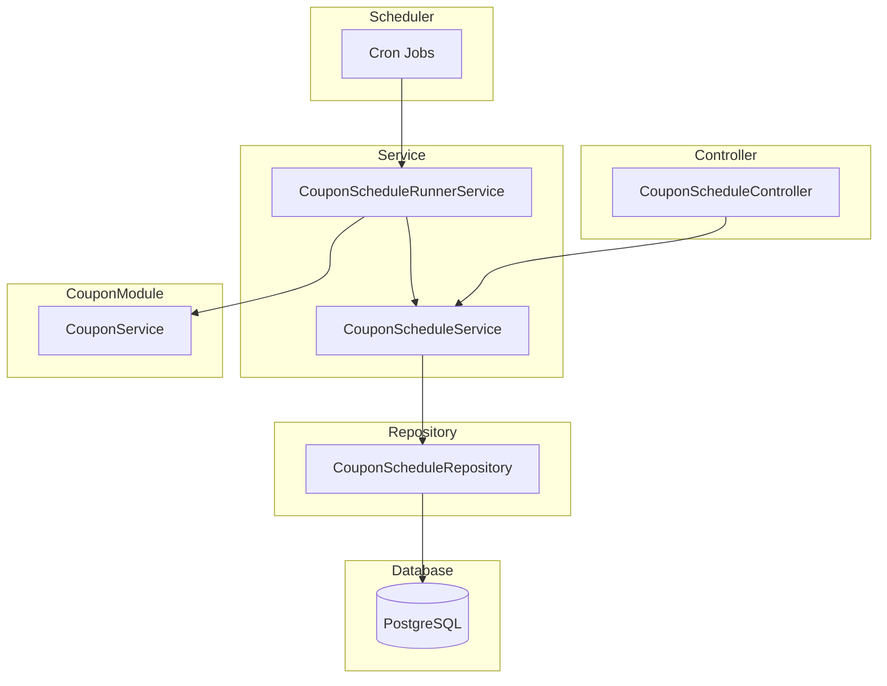

# Coupon Schedule Module Documentation

## Tổng Quan

Module `coupon-schedule` quản lý các lịch tự động tạo coupon theo chu kỳ trong hệ thống GEN-HUB. Hỗ trợ các chu kỳ: **YEARLY** (hàng năm), **QUARTERLY** (hàng quý), **MONTHLY** (hàng tháng), **WEEKLY** (hàng tuần), **DAILY** (hàng ngày).

---

## Kiến Trúc



---

## API Endpoints

> [!TIP]
> Tất cả các API đều hỗ trợ header `Accept-Language` để chọn ngôn ngữ phản hồi.
>
> - **vi** - Tiếng Việt (mặc định)
> - **en** - English

### 1. POST /coupon-schedules - Tạo lịch coupon mới

**Mô tả:** Tạo mới một lịch tự động tạo coupon theo chu kỳ.

**Xác thực:** Bearer Token (JWT)

**Quyền yêu cầu:** `coupon-schedule.create`

**Headers:**

```http
Authorization: Bearer <access_token>
Content-Type: application/json
Accept-Language: vi
```

**Request Body Schema:**

| Field                         | Type     | Required     | Description                                                    |
| ----------------------------- | -------- | ------------ | -------------------------------------------------------------- |
| `name`                        | string   | **Required** | Tên lịch coupon (max 255 ký tự)                                |
| `description`                 | string   | Optional     | Mô tả                                                          |
| `period`                      | enum     | **Required** | Chu kỳ: YEARLY, QUARTERLY, MONTHLY, WEEKLY, DAILY              |
| `coupon_type`                 | enum     | Optional     | Loại coupon: PUBLIC, PRIVATE (default: PUBLIC)                 |
| `scheduled_day`               | number   | Conditional  | Ngày trong tháng (1-31), bắt buộc cho YEARLY/QUARTERLY/MONTHLY |
| `scheduled_month`             | number   | Conditional  | Tháng trong năm (1-12), bắt buộc cho YEARLY/QUARTERLY          |
| `scheduled_weekday`           | number   | Conditional  | Thứ trong tuần (0-6, 0=CN), bắt buộc cho WEEKLY                |
| `scheduled_hour`              | number   | Conditional  | Giờ (0-23), bắt buộc cho DAILY                                 |
| `scheduled_minute`            | number   | Conditional  | Phút (0-59), bắt buộc cho DAILY                                |
| `is_random_code`              | boolean  | Optional     | Code ngẫu nhiên (default: true)                                |
| `is_fixed_code`               | boolean  | Optional     | Code cố định                                                   |
| `fixed_code_value`            | string   | Conditional  | Giá trị code cố định (max 30 ký tự)                            |
| `use_suffix`                  | boolean  | Optional     | Sử dụng suffix                                                 |
| `use_prefix`                  | boolean  | Optional     | Sử dụng prefix                                                 |
| `is_permanent_coupon`         | boolean  | Optional     | Coupon vĩnh viễn (default: false)                              |
| `coupon_duration_value`       | number   | Conditional  | Giá trị thời gian áp dụng                                      |
| `coupon_duration_unit`        | enum     | Conditional  | Đơn vị: HOUR, DAY, WEEK, MONTH, YEAR                           |
| `discount_type`               | enum     | **Required** | Loại giảm giá: PERCENT, AMOUNT, FREE_MONTHS                    |
| `discount_value`              | number   | **Required** | Giá trị giảm giá                                               |
| `require_min_warehouses`      | boolean  | Optional     | Yêu cầu số kho tối thiểu                                       |
| `min_warehouses`              | number   | Conditional  | Số kho tối thiểu                                               |
| `require_min_rows`            | boolean  | Optional     | Yêu cầu số row tối thiểu                                       |
| `min_rows`                    | number   | Conditional  | Số row tối thiểu                                               |
| `require_min_order_amount`    | boolean  | Optional     | Yêu cầu đơn hàng tối thiểu                                     |
| `min_order_amount`            | number   | Conditional  | Giá trị đơn hàng tối thiểu                                     |
| `require_min_rental_duration` | boolean  | Optional     | Yêu cầu thời gian thuê tối thiểu                               |
| `min_rental_duration_value`   | number   | Conditional  | Thời gian thuê tối thiểu                                       |
| `min_rental_duration_unit`    | enum     | Conditional  | Đơn vị: DAY, WEEK, MONTH, YEAR                                 |
| `is_unlimited_discount`       | boolean  | Optional     | Không giới hạn giảm giá (cho PERCENT)                          |
| `max_discount_amount`         | number   | Conditional  | Giá trị giảm tối đa                                            |
| `max_usage`                   | number   | Optional     | Số lượng sử dụng tối đa (0 = không giới hạn)                   |
| `is_public`                   | boolean  | Optional     | Coupon công khai                                               |
| `apply_for_first_rental`      | boolean  | Optional     | Áp dụng cho thuê lần đầu                                       |
| `apply_for_renewal`           | boolean  | Optional     | Áp dụng cho gia hạn                                            |
| `apply_for_all_warehouses`    | boolean  | Optional     | Áp dụng cho tất cả kho                                         |
| `apply_for_all_rows`          | boolean  | Optional     | Áp dụng cho tất cả row                                         |
| `apply_for_all_addons`        | boolean  | Optional     | Áp dụng cho tất cả addon                                       |
| `target_user_ids`             | string[] | Conditional  | Danh sách ID user (cho PRIVATE)                                |
| `target_warehouse_ids`        | string[] | Conditional  | Danh sách ID warehouse                                         |
| `target_row_ids`              | string[] | Conditional  | Danh sách ID row                                               |
| `target_addon_ids`            | string[] | Conditional  | Danh sách ID addon                                             |
| `is_active`                   | boolean  | Optional     | Trạng thái hoạt động                                           |
| `is_unlimited_stack`          | boolean  | Optional     | Có thể áp dụng chung vô hạn                                    |
| `max_stack_count`             | number   | Conditional  | Số coupon tối đa có thể áp dụng chung                          |
| `has_gift_addons`             | boolean  | Optional     | Có tặng kèm addon                                              |
| `gift_addon_ids`              | string[] | Conditional  | Danh sách ID addon tặng kèm                                    |
| `has_gift_insurances`         | boolean  | Optional     | Có tặng kèm bảo hiểm                                           |
| `gift_insurance_ids`          | string[] | Conditional  | Danh sách ID bảo hiểm tặng kèm                                 |

**Request Body Examples:**

<details>
<summary><b>Ví dụ 1: Tạo lịch cơ bản - Giảm giá hàng tháng</b></summary>

```json
{
  "name": "Khuyến mãi đầu tháng",
  "description": "Coupon giảm giá 20% vào đầu mỗi tháng",
  "period": "MONTHLY",
  "scheduled_day": 1,
  "discount_type": "PERCENT",
  "discount_value": 20,
  "is_random_code": true,
  "is_permanent_coupon": false,
  "coupon_duration_value": 7,
  "coupon_duration_unit": "DAY",
  "max_usage": 100,
  "is_active": true
}
```

</details>

<details>
<summary><b>Ví dụ 2: Tạo lịch hàng năm - Khuyến mãi Tết</b></summary>

```json
{
  "name": "Khuyến mãi Tết Nguyên Đán",
  "description": "Coupon giảm 500,000đ cho năm mới",
  "period": "YEARLY",
  "scheduled_day": 1,
  "scheduled_month": 1,
  "discount_type": "AMOUNT",
  "discount_value": 500000,
  "is_random_code": false,
  "is_fixed_code": true,
  "fixed_code_value": "TET",
  "use_suffix": true,
  "is_permanent_coupon": false,
  "coupon_duration_value": 1,
  "coupon_duration_unit": "MONTH",
  "max_usage": 1000,
  "is_active": true
}
```

</details>

<details>
<summary><b>Ví dụ 3: Tạo lịch với điều kiện áp dụng</b></summary>

```json
{
  "name": "Khuyến mãi VIP",
  "description": "Coupon dành cho đơn hàng lớn",
  "period": "WEEKLY",
  "scheduled_weekday": 1,
  "discount_type": "PERCENT",
  "discount_value": 15,
  "is_random_code": true,
  "is_permanent_coupon": false,
  "coupon_duration_value": 3,
  "coupon_duration_unit": "DAY",
  "require_min_order_amount": true,
  "min_order_amount": 5000000,
  "require_min_rental_duration": true,
  "min_rental_duration_value": 6,
  "min_rental_duration_unit": "MONTH",
  "is_unlimited_discount": false,
  "max_discount_amount": 1000000,
  "max_usage": 50,
  "is_active": true
}
```

</details>

<details>
<summary><b>Ví dụ 4: Tạo lịch coupon riêng tư (PRIVATE)</b></summary>

```json
{
  "name": "Khuyến mãi thành viên thân thiết",
  "description": "Coupon dành riêng cho khách hàng VIP",
  "period": "MONTHLY",
  "scheduled_day": 15,
  "coupon_type": "PRIVATE",
  "discount_type": "PERCENT",
  "discount_value": 30,
  "is_random_code": true,
  "is_permanent_coupon": false,
  "coupon_duration_value": 14,
  "coupon_duration_unit": "DAY",
  "max_usage": 1,
  "target_user_ids": [
    "550e8400-e29b-41d4-a716-446655440001",
    "550e8400-e29b-41d4-a716-446655440002"
  ],
  "is_active": true
}
```

</details>

**Response (201 Created):**

```json
{
  "code": "coupon-schedule.create.success",
  "message": "Tạo lịch coupon thành công",
  "success": true,
  "data": {
    "id": "550e8400-e29b-41d4-a716-446655440000",
    "name": "Khuyến mãi đầu tháng",
    "description": "Coupon giảm giá 20% vào đầu mỗi tháng",
    "period": "MONTHLY",
    "scheduled_day": 1,
    "discount_type": "PERCENT",
    "discount_value": 20,
    "is_active": true,
    "next_run_at": "2026-02-01T00:00:00.000Z",
    "created_at": "2026-01-22T13:00:00.000Z",
    "created_by": "550e8400-e29b-41d4-a716-446655440099"
  }
}
```

---

### 2. GET /coupon-schedules - Lấy danh sách lịch coupon

**Mô tả:** Lấy danh sách các lịch coupon với phân trang và lọc.

**Xác thực:** Bearer Token (JWT)

**Quyền yêu cầu:** `coupon-schedule.list`

**Query Parameters:**

| Parameter   | Type    | Required | Default | Description                   |
| ----------- | ------- | -------- | ------- | ----------------------------- |
| `limit`     | number  | Optional | 10      | Số bản ghi mỗi trang (1-100)  |
| `offset`    | number  | Optional | 0       | Vị trí bắt đầu                |
| `keywords`  | string  | Optional | -       | Từ khóa tìm kiếm theo tên     |
| `is_active` | boolean | Optional | -       | Lọc theo trạng thái hoạt động |

**Response (200 OK):**

```json
{
  "code": "coupon-schedule.list.success",
  "message": "Lấy danh sách lịch coupon thành công",
  "success": true,
  "data": {
    "items": [
      {
        "id": "550e8400-e29b-41d4-a716-446655440001",
        "name": "Khuyến mãi đầu tháng",
        "description": "Coupon giảm giá 20% vào đầu mỗi tháng",
        "period": "MONTHLY",
        "discount_type": "PERCENT",
        "discount_value": 20,
        "is_active": true,
        "last_run_at": "2026-01-01T00:00:00.000Z",
        "next_run_at": "2026-02-01T00:00:00.000Z",
        "created_at": "2025-12-15T10:30:00.000Z"
      }
    ],
    "total": 50,
    "limit": 10,
    "offset": 0,
    "hasMore": true
  }
}
```

---

### 3. GET /coupon-schedules/:id - Lấy chi tiết lịch coupon

**Mô tả:** Lấy thông tin chi tiết của một lịch coupon theo ID.

**Xác thực:** Bearer Token (JWT)

**Quyền yêu cầu:** `coupon-schedule.read`

**Path Parameters:**

| Parameter | Type          | Required     | Description        |
| --------- | ------------- | ------------ | ------------------ |
| `id`      | string (UUID) | **Required** | ID của lịch coupon |

**Response (200 OK):**

```json
{
  "code": "coupon-schedule.read.success",
  "message": "Lấy chi tiết lịch coupon thành công",
  "success": true,
  "data": {
    "id": "550e8400-e29b-41d4-a716-446655440000",
    "name": "Khuyến mãi đầu tháng",
    "description": "Coupon giảm giá 20% vào đầu mỗi tháng",
    "period": "MONTHLY",
    "scheduled_day": 1,
    "scheduled_month": null,
    "scheduled_weekday": null,
    "scheduled_hour": null,
    "scheduled_minute": null,
    "is_random_code": true,
    "is_fixed_code": false,
    "fixed_code_value": null,
    "use_suffix": false,
    "use_prefix": false,
    "is_permanent_coupon": false,
    "coupon_duration_value": 7,
    "coupon_duration_unit": "DAY",
    "discount_type": "PERCENT",
    "discount_value": 20,
    "require_min_warehouses": false,
    "min_warehouses": null,
    "require_min_rows": false,
    "min_rows": null,
    "require_min_order_amount": false,
    "min_order_amount": null,
    "require_min_rental_duration": false,
    "min_rental_duration_value": null,
    "min_rental_duration_unit": null,
    "is_unlimited_discount": false,
    "max_discount_amount": 500000,
    "max_usage": 100,
    "is_public": false,
    "apply_for_first_rental": true,
    "apply_for_renewal": true,
    "is_active": true,
    "last_run_at": "2026-01-01T00:00:00.000Z",
    "next_run_at": "2026-02-01T00:00:00.000Z",
    "created_at": "2025-12-15T10:30:00.000Z",
    "updated_at": "2026-01-10T14:20:00.000Z",
    "created_by": "550e8400-e29b-41d4-a716-446655440099",
    "updated_by": "550e8400-e29b-41d4-a716-446655440099"
  }
}
```

---

### 4. PUT /coupon-schedules/:id - Cập nhật lịch coupon

**Mô tả:** Cập nhật thông tin của một lịch coupon. Chỉ các trường được gửi trong request body mới được cập nhật.

**Xác thực:** Bearer Token (JWT)

**Quyền yêu cầu:** `coupon-schedule.update`

**Request Body Examples:**

<details>
<summary><b>Ví dụ 1: Cập nhật thông tin cơ bản</b></summary>

```json
{
  "name": "Khuyến mãi đầu tháng - Updated",
  "description": "Mô tả mới cho lịch coupon"
}
```

</details>

<details>
<summary><b>Ví dụ 2: Cập nhật giảm giá</b></summary>

```json
{
  "discount_type": "PERCENT",
  "discount_value": 25,
  "is_unlimited_discount": false,
  "max_discount_amount": 750000
}
```

</details>

<details>
<summary><b>Ví dụ 3: Bật/tắt trạng thái</b></summary>

```json
{
  "is_active": false
}
```

</details>

**Response (200 OK):**

```json
{
  "code": "coupon-schedule.update.success",
  "message": "Cập nhật lịch coupon thành công",
  "success": true,
  "data": {
    "id": "550e8400-e29b-41d4-a716-446655440000",
    "name": "Khuyến mãi đầu tháng - Updated",
    "updated_at": "2026-01-22T14:00:00.000Z",
    "updated_by": "550e8400-e29b-41d4-a716-446655440099"
  }
}
```

---

### 5. DELETE /coupon-schedules/delete/many - Xóa nhiều lịch coupon

**Mô tả:** Xóa mềm nhiều lịch coupon theo danh sách ID.

**Xác thực:** Bearer Token (JWT)

**Quyền yêu cầu:** `coupon-schedule.delete`

**Request Body:**

```json
{
  "ids": [
    "550e8400-e29b-41d4-a716-446655440001",
    "550e8400-e29b-41d4-a716-446655440002",
    "550e8400-e29b-41d4-a716-446655440003"
  ]
}
```

**Response (200 OK):**

```json
{
  "code": "coupon-schedule.delete.success",
  "message": "Xóa nhiều lịch coupon thành công",
  "success": true,
  "data": null
}
```

---

### 6. DELETE /coupon-schedules/:id - Xóa lịch coupon

**Mô tả:** Xóa mềm một lịch coupon theo ID.

**Xác thực:** Bearer Token (JWT)

**Quyền yêu cầu:** `coupon-schedule.delete`

**Path Parameters:**

| Parameter | Type          | Required     | Description        |
| --------- | ------------- | ------------ | ------------------ |
| `id`      | string (UUID) | **Required** | ID của lịch coupon |

**Response (200 OK):**

```json
{
  "code": "coupon-schedule.delete.success",
  "message": "Xóa lịch coupon thành công",
  "success": true,
  "data": null
}
```

---

## Error Responses

<details>
<summary><b>401 Unauthorized</b></summary>

```json
// Không có token
{
  "code": "error.unauthorized.token_missing",
  "message": "Không có quyền truy cập",
  "success": false
}

// Token hết hạn
{
  "code": "error.unauthorized.token_expired",
  "message": "Token đã hết hạn",
  "success": false
}

// Token không hợp lệ
{
  "code": "error.unauthorized.token_invalid",
  "message": "Token không hợp lệ",
  "success": false
}

// Token không đúng định dạng
{
  "code": "error.unauthorized.token_malformed",
  "message": "Token không đúng định dạng",
  "success": false
}
```

</details>

<details>
<summary><b>403 Forbidden</b></summary>

```json
// Không có quyền thực hiện
{
  "code": "error.forbidden.no_permission",
  "message": "Không có quyền thực hiện thao tác này",
  "success": false
}

// Tài khoản bị khóa
{
  "code": "error.forbidden.account_banned",
  "message": "Tài khoản đã bị khóa",
  "success": false
}

// Tài khoản chưa xác minh
{
  "code": "error.forbidden.account_not_verified",
  "message": "Tài khoản chưa được xác minh. Vui lòng xác minh email để tiếp tục.",
  "success": false
}

// Tài khoản không tồn tại
{
  "code": "error.forbidden.account_not_found",
  "message": "Tài khoản không tồn tại",
  "success": false
}
```

</details>

<details>
<summary><b>404 Not Found</b></summary>

```json
{
  "code": "coupon-schedule.errors.not_found",
  "message": "Không tìm thấy lịch coupon",
  "success": false
}
```

</details>

<details>
<summary><b>409 Conflict</b></summary>

```json
// Tên đã tồn tại
{
  "code": "coupon-schedule.errors.name_exists",
  "message": "Tên lịch coupon đã tồn tại",
  "success": false
}

// Code cố định đã tồn tại
{
  "code": "coupon-schedule.errors.fixed_code_exists",
  "message": "Code cố định đã được sử dụng bởi lịch khác đang hoạt động",
  "success": false
}
```

</details>

<details>
<summary><b>422 Unprocessable Entity</b></summary>

```json
{
  "code": "error.validation",
  "message": "Dữ liệu đầu vào không hợp lệ",
  "success": false,
  "errors": [
    { "field": "name", "message": "Tên lịch coupon không được để trống" },
    {
      "field": "period",
      "message": "Chu kỳ phải là YEARLY, QUARTERLY, MONTHLY, WEEKLY hoặc DAILY"
    }
  ]
}
```

</details>

---

## Validation Rules

### Period Configuration

| Period    | Required Fields                                    |
| --------- | -------------------------------------------------- |
| YEARLY    | `scheduled_day` (1-31), `scheduled_month` (1-12)   |
| QUARTERLY | `scheduled_day` (1-31), `scheduled_month` (1-12)   |
| MONTHLY   | `scheduled_day` (1-31)                             |
| WEEKLY    | `scheduled_weekday` (0-6, 0=Sunday)                |
| DAILY     | `scheduled_hour` (0-23), `scheduled_minute` (0-59) |

### Discount

| Discount Type | discount_value Range | Additional Requirements                                   |
| ------------- | -------------------- | --------------------------------------------------------- |
| PERCENT       | 1-100                | `max_discount_amount` nếu `is_unlimited_discount` = false |
| AMOUNT        | >= 1                 | -                                                         |
| FREE_MONTHS   | >= 1                 | -                                                         |

### Duration (khi `is_permanent_coupon` = false)

| Field                   | Type   | Range                        |
| ----------------------- | ------ | ---------------------------- |
| `coupon_duration_value` | number | >= 1                         |
| `coupon_duration_unit`  | enum   | HOUR, DAY, WEEK, MONTH, YEAR |

### Conditional Fields

| Condition                          | Required Fields                     |
| ---------------------------------- | ----------------------------------- |
| `coupon_type` = PRIVATE            | `target_user_ids` (at least 1)      |
| `apply_for_all_warehouses` = false | `target_warehouse_ids` (at least 1) |
| `apply_for_all_rows` = false       | `target_row_ids` (at least 1)       |
| `apply_for_all_addons` = false     | `target_addon_ids` (at least 1)     |
| `has_gift_addons` = true           | `gift_addon_ids` (at least 1)       |
| `has_gift_insurances` = true       | `gift_insurance_ids` (at least 1)   |
| `is_unlimited_stack` = false       | `max_stack_count` (>= 1)            |

---

## Files Trong Module

| File                                      | Mô tả                               |
| ----------------------------------------- | ----------------------------------- |
| `coupon-schedule.controller.ts`           | Controller xử lý HTTP requests      |
| `coupon-schedule.service.ts`              | Service chính xử lý business logic  |
| `coupon-schedule-runner.service.ts`       | Service chạy các lịch theo cron job |
| `coupon-schedule.repository.ts`           | Repository truy vấn database        |
| `coupon-schedule.module.ts`               | Module definition                   |
| `dto/create-coupon-schedule.dto.ts`       | DTO tạo mới                         |
| `dto/update-coupon-schedule.dto.ts`       | DTO cập nhật                        |
| `dto/query-coupon-schedule.dto.ts`        | DTO query parameters                |
| `interfaces/coupon-schedule.interface.ts` | Interface definitions               |

---

## Permissions

| Permission               | Description               |
| ------------------------ | ------------------------- |
| `coupon-schedule.create` | Tạo lịch coupon mới       |
| `coupon-schedule.list`   | Xem danh sách lịch coupon |
| `coupon-schedule.read`   | Xem chi tiết lịch coupon  |
| `coupon-schedule.update` | Cập nhật lịch coupon      |
| `coupon-schedule.delete` | Xóa lịch coupon           |
