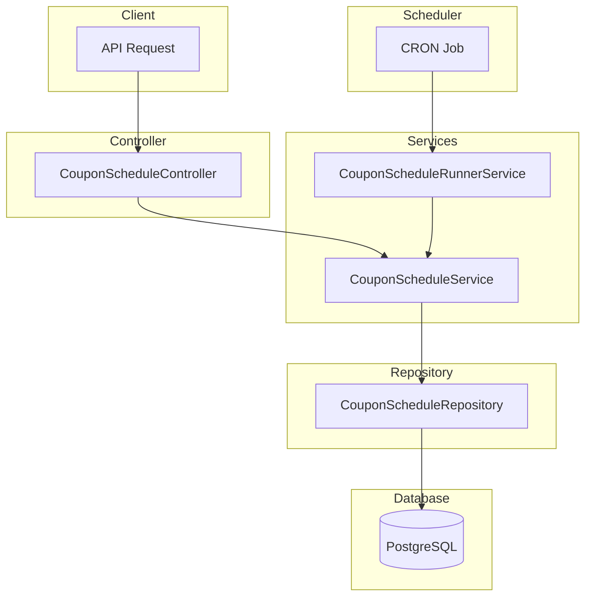

# Coupon Schedule Module Documentation

## Tổng Quan

Module `coupon-schedule` quản lý lịch tự động tạo coupon theo chu kỳ trong hệ thống GEN-HUB. Hỗ trợ các chu kỳ: YEARLY (hàng năm), QUARTERLY (hàng quý), MONTHLY (hàng tháng), WEEKLY (hàng tuần), DAILY (hàng ngày).

---

## Kiến Trúc



---

## API Endpoints

> [!TIP]
> Tất cả các API đều hỗ trợ header `Accept-Language` để chọn ngôn ngữ phản hồi.
> - **vi** - Tiếng Việt (mặc định)
> - **en** - English

### 1. POST /coupon-schedules - Tạo lịch coupon mới

**Mô tả:** Tạo mới một lịch tự động tạo coupon theo chu kỳ.

**Xác thực:** Bearer Token (JWT)

**Quyền yêu cầu:** `coupon-schedule.create`

**Headers:**
```http
Authorization: Bearer <access_token>
Content-Type: application/json
Accept-Language: vi
```

**Request Body Schema:**

| Field | Type | Required | Description |
|-------|------|----------|-------------|
| `name` | string | ✅ | Tên lịch tạo coupon (max 255 ký tự) |
| `description` | string | ❌ | Mô tả lịch coupon |
| `period` | enum | ✅ | `YEARLY` \| `QUARTERLY` \| `MONTHLY` \| `WEEKLY` \| `DAILY` |
| `coupon_type` | enum | ❌ | `PUBLIC` \| `PRIVATE` (default: PUBLIC) |
| `scheduled_day` | number | Conditional | Ngày trong tháng 1-31 (cho YEARLY, QUARTERLY, MONTHLY) |
| `scheduled_month` | number | Conditional | Tháng trong năm 1-12 (cho YEARLY, QUARTERLY) |
| `scheduled_weekday` | number | Conditional | Thứ trong tuần 0-6, 0=CN (cho WEEKLY) |
| `scheduled_hour` | number | Conditional | Giờ 0-23 (cho DAILY) |
| `scheduled_minute` | number | Conditional | Phút 0-59 (cho DAILY) |
| `is_random_code` | boolean | ❌ | Sử dụng mã ngẫu nhiên (default: true) |
| `is_fixed_code` | boolean | Conditional | Sử dụng mã cố định (khi is_random_code=false) |
| `fixed_code_value` | string | Conditional | Giá trị mã cố định (max 30 ký tự) |
| `use_suffix` | boolean | Conditional | Sử dụng hậu tố cho mã |
| `use_prefix` | boolean | Conditional | Sử dụng tiền tố cho mã |
| `is_permanent_coupon` | boolean | ❌ | Coupon được tạo là vĩnh viễn |
| `coupon_duration_value` | number | Conditional | Giá trị thời gian hiệu lực coupon |
| `coupon_duration_unit` | enum | Conditional | `HOUR` \| `DAY` \| `WEEK` \| `MONTH` \| `YEAR` |
| `discount_type` | enum | ✅ | `PERCENT` \| `AMOUNT` \| `FREE_MONTHS` |
| `discount_value` | number | ✅ | Giá trị giảm giá (1-100 cho PERCENT) |
| `require_min_warehouses` | boolean | ❌ | Yêu cầu số kho tối thiểu |
| `min_warehouses` | number | Conditional | Số kho tối thiểu |
| `require_min_rows` | boolean | ❌ | Yêu cầu số row tối thiểu |
| `min_rows` | number | Conditional | Số row tối thiểu |
| `require_min_order_amount` | boolean | ❌ | Yêu cầu đơn hàng tối thiểu |
| `min_order_amount` | number | Conditional | Giá trị đơn hàng tối thiểu |
| `require_min_rental_duration` | boolean | ❌ | Yêu cầu thời gian thuê tối thiểu |
| `min_rental_duration_value` | number | Conditional | Giá trị thời gian thuê tối thiểu |
| `min_rental_duration_unit` | enum | Conditional | `HOUR` \| `DAY` \| `WEEK` \| `MONTH` \| `YEAR` |
| `is_unlimited_discount` | boolean | ❌ | Không giới hạn giảm giá |
| `max_discount_amount` | number | Conditional | Giá trị giảm tối đa |
| `max_usage` | number | ❌ | Số lượng sử dụng tối đa (0 = không giới hạn) |
| `is_public` | boolean | ❌ | Coupon công khai |
| `apply_for_first_rental` | boolean | ❌ | Áp dụng cho thuê lần đầu |
| `apply_for_renewal` | boolean | ❌ | Áp dụng cho gia hạn |
| `apply_for_all_warehouses` | boolean | ❌ | Áp dụng cho tất cả kho |
| `apply_for_all_rows` | boolean | ❌ | Áp dụng cho tất cả row |
| `apply_for_all_addons` | boolean | ❌ | Áp dụng cho tất cả addon |
| `target_user_ids` | string[] | Conditional | ID user được áp dụng (khi PRIVATE) |
| `target_warehouse_ids` | string[] | Conditional | ID warehouse được áp dụng |
| `target_row_ids` | string[] | Conditional | ID row được áp dụng |
| `target_addon_ids` | string[] | Conditional | ID addon được áp dụng |
| `is_active` | boolean | ❌ | Trạng thái hoạt động |
| `is_unlimited_stack` | boolean | ❌ | Có thể áp dụng chung với vô hạn coupon khác |
| `max_stack_count` | number | Conditional | Số coupon tối đa có thể áp dụng chung |
| `has_gift_addons` | boolean | ❌ | Có tặng kèm addon |
| `gift_addon_ids` | string[] | Conditional | ID addon được tặng kèm |
| `has_gift_insurances` | boolean | ❌ | Có tặng kèm bảo hiểm |
| `gift_insurance_ids` | string[] | Conditional | ID bảo hiểm được tặng kèm |

**Request Body Examples:**

<details>
<summary><b>Ví dụ 1: Tạo lịch cơ bản - Giảm giá hàng tháng</b></summary>

```json
{
  "name": "Khuyến mãi đầu tháng",
  "description": "Coupon giảm giá 20% vào đầu mỗi tháng",
  "period": "MONTHLY",
  "scheduled_day": 1,
  "discount_type": "PERCENT",
  "discount_value": 20,
  "is_random_code": true,
  "is_permanent_coupon": false,
  "coupon_duration_value": 7,
  "coupon_duration_unit": "DAY",
  "max_usage": 100,
  "is_active": true
}
```
</details>

<details>
<summary><b>Ví dụ 2: Tạo lịch hàng năm - Khuyến mãi Tết</b></summary>

```json
{
  "name": "Khuyến mãi Tết Nguyên Đán",
  "description": "Coupon giảm 500,000đ cho năm mới",
  "period": "YEARLY",
  "scheduled_day": 1,
  "scheduled_month": 1,
  "discount_type": "AMOUNT",
  "discount_value": 500000,
  "is_random_code": false,
  "is_fixed_code": true,
  "fixed_code_value": "TET",
  "use_suffix": true,
  "is_permanent_coupon": false,
  "coupon_duration_value": 1,
  "coupon_duration_unit": "MONTH",
  "max_usage": 1000,
  "is_active": true
}
```
</details>

<details>
<summary><b>Ví dụ 3: Tạo lịch với điều kiện áp dụng</b></summary>

```json
{
  "name": "Khuyến mãi VIP",
  "description": "Coupon dành cho đơn hàng lớn",
  "period": "WEEKLY",
  "scheduled_weekday": 1,
  "discount_type": "PERCENT",
  "discount_value": 15,
  "is_random_code": true,
  "is_permanent_coupon": false,
  "coupon_duration_value": 3,
  "coupon_duration_unit": "DAY",
  "require_min_order_amount": true,
  "min_order_amount": 5000000,
  "require_min_rental_duration": true,
  "min_rental_duration_value": 6,
  "min_rental_duration_unit": "MONTH",
  "is_unlimited_discount": false,
  "max_discount_amount": 1000000,
  "max_usage": 50,
  "is_active": true
}
```
</details>

<details>
<summary><b>Ví dụ 4: Tạo lịch coupon riêng tư</b></summary>

```json
{
  "name": "Khuyến mãi thành viên thân thiết",
  "description": "Coupon dành riêng cho khách hàng VIP",
  "period": "MONTHLY",
  "scheduled_day": 15,
  "coupon_type": "PRIVATE",
  "discount_type": "PERCENT",
  "discount_value": 30,
  "is_random_code": true,
  "is_permanent_coupon": false,
  "coupon_duration_value": 14,
  "coupon_duration_unit": "DAY",
  "max_usage": 1,
  "target_user_ids": [
    "550e8400-e29b-41d4-a716-446655440001",
    "550e8400-e29b-41d4-a716-446655440002"
  ],
  "is_active": true
}
```
</details>

<details>
<summary><b>Ví dụ 5: Tạo lịch với quà tặng kèm</b></summary>

```json
{
  "name": "Combo khuyến mãi đặc biệt",
  "description": "Giảm giá + tặng addon và bảo hiểm",
  "period": "QUARTERLY",
  "scheduled_day": 1,
  "scheduled_month": 1,
  "discount_type": "PERCENT",
  "discount_value": 10,
  "is_random_code": true,
  "is_permanent_coupon": false,
  "coupon_duration_value": 1,
  "coupon_duration_unit": "MONTH",
  "has_gift_addons": true,
  "gift_addon_ids": ["550e8400-e29b-41d4-a716-446655440010"],
  "has_gift_insurances": true,
  "gift_insurance_ids": ["550e8400-e29b-41d4-a716-446655440020"],
  "is_active": true
}
```
</details>

**Response (201 Created):**

```json
{
  "code": "coupon-schedule.create.success",
  "message": "Tạo lịch coupon thành công",
  "success": true,
  "data": {
    "id": "550e8400-e29b-41d4-a716-446655440000",
    "name": "Khuyến mãi đầu tháng",
    "description": "Coupon giảm giá 20% vào đầu mỗi tháng",
    "period": "MONTHLY",
    "scheduled_day": 1,
    "scheduled_month": null,
    "scheduled_weekday": null,
    "scheduled_hour": null,
    "scheduled_minute": null,
    "is_random_code": true,
    "is_fixed_code": false,
    "fixed_code_value": null,
    "use_suffix": false,
    "use_prefix": false,
    "is_permanent_coupon": false,
    "coupon_duration_value": 7,
    "coupon_duration_unit": "DAY",
    "discount_type": "PERCENT",
    "discount_value": 20,
    "require_min_warehouses": false,
    "min_warehouses": null,
    "require_min_rows": false,
    "min_rows": null,
    "require_min_order_amount": false,
    "min_order_amount": null,
    "require_min_rental_duration": false,
    "min_rental_duration_value": null,
    "min_rental_duration_unit": null,
    "is_unlimited_discount": false,
    "max_discount_amount": null,
    "max_usage": 100,
    "is_public": true,
    "apply_for_first_rental": true,
    "apply_for_renewal": true,
    "is_unlimited_stack": false,
    "max_stack_count": 1,
    "has_gift_addons": false,
    "has_gift_insurances": false,
    "last_run_at": null,
    "next_run_at": "2026-02-01T00:00:00.000Z",
    "is_active": true,
    "created_at": "2026-01-22T13:00:00.000Z",
    "created_by": "550e8400-e29b-41d4-a716-446655440099"
  }
}
```

**Error Responses:**

<details>
<summary><b>401 Unauthorized</b></summary>

```json
// Không có token
{
  "code": "error.unauthorized.token_missing",
  "message": "Không có quyền truy cập",
  "success": false
}

// Token hết hạn
{
  "code": "error.unauthorized.token_expired",
  "message": "Token đã hết hạn",
  "success": false
}

// Token không hợp lệ
{
  "code": "error.unauthorized.token_invalid",
  "message": "Token không hợp lệ",
  "success": false
}
```
</details>

<details>
<summary><b>403 Forbidden</b></summary>

```json
// Không có quyền thực hiện
{
  "code": "error.forbidden.no_permission",
  "message": "Không có quyền thực hiện thao tác này",
  "success": false
}

// Tài khoản bị khóa
{
  "code": "error.forbidden.account_banned",
  "message": "Tài khoản đã bị khóa",
  "success": false
}
```
</details>

<details>
<summary><b>422 Unprocessable Entity</b></summary>

```json
{
  "code": "error.validation",
  "message": "Dữ liệu đầu vào không hợp lệ",
  "success": false,
  "errors": [
    { "field": "name", "message": "Tên lịch coupon không được để trống" },
    { "field": "scheduled_day", "message": "Ngày phải từ 1-31" }
  ]
}
```
</details>

---

### 2. GET /coupon-schedules - Lấy danh sách lịch coupon

**Mô tả:** Lấy danh sách các lịch coupon với phân trang và lọc theo trạng thái hoạt động.

**Xác thực:** Bearer Token (JWT)

**Quyền yêu cầu:** `coupon-schedule.list` (xem lịch do mình tạo) hoặc `coupon-schedule.list.all` (xem tất cả)

**Query Parameters:**

| Parameter | Type | Required | Description | Example |
|-----------|------|----------|-------------|---------|
| `limit` | number | ❌ | Số lượng bản ghi mỗi trang (1-100) | 10 |
| `offset` | number | ❌ | Vị trí bắt đầu | 0 |
| `keywords` | string | ❌ | Từ khóa tìm kiếm theo tên | khuyến mãi |
| `is_active` | boolean | ❌ | Lọc theo trạng thái hoạt động | true |

**Request:**
```http
GET /coupon-schedules?limit=10&offset=0&is_active=true HTTP/1.1
Host: api.gen-hub.dev
Authorization: Bearer <access_token>
Accept-Language: vi
```

**Response (200 OK):**

```json
{
  "code": "coupon-schedule.list.success",
  "message": "Lấy danh sách lịch coupon thành công",
  "success": true,
  "data": {
    "items": [
      {
        "id": "550e8400-e29b-41d4-a716-446655440001",
        "name": "Khuyến mãi đầu tháng",
        "description": "Coupon giảm giá 20% vào đầu mỗi tháng",
        "period": "MONTHLY",
        "discount_type": "PERCENT",
        "discount_value": 20,
        "is_active": true,
        "last_run_at": "2026-01-01T00:00:00.000Z",
        "next_run_at": "2026-02-01T00:00:00.000Z",
        "created_at": "2025-12-15T10:30:00.000Z"
      },
      {
        "id": "550e8400-e29b-41d4-a716-446655440002",
        "name": "Khuyến mãi Tết",
        "description": "Coupon giảm 500,000đ cho năm mới",
        "period": "YEARLY",
        "discount_type": "AMOUNT",
        "discount_value": 500000,
        "is_active": true,
        "last_run_at": "2026-01-01T00:00:00.000Z",
        "next_run_at": "2027-01-01T00:00:00.000Z",
        "created_at": "2025-11-20T08:00:00.000Z"
      }
    ],
    "total": 50,
    "limit": 10,
    "offset": 0,
    "hasMore": true
  }
}
```

---

### 3. GET /coupon-schedules/:id - Lấy chi tiết lịch coupon

**Mô tả:** Lấy thông tin chi tiết của một lịch coupon theo ID, bao gồm tất cả cấu hình và điều kiện áp dụng.

**Xác thực:** Bearer Token (JWT)

**Quyền yêu cầu:** `coupon-schedule.read` (xem lịch do mình tạo) hoặc `coupon-schedule.read.all` (xem tất cả)

**Path Parameters:**

| Parameter | Type | Description |
|-----------|------|-------------|
| `id` | UUID | ID của lịch coupon |

**Request:**
```http
GET /coupon-schedules/550e8400-e29b-41d4-a716-446655440000 HTTP/1.1
Host: api.gen-hub.dev
Authorization: Bearer <access_token>
Accept-Language: vi
```

**Response (200 OK):**

```json
{
  "code": "coupon-schedule.read.success",
  "message": "Lấy chi tiết lịch coupon thành công",
  "success": true,
  "data": {
    "id": "550e8400-e29b-41d4-a716-446655440000",
    "name": "Khuyến mãi đầu tháng",
    "description": "Coupon giảm giá 20% vào đầu mỗi tháng",
    "period": "MONTHLY",
    "scheduled_day": 1,
    "scheduled_month": null,
    "scheduled_weekday": null,
    "scheduled_hour": null,
    "scheduled_minute": null,
    "is_random_code": true,
    "is_fixed_code": false,
    "fixed_code_value": null,
    "use_suffix": false,
    "use_prefix": false,
    "is_permanent_coupon": false,
    "coupon_duration_value": 7,
    "coupon_duration_unit": "DAY",
    "discount_type": "PERCENT",
    "discount_value": 20,
    "require_min_warehouses": false,
    "min_warehouses": null,
    "require_min_rows": false,
    "min_rows": null,
    "require_min_order_amount": false,
    "min_order_amount": null,
    "require_min_rental_duration": false,
    "min_rental_duration_value": null,
    "min_rental_duration_unit": null,
    "is_unlimited_discount": false,
    "max_discount_amount": 500000,
    "max_usage": 100,
    "is_public": false,
    "apply_for_first_rental": true,
    "apply_for_renewal": true,
    "is_unlimited_stack": false,
    "max_stack_count": 1,
    "has_gift_addons": false,
    "has_gift_insurances": false,
    "last_run_at": "2026-01-01T00:00:00.000Z",
    "next_run_at": "2026-02-01T00:00:00.000Z",
    "is_active": true,
    "created_at": "2025-12-15T10:30:00.000Z",
    "updated_at": "2026-01-10T14:20:00.000Z"
  }
}
```

**Error Responses:**

<details>
<summary><b>404 Not Found</b></summary>

```json
{
  "code": "coupon-schedule.errors.not_found",
  "message": "Không tìm thấy lịch coupon",
  "success": false
}
```
</details>

---

### 4. PUT /coupon-schedules/:id - Cập nhật lịch coupon

**Mô tả:** Cập nhật thông tin của một lịch coupon. Chỉ các trường được gửi trong request body mới được cập nhật.

**Xác thực:** Bearer Token (JWT)

**Quyền yêu cầu:** `coupon-schedule.update` (cập nhật lịch do mình tạo) hoặc `coupon-schedule.update.all` (cập nhật bất kỳ)

**Path Parameters:**

| Parameter | Type | Description |
|-----------|------|-------------|
| `id` | UUID | ID của lịch coupon |

**Request Body Examples:**

<details>
<summary><b>Ví dụ 1: Cập nhật thông tin cơ bản</b></summary>

```json
{
  "name": "Khuyến mãi đầu tháng - Updated",
  "description": "Mô tả mới cho lịch coupon"
}
```
</details>

<details>
<summary><b>Ví dụ 2: Cập nhật giảm giá</b></summary>

```json
{
  "discount_type": "PERCENT",
  "discount_value": 25,
  "is_unlimited_discount": false,
  "max_discount_amount": 750000
}
```
</details>

<details>
<summary><b>Ví dụ 3: Cập nhật lịch chạy</b></summary>

```json
{
  "period": "WEEKLY",
  "scheduled_weekday": 5
}
```
</details>

<details>
<summary><b>Ví dụ 4: Bật/tắt trạng thái</b></summary>

```json
{
  "is_active": false
}
```
</details>

<details>
<summary><b>Ví dụ 5: Cập nhật điều kiện áp dụng</b></summary>

```json
{
  "require_min_order_amount": true,
  "min_order_amount": 2000000,
  "require_min_rental_duration": true,
  "min_rental_duration_value": 3,
  "min_rental_duration_unit": "MONTH"
}
```
</details>

**Response (200 OK):**

```json
{
  "code": "coupon-schedule.update.success",
  "message": "Cập nhật lịch coupon thành công",
  "success": true,
  "data": {
    "id": "550e8400-e29b-41d4-a716-446655440000",
    "name": "Khuyến mãi đầu tháng - Updated",
    "description": "Mô tả mới cho lịch coupon",
    "period": "MONTHLY",
    "discount_type": "PERCENT",
    "discount_value": 25,
    "is_active": true,
    "updated_at": "2026-01-20T10:30:00.000Z",
    "updated_by": "550e8400-e29b-41d4-a716-446655440099"
  }
}
```

---

### 5. DELETE /coupon-schedules/delete/many - Xóa nhiều lịch coupon

**Mô tả:** Xóa mềm nhiều lịch coupon theo danh sách ID. Các lịch đã xóa có thể khôi phục.

**Xác thực:** Bearer Token (JWT)

**Quyền yêu cầu:** `coupon-schedule.delete` (xóa lịch do mình tạo) hoặc `coupon-schedule.delete.all` (xóa bất kỳ)

**Request Body:**

```json
{
  "ids": [
    "550e8400-e29b-41d4-a716-446655440001",
    "550e8400-e29b-41d4-a716-446655440002",
    "550e8400-e29b-41d4-a716-446655440003"
  ]
}
```

**Response (200 OK):**

```json
{
  "code": "coupon-schedule.delete.success",
  "message": "Xóa nhiều lịch coupon thành công",
  "success": true,
  "data": null
}
```

---

### 6. DELETE /coupon-schedules/:id - Xóa lịch coupon

**Mô tả:** Xóa mềm một lịch coupon theo ID. Lịch đã xóa có thể khôi phục.

**Xác thực:** Bearer Token (JWT)

**Quyền yêu cầu:** `coupon-schedule.delete` (xóa lịch do mình tạo) hoặc `coupon-schedule.delete.all` (xóa bất kỳ)

**Path Parameters:**

| Parameter | Type | Description |
|-----------|------|-------------|
| `id` | UUID | ID của lịch coupon |

**Response (200 OK):**

```json
{
  "code": "coupon-schedule.delete.success",
  "message": "Xóa lịch coupon thành công",
  "success": true,
  "data": null
}
```

---

## Validation Rules

### Period (Chu kỳ)
- `YEARLY`: Hàng năm - yêu cầu `scheduled_day` và `scheduled_month`
- `QUARTERLY`: Hàng quý - yêu cầu `scheduled_day` và `scheduled_month`
- `MONTHLY`: Hàng tháng - yêu cầu `scheduled_day`
- `WEEKLY`: Hàng tuần - yêu cầu `scheduled_weekday`
- `DAILY`: Hàng ngày - yêu cầu `scheduled_hour` và `scheduled_minute`

### Schedule Parameters
- `scheduled_day`: 1-31
- `scheduled_month`: 1-12
- `scheduled_weekday`: 0-6 (0 = Chủ nhật)
- `scheduled_hour`: 0-23
- `scheduled_minute`: 0-59

### Discount Type
- `PERCENT`: Giảm theo phần trăm (1-100%)
- `AMOUNT`: Giảm số tiền cố định
- `FREE_MONTHS`: Tặng tháng miễn phí

### Coupon Duration Unit
- `HOUR`: Giờ
- `DAY`: Ngày
- `WEEK`: Tuần
- `MONTH`: Tháng
- `YEAR`: Năm

### Strings
- `name`: max 255 ký tự
- `fixed_code_value`: max 30 ký tự

---

## Files Trong Module

| File | Mô tả |
|------|-------|
| [coupon-schedule.module.ts](file:///c:/Users/pc/Desktop/document/PRO219/Project/GEN-HUB/server/src/modules/coupon-schedule/coupon-schedule.module.ts) | NestJS module definition |
| [coupon-schedule.controller.ts](file:///c:/Users/pc/Desktop/document/PRO219/Project/GEN-HUB/server/src/modules/coupon-schedule/coupon-schedule.controller.ts) | REST API endpoints |
| [coupon-schedule.service.ts](file:///c:/Users/pc/Desktop/document/PRO219/Project/GEN-HUB/server/src/modules/coupon-schedule/coupon-schedule.service.ts) | Business logic |
| [coupon-schedule-runner.service.ts](file:///c:/Users/pc/Desktop/document/PRO219/Project/GEN-HUB/server/src/modules/coupon-schedule/coupon-schedule-runner.service.ts) | CRON job runner |
| [dto/create-coupon-schedule.dto.ts](file:///c:/Users/pc/Desktop/document/PRO219/Project/GEN-HUB/server/src/modules/coupon-schedule/dto/create-coupon-schedule.dto.ts) | DTO tạo mới |
| [dto/update-coupon-schedule.dto.ts](file:///c:/Users/pc/Desktop/document/PRO219/Project/GEN-HUB/server/src/modules/coupon-schedule/dto/update-coupon-schedule.dto.ts) | DTO cập nhật |
| [dto/query-coupon-schedule.dto.ts](file:///c:/Users/pc/Desktop/document/PRO219/Project/GEN-HUB/server/src/modules/coupon-schedule/dto/query-coupon-schedule.dto.ts) | DTO query |

---

## Permissions

| Permission | Mô tả |
|------------|-------|
| `coupon-schedule.create` | Tạo lịch coupon mới |
| `coupon-schedule.list` | Xem danh sách lịch coupon do mình tạo |
| `coupon-schedule.list.all` | Xem tất cả lịch coupon |
| `coupon-schedule.read` | Xem chi tiết lịch coupon do mình tạo |
| `coupon-schedule.read.all` | Xem chi tiết bất kỳ lịch coupon nào |
| `coupon-schedule.update` | Cập nhật lịch coupon do mình tạo |
| `coupon-schedule.update.all` | Cập nhật bất kỳ lịch coupon nào |
| `coupon-schedule.delete` | Xóa lịch coupon do mình tạo |
| `coupon-schedule.delete.all` | Xóa bất kỳ lịch coupon nào |

---

## CRON Job Runner

Module bao gồm `CouponScheduleRunnerService` chạy CRON job tự động tạo coupon theo lịch đã cấu hình:

- **Kiểm tra định kỳ**: Hệ thống kiểm tra các lịch đến hạn chạy
- **Tạo coupon tự động**: Khi đến thời điểm `next_run_at`, tạo coupon mới theo cấu hình
- **Liên kết schedule_id**: Coupon được tạo sẽ có `schedule_id` trỏ về lịch gốc
- **Cập nhật next_run_at**: Sau khi chạy, tính toán và cập nhật thời điểm chạy tiếp theo
