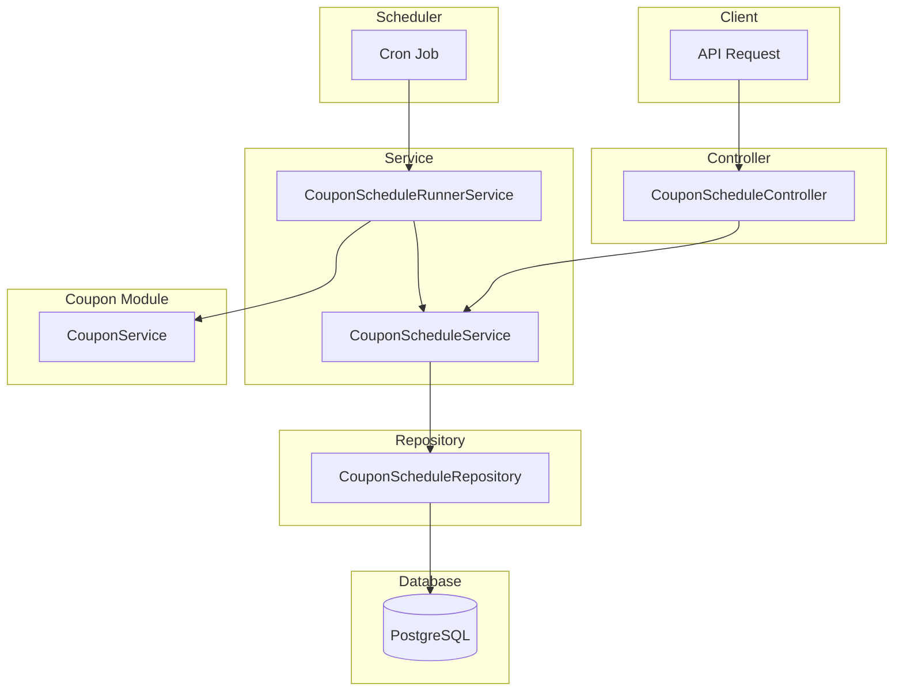

# Coupon Schedule Module Documentation

## Tổng Quan

Module `coupon-schedule` quản lý các lịch tự động tạo coupon theo chu kỳ. Module này cho phép admin tạo các lịch coupon sẽ tự động chạy vào các thời điểm định kỳ (hàng năm, hàng quý, hàng tháng, hàng tuần, hàng ngày) để tạo ra các coupon mới.

Hệ thống sử dụng scheduler service để chạy các lịch coupon tự động và tạo coupon mới dựa trên cấu hình của lịch.

---

## Kiến Trúc



---

## API Endpoints

> [!TIP]
> Tất cả các API đều hỗ trợ header `Accept-Language` để chọn ngôn ngữ phản hồi.
> - **vi** - Tiếng Việt (mặc định)
> - **en** - English

### 1. POST /coupon-schedules - Tạo lịch coupon mới

**Mô tả:** Tạo mới một lịch tự động tạo coupon theo chu kỳ. Hỗ trợ các chu kỳ: YEARLY (hàng năm), QUARTERLY (hàng quý), MONTHLY (hàng tháng), WEEKLY (hàng tuần), DAILY (hàng ngày).

**Xác thực:** Bearer Token (JWT)

**Quyền yêu cầu:** `coupon-schedule.create`

**Headers:**
```http
Authorization: Bearer <access_token>
Content-Type: application/json
Accept-Language: vi
```

**Request Body Schema:**

| Field | Type | Required | Description |
|-------|------|----------|-------------|
| `name` | string | Yes | Tên lịch coupon (max 255 ký tự) |
| `description` | string | Optional | Mô tả lịch coupon |
| `period` | enum | Yes | Chu kỳ: `YEARLY`, `QUARTERLY`, `MONTHLY`, `WEEKLY`, `DAILY` |
| `coupon_type` | enum | Optional | Loại coupon: `PUBLIC` hoặc `PRIVATE` (default: `PUBLIC`) |
| `scheduled_day` | number | Conditional | Ngày trong tháng (1-31, required nếu period = YEARLY/QUARTERLY/MONTHLY) |
| `scheduled_month` | number | Conditional | Tháng trong năm (1-12, required nếu period = YEARLY/QUARTERLY) |
| `scheduled_weekday` | number | Conditional | Thứ trong tuần (0-6, 0=CN, required nếu period = WEEKLY) |
| `scheduled_hour` | number | Conditional | Giờ (0-23, required nếu period = DAILY) |
| `scheduled_minute` | number | Conditional | Phút (0-59, required nếu period = DAILY) |
| `is_random_code` | boolean | Optional | Sử dụng mã ngẫu nhiên (default: true) |
| `is_fixed_code` | boolean | Conditional | Sử dụng mã cố định (required nếu `is_random_code = false`) |
| `fixed_code_value` | string | Conditional | Giá trị mã cố định (required nếu `is_fixed_code = true`, max 30 ký tự) |
| `use_suffix` | boolean | Optional | Sử dụng hậu tố cho mã (default: false) |
| `use_prefix` | boolean | Optional | Sử dụng tiền tố cho mã (default: false) |
| `is_permanent_coupon` | boolean | Optional | Coupon được tạo là vĩnh viễn (default: false) |
| `coupon_duration_value` | number | Conditional | Giá trị thời gian hiệu lực (required nếu `is_permanent_coupon = false`) |
| `coupon_duration_unit` | enum | Conditional | Đơn vị: `HOUR`, `DAY`, `WEEK`, `MONTH`, `YEAR` (required nếu `is_permanent_coupon = false`) |
| `discount_type` | enum | Yes | Loại giảm giá: `PERCENT`, `AMOUNT`, `FREE_MONTHS` |
| `discount_value` | number | Yes | Giá trị giảm giá |
| `require_min_warehouses` | boolean | Optional | Yêu cầu số kho tối thiểu (default: false) |
| `min_warehouses` | number | Conditional | Số kho tối thiểu (required nếu `require_min_warehouses = true`) |
| `require_min_rows` | boolean | Optional | Yêu cầu số row tối thiểu (default: false) |
| `min_rows` | number | Conditional | Số row tối thiểu (required nếu `require_min_rows = true`) |
| `require_min_order_amount` | boolean | Optional | Yêu cầu đơn hàng tối thiểu (default: false) |
| `min_order_amount` | number | Conditional | Giá trị đơn hàng tối thiểu (required nếu `require_min_order_amount = true`) |
| `require_min_rental_duration` | boolean | Optional | Yêu cầu thời gian thuê tối thiểu (default: false) |
| `min_rental_duration_value` | number | Conditional | Giá trị thời gian thuê tối thiểu (required nếu `require_min_rental_duration = true`) |
| `min_rental_duration_unit` | enum | Conditional | Đơn vị: `HOUR`, `DAY`, `WEEK`, `MONTH`, `YEAR` (required nếu `require_min_rental_duration = true`) |
| `is_unlimited_discount` | boolean | Optional | Không giới hạn giảm giá (chỉ cho PERCENT, default: false) |
| `max_discount_amount` | number | Conditional | Giá trị giảm tối đa (required nếu `discount_type = PERCENT` và `is_unlimited_discount = false`) |
| `max_usage` | number | Optional | Số lượng sử dụng tối đa cho mỗi coupon được tạo (default: 0 = không giới hạn) |
| `is_public` | boolean | Optional | Coupon công khai (default: true) |
| `apply_for_first_rental` | boolean | Optional | Áp dụng cho thuê lần đầu (default: true) |
| `apply_for_renewal` | boolean | Optional | Áp dụng cho gia hạn (default: true) |
| `is_unlimited_stack` | boolean | Optional | Có thể áp dụng chung với vô hạn coupon khác (default: false) |
| `max_stack_count` | number | Conditional | Số coupon tối đa có thể áp dụng chung (required nếu `is_unlimited_stack = false`) |
| `has_gift_addons` | boolean | Optional | Có tặng kèm addon (default: false) |
| `gift_addon_ids` | array | Conditional | Danh sách ID addon được tặng (required nếu `has_gift_addons = true`) |
| `has_gift_insurances` | boolean | Optional | Có tặng kèm bảo hiểm (default: false) |
| `gift_insurance_ids` | array | Conditional | Danh sách ID bảo hiểm được tặng (required nếu `has_gift_insurances = true`) |
| `target_user_ids` | array | Conditional | Danh sách ID user (required nếu `coupon_type = PRIVATE`) |
| `is_active` | boolean | Optional | Trạng thái hoạt động (default: true) |

**Request Body Examples:**

<details>
<summary><b>Ví dụ 1: Lịch hàng tháng - Giảm giá đầu tháng</b></summary>

```json
{
  "name": "Khuyến mãi đầu tháng",
  "description": "Coupon giảm giá 20% vào đầu mỗi tháng",
  "period": "MONTHLY",
  "scheduled_day": 1,
  "discount_type": "PERCENT",
  "discount_value": 20,
  "is_random_code": true,
  "is_permanent_coupon": false,
  "coupon_duration_value": 7,
  "coupon_duration_unit": "DAY",
  "max_usage": 100,
  "is_active": true
}
```
</details>

<details>
<summary><b>Ví dụ 2: Lịch hàng năm - Khuyến mãi Tết</b></summary>

```json
{
  "name": "Khuyến mãi Tết Nguyên Đán",
  "description": "Coupon giảm 500,000đ cho năm mới",
  "period": "YEARLY",
  "scheduled_day": 1,
  "scheduled_month": 1,
  "discount_type": "AMOUNT",
  "discount_value": 500000,
  "is_random_code": false,
  "is_fixed_code": true,
  "fixed_code_value": "TET",
  "use_suffix": true,
  "is_permanent_coupon": false,
  "coupon_duration_value": 1,
  "coupon_duration_unit": "MONTH",
  "max_usage": 1000,
  "is_active": true
}
```
</details>

<details>
<summary><b>Ví dụ 3: Lịch hàng tuần với điều kiện</b></summary>

```json
{
  "name": "Khuyến mãi VIP",
  "description": "Coupon dành cho đơn hàng lớn",
  "period": "WEEKLY",
  "scheduled_weekday": 1,
  "discount_type": "PERCENT",
  "discount_value": 15,
  "is_random_code": true,
  "is_permanent_coupon": false,
  "coupon_duration_value": 3,
  "coupon_duration_unit": "DAY",
  "require_min_order_amount": true,
  "min_order_amount": 5000000,
  "require_min_rental_duration": true,
  "min_rental_duration_value": 6,
  "min_rental_duration_unit": "MONTH",
  "is_unlimited_discount": false,
  "max_discount_amount": 1000000,
  "max_usage": 50,
  "is_active": true
}
```
</details>

<details>
<summary><b>Ví dụ 4: Lịch coupon riêng tư</b></summary>

```json
{
  "name": "Khuyến mãi thành viên thân thiết",
  "description": "Coupon dành riêng cho khách hàng VIP",
  "period": "MONTHLY",
  "scheduled_day": 15,
  "coupon_type": "PRIVATE",
  "discount_type": "PERCENT",
  "discount_value": 30,
  "is_random_code": true,
  "is_permanent_coupon": false,
  "coupon_duration_value": 14,
  "coupon_duration_unit": "DAY",
  "max_usage": 1,
  "target_user_ids": [
    "550e8400-e29b-41d4-a716-446655440001",
    "550e8400-e29b-41d4-a716-446655440002"
  ],
  "is_active": true
}
```
</details>

**Response (201 Created):**

```json
{
  "code": "coupon-schedule.create.success",
  "message": "Tạo lịch coupon thành công",
  "success": true,
  "data": {
    "id": "550e8400-e29b-41d4-a716-446655440000",
    "name": "Khuyến mãi đầu tháng",
    "description": "Coupon giảm giá 20% vào đầu mỗi tháng",
    "period": "MONTHLY",
    "scheduled_day": 1,
    "scheduled_month": null,
    "scheduled_weekday": null,
    "scheduled_hour": null,
    "scheduled_minute": null,
    "is_random_code": true,
    "is_fixed_code": false,
    "fixed_code_value": null,
    "use_suffix": false,
    "use_prefix": false,
    "is_permanent_coupon": false,
    "coupon_duration_value": 7,
    "coupon_duration_unit": "DAY",
    "discount_type": "PERCENT",
    "discount_value": 20,
    "require_min_warehouses": false,
    "min_warehouses": null,
    "require_min_rows": false,
    "min_rows": null,
    "require_min_order_amount": false,
    "min_order_amount": null,
    "require_min_rental_duration": false,
    "min_rental_duration_value": null,
    "min_rental_duration_unit": null,
    "is_unlimited_discount": false,
    "max_discount_amount": null,
    "max_usage": 100,
    "is_public": true,
    "apply_for_first_rental": true,
    "apply_for_renewal": true,
    "is_unlimited_stack": false,
    "max_stack_count": 1,
    "has_gift_addons": false,
    "has_gift_insurances": false,
    "last_run_at": null,
    "next_run_at": "2026-02-01T00:00:00.000Z",
    "is_active": true,
    "created_at": "2026-01-22T13:00:00.000Z",
    "created_by": "550e8400-e29b-41d4-a716-446655440099"
  }
}
```

**Error Responses:**

<details>
<summary><b>401 Unauthorized</b></summary>

Xem [Error Responses](#error-responses) chung
</details>

<details>
<summary><b>403 Forbidden</b></summary>

Xem [Error Responses](#error-responses) chung
</details>

<details>
<summary><b>422 Unprocessable Entity - Validation Error</b></summary>

Xem [Error Responses](#error-responses) chung
</details>

---

### 2. GET /coupon-schedules - Lấy danh sách lịch coupon

**Mô tả:** Lấy danh sách các lịch coupon với phân trang và lọc theo trạng thái hoạt động. Hỗ trợ tìm kiếm theo tên.

**Xác thực:** Bearer Token (JWT)

**Quyền yêu cầu:** `coupon-schedule.list`

**Headers:**
```http
Authorization: Bearer <access_token>
Accept-Language: vi
```

**Query Parameters:**

| Parameter | Type | Required | Description |
|-----------|------|----------|-------------|
| `limit` | number | Optional | Số lượng bản ghi mỗi trang (default: 10, min: 1, max: 100) |
| `offset` | number | Optional | Vị trí bắt đầu (default: 0, min: 0) |
| `keywords` | string | Optional | Từ khóa tìm kiếm theo tên lịch coupon |
| `is_active` | boolean | Optional | Lọc theo trạng thái hoạt động |

**Response (200 OK):**

```json
{
  "code": "coupon-schedule.list.success",
  "message": "Lấy danh sách lịch coupon thành công",
  "success": true,
  "data": {
    "items": [
      {
        "id": "550e8400-e29b-41d4-a716-446655440001",
        "name": "Khuyến mãi đầu tháng",
        "description": "Coupon giảm giá 20% vào đầu mỗi tháng",
        "period": "MONTHLY",
        "discount_type": "PERCENT",
        "discount_value": 20,
        "is_active": true,
        "last_run_at": "2026-01-01T00:00:00.000Z",
        "next_run_at": "2026-02-01T00:00:00.000Z",
        "created_at": "2025-12-15T10:30:00.000Z"
      }
    ],
    "total": 50,
    "limit": 10,
    "offset": 0,
    "hasMore": true
  }
}
```

**Error Responses:**

<details>
<summary><b>401 Unauthorized</b></summary>

Xem [Error Responses](#error-responses) chung
</details>

<details>
<summary><b>403 Forbidden</b></summary>

Xem [Error Responses](#error-responses) chung
</details>

---

### 3. GET /coupon-schedules/:id - Lấy chi tiết lịch coupon

**Mô tả:** Lấy thông tin chi tiết của một lịch coupon theo ID, bao gồm tất cả cấu hình và điều kiện áp dụng.

**Xác thực:** Bearer Token (JWT)

**Quyền yêu cầu:** `coupon-schedule.read`

**Headers:**
```http
Authorization: Bearer <access_token>
Accept-Language: vi
```

**Path Parameters:**

| Parameter | Type | Description |
|-----------|------|-------------|
| `id` | string (UUID) | ID của lịch coupon |

**Response (200 OK):** Trả về đầy đủ thông tin lịch coupon (tương tự response của POST /coupon-schedules)

**Error Responses:**

<details>
<summary><b>404 Not Found</b></summary>

```json
{
  "code": "coupon-schedule.errors.not_found",
  "message": "Không tìm thấy lịch coupon",
  "success": false
}
```
</details>

<details>
<summary><b>401 Unauthorized</b></summary>

Xem [Error Responses](#error-responses) chung
</details>

<details>
<summary><b>403 Forbidden</b></summary>

Xem [Error Responses](#error-responses) chung
</details>

---

### 4. PUT /coupon-schedules/:id - Cập nhật lịch coupon

**Mô tả:** Cập nhật thông tin của một lịch coupon. Chỉ các trường được gửi trong request body mới được cập nhật, các trường khác giữ nguyên.

**Xác thực:** Bearer Token (JWT)

**Quyền yêu cầu:** `coupon-schedule.update`

**Headers:**
```http
Authorization: Bearer <access_token>
Content-Type: application/json
Accept-Language: vi
```

**Path Parameters:**

| Parameter | Type | Description |
|-----------|------|-------------|
| `id` | string (UUID) | ID của lịch coupon |

**Request Body:** Tương tự như `CreateCouponScheduleDto` nhưng tất cả các trường đều optional

**Request Body Examples:**

<details>
<summary><b>Ví dụ 1: Cập nhật thông tin cơ bản</b></summary>

```json
{
  "name": "Khuyến mãi đầu tháng - Updated",
  "description": "Mô tả mới cho lịch coupon"
}
```
</details>

<details>
<summary><b>Ví dụ 2: Cập nhật giảm giá</b></summary>

```json
{
  "discount_type": "PERCENT",
  "discount_value": 25,
  "is_unlimited_discount": false,
  "max_discount_amount": 750000
}
```
</details>

<details>
<summary><b>Ví dụ 3: Cập nhật lịch chạy</b></summary>

```json
{
  "period": "WEEKLY",
  "scheduled_weekday": 5
}
```
</details>

<details>
<summary><b>Ví dụ 4: Bật/tắt trạng thái</b></summary>

```json
{
  "is_active": false
}
```
</details>

**Response (200 OK):** Trả về thông tin lịch coupon sau khi cập nhật

**Error Responses:**

<details>
<summary><b>404 Not Found</b></summary>

```json
{
  "code": "coupon-schedule.errors.not_found",
  "message": "Không tìm thấy lịch coupon",
  "success": false
}
```
</details>

<details>
<summary><b>401 Unauthorized</b></summary>

Xem [Error Responses](#error-responses) chung
</details>

<details>
<summary><b>403 Forbidden</b></summary>

Xem [Error Responses](#error-responses) chung
</details>

<details>
<summary><b>422 Unprocessable Entity - Validation Error</b></summary>

Xem [Error Responses](#error-responses) chung
</details>

---

### 5. DELETE /coupon-schedules/delete/many - Xóa nhiều lịch coupon

**Mô tả:** Xóa mềm nhiều lịch coupon theo danh sách ID. Các lịch đã xóa có thể khôi phục.

**Xác thực:** Bearer Token (JWT)

**Quyền yêu cầu:** `coupon-schedule.delete`

**Headers:**
```http
Authorization: Bearer <access_token>
Content-Type: application/json
Accept-Language: vi
```

**Request Body:**

```json
{
  "ids": [
    "550e8400-e29b-41d4-a716-446655440001",
    "550e8400-e29b-41d4-a716-446655440002",
    "550e8400-e29b-41d4-a716-446655440003"
  ]
}
```

**Response (200 OK):**

```json
{
  "code": "coupon-schedule.delete.success",
  "message": "Xóa nhiều lịch coupon thành công",
  "success": true,
  "data": null
}
```

**Error Responses:**

<details>
<summary><b>404 Not Found</b></summary>

```json
{
  "code": "coupon-schedule.errors.not_found",
  "message": "Không tìm thấy lịch coupon",
  "success": false
}
```
</details>

<details>
<summary><b>401 Unauthorized</b></summary>

Xem [Error Responses](#error-responses) chung
</details>

<details>
<summary><b>403 Forbidden</b></summary>

Xem [Error Responses](#error-responses) chung
</details>

<details>
<summary><b>422 Unprocessable Entity - Validation Error</b></summary>

Xem [Error Responses](#error-responses) chung
</details>

---

### 6. DELETE /coupon-schedules/:id - Xóa lịch coupon

**Mô tả:** Xóa mềm một lịch coupon theo ID. Lịch đã xóa có thể khôi phục.

**Xác thực:** Bearer Token (JWT)

**Quyền yêu cầu:** `coupon-schedule.delete`

**Headers:**
```http
Authorization: Bearer <access_token>
Accept-Language: vi
```

**Path Parameters:**

| Parameter | Type | Description |
|-----------|------|-------------|
| `id` | string (UUID) | ID của lịch coupon |

**Response (200 OK):**

```json
{
  "code": "coupon-schedule.delete.success",
  "message": "Xóa lịch coupon thành công",
  "success": true,
  "data": null
}
```

**Error Responses:**

<details>
<summary><b>404 Not Found</b></summary>

```json
{
  "code": "coupon-schedule.errors.not_found",
  "message": "Không tìm thấy lịch coupon",
  "success": false
}
```
</details>

<details>
<summary><b>401 Unauthorized</b></summary>

Xem [Error Responses](#error-responses) chung
</details>

<details>
<summary><b>403 Forbidden</b></summary>

Xem [Error Responses](#error-responses) chung
</details>

---

## Error Responses

### 401 Unauthorized

```json
// Không có token
{
  "code": "error.unauthorized.token_missing",
  "message": "Không có quyền truy cập",
  "success": false
}

// Token hết hạn
{
  "code": "error.unauthorized.token_expired",
  "message": "Token đã hết hạn",
  "success": false
}

// Token không hợp lệ
{
  "code": "error.unauthorized.token_invalid",
  "message": "Token không hợp lệ",
  "success": false
}

// Token không đúng định dạng
{
  "code": "error.unauthorized.token_malformed",
  "message": "Token không đúng định dạng",
  "success": false
}
```

### 403 Forbidden

```json
// Không có quyền thực hiện
{
  "code": "error.forbidden.no_permission",
  "message": "Không có quyền thực hiện thao tác này",
  "success": false
}

// Tài khoản bị khóa
{
  "code": "error.forbidden.account_banned",
  "message": "Tài khoản đã bị khóa",
  "success": false
}

// Tài khoản chưa xác minh
{
  "code": "error.forbidden.account_not_verified",
  "message": "Tài khoản chưa được xác minh. Vui lòng xác minh email để tiếp tục.",
  "success": false
}

// Tài khoản không tồn tại
{
  "code": "error.forbidden.account_not_found",
  "message": "Tài khoản không tồn tại",
  "success": false
}
```

### 422 Unprocessable Entity - Validation Error

```json
{
  "code": "error.validation",
  "message": "Dữ liệu đầu vào không hợp lệ",
  "success": false,
  "errors": [
    { "field": "scheduled_day", "message": "Ngày trong tháng phải từ 1 đến 31" },
    { "field": "discount_value", "message": "Giá trị giảm giá phải từ 1 đến 100 cho loại PERCENT" }
  ]
}
```

---

## Validation Rules

### Period & Scheduling

- **YEARLY**: `scheduled_day` (1-31) và `scheduled_month` (1-12) bắt buộc
- **QUARTERLY**: `scheduled_day` (1-31) và `scheduled_month` (1-12) bắt buộc
- **MONTHLY**: `scheduled_day` (1-31) bắt buộc
- **WEEKLY**: `scheduled_weekday` (0-6, 0=CN) bắt buộc
- **DAILY**: `scheduled_hour` (0-23) và `scheduled_minute` (0-59) bắt buộc

### Code Configuration

- Nếu `is_random_code = false` → `is_fixed_code` và `fixed_code_value` bắt buộc
- `fixed_code_value`: max 30 ký tự

### Coupon Duration

- Nếu `is_permanent_coupon = false` → `coupon_duration_value` và `coupon_duration_unit` bắt buộc
- `coupon_duration_value`: phải >= 1

### Discount

- **PERCENT**: `discount_value` từ 1-100
- **AMOUNT**: `discount_value` > 0
- **FREE_MONTHS**: `discount_value` > 0
- Nếu `discount_type = PERCENT` và `is_unlimited_discount = false` → `max_discount_amount` bắt buộc

### Conditional Fields

Tương tự như module `coupon`, các điều kiện áp dụng có validation tương tự.

---

## Scheduling Logic

### Next Run Calculation

Hệ thống tự động tính toán `next_run_at` dựa trên `period` và các thông số scheduling:

- **YEARLY**: Chạy vào ngày `scheduled_day` tháng `scheduled_month` hàng năm
- **QUARTERLY**: Chạy vào ngày `scheduled_day` tháng `scheduled_month` mỗi quý (tháng 1, 4, 7, 10)
- **MONTHLY**: Chạy vào ngày `scheduled_day` hàng tháng
- **WEEKLY**: Chạy vào thứ `scheduled_weekday` hàng tuần
- **DAILY**: Chạy vào `scheduled_hour:scheduled_minute` hàng ngày

### Coupon Creation

Khi scheduler chạy, hệ thống sẽ:

1. Tìm tất cả lịch coupon có `is_active = true` và `next_run_at <= now`
2. Với mỗi lịch:
   - Tạo coupon mới dựa trên cấu hình của lịch
   - Tính toán thời gian hiệu lực:
     - Nếu `is_permanent_coupon = true`: `starts_at = now`, `ends_at = null`
     - Nếu `is_permanent_coupon = false`: `starts_at = now`, `ends_at = now + coupon_duration_value + coupon_duration_unit`
   - Tạo mã coupon:
     - Nếu `is_random_code = true`: Tạo mã ngẫu nhiên
     - Nếu `is_fixed_code = true`: Sử dụng `fixed_code_value` + suffix/prefix nếu có
   - Cập nhật `last_run_at = now` và tính `next_run_at` mới
   - Ghi log hệ thống

---

## Permissions

| Permission | Mô tả |
|------------|-------|
| `coupon-schedule.create` | Tạo lịch coupon mới |
| `coupon-schedule.list` | Xem danh sách lịch coupon |
| `coupon-schedule.read` | Xem chi tiết lịch coupon |
| `coupon-schedule.update` | Cập nhật lịch coupon |
| `coupon-schedule.delete` | Xóa lịch coupon |

---

## Files Trong Module

| File | Mô tả |
|------|-------|
| [coupon-schedule.module.ts](../../src/modules/coupon-schedule/coupon-schedule.module.ts) | NestJS module definition |
| [coupon-schedule.controller.ts](../../src/modules/coupon-schedule/coupon-schedule.controller.ts) | REST API endpoints |
| [coupon-schedule.service.ts](../../src/modules/coupon-schedule/coupon-schedule.service.ts) | Business logic |
| [coupon-schedule-runner.service.ts](../../src/modules/coupon-schedule/coupon-schedule-runner.service.ts) | Scheduler service để chạy lịch |
| [dto/create-coupon-schedule.dto.ts](../../src/modules/coupon-schedule/dto/create-coupon-schedule.dto.ts) | DTO tạo lịch |
| [dto/update-coupon-schedule.dto.ts](../../src/modules/coupon-schedule/dto/update-coupon-schedule.dto.ts) | DTO cập nhật lịch |
| [dto/query-coupon-schedule.dto.ts](../../src/modules/coupon-schedule/dto/query-coupon-schedule.dto.ts) | Query DTO |
| [interfaces/coupon-schedule.interface.ts](../../src/modules/coupon-schedule/interfaces/coupon-schedule.interface.ts) | TypeScript interfaces |
