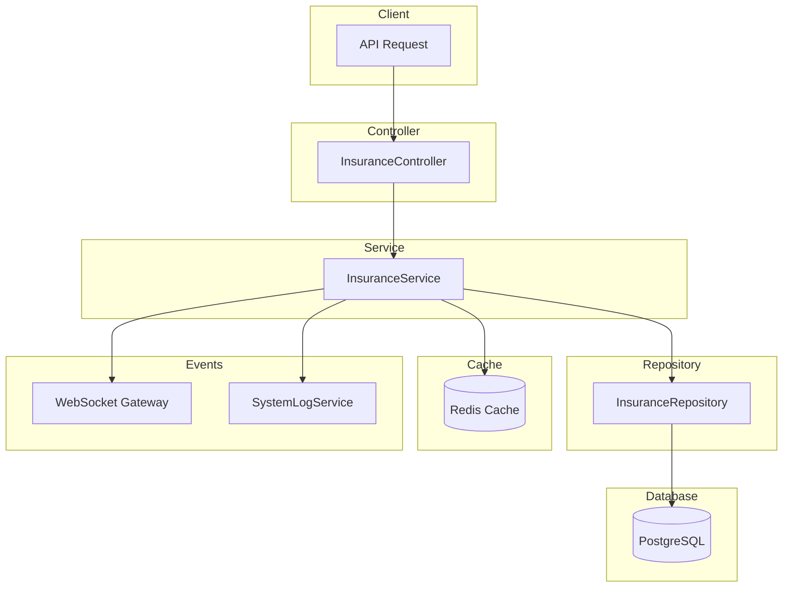

# Insurance Module Documentation

## Tổng Quan

Module `insurance` quản lý các gói bảo hiểm trong hệ thống GEN-HUB. Hỗ trợ tạo, cập nhật, xóa và quản lý các gói bảo hiểm với các tính năng:

- Quản lý thông tin bảo hiểm (tên, mô tả, giá)
- Phí quản lý linh hoạt (theo phần trăm hoặc số tiền cố định)
- Trạng thái hoạt động (active/inactive)
- Soft delete với khả năng khôi phục
- Cache với Redis để tối ưu hiệu suất
- Real-time updates qua WebSocket

---

## Kiến Trúc



---

## API Endpoints

> [!TIP]
> Tất cả các API đều hỗ trợ header `Accept-Language` để chọn ngôn ngữ phản hồi.
>
> - **vi** - Tiếng Việt (mặc định)
> - **en** - English

### 1. POST /insurances - Tạo bảo hiểm mới

**Mô tả:** Tạo một gói bảo hiểm mới cho hệ thống.

**Xác thực:** Bearer Token (JWT)

**Quyền yêu cầu:** `insurance.create`

**Headers:**

```http
Authorization: Bearer <access_token>
Content-Type: application/json
Accept-Language: vi
```

**Request Body Schema:**

| Field                  | Type    | Required    | Description                                                                |
| ---------------------- | ------- | ----------- | -------------------------------------------------------------------------- |
| `name`                 | string  | Required    | Tên bảo hiểm (max 255 ký tự)                                               |
| `description`          | string  | Optional    | Mô tả bảo hiểm                                                             |
| `price`                | number  | Required    | Giá bảo hiểm (VNĐ, min: 0)                                                 |
| `use_management_fee`   | boolean | Optional    | Sử dụng phí quản lý (default: false)                                       |
| `management_fee_type`  | enum    | Conditional | Loại phí: `PERCENT` hoặc `AMOUNT` (bắt buộc khi use_management_fee = true) |
| `management_fee_value` | number  | Conditional | Giá trị phí (bắt buộc khi use_management_fee = true)                       |
| `is_active`            | boolean | Optional    | Trạng thái hoạt động (default: true)                                       |

**Request Body Examples:**

<details>
<summary><b>Ví dụ 1: Bảo hiểm cơ bản</b></summary>

```json
{
  "name": "Bảo hiểm hàng hóa cơ bản",
  "description": "Bảo hiểm giá trị hàng hóa trong kho",
  "price": 500000,
  "is_active": true
}
```

</details>

<details>
<summary><b>Ví dụ 2: Bảo hiểm với phí quản lý theo %</b></summary>

```json
{
  "name": "Bảo hiểm cao cấp",
  "description": "Bảo hiểm toàn diện cho hàng hóa giá trị cao",
  "price": 1000000,
  "use_management_fee": true,
  "management_fee_type": "PERCENT",
  "management_fee_value": 10,
  "is_active": true
}
```

</details>

<details>
<summary><b>Ví dụ 3: Bảo hiểm với phí quản lý cố định</b></summary>

```json
{
  "name": "Bảo hiểm tiêu chuẩn",
  "description": "Gói bảo hiểm tiêu chuẩn cho kho hàng",
  "price": 750000,
  "use_management_fee": true,
  "management_fee_type": "AMOUNT",
  "management_fee_value": 50000,
  "is_active": true
}
```

</details>

**Response (201 Created):**

```json
{
  "code": "insurance.create.success",
  "message": "Tạo bảo hiểm thành công",
  "success": true,
  "data": {
    "id": "550e8400-e29b-41d4-a716-446655440000",
    "name": "Bảo hiểm hàng hóa cơ bản",
    "description": "Bảo hiểm giá trị hàng hóa trong kho",
    "price": 500000,
    "use_management_fee": false,
    "management_fee_type": null,
    "management_fee_value": null,
    "is_active": true,
    "created_at": "2026-01-22T10:00:00.000Z",
    "updated_at": null,
    "created_by": "550e8400-e29b-41d4-a716-446655440001"
  }
}
```

**Error Responses:**

<details>
<summary><b>409 Conflict - Tên đã tồn tại</b></summary>

```json
{
  "code": "insurance.errors.name_exists",
  "message": "Tên bảo hiểm đã tồn tại",
  "success": false
}
```

</details>

<details>
<summary><b>401 Unauthorized</b></summary>

```json
// Không có token
{
  "code": "error.unauthorized.token_missing",
  "message": "Không có quyền truy cập",
  "success": false
}

// Token hết hạn
{
  "code": "error.unauthorized.token_expired",
  "message": "Token đã hết hạn",
  "success": false
}

// Token không hợp lệ
{
  "code": "error.unauthorized.token_invalid",
  "message": "Token không hợp lệ",
  "success": false
}
```

</details>

<details>
<summary><b>403 Forbidden</b></summary>

```json
// Không có quyền thực hiện
{
  "code": "error.forbidden.no_permission",
  "message": "Không có quyền thực hiện thao tác này",
  "success": false
}

// Tài khoản bị khóa
{
  "code": "error.forbidden.account_banned",
  "message": "Tài khoản đã bị khóa",
  "success": false
}
```

</details>

<details>
<summary><b>422 Unprocessable Entity</b></summary>

```json
{
  "code": "error.validation",
  "message": "Dữ liệu đầu vào không hợp lệ",
  "success": false,
  "errors": [
    { "field": "name", "message": "Tên bảo hiểm không được để trống" },
    { "field": "price", "message": "Giá bảo hiểm phải là số" }
  ]
}
```

</details>

---

### 2. GET /insurances - Lấy danh sách bảo hiểm

**Mô tả:** Lấy danh sách tất cả bảo hiểm với phân trang và bộ lọc.

**Xác thực:** Bearer Token (JWT)

**Quyền yêu cầu:** `insurance.list` hoặc `insurance.list.all`

> [!NOTE]
> - Với quyền `insurance.list`: chỉ lấy các bảo hiểm do chính user tạo (created_by = userId)
> - Với quyền `insurance.list.all`: lấy tất cả bảo hiểm của mọi người

**Headers:**

```http
Authorization: Bearer <access_token>
Accept-Language: vi
```

**Query Parameters:**

| Parameter   | Type    | Required | Default | Description                          |
| ----------- | ------- | -------- | ------- | ------------------------------------ |
| `limit`     | number  | Optional | 10      | Số lượng bản ghi mỗi trang (min: 1)  |
| `offset`    | number  | Optional | 0       | Vị trí bắt đầu                       |
| `keywords`  | string  | Optional | -       | Từ khóa tìm kiếm theo tên hoặc mô tả |
| `is_active` | boolean | Optional | -       | Lọc theo trạng thái hoạt động        |

**Request Examples:**

```http
# Lấy 10 bảo hiểm đầu tiên
GET /insurances HTTP/1.1

# Lấy trang thứ 2 (10 items/trang)
GET /insurances?limit=10&offset=10 HTTP/1.1

# Tìm kiếm theo từ khóa
GET /insurances?keywords=cao+cấp HTTP/1.1

# Lọc chỉ bảo hiểm đang hoạt động
GET /insurances?is_active=true HTTP/1.1
```

**Response (200 OK):**

```json
{
  "code": "insurance.list.success",
  "message": "Lấy danh sách bảo hiểm thành công",
  "success": true,
  "data": {
    "items": [
      {
        "id": "550e8400-e29b-41d4-a716-446655440000",
        "name": "Bảo hiểm hàng hóa cơ bản",
        "description": "Bảo hiểm giá trị hàng hóa trong kho",
        "price": 500000,
        "use_management_fee": false,
        "management_fee_type": null,
        "management_fee_value": null,
        "is_active": true,
        "created_at": "2026-01-22T10:00:00.000Z"
      },
      {
        "id": "550e8400-e29b-41d4-a716-446655440001",
        "name": "Bảo hiểm cao cấp",
        "description": "Bảo hiểm toàn diện cho hàng hóa giá trị cao",
        "price": 1000000,
        "use_management_fee": true,
        "management_fee_type": "PERCENT",
        "management_fee_value": 10,
        "is_active": true,
        "created_at": "2026-01-22T09:00:00.000Z"
      }
    ],
    "total": 50,
    "limit": 10,
    "offset": 0,
    "hasMore": true
  }
}
```

---

### 3. GET /insurances/active - Lấy danh sách bảo hiểm đang hoạt động

**Mô tả:** Lấy danh sách tất cả bảo hiểm có trạng thái is_active = true và is_deleted = false với phân trang. API này không yêu cầu xác thực và có thể được sử dụng công khai.

**Xác thực:** Không yêu cầu

**Headers:**
```http
Accept-Language: vi
```

**Query Parameters:**

| Parameter | Type   | Required | Default | Description                         |
| --------- | ------ | -------- | ------- | ----------------------------------- |
| `limit`   | number | Optional | 10      | Số lượng bản ghi mỗi trang (min: 1) |
| `offset`  | number | Optional | 0       | Vị trí bắt đầu (min: 0)             |

**Request Examples:**

```http
# Lấy 10 bảo hiểm active đầu tiên
GET /insurances/active HTTP/1.1

# Lấy với phân trang
GET /insurances/active?limit=20&offset=40 HTTP/1.1
```

**Response (200 OK):**

```json
{
  "code": "insurance.list.success",
  "message": "Lấy danh sách bảo hiểm active thành công",
  "success": true,
  "data": {
    "items": [
      {
        "id": "550e8400-e29b-41d4-a716-446655440000",
        "name": "Bảo hiểm hàng hóa cơ bản",
        "description": "Bảo hiểm giá trị hàng hóa trong kho",
        "price": 500000,
        "use_management_fee": false,
        "management_fee_type": null,
        "management_fee_value": null,
        "is_active": true
      },
      {
        "id": "550e8400-e29b-41d4-a716-446655440001",
        "name": "Bảo hiểm cao cấp",
        "description": "Bảo hiểm toàn diện cho hàng hóa giá trị cao",
        "price": 1000000,
        "use_management_fee": true,
        "management_fee_type": "PERCENT",
        "management_fee_value": 10,
        "is_active": true
      }
    ],
    "total": 25,
    "limit": 10,
    "offset": 0
  }
}
```

---

### 4. GET /insurances/:id - Lấy chi tiết bảo hiểm

**Mô tả:** Lấy thông tin chi tiết của một bảo hiểm theo ID.

**Xác thực:** Bearer Token (JWT)

**Quyền yêu cầu:** `insurance.read` hoặc `insurance.read.all`

> [!NOTE]
> - Với quyền `insurance.read`: chỉ lấy được bảo hiểm do chính user tạo (created_by = userId)
> - Với quyền `insurance.read.all`: lấy được bảo hiểm của bất kỳ ai

**Headers:**

```http
Authorization: Bearer <access_token>
Accept-Language: vi
```

**Path Parameters:**

| Parameter | Type | Description     |
| --------- | ---- | --------------- |
| `id`      | UUID | ID của bảo hiểm |

**Request:**

```http
GET /insurances/550e8400-e29b-41d4-a716-446655440000 HTTP/1.1
```

**Response (200 OK):**

```json
{
  "code": "insurance.read.success",
  "message": "Lấy chi tiết bảo hiểm thành công",
  "success": true,
  "data": {
    "id": "550e8400-e29b-41d4-a716-446655440000",
    "name": "Bảo hiểm hàng hóa cơ bản",
    "description": "Bảo hiểm giá trị hàng hóa trong kho",
    "price": 500000,
    "use_management_fee": false,
    "management_fee_type": null,
    "management_fee_value": null,
    "is_active": true,
    "created_at": "2026-01-22T10:00:00.000Z",
    "updated_at": null,
    "created_by": "550e8400-e29b-41d4-a716-446655440001",
    "updated_by": null
  }
}
```

**Error Responses:**

<details>
<summary><b>404 Not Found</b></summary>

```json
{
  "code": "insurance.errors.not_found",
  "message": "Không tìm thấy bảo hiểm",
  "success": false
}
```

</details>

---

### 5. PUT /insurances/:id - Cập nhật bảo hiểm

**Mô tả:** Cập nhật thông tin của một bảo hiểm. Chỉ các trường được gửi trong request body mới được cập nhật.

**Xác thực:** Bearer Token (JWT)

**Quyền yêu cầu:** `insurance.update` hoặc `insurance.update.all`

> [!NOTE]
> - Với quyền `insurance.update`: chỉ cập nhật được bảo hiểm do chính user tạo (created_by = userId)
> - Với quyền `insurance.update.all`: cập nhật được bảo hiểm của bất kỳ ai

**Headers:**

```http
Authorization: Bearer <access_token>
Content-Type: application/json
Accept-Language: vi
```

**Path Parameters:**

| Parameter | Type | Description     |
| --------- | ---- | --------------- |
| `id`      | UUID | ID của bảo hiểm |

**Request Body Examples:**

<details>
<summary><b>Ví dụ 1: Cập nhật giá</b></summary>

```json
{
  "price": 600000
}
```

</details>

<details>
<summary><b>Ví dụ 2: Cập nhật tên và mô tả</b></summary>

```json
{
  "name": "Bảo hiểm hàng hóa cao cấp",
  "description": "Gói bảo hiểm cao cấp dành cho hàng hóa giá trị cao"
}
```

</details>

<details>
<summary><b>Ví dụ 3: Cập nhật phí quản lý</b></summary>

```json
{
  "use_management_fee": true,
  "management_fee_type": "PERCENT",
  "management_fee_value": 15
}
```

</details>

<details>
<summary><b>Ví dụ 4: Bật/tắt trạng thái</b></summary>

```json
{
  "is_active": false
}
```

</details>

**Response (200 OK):**

```json
{
  "code": "insurance.update.success",
  "message": "Cập nhật bảo hiểm thành công",
  "success": true,
  "data": {
    "id": "550e8400-e29b-41d4-a716-446655440000",
    "name": "Bảo hiểm hàng hóa cao cấp",
    "description": "Gói bảo hiểm cao cấp dành cho hàng hóa giá trị cao",
    "price": 600000,
    "use_management_fee": false,
    "management_fee_type": null,
    "management_fee_value": null,
    "is_active": true,
    "created_at": "2026-01-22T10:00:00.000Z",
    "updated_at": "2026-01-22T12:00:00.000Z",
    "updated_by": "550e8400-e29b-41d4-a716-446655440001"
  }
}
```

**Error Responses:**

<details>
<summary><b>404 Not Found</b></summary>

```json
{
  "code": "insurance.errors.not_found",
  "message": "Không tìm thấy bảo hiểm",
  "success": false
}
```

</details>

<details>
<summary><b>409 Conflict</b></summary>

```json
{
  "code": "insurance.errors.name_exists",
  "message": "Tên bảo hiểm đã tồn tại",
  "success": false
}
```

</details>

---

### 6. DELETE /insurances/delete/many - Xóa nhiều bảo hiểm

**Mô tả:** Xóa mềm nhiều bảo hiểm cùng lúc. Các bản ghi không bị xóa vĩnh viễn mà chỉ được đánh dấu là đã xóa.

**Xác thực:** Bearer Token (JWT)

**Quyền yêu cầu:** `insurance.delete` hoặc `insurance.delete.all`

> [!NOTE]
> - Với quyền `insurance.delete`: chỉ xóa được bảo hiểm do chính user tạo (created_by = userId)
> - Với quyền `insurance.delete.all`: xóa được bảo hiểm của bất kỳ ai

**Headers:**

```http
Authorization: Bearer <access_token>
Content-Type: application/json
Accept-Language: vi
```

**Request Body:**

```json
{
  "ids": [
    "550e8400-e29b-41d4-a716-446655440000",
    "550e8400-e29b-41d4-a716-446655440001"
  ]
}
```

**Response (200 OK):**

```json
{
  "code": "insurance.delete.success",
  "message": "Xóa nhiều bảo hiểm thành công",
  "success": true,
  "data": null
}
```

---

### 7. DELETE /insurances/:id - Xóa bảo hiểm

**Mô tả:** Xóa mềm một bảo hiểm. Bản ghi không bị xóa vĩnh viễn mà chỉ được đánh dấu là đã xóa.

**Xác thực:** Bearer Token (JWT)

**Quyền yêu cầu:** `insurance.delete` hoặc `insurance.delete.all`

> [!NOTE]
> - Với quyền `insurance.delete`: chỉ xóa được bảo hiểm do chính user tạo (created_by = userId)
> - Với quyền `insurance.delete.all`: xóa được bảo hiểm của bất kỳ ai

**Headers:**

```http
Authorization: Bearer <access_token>
Accept-Language: vi
```

**Path Parameters:**

| Parameter | Type | Description     |
| --------- | ---- | --------------- |
| `id`      | UUID | ID của bảo hiểm |

**Request:**

```http
DELETE /insurances/550e8400-e29b-41d4-a716-446655440000 HTTP/1.1
```

**Response (200 OK):**

```json
{
  "code": "insurance.delete.success",
  "message": "Xóa bảo hiểm thành công",
  "success": true,
  "data": null
}
```

**Error Responses:**

<details>
<summary><b>404 Not Found</b></summary>

```json
{
  "code": "insurance.errors.not_found",
  "message": "Không tìm thấy bảo hiểm",
  "success": false
}
```

</details>

---

## Data Types

### ManagementFeeType Enum

| Value     | Description                              |
| --------- | ---------------------------------------- |
| `PERCENT` | Phí quản lý tính theo phần trăm (0-100%) |
| `AMOUNT`  | Phí quản lý là số tiền cố định (VNĐ)     |

---

## Websocket Events

Khi bảo hiểm được thay đổi, server sẽ emit các event qua WebSocket để thông báo cho clients.

### Event Types

| Action      | Event Name              | Description            |
| ----------- | ----------------------- | ---------------------- |
| Create      | `insurance:created`     | Bảo hiểm mới được tạo  |
| Update      | `insurance:updated`     | Bảo hiểm được cập nhật |
| Delete      | `insurance:deleted`     | Bảo hiểm bị xóa        |
| Delete Many | `insurance:deletedMany` | Nhiều bảo hiểm bị xóa  |

### Event Payload Examples

<details>
<summary><b>insurance:created</b></summary>

```json
{
  "insuranceId": "550e8400-e29b-41d4-a716-446655440000",
  "name": "Bảo hiểm hàng hóa cơ bản",
  "createdBy": "550e8400-e29b-41d4-a716-446655440001",
  "timestamp": "2026-01-22T10:00:00.000Z"
}
```

</details>

<details>
<summary><b>insurance:updated</b></summary>

```json
{
  "insuranceId": "550e8400-e29b-41d4-a716-446655440000",
  "name": "Bảo hiểm hàng hóa cao cấp",
  "updatedFields": ["name", "price"],
  "updatedBy": "550e8400-e29b-41d4-a716-446655440001",
  "timestamp": "2026-01-22T12:00:00.000Z"
}
```

</details>

<details>
<summary><b>insurance:deleted</b></summary>

```json
{
  "insuranceId": "550e8400-e29b-41d4-a716-446655440000",
  "name": "Bảo hiểm hàng hóa cơ bản",
  "deletedBy": "550e8400-e29b-41d4-a716-446655440001",
  "timestamp": "2026-01-22T14:00:00.000Z"
}
```

</details>

<details>
<summary><b>insurance:deletedMany</b></summary>

```json
{
  "insuranceIds": [
    "550e8400-e29b-41d4-a716-446655440000",
    "550e8400-e29b-41d4-a716-446655440001"
  ],
  "deletedBy": "550e8400-e29b-41d4-a716-446655440002",
  "timestamp": "2026-01-22T14:00:00.000Z"
}
```

</details>

---

## Caching

Module sử dụng Redis cache để tối ưu hiệu suất:

| Cache Key Pattern              | TTL  | Description                                      |
| ------------------------------ | ---- | ------------------------------------------------ |
| `insurance:{id}`               | 300s | Cache chi tiết bảo hiểm theo ID                  |
| `insurance:list:*`             | 60s  | Cache danh sách bảo hiểm                          |
| `insurance:active:<limit>:<offset>` | 60s  | Cache danh sách bảo hiểm active (có phân trang) |

**Biến môi trường:**

| Variable                         | Default | Description                |
| -------------------------------- | ------- | -------------------------- |
| `REDIS_INSURANCE_CACHE_TTL`      | 300     | TTL cache chi tiết (giây)  |
| `REDIS_INSURANCE_LIST_CACHE_TTL` | 60      | TTL cache danh sách (giây) |

---

## Validation Rules

### Name

- Bắt buộc
- Phải là string
- Tối đa 255 ký tự
- Không được trùng với bảo hiểm khác

### Price

- Bắt buộc
- Phải là số
- Tối thiểu: 0

### Management Fee

- `management_fee_type` và `management_fee_value` bắt buộc khi `use_management_fee = true`
- `management_fee_type`: phải là `PERCENT` hoặc `AMOUNT`
- `management_fee_value`:
  - Nếu type = `PERCENT`: phải trong khoảng 0-100
  - Nếu type = `AMOUNT`: phải >= 0

---

## Files Trong Module

| File                                | Description                   |
| ----------------------------------- | ----------------------------- |
| `insurance.controller.ts`           | Controller xử lý API requests |
| `insurance.service.ts`              | Business logic và caching     |
| `insurance.repository.ts`           | Data access layer (Prisma)    |
| `insurance.module.ts`               | NestJS module definition      |
| `dto/create-insurance.dto.ts`       | DTO tạo mới bảo hiểm          |
| `dto/update-insurance.dto.ts`       | DTO cập nhật bảo hiểm         |
| `dto/query-insurance.dto.ts`        | DTO query parameters          |
| `interfaces/insurance.interface.ts` | TypeScript interfaces         |

---

## Required Permissions

| Permission         | Description                                    | Endpoint |
| ------------------ | ---------------------------------------------- | -------- |
| `insurance.create` | Tạo bảo hiểm mới                                | `POST /insurances` |
| `insurance.list`   | Xem danh sách bảo hiểm (chỉ của mình)          | `GET /insurances` |
| `insurance.list.all` | Xem tất cả bảo hiểm (của mọi người)            | `GET /insurances` |
| -                  | Xem danh sách bảo hiểm đang hoạt động (public)  | `GET /insurances/active` |
| `insurance.read`   | Xem chi tiết bảo hiểm (chỉ của mình)           | `GET /insurances/:id` |
| `insurance.read.all` | Xem chi tiết tất cả bảo hiểm (của mọi người)   | `GET /insurances/:id` |
| `insurance.update` | Cập nhật bảo hiểm (chỉ của mình)                | `PUT /insurances/:id` |
| `insurance.update.all` | Cập nhật tất cả bảo hiểm (của mọi người)        | `PUT /insurances/:id` |
| `insurance.delete` | Xóa bảo hiểm (chỉ của mình)                     | `DELETE /insurances/:id`, `DELETE /insurances/delete/many` |
| `insurance.delete.all` | Xóa tất cả bảo hiểm (của mọi người)             | `DELETE /insurances/:id`, `DELETE /insurances/delete/many` |

> [!NOTE]
> API `GET /insurances/active` không yêu cầu xác thực và có thể được sử dụng công khai.
