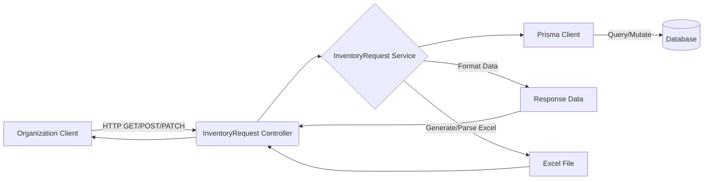

# Inventory Request API Documentation

## Tổng quan
Module **Inventory Request** là trái tim của hệ thống quản lý kho, cung cấp các API để tổ chức quản lý luồng hàng hóa (Nhập kho - Inbound, Xuất kho - Outbound), theo dõi tồn kho (Stock), xem lịch sử giao dịch (Transactions) và thực hiện tái cấu trúc kho (Rebalance).

## Kiến trúc



## Xác thực & Phân quyền
- **Xác thực**: Hỗ trợ đồng thời JWT token (qua header `Authorization: Bearer <token>`) và API Key (qua header `X-API-Key`) thông qua `CombinedAuthGuard`.
- **Phân quyền**: Yêu cầu các quyền riêng biệt cho từng nghiệp vụ (ví dụ: `org.inventory.inbound.list`, `org.inventory.inbound.create`, `org.inventory.inbound.approve`, v.v.).

---

## 1. Quản lý Nhập kho (Inbound)

### Lấy file mẫu nhập kho
**Endpoint:** `GET /organizations/:orgId/inventory/inbound/template`
**Quyền:** `org.inventory.inbound.create`
- **Mô tả:** Tải file Excel mẫu để điền dữ liệu nhập kho hàng loạt.
- **Response 200:** File binary Excel.

### Import file nhập kho
**Endpoint:** `POST /organizations/:orgId/inventory/inbound/import`
**Quyền:** `org.inventory.inbound.create`
- **Mô tả:** Upload file Excel (`multipart/form-data`) để tạo hàng loạt phiếu nhập kho.
- **Response 201:**
```json
{
  "code": "inventory-request.inbound-import",
  "message": "Nhập dữ liệu thành công",
  "success": true,
  "data": {
    "success_count": 15,
    "error_count": 0,
    "errors": []
  }
}
```

### Xuất danh sách nhập kho
**Endpoint:** `GET /organizations/:orgId/inventory/inbound/export`
**Quyền:** `org.inventory.inbound.export`
- **Mô tả:** Tải về file Excel chứa danh sách phiếu nhập dựa trên bộ lọc (`warehouse_id`, `status`, `keywords`).
- **Response 200:** File binary Excel.

*(Ghi chú: Module còn chứa các API cơ bản như list, get detail, create, approve, reject, start-receiving, confirm-receiving, confirm-putaway cho luồng Inbound).*

---

## 2. Quản lý Xuất kho (Outbound)

### Lấy file mẫu xuất kho
**Endpoint:** `GET /organizations/:orgId/inventory/outbound/template`
**Quyền:** `org.inventory.outbound.create`
- **Mô tả:** Tải file Excel mẫu để điền dữ liệu xuất kho hàng loạt.
- **Response 200:** File binary Excel.

### Import file xuất kho
**Endpoint:** `POST /organizations/:orgId/inventory/outbound/import`
**Quyền:** `org.inventory.outbound.create`
- **Mô tả:** Upload file Excel (`multipart/form-data`) để tạo hàng loạt phiếu xuất kho.
- **Response 201:** Tương tự như Import Inbound.

### Xuất danh sách xuất kho
**Endpoint:** `GET /organizations/:orgId/inventory/outbound/export`
**Quyền:** `org.inventory.outbound.export`
- **Mô tả:** Tải về file Excel chứa danh sách phiếu xuất dựa trên bộ lọc.
- **Response 200:** File binary Excel.

*(Ghi chú: Module còn chứa các API cơ bản như list, get detail, create, approve, reject, confirm-picking, confirm-checking, complete-shipment cho luồng Outbound).*

---

## 3. Quản lý Tồn kho & Giao dịch (Stock & Transactions)

### Lấy chỉ số tổng hợp tồn kho
**Endpoint:** `GET /organizations/:orgId/inventory/inventory-total/:warehouseId`
**Quyền:** `org.inventory.inbound.list`
- **Mô tả:** Lấy các chỉ số tổng cộng về tồn kho để hiển thị trên dashboard.
- **Response 200:**
```json
{
  "code": "inventory-request.get_total",
  "message": "Lấy tổng hợp tồn kho thành công",
  "success": true,
  "data": {
    "warehouse_id": "550e8400-e29b-41d4-a716-446655440003",
    "warehouse_name": "Kho lạnh Quận 7",
    "total_qty": 1250,
    "available_qty": 970,
    "reserved_qty": 280,
    "total_skus": 42
  }
}
```

### Lịch sử giao dịch kho
**Endpoint:** `GET /organizations/:orgId/inventory/transactions`
**Quyền:** `org.inventory.inbound.list`
- **Mô tả:** Lấy danh sách lịch sử biến động kho (INBOUND, OUTBOUND, TRANSFER, ADJUSTMENT, RETURN).
- **Parameters:** `warehouse_id`, `keywords`, `type`, `limit`, `offset`.
- **Response 200:** Danh sách phân trang các giao dịch.

### Tái cấu trúc sắp xếp kho (Rebalance)
**Endpoint:** `POST /organizations/:orgId/inventory/stock/rebalance`
**Quyền:** `org.inventory.inbound.approve`
- **Mô tả:** Tự động phân bổ lại hàng hóa trong các ô lưu trữ (chống chồng lấp, mở rộng nếu thiếu).
- **Parameters (Query):** `warehouse_id`
- **Response 201:**
```json
{
  "code": "inventory-request.rebalance_success",
  "message": "Tái cấu trúc kho thành công",
  "success": true,
  "data": {
    "rebalanced_slots": 15,
    "expanded_slots": 3,
    "message": "Đã tái cấu trúc 15 ô, tạo thêm 3 ô mới"
  }
}
```

### Xuất báo cáo tồn kho
**Endpoint:** `GET /organizations/:orgId/inventory/stock/export`
**Quyền:** `org.inventory.inbound.list`
- **Mô tả:** Tải về báo cáo Excel chứa thông tin tồn kho chi tiết.
- **Response 200:** File binary Excel.

---

## Error Responses chung
| Status | Code | Message | Description |
|--------|------|---------|-------------|
| 400 | `invalid_operation` | Bad Request | Dữ liệu không hợp lệ hoặc thao tác sai trạng thái quy trình |
| 401 | `unauthorized` | Unauthorized | Token/API key không hợp lệ |
| 403 | `forbidden` | Forbidden | Không có quyền tương ứng |
| 404 | `not_found` | Not Found | Không tìm thấy kho, phiếu hoặc chi tiết |
| 409 | `conflict` | Conflict | Xung đột tồn kho hoặc trạng thái đang xử lý |
