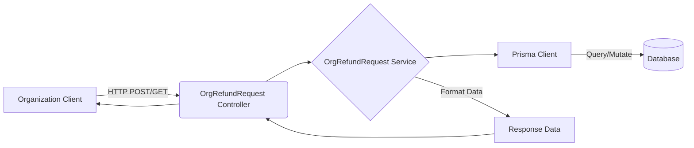

# Org Refund Request API Documentation

## Tổng quan
Module **Org Refund Request** cho phép các Tổ chức tạo và theo dõi các yêu cầu hoàn tiền cho các hợp đồng thuê kho. Hệ thống tự động tính toán số tiền hoàn trả dựa trên thông tin hợp đồng gốc, tỷ lệ phần trăm phí phạt hủy sớm và đưa ra số tiền thực nhận.

## Kiến trúc



## Xác thực & Phân quyền
- **Xác thực**: Hỗ trợ đồng thời JWT token (qua header `Authorization: Bearer <token>`) và API Key (qua header `X-API-Key`) thông qua `CombinedAuthGuard`.
- **Phân quyền**: Sử dụng `OrgPermissionGuard` với decorator `@RequireOrgPermission`.
- **Bảo mật**: ID tổ chức (`orgId`) luôn được kiểm tra và giới hạn quyền truy cập dữ liệu trong phạm vi của tổ chức đó.

---

## 1. Tạo yêu cầu hoàn tiền

Tạo mới một yêu cầu hoàn tiền cho hợp đồng thuê kho của tổ chức. Hệ thống yêu cầu cung cấp số tiền phí phạt và số tiền thực nhận để đối chiếu.

**Endpoint:** `POST /organizations/:orgId/refund-requests`
**Quyền:** `refund-request.create`

### Parameters (Path)
| Name | Type | Required | Description |
|------|------|----------|-------------|
| `orgId` | UUID | Yes | ID của tổ chức sở hữu hợp đồng |

### Request Body (JSON)
| Name | Type | Required | Description |
|------|------|----------|-------------|
| `rental_contract_id` | UUID | Yes | ID của hợp đồng thuê kho |
| `original_amount` | Number | Yes | Số tiền gốc của hợp đồng (VND) |
| `fee_percent` | Number | Yes | Tỷ lệ phần trăm phí phạt |
| `fee_amount` | Number | Yes | Số tiền phí phạt (VND) |
| `final_refund_amount` | Number | Yes | Số tiền thực nhận (VND) |
| `reason` | String | No | Lý do yêu cầu hoàn tiền (tối đa 1000 ký tự) |

**Example Body:**
```json
{
  "rental_contract_id": "550e8400-e29b-41d4-a716-446655440010",
  "original_amount": 10000000,
  "fee_percent": 10,
  "fee_amount": 1000000,
  "final_refund_amount": 9000000,
  "reason": "Chuyển văn phòng nên không còn nhu cầu sử dụng kho"
}
```

### Response 201 (Created)
```json
{
  "code": "refund-request.create_success",
  "message": "Tạo yêu cầu hoàn tiền thành công",
  "success": true,
  "data": {
    "id": "550e8400-e29b-41d4-a716-446655440099",
    "code": "RR-202603-0001",
    "status": "PENDING",
    "original_amount": 10000000,
    "fee_percent": 10,
    "fee_amount": 1000000,
    "final_refund_amount": 9000000,
    "reason": "Chuyển văn phòng nên không còn nhu cầu sử dụng kho",
    "organization_id": "550e8400-e29b-41d4-a716-446655440001",
    "rental_contract_id": "550e8400-e29b-41d4-a716-446655440010",
    "created_at": "2026-03-12T08:00:00.000Z"
  }
}
```

---

## 2. Lấy danh sách yêu cầu hoàn tiền

Lấy danh sách các yêu cầu hoàn tiền của tổ chức, hỗ trợ phân trang và tìm kiếm.

**Endpoint:** `GET /organizations/:orgId/refund-requests`
**Quyền:** `refund-request.list`

### Parameters (Path & Query)
| Name | In | Type | Required | Default | Description |
|------|----|------|----------|---------|-------------|
| `orgId` | Path | UUID | Yes | - | ID của tổ chức |
| `limit` | Query | Number | No | `10` | Số lượng kết quả tối đa |
| `offset` | Query | Number | No | `0` | Vị trí bắt đầu |
| `keywords` | Query | String | No | - | Tìm theo mã hợp đồng hoặc ghi chú |
| `status` | Query | Enum | No | - | Lọc theo trạng thái (`PENDING`, `APPROVED`, v.v.) |

### Response 200 (Success)
```json
{
  "code": "refund-request.list_success",
  "message": "Lấy danh sách yêu cầu hoàn tiền thành công",
  "success": true,
  "data": {
    "items": [
      {
        "id": "550e8400-e29b-41d4-a716-446655440099",
        "code": "RR-202603-0001",
        "status": "PENDING",
        "final_refund_amount": 9000000,
        "created_at": "2026-03-12T08:00:00.000Z"
      }
    ],
    "total": 15,
    "limit": 10,
    "offset": 0,
    "hasMore": true
  }
}
```

---

## 3. Lấy chi tiết yêu cầu hoàn tiền

Lấy thông tin chi tiết của một yêu cầu hoàn tiền cụ thể.

**Endpoint:** `GET /organizations/:orgId/refund-requests/:id`
**Quyền:** `refund-request.read`

### Parameters (Path)
| Name | Type | Required | Description |
|------|------|----------|-------------|
| `orgId` | UUID | Yes | ID của tổ chức |
| `id` | UUID | Yes | ID của yêu cầu hoàn tiền |

### Response 200 (Success)
```json
{
  "code": "refund-request.get_success",
  "message": "Lấy thông tin yêu cầu hoàn tiền thành công",
  "success": true,
  "data": {
    "id": "550e8400-e29b-41d4-a716-446655440099",
    "code": "RR-202603-0001",
    "status": "PENDING",
    "original_amount": 10000000,
    "fee_percent": 10,
    "fee_amount": 1000000,
    "final_refund_amount": 9000000,
    "reason": "Chuyển văn phòng nên không còn nhu cầu sử dụng kho",
    "organization_id": "550e8400-e29b-41d4-a716-446655440001",
    "rental_contract_id": "550e8400-e29b-41d4-a716-446655440010",
    "created_at": "2026-03-12T08:00:00.000Z",
    "updated_at": "2026-03-12T08:00:00.000Z",
    "is_deleted": false
  }
}
```

## Error Responses chung
| Status | Code | Message | Description |
|--------|------|---------|-------------|
| 400 | `error.refund_request.contract_not_eligible` | Lỗi nghiệp vụ | Hợp đồng không đủ điều kiện hoàn tiền |
| 401 | `unauthorized` | Unauthorized | Token/API key không hợp lệ |
| 403 | `forbidden` | Forbidden | Không có quyền thực hiện hành động |
| 404 | `error.refund_request.contract_not_found` | Not Found | Không tìm thấy hợp đồng hoặc yêu cầu hoàn tiền |
