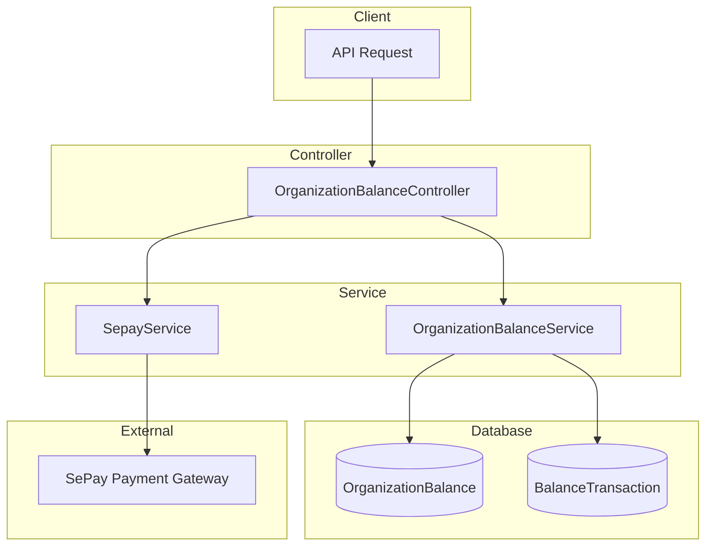

# Organization Balance Module Documentation

## Tổng Quan

Module `organization-balance` quản lý số dư tài khoản của tổ chức trong hệ thống GEN-HUB. Cho phép tổ chức xem số dư, lịch sử giao dịch và tạo yêu cầu nạp tiền qua SePay.

---

## Kiến Trúc



---

## API Endpoints

> [!TIP]
> Tất cả các API đều yêu cầu xác thực JWT và quyền tổ chức (OrgPermission).
> Hỗ trợ header `Accept-Language` để chọn ngôn ngữ phản hồi (vi/en).

### 1. GET /organizations/:orgId/balance - Xem số dư tổ chức

**Mô tả:** Lấy thông tin chi tiết số dư tài khoản của tổ chức bao gồm: số dư hiện tại, tổng nạp, tổng chi, tổng hoàn tiền.

**Xác thực:** Bearer Token (JWT)

**Quyền yêu cầu:** `organization.balance.read`

**Path Parameters:**

| Parameter | Type | Required | Description |
|-----------|------|----------|-------------|
| `orgId` | string (UUID) | Yes | ID của tổ chức |

**Request:**
```http
GET /organizations/550e8400-e29b-41d4-a716-446655440000/balance HTTP/1.1
Host: api.gen-hub.dev
Authorization: Bearer <access_token>
Accept-Language: vi
```

**Response (200 OK):**
```json
{
  "code": "organization-balance.get",
  "message": "Lấy số dư thành công",
  "success": true,
  "data": {
    "id": "550e8400-e29b-41d4-a716-446655440001",
    "organization_id": "550e8400-e29b-41d4-a716-446655440000",
    "balance": 5000000,
    "total_deposited": 10000000,
    "total_spent": 4500000,
    "total_refunded": 500000,
    "is_active": true,
    "created_at": "2026-01-15T10:30:00.000Z",
    "updated_at": "2026-02-07T08:00:00.000Z",
    "organization": {
      "id": "550e8400-e29b-41d4-a716-446655440000",
      "name": "Công ty TNHH ABC"
    }
  }
}
```

**Error Responses:**

<details>
<summary><b>401 Unauthorized</b></summary>

```json
{
  "code": "error.unauthorized.token_missing",
  "message": "Không có quyền truy cập",
  "success": false
}
```
</details>

<details>
<summary><b>403 Forbidden</b></summary>

```json
{
  "code": "error.forbidden.no_permission",
  "message": "Không có quyền thực hiện thao tác này",
  "success": false
}
```
</details>

<details>
<summary><b>404 Not Found</b></summary>

```json
{
  "code": "organization-balance.not_found",
  "message": "Không tìm thấy số dư tổ chức",
  "success": false
}
```
</details>

---

### 2. GET /organizations/:orgId/balance/transactions - Xem lịch sử giao dịch

**Mô tả:** Lấy danh sách các giao dịch số dư của tổ chức với phân trang và bộ lọc. Bao gồm các loại giao dịch: nạp tiền, thanh toán, hoàn tiền, điều chỉnh.

**Xác thực:** Bearer Token (JWT)

**Quyền yêu cầu:** `organization.balance.read`

**Path Parameters:**

| Parameter | Type | Required | Description |
|-----------|------|----------|-------------|
| `orgId` | string (UUID) | Yes | ID của tổ chức |

**Query Parameters:**

| Parameter | Type | Required | Default | Description |
|-----------|------|----------|---------|-------------|
| `limit` | integer | No | 20 | Số lượng items trả về (1-100) |
| `offset` | integer | No | 0 | Vị trí bắt đầu (skip) |
| `type` | enum | No | - | Lọc theo loại: `DEPOSIT`, `PAYMENT`, `REFUND`, `ADJUSTMENT` |
| `keywords` | string | No | - | Tìm kiếm trong mô tả giao dịch |

**Request:**
```http
GET /organizations/550e8400-e29b-41d4-a716-446655440000/balance/transactions?limit=20&offset=0&type=DEPOSIT HTTP/1.1
Host: api.gen-hub.dev
Authorization: Bearer <access_token>
Accept-Language: vi
```

**Response (200 OK):**
```json
{
  "code": "organization-balance.transactions",
  "message": "Lấy danh sách giao dịch thành công",
  "success": true,
  "data": {
    "items": [
      {
        "id": "550e8400-e29b-41d4-a716-446655440002",
        "organization_id": "550e8400-e29b-41d4-a716-446655440000",
        "type": "DEPOSIT",
        "amount": 1000000,
        "balance_before": 4000000,
        "balance_after": 5000000,
        "description": "Nạp tiền qua SePay",
        "notes": "Nạp tiền tháng 2",
        "reference_type": "Payment",
        "reference_id": "550e8400-e29b-41d4-a716-446655440099",
        "created_at": "2026-02-07T08:00:00.000Z",
        "performed_by_user": {
          "id": "550e8400-e29b-41d4-a716-446655440003",
          "name": "Nguyễn Văn A"
        }
      }
    ],
    "total": 150,
    "limit": 20,
    "offset": 0,
    "hasMore": true
  }
}
```

**Error Responses:**

<details>
<summary><b>422 Unprocessable Entity</b></summary>

```json
{
  "code": "error.validation",
  "message": "Dữ liệu đầu vào không hợp lệ",
  "success": false,
  "errors": [
    { "field": "limit", "message": "Giá trị phải từ 1 đến 100" }
  ]
}
```
</details>

---

### 3. POST /organizations/:orgId/balance/deposit - Tạo yêu cầu nạp tiền

**Mô tả:** Tạo yêu cầu nạp tiền mới cho tổ chức. Hệ thống sẽ tạo mã giao dịch và thông tin chuyển khoản qua SePay. Số tiền tối thiểu 10,000 VND, tối đa 100,000,000 VND.

**Xác thực:** Bearer Token (JWT)

**Quyền yêu cầu:** `organization.balance.deposit`

**Path Parameters:**

| Parameter | Type | Required | Description |
|-----------|------|----------|-------------|
| `orgId` | string (UUID) | Yes | ID của tổ chức |

**Request Body Schema:**

| Field | Type | Required | Description |
|-------|------|----------|-------------|
| `amount` | integer | Yes | Số tiền nạp (10,000 - 100,000,000 VND) |
| `notes` | string | No | Ghi chú cho giao dịch |

**Request Body Examples:**

<details>
<summary><b>Ví dụ 1: Nạp 100,000 VND</b></summary>

```json
{
  "amount": 100000,
  "notes": "Nạp tiền lần đầu"
}
```
</details>

<details>
<summary><b>Ví dụ 2: Nạp 1,000,000 VND</b></summary>

```json
{
  "amount": 1000000,
  "notes": "Nạp tiền thanh toán hợp đồng"
}
```
</details>

<details>
<summary><b>Ví dụ 3: Nạp 10,000,000 VND</b></summary>

```json
{
  "amount": 10000000,
  "notes": "Nạp tiền dự trữ cho quý 1/2026"
}
```
</details>

**Response (201 Created):**
```json
{
  "code": "organization-balance.deposit.created",
  "message": "Tạo yêu cầu nạp tiền thành công",
  "success": true,
  "data": {
    "payment_id": "550e8400-e29b-41d4-a716-446655440010",
    "transaction_code": "GH1234567890",
    "amount": 1000000,
    "bank_info": {
      "bank_name": "Vietcombank",
      "account_number": "1234567890",
      "account_name": "CONG TY GEN-HUB",
      "branch": "Chi nhánh Hồ Chí Minh"
    },
    "qr_code_url": "https://api.sepay.vn/qr/...",
    "expires_at": "2026-02-07T09:00:00.000Z"
  }
}
```

**Error Responses:**

<details>
<summary><b>400 Bad Request</b></summary>

```json
{
  "code": "organization-balance.amount_invalid",
  "message": "Số tiền phải từ 10,000 đến 100,000,000 VND",
  "success": false
}
```
</details>

<details>
<summary><b>422 Unprocessable Entity</b></summary>

```json
{
  "code": "error.validation",
  "message": "Dữ liệu đầu vào không hợp lệ",
  "success": false,
  "errors": [
    { "field": "amount", "message": "Số tiền phải là số nguyên" }
  ]
}
```
</details>

---

## Transaction Types

| Type | Description |
|------|-------------|
| `DEPOSIT` | Nạp tiền vào tài khoản |
| `PAYMENT` | Thanh toán cho hợp đồng/dịch vụ |
| `REFUND` | Hoàn tiền từ hợp đồng bị hủy |
| `ADJUSTMENT` | Điều chỉnh số dư bởi admin |

---

## Files Trong Module

| File | Mô tả |
|------|-------|
| `organization-balance.controller.ts` | Controller xử lý API endpoints |
| `organization-balance.service.ts` | Business logic cho số dư và giao dịch |
| `organization-balance.repository.ts` | Data access layer |
| `organization-balance.module.ts` | Module configuration |
| `dto/create-deposit.dto.ts` | DTO tạo yêu cầu nạp tiền |
| `dto/query-balance-transaction.dto.ts` | DTO query giao dịch |
| `interfaces/index.ts` | TypeScript interfaces |
