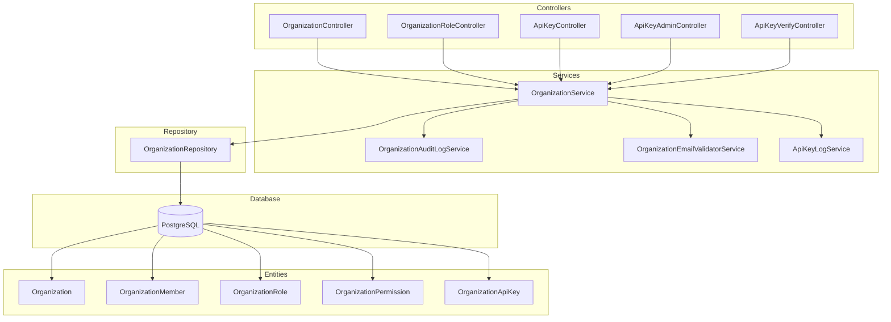
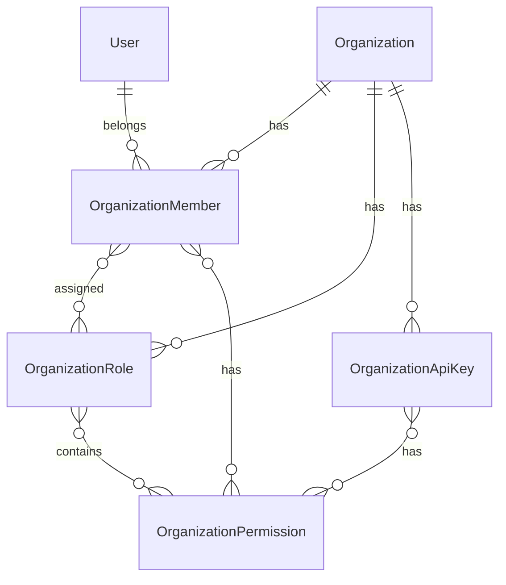

# Organization Module Documentation

## Tổng Quan

Module `organization` quản lý tổ chức (doanh nghiệp) trong hệ thống GEN-HUB. Module cung cấp đầy đủ các chức năng quản lý tổ chức, thành viên, vai trò, quyền và API keys với hỗ trợ xác thực qua email và OAuth.

---

## Kiến Trúc



---

## Quan Hệ Dữ Liệu



---

## API Endpoints

> [!TIP]
> Tất cả các API đều hỗ trợ header `Accept-Language` để chọn ngôn ngữ phản hồi.
>
> - **vi** - Tiếng Việt (mặc định)
> - **en** - English

---

## Organizations

### 1. POST /organizations - Tạo tổ chức mới

**Mô tả:** Tạo mới một tổ chức với đầy đủ thông tin bao gồm thông tin đại diện, mã số thuế và cấu hình email.

**Xác thực:** Bearer Token (JWT)

**Quyền yêu cầu:** `organization.create`

**Request Body:**

| Field                  | Type   | Required | Description                  |
| ---------------------- | ------ | -------- | ---------------------------- |
| `name`                 | string | Yes      | Tên tổ chức                  |
| `international_name`   | string | No       | Tên quốc tế                  |
| `tax_code`             | string | Yes      | Mã số thuế                   |
| `headquarters_address` | string | No       | Địa chỉ trụ sở               |
| `representative_name`  | string | No       | Tên người đại diện           |
| `representative_title` | string | No       | Chức danh người đại diện     |
| `representative_phone` | string | No       | Số điện thoại người đại diện |
| `representative_email` | string | No       | Email người đại diện         |

**Request Body Examples:**

<details>
<summary><b>Tổ chức cơ bản</b></summary>

```json
{
  "name": "Công ty ABC",
  "tax_code": "0123456789"
}
```

</details>

<details>
<summary><b>Tổ chức đầy đủ</b></summary>

```json
{
  "name": "Công ty XYZ",
  "international_name": "XYZ Company",
  "tax_code": "0123456789",
  "headquarters_address": "123 Nguyễn Văn Linh, Quận 7, TP.HCM",
  "representative_name": "Nguyễn Văn A",
  "representative_title": "Giám đốc",
  "representative_phone": "0901234567",
  "representative_email": "contact@xyz.com"
}
```

</details>

**Response (201 Created):**

```json
{
  "code": "ORGANIZATION_CREATE_SUCCESS",
  "message": "Tạo tổ chức thành công",
  "success": true,
  "data": {
    "id": "550e8400-e29b-41d4-a716-446655440000",
    "name": "Công ty XYZ",
    "international_name": "XYZ Company",
    "tax_code": "0123456789",
    "owner_id": "550e8400-e29b-41d4-a716-446655440001",
    "is_active": true,
    "created_at": "2026-01-20T06:00:00.000Z"
  }
}
```

---

### 2. GET /organizations - Lấy danh sách tổ chức

**Mô tả:** Lấy danh sách các tổ chức với phân trang và tìm kiếm.

**Query Parameters:**

| Parameter   | Type    | Required | Default | Description             |
| ----------- | ------- | -------- | ------- | ----------------------- |
| `limit`     | number  | No       | 10      | Số lượng bản ghi tối đa |
| `offset`    | number  | No       | 0       | Số bản ghi bỏ qua       |
| `keywords`  | string  | No       | -       | Từ khóa tìm kiếm        |
| `is_active` | boolean | No       | -       | Lọc theo trạng thái     |

**Response (200 OK):**

```json
{
  "code": "ORGANIZATION_LIST_SUCCESS",
  "message": "Lấy danh sách tổ chức thành công",
  "success": true,
  "data": {
    "items": [...],
    "total": 50,
    "limit": 10,
    "offset": 0
  }
}
```

---

### 3. GET /organizations/:id - Lấy chi tiết tổ chức

**Path Parameters:**

| Parameter | Type | Description    |
| --------- | ---- | -------------- |
| `id`      | UUID | ID của tổ chức |

**Response (200 OK):**

```json
{
  "code": "ORGANIZATION_GET_SUCCESS",
  "message": "Lấy thông tin tổ chức thành công",
  "success": true,
  "data": {
    "id": "550e8400-e29b-41d4-a716-446655440000",
    "name": "Công ty XYZ",
    "international_name": "XYZ Company",
    "tax_code": "0123456789",
    "headquarters_address": "123 Nguyễn Văn Linh",
    "representative_name": "Nguyễn Văn A",
    "owner": {
      "id": "550e8400-e29b-41d4-a716-446655440001",
      "email": "owner@xyz.com",
      "full_name": "Nguyễn Văn A"
    },
    "is_active": true,
    "created_at": "2026-01-20T06:00:00.000Z"
  }
}
```

---

### 4. PUT /organizations/:id - Cập nhật tổ chức

**Xác thực:** Bearer Token (JWT)

**Quyền yêu cầu:** `organization.update`

**Request Body:** Tương tự CreateOrganizationDto, tất cả các field đều optional.

---

### 5. DELETE /organizations/:id - Xóa tổ chức

**Xác thực:** Bearer Token (JWT)

**Quyền yêu cầu:** `organization.delete`

---

### 6. POST /organizations/:id/transfer-ownership - Chuyển quyền sở hữu

**Mô tả:** Chuyển quyền sở hữu tổ chức cho thành viên khác.

**Request Body:**

```json
{
  "new_owner_email": "newowner@example.com"
}
```

---

## Members

### 7. GET /organizations/:id/members - Lấy danh sách thành viên

**Query Parameters:**

| Parameter     | Type    | Description                   |
| ------------- | ------- | ----------------------------- |
| `limit`       | number  | Số lượng bản ghi              |
| `offset`      | number  | Số bản ghi bỏ qua             |
| `is_accepted` | boolean | Lọc theo trạng thái chấp nhận |

**Response (200 OK):**

```json
{
  "code": "ORGANIZATION_MEMBER_LIST_SUCCESS",
  "message": "Lấy danh sách thành viên thành công",
  "success": true,
  "data": {
    "items": [
      {
        "id": "550e8400-e29b-41d4-a716-446655440100",
        "user": {
          "id": "550e8400-e29b-41d4-a716-446655440001",
          "email": "member@example.com",
          "full_name": "Nguyễn Văn B"
        },
        "display_name": "Product Manager",
        "is_accepted": true,
        "is_owner": false,
        "roles": [...],
        "permissions": [...]
      }
    ],
    "total": 10
  }
}
```

---

### 8. POST /organizations/:id/members/invite - Mời thành viên

**Request Body:**

```json
{
  "emails": ["user1@example.com", "user2@example.com"]
}
```

**Response (201 Created):**

```json
{
  "code": "ORGANIZATION_MEMBER_INVITE_SUCCESS",
  "message": "Đã gửi lời mời thành công",
  "success": true,
  "data": {
    "success": ["user1@example.com"],
    "failed": []
  }
}
```

---

### 9. POST /organizations/:id/members/accept - Chấp nhận lời mời

### 10. POST /organizations/:id/members/reject - Từ chối lời mời

### 11. POST /organizations/:id/leave - Rời khỏi tổ chức

### 12. DELETE /organizations/:id/members/:memberId - Xóa thành viên

### 13. PUT /organizations/:id/members/:memberId/roles - Gán vai trò cho thành viên

**Request Body:**

```json
{
  "role_ids": ["role-uuid-1", "role-uuid-2"]
}
```

### 14. PUT /organizations/:id/members/:memberId/permissions - Gán quyền cho thành viên

**Request Body:**

```json
{
  "permission_ids": ["perm-uuid-1", "perm-uuid-2"]
}
```

---

## Roles (Organization Roles)

### 15. POST /organizations/:orgId/roles - Tạo vai trò mới

**Request Body:**

```json
{
  "name": "Manager",
  "description": "Quản lý kho hàng",
  "permission_ids": ["perm-uuid-1", "perm-uuid-2"]
}
```

### 16. GET /organizations/:orgId/roles - Lấy danh sách vai trò

### 17. GET /organizations/:orgId/roles/:roleId - Lấy chi tiết vai trò

### 18. PUT /organizations/:orgId/roles/:roleId - Cập nhật vai trò

### 19. DELETE /organizations/:orgId/roles/:roleId - Xóa vai trò

---

## API Keys

### 20. POST /organizations/:orgId/api-keys - Tạo API key

**Request Body:**

```json
{
  "name": "Production API Key",
  "description": "Key cho hệ thống tích hợp",
  "permission_ids": ["perm-uuid-1", "perm-uuid-2"],
  "expires_at": "2027-01-01T00:00:00Z",
  "allowed_origins": ["https://app.example.com"],
  "rate_limit_ttl": 60,
  "rate_limit_max": 100
}
```

**Response (201 Created):**

```json
{
  "code": "APIKEY_CREATE_SUCCESS",
  "message": "Tạo API key thành công. Key chỉ hiển thị một lần.",
  "success": true,
  "data": {
    "id": "550e8400-e29b-41d4-a716-446655440200",
    "name": "Production API Key",
    "key": "genhub_xxxxxxxxxxxxxxxxxxxxxxxxxxxx",
    "created_at": "2026-01-20T06:00:00.000Z"
  }
}
```

> [!WARNING]
> API key chỉ hiển thị **một lần duy nhất** sau khi tạo hoặc reset. Hãy lưu lại key ngay lập tức.

### 21. GET /organizations/:orgId/api-keys - Lấy danh sách API keys

### 22. GET /organizations/:orgId/api-keys/:keyId - Lấy chi tiết API key

### 23. PUT /organizations/:orgId/api-keys/:keyId - Cập nhật API key

### 24. POST /organizations/:orgId/api-keys/:keyId/reset - Reset API key

### 25. DELETE /organizations/:orgId/api-keys/:keyId - Xóa API key

---

## Invite Token

### 26. GET /organizations/invite/verify/:token - Kiểm tra token mời

### 27. POST /organizations/invite/accept/:token - Chấp nhận lời mời bằng token

### 28. POST /organizations/invite/reject/:token - Từ chối lời mời bằng token

---

## Error Responses

<details>
<summary><b>401 Unauthorized</b></summary>

```json
{
  "code": "error.unauthorized.token_missing",
  "message": "Không có quyền truy cập",
  "success": false
}
```

</details>

<details>
<summary><b>403 Forbidden</b></summary>

```json
{
  "code": "organization.errors.permission_denied",
  "message": "Không có quyền thực hiện thao tác này",
  "success": false
}
```

</details>

<details>
<summary><b>404 Not Found</b></summary>

```json
{
  "code": "organization.errors.not_found",
  "message": "Không tìm thấy tổ chức",
  "success": false
}
```

</details>

<details>
<summary><b>409 Conflict</b></summary>

```json
{
  "code": "organization.errors.name_exists",
  "message": "Tên tổ chức đã tồn tại",
  "success": false
}
```

</details>

<details>
<summary><b>422 Unprocessable Entity</b></summary>

```json
{
  "code": "error.validation",
  "message": "Dữ liệu đầu vào không hợp lệ",
  "success": false,
  "errors": [{ "field": "name", "message": "Tên tổ chức không được để trống" }]
}
```

</details>

---

## Files Trong Module

| File                                                                                                                             | Mô tả                                        |
| -------------------------------------------------------------------------------------------------------------------------------- | -------------------------------------------- |
| [organization.module.ts](file:///e:/STUDY/Demo/gen-hub/server/src/modules/organization/organization.module.ts)                   | NestJS module definition                     |
| [organization.controller.ts](file:///e:/STUDY/Demo/gen-hub/server/src/modules/organization/organization.controller.ts)           | REST API endpoints cho tổ chức và thành viên |
| [organization-role.controller.ts](file:///e:/STUDY/Demo/gen-hub/server/src/modules/organization/organization-role.controller.ts) | REST API endpoints cho vai trò               |
| [api-key.controller.ts](file:///e:/STUDY/Demo/gen-hub/server/src/modules/organization/api-key.controller.ts)                     | REST API endpoints cho API keys              |
| [organization.service.ts](file:///e:/STUDY/Demo/gen-hub/server/src/modules/organization/organization.service.ts)                 | Business logic chính                         |
| [organization.repository.ts](file:///e:/STUDY/Demo/gen-hub/server/src/modules/organization/organization.repository.ts)           | Database queries                             |
| [dto/](file:///e:/STUDY/Demo/gen-hub/server/src/modules/organization/dto/)                                                       | DTOs với validation                          |

---

## Permissions

| Permission                    | Mô tả                               |
| ----------------------------- | ----------------------------------- |
| `organization.create`         | Tạo tổ chức mới                     |
| `organization.list`           | Xem danh sách tổ chức               |
| `organization.list.all`       | Xem tất cả tổ chức (admin)          |
| `organization.read`           | Xem chi tiết tổ chức                |
| `organization.read.all`       | Xem chi tiết tất cả tổ chức (admin) |
| `organization.update`         | Cập nhật tổ chức                    |
| `organization.update.all`     | Cập nhật tất cả tổ chức (admin)     |
| `organization.update_request` | Gửi yêu cầu cập nhật                |
| `organization.delete`         | Xóa tổ chức                         |
| `organization.delete.all`     | Xóa tất cả tổ chức (admin)          |

---

## Audit Log

Module tự động ghi log các hoạt động quan trọng:

| Action                | Description         |
| --------------------- | ------------------- |
| `organization.create` | Tạo tổ chức mới     |
| `organization.update` | Cập nhật tổ chức    |
| `organization.delete` | Xóa tổ chức         |
| `member.invite`       | Mời thành viên      |
| `member.accept`       | Chấp nhận lời mời   |
| `member.remove`       | Xóa thành viên      |
| `role.create`         | Tạo vai trò         |
| `role.update`         | Cập nhật vai trò    |
| `apikey.create`       | Tạo API key         |
| `apikey.reset`        | Reset API key       |
| `ownership.transfer`  | Chuyển quyền sở hữu |
