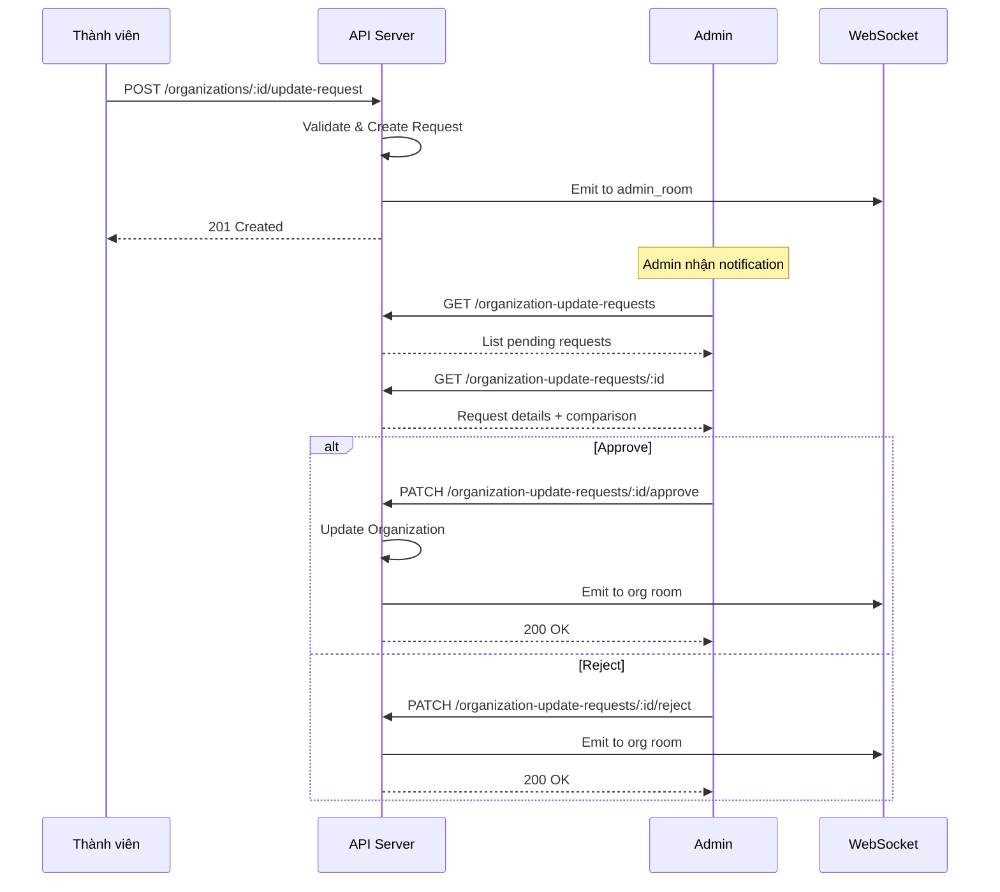

# Organization Update Request Module Documentation

## Tổng Quan

Module `organization-update-request` quản lý các yêu cầu cập nhật thông tin tổ chức trong hệ thống GEN-HUB. Khi thành viên của tổ chức muốn thay đổi thông tin quan trọng (mã số thuế, người đại diện...), họ gửi yêu cầu và admin sẽ phê duyệt hoặc từ chối.

---

## Luồng Xử Lý



---

## Trạng Thái Request

| Status     | Mô tả                                    |
| ---------- | ---------------------------------------- |
| `PENDING`  | Đang chờ admin phê duyệt                 |
| `APPROVED` | Đã được phê duyệt, thông tin đã cập nhật |
| `REJECTED` | Đã bị từ chối với lý do                  |

---

## API Endpoints

> [!TIP]
> Tất cả các API đều hỗ trợ header `Accept-Language` để chọn ngôn ngữ phản hồi.

---

### 1. GET /organization-update-requests - Lấy danh sách yêu cầu

**Mô tả:** Lấy danh sách các yêu cầu cập nhật thông tin tổ chức với phân trang và lọc theo trạng thái.

**Xác thực:** Bearer Token (JWT)

**Quyền yêu cầu:** `organization.update_request.list`

**Query Parameters:**

| Parameter | Type   | Required | Default | Description                           |
| --------- | ------ | -------- | ------- | ------------------------------------- |
| `limit`   | number | No       | 10      | Số lượng bản ghi tối đa               |
| `offset`  | number | No       | 0       | Số bản ghi bỏ qua                     |
| `status`  | enum   | No       | -       | PENDING, APPROVED, REJECTED           |
| `keyword` | string | No       | -       | Tìm kiếm theo tên tổ chức, mã số thuế |

**Response (200 OK):**

```json
{
  "code": "ORGANIZATION_UPDATE_REQUEST_LIST_SUCCESS",
  "message": "Lấy danh sách yêu cầu thành công",
  "success": true,
  "data": {
    "items": [
      {
        "id": "550e8400-e29b-41d4-a716-446655440000",
        "organization_id": "550e8400-e29b-41d4-a716-446655440001",
        "organization": {
          "id": "550e8400-e29b-41d4-a716-446655440001",
          "name": "Công ty ABC"
        },
        "tax_code": "0123456789",
        "representative_name": "Nguyễn Văn A",
        "representative_title": "Giám đốc",
        "status": "PENDING",
        "requester": {
          "id": "550e8400-e29b-41d4-a716-446655440002",
          "email": "user@abc.com",
          "full_name": "Nguyễn Văn B"
        },
        "created_at": "2026-01-20T06:00:00.000Z"
      }
    ],
    "total": 25,
    "limit": 10,
    "offset": 0
  }
}
```

---

### 2. GET /organization-update-requests/:id - Lấy chi tiết yêu cầu

**Mô tả:** Lấy thông tin chi tiết của một yêu cầu cập nhật bao gồm thông tin hiện tại và thông tin mới.

**Xác thực:** Bearer Token (JWT)

**Quyền yêu cầu:** `organization.update_request.read`

**Path Parameters:**

| Parameter | Type | Description             |
| --------- | ---- | ----------------------- |
| `id`      | UUID | ID của yêu cầu cập nhật |

**Response (200 OK):**

```json
{
  "code": "ORGANIZATION_UPDATE_REQUEST_GET_SUCCESS",
  "message": "Lấy chi tiết yêu cầu thành công",
  "success": true,
  "data": {
    "id": "550e8400-e29b-41d4-a716-446655440000",
    "organization_id": "550e8400-e29b-41d4-a716-446655440001",
    "organization": {
      "id": "550e8400-e29b-41d4-a716-446655440001",
      "name": "Công ty ABC",
      "tax_code": "9999999999",
      "representative_name": "Nguyễn Văn Old"
    },
    "tax_code": "0123456789",
    "representative_name": "Nguyễn Văn A",
    "representative_title": "Giám đốc",
    "representative_phone": "0901234567",
    "representative_email": "contact@abc.com",
    "status": "PENDING",
    "reject_reason": null,
    "requester": {
      "id": "550e8400-e29b-41d4-a716-446655440002",
      "email": "user@abc.com",
      "full_name": "Nguyễn Văn B"
    },
    "created_at": "2026-01-20T06:00:00.000Z"
  }
}
```

---

### 3. PATCH /organization-update-requests/:id/approve - Duyệt yêu cầu

**Mô tả:** Phê duyệt yêu cầu cập nhật. Thông tin tổ chức sẽ được cập nhật tự động.

**Xác thực:** Bearer Token (JWT)

**Quyền yêu cầu:** `organization.update_request.approve`

**Path Parameters:**

| Parameter | Type | Description             |
| --------- | ---- | ----------------------- |
| `id`      | UUID | ID của yêu cầu cập nhật |

**Response (200 OK):**

```json
{
  "code": "ORGANIZATION_UPDATE_REQUEST_APPROVE_SUCCESS",
  "message": "Duyệt yêu cầu thành công",
  "success": true,
  "data": {
    "id": "550e8400-e29b-41d4-a716-446655440000",
    "organization_id": "550e8400-e29b-41d4-a716-446655440001",
    "status": "APPROVED",
    "updated_by": "550e8400-e29b-41d4-a716-446655440003",
    "updated_at": "2026-01-20T07:00:00.000Z"
  }
}
```

> [!IMPORTANT]
> Sau khi duyệt, hệ thống sẽ:
>
> - Cập nhật thông tin tổ chức theo yêu cầu
> - Ghi log hành động
> - Gửi thông báo realtime đến thành viên tổ chức

---

### 4. PATCH /organization-update-requests/:id/reject - Từ chối yêu cầu

**Mô tả:** Từ chối yêu cầu cập nhật với lý do.

**Xác thực:** Bearer Token (JWT)

**Quyền yêu cầu:** `organization.update_request.reject`

**Path Parameters:**

| Parameter | Type | Description             |
| --------- | ---- | ----------------------- |
| `id`      | UUID | ID của yêu cầu cập nhật |

**Request Body:**

| Field           | Type   | Required | Description   |
| --------------- | ------ | -------- | ------------- |
| `reject_reason` | string | Yes      | Lý do từ chối |

**Request Body Example:**

```json
{
  "reject_reason": "Thông tin mã số thuế không chính xác"
}
```

**Response (200 OK):**

```json
{
  "code": "ORGANIZATION_UPDATE_REQUEST_REJECT_SUCCESS",
  "message": "Từ chối yêu cầu thành công",
  "success": true,
  "data": {
    "id": "550e8400-e29b-41d4-a716-446655440000",
    "organization_id": "550e8400-e29b-41d4-a716-446655440001",
    "status": "REJECTED",
    "reject_reason": "Thông tin mã số thuế không chính xác",
    "updated_by": "550e8400-e29b-41d4-a716-446655440003",
    "updated_at": "2026-01-20T07:00:00.000Z"
  }
}
```

---

## Error Responses

<details>
<summary><b>400 Bad Request - Yêu cầu không hợp lệ</b></summary>

```json
{
  "code": "organization.errors.request_not_pending",
  "message": "Yêu cầu không ở trạng thái chờ duyệt",
  "success": false
}
```

</details>

<details>
<summary><b>401 Unauthorized</b></summary>

```json
{
  "code": "error.unauthorized.token_missing",
  "message": "Không có quyền truy cập",
  "success": false
}
```

</details>

<details>
<summary><b>403 Forbidden</b></summary>

```json
{
  "code": "organization-update-request.errors.permission_denied",
  "message": "Không có quyền thực hiện thao tác này",
  "success": false
}
```

</details>

<details>
<summary><b>404 Not Found</b></summary>

```json
{
  "code": "organization.errors.request_not_found",
  "message": "Không tìm thấy yêu cầu cập nhật",
  "success": false
}
```

</details>

<details>
<summary><b>422 Unprocessable Entity</b></summary>

```json
{
  "code": "error.validation",
  "message": "Dữ liệu đầu vào không hợp lệ",
  "success": false,
  "errors": [
    { "field": "reject_reason", "message": "Lý do từ chối không được để trống" }
  ]
}
```

</details>

---

## WebSocket Events

Module tự động phát các sự kiện realtime qua Socket.IO:

| Event                                  | Room           | Payload         | Description            |
| -------------------------------------- | -------------- | --------------- | ---------------------- |
| `organization_update_request_created`  | `admin_room`   | Request object  | Khi có yêu cầu mới     |
| `organization_update_request_approved` | `org_{org_id}` | Updated request | Khi yêu cầu được duyệt |
| `organization_update_request_rejected` | `org_{org_id}` | Updated request | Khi yêu cầu bị từ chối |

---

## Files Trong Module

| File                                                                                                                                                                | Mô tả                    |
| ------------------------------------------------------------------------------------------------------------------------------------------------------------------- | ------------------------ |
| [organization-update-request.module.ts](file:///e:/STUDY/Demo/gen-hub/server/src/modules/organization-update-request/organization-update-request.module.ts)         | NestJS module definition |
| [organization-update-request.controller.ts](file:///e:/STUDY/Demo/gen-hub/server/src/modules/organization-update-request/organization-update-request.controller.ts) | REST API endpoints       |
| [organization-update-request.service.ts](file:///e:/STUDY/Demo/gen-hub/server/src/modules/organization-update-request/organization-update-request.service.ts)       | Business logic           |
| [organization-update-request.repository.ts](file:///e:/STUDY/Demo/gen-hub/server/src/modules/organization-update-request/organization-update-request.repository.ts) | Database queries         |
| [dto/](file:///e:/STUDY/Demo/gen-hub/server/src/modules/organization-update-request/dto/)                                                                           | DTOs với validation      |

---

## Permissions

| Permission                            | Mô tả                                |
| ------------------------------------- | ------------------------------------ |
| `organization.update_request`         | Gửi yêu cầu cập nhật (tổ chức level) |
| `organization.update_request.list`    | Xem danh sách yêu cầu (admin)        |
| `organization.update_request.read`    | Xem chi tiết yêu cầu (admin)         |
| `organization.update_request.approve` | Phê duyệt yêu cầu (admin)            |
| `organization.update_request.reject`  | Từ chối yêu cầu (admin)              |
