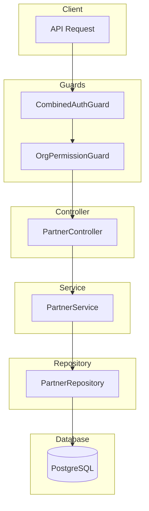

# Partner Module Documentation

## Tổng Quan

Module `partner` quản lý đối tác của tổ chức trong hệ thống GEN-HUB. Đối tác có thể là:
- **CUSTOMER** - Khách hàng
- **SUPPLIER** - Nhà cung cấp

Module hỗ trợ đầy đủ các tính năng CRUD với phân quyền theo tổ chức (Organization-based permission).

---

## Kiến Trúc



---

## API Endpoints

> [!TIP]
> Tất cả các API đều hỗ trợ header `Accept-Language` để chọn ngôn ngữ phản hồi.
> - **vi** - Tiếng Việt (mặc định)
> - **en** - English

### Base URL

```
/organizations/:orgId/partners
```

### Xác thực

Tất cả API yêu cầu xác thực bằng một trong các phương thức:
- **Bearer Token (JWT)**: Header `Authorization: Bearer <access_token>`
- **API Key**: Header `X-API-Key: <api_key>`

---

### 1. POST /organizations/:orgId/partners - Tạo đối tác mới

**Mô tả:** Tạo một đối tác mới trong tổ chức. Đối tác có thể là khách hàng (CUSTOMER) hoặc nhà cung cấp (SUPPLIER). Mã đối tác phải duy nhất trong tổ chức.

**Quyền yêu cầu:** `partner.create`

**Headers:**
```http
Authorization: Bearer <access_token>
Content-Type: application/json
Accept-Language: vi
```

**Path Parameters:**

| Parameter | Type | Required | Description |
|-----------|------|----------|-------------|
| `orgId` | UUID | Yes | ID của tổ chức |

**Request Body Schema:**

| Field | Type | Required | Description |
|-------|------|----------|-------------|
| `name` | string | Yes | Tên đối tác (max 255 ký tự) |
| `code` | string | Yes | Mã đối tác (max 50 ký tự, duy nhất trong tổ chức) |
| `type` | enum | Yes | Loại đối tác: `CUSTOMER` hoặc `SUPPLIER` |
| `phone` | string | No | Số điện thoại (max 20 ký tự) |
| `email` | string | No | Email liên hệ (max 255 ký tự) |
| `tax_code` | string | No | Mã số thuế (max 20 ký tự) |
| `address_detail` | string | No | Địa chỉ chi tiết |
| `ward_id` | UUID | No | ID phường/xã |
| `is_active` | boolean | No | Trạng thái hoạt động (mặc định: true) |

**Request Body Examples:**

<details>
<summary><b>Ví dụ 1: Tạo khách hàng đầy đủ thông tin</b></summary>

```json
{
  "name": "Công ty TNHH ABC",
  "code": "KH001",
  "type": "CUSTOMER",
  "phone": "0901234567",
  "email": "contact@abc.com",
  "tax_code": "0123456789",
  "address_detail": "123 Đường Nguyễn Huệ, Quận 1",
  "ward_id": "550e8400-e29b-41d4-a716-446655440000",
  "is_active": true
}
```
</details>

<details>
<summary><b>Ví dụ 2: Tạo nhà cung cấp</b></summary>

```json
{
  "name": "Nhà cung cấp XYZ",
  "code": "NCC001",
  "type": "SUPPLIER",
  "phone": "0987654321",
  "email": "info@xyz.vn",
  "is_active": true
}
```
</details>

<details>
<summary><b>Ví dụ 3: Tạo với thông tin tối thiểu</b></summary>

```json
{
  "name": "Đối tác mới",
  "code": "DT001",
  "type": "CUSTOMER"
}
```
</details>

**Response (201 Created):**
```json
{
  "code": "partner.create_success",
  "message": "Tạo đối tác thành công",
  "success": true,
  "data": {
    "id": "550e8400-e29b-41d4-a716-446655440001",
    "organization_id": "550e8400-e29b-41d4-a716-446655440000",
    "name": "Công ty TNHH ABC",
    "code": "KH001",
    "type": "CUSTOMER",
    "phone": "0901234567",
    "email": "contact@abc.com",
    "tax_code": "0123456789",
    "address_detail": "123 Đường Nguyễn Huệ, Quận 1",
    "ward_id": "550e8400-e29b-41d4-a716-446655440000",
    "ward": {
      "id": "550e8400-e29b-41d4-a716-446655440000",
      "name": "Phường Bến Nghé",
      "province": {
        "id": "550e8400-e29b-41d4-a716-446655440099",
        "name": "TP. Hồ Chí Minh"
      }
    },
    "is_active": true,
    "created_at": "2026-02-01T09:00:00.000Z",
    "updated_at": "2026-02-01T09:00:00.000Z",
    "is_deleted": false
  }
}
```

**Error Responses:**

<details>
<summary><b>401 Unauthorized</b></summary>

```json
// Không có token
{
  "code": "error.unauthorized.token_missing",
  "message": "Không có quyền truy cập",
  "success": false
}

// Token hết hạn
{
  "code": "error.unauthorized.token_expired",
  "message": "Token đã hết hạn",
  "success": false
}

// Token không hợp lệ
{
  "code": "error.unauthorized.token_invalid",
  "message": "Token không hợp lệ",
  "success": false
}
```
</details>

<details>
<summary><b>403 Forbidden</b></summary>

```json
// Không có quyền thực hiện
{
  "code": "error.forbidden.no_permission",
  "message": "Không có quyền thực hiện thao tác này",
  "success": false
}

// Tài khoản bị khóa
{
  "code": "error.forbidden.account_banned",
  "message": "Tài khoản đã bị khóa",
  "success": false
}
```
</details>

<details>
<summary><b>404 Not Found</b></summary>

```json
// Không tìm thấy tổ chức
{
  "code": "partner.organization_not_found",
  "message": "Không tìm thấy tổ chức",
  "success": false
}

// Không tìm thấy phường/xã
{
  "code": "partner.ward_not_found",
  "message": "Không tìm thấy phường/xã",
  "success": false
}
```
</details>

<details>
<summary><b>409 Conflict</b></summary>

```json
{
  "code": "partner.code_exists",
  "message": "Mã đối tác đã tồn tại trong tổ chức",
  "success": false
}
```
</details>

<details>
<summary><b>422 Unprocessable Entity</b></summary>

```json
{
  "code": "error.validation",
  "message": "Dữ liệu đầu vào không hợp lệ",
  "success": false,
  "errors": [
    { "field": "name", "message": "Tên đối tác không được để trống" },
    { "field": "type", "message": "Loại đối tác không hợp lệ (CUSTOMER hoặc SUPPLIER)" }
  ]
}
```
</details>

---

### 2. GET /organizations/:orgId/partners - Lấy danh sách đối tác

**Mô tả:** Lấy danh sách đối tác của tổ chức với hỗ trợ phân trang và tìm kiếm. Có thể lọc theo loại đối tác và trạng thái hoạt động.

**Quyền yêu cầu:** `partner.list`

**Headers:**
```http
Authorization: Bearer <access_token>
Accept-Language: vi
```

**Path Parameters:**

| Parameter | Type | Required | Description |
|-----------|------|----------|-------------|
| `orgId` | UUID | Yes | ID của tổ chức |

**Query Parameters:**

| Parameter | Type | Required | Default | Description |
|-----------|------|----------|---------|-------------|
| `limit` | number | No | 20 | Số lượng bản ghi tối đa (min: 1) |
| `offset` | number | No | 0 | Vị trí bắt đầu lấy dữ liệu (min: 0) |
| `keywords` | string | No | - | Từ khóa tìm kiếm (tên, mã, email, phone) |
| `type` | enum | No | - | Lọc theo loại: `CUSTOMER` hoặc `SUPPLIER` |
| `is_active` | boolean | No | - | Lọc theo trạng thái hoạt động |

**Request Examples:**

```http
# Lấy 20 đối tác đầu tiên
GET /organizations/550e8400-e29b-41d4-a716-446655440000/partners

# Tìm kiếm với từ khóa
GET /organizations/550e8400-e29b-41d4-a716-446655440000/partners?keywords=ABC

# Lọc khách hàng đang hoạt động
GET /organizations/550e8400-e29b-41d4-a716-446655440000/partners?type=CUSTOMER&is_active=true

# Phân trang
GET /organizations/550e8400-e29b-41d4-a716-446655440000/partners?limit=10&offset=20
```

**Response (200 OK):**
```json
{
  "code": "partner.list_success",
  "message": "Lấy danh sách đối tác thành công",
  "success": true,
  "data": {
    "items": [
      {
        "id": "550e8400-e29b-41d4-a716-446655440001",
        "organization_id": "550e8400-e29b-41d4-a716-446655440000",
        "name": "Công ty TNHH ABC",
        "code": "KH001",
        "type": "CUSTOMER",
        "phone": "0901234567",
        "email": "contact@abc.com",
        "tax_code": "0123456789",
        "address_detail": "123 Đường Nguyễn Huệ, Quận 1",
        "ward_id": null,
        "is_active": true,
        "created_at": "2026-02-01T09:00:00.000Z",
        "updated_at": "2026-02-01T09:00:00.000Z",
        "is_deleted": false
      }
    ],
    "total": 50,
    "limit": 20,
    "offset": 0
  }
}
```

**Error Responses:** Xem phần Error Responses của API tạo đối tác (không có 409, 422).

---

### 3. GET /organizations/:orgId/partners/:id - Lấy chi tiết đối tác

**Mô tả:** Lấy thông tin chi tiết của một đối tác theo ID. Bao gồm thông tin địa chỉ đầy đủ nếu có.

**Quyền yêu cầu:** `partner.read`

**Headers:**
```http
Authorization: Bearer <access_token>
Accept-Language: vi
```

**Path Parameters:**

| Parameter | Type | Required | Description |
|-----------|------|----------|-------------|
| `orgId` | UUID | Yes | ID của tổ chức |
| `id` | UUID | Yes | ID của đối tác |

**Response (200 OK):**
```json
{
  "code": "partner.get_success",
  "message": "Lấy thông tin đối tác thành công",
  "success": true,
  "data": {
    "id": "550e8400-e29b-41d4-a716-446655440001",
    "organization_id": "550e8400-e29b-41d4-a716-446655440000",
    "name": "Công ty TNHH ABC",
    "code": "KH001",
    "type": "CUSTOMER",
    "phone": "0901234567",
    "email": "contact@abc.com",
    "tax_code": "0123456789",
    "address_detail": "123 Đường Nguyễn Huệ, Quận 1",
    "ward_id": "550e8400-e29b-41d4-a716-446655440000",
    "ward": {
      "id": "550e8400-e29b-41d4-a716-446655440000",
      "name": "Phường Bến Nghé",
      "province": {
        "id": "550e8400-e29b-41d4-a716-446655440099",
        "name": "TP. Hồ Chí Minh"
      }
    },
    "is_active": true,
    "created_at": "2026-02-01T09:00:00.000Z",
    "updated_at": "2026-02-01T09:00:00.000Z",
    "is_deleted": false
  }
}
```

**Error Responses:**

<details>
<summary><b>404 Not Found</b></summary>

```json
{
  "code": "partner.not_found",
  "message": "Không tìm thấy đối tác",
  "success": false
}
```
</details>

---

### 4. PUT /organizations/:orgId/partners/:id - Cập nhật đối tác

**Mô tả:** Cập nhật thông tin đối tác. Tất cả các trường đều tùy chọn, chỉ các trường được gửi mới được cập nhật.

**Quyền yêu cầu:** `partner.update`

**Headers:**
```http
Authorization: Bearer <access_token>
Content-Type: application/json
Accept-Language: vi
```

**Path Parameters:**

| Parameter | Type | Required | Description |
|-----------|------|----------|-------------|
| `orgId` | UUID | Yes | ID của tổ chức |
| `id` | UUID | Yes | ID của đối tác |

**Request Body Examples:**

<details>
<summary><b>Ví dụ 1: Cập nhật thông tin liên hệ</b></summary>

```json
{
  "phone": "0909123456",
  "email": "new-email@abc.com"
}
```
</details>

<details>
<summary><b>Ví dụ 2: Cập nhật địa chỉ</b></summary>

```json
{
  "address_detail": "456 Đường Lê Lợi, Quận 1",
  "ward_id": "550e8400-e29b-41d4-a716-446655440002"
}
```
</details>

<details>
<summary><b>Ví dụ 3: Vô hiệu hóa đối tác</b></summary>

```json
{
  "is_active": false
}
```
</details>

**Response (200 OK):**
```json
{
  "code": "partner.update_success",
  "message": "Cập nhật đối tác thành công",
  "success": true,
  "data": {
    "id": "550e8400-e29b-41d4-a716-446655440001",
    "organization_id": "550e8400-e29b-41d4-a716-446655440000",
    "name": "Công ty TNHH ABC - Chi nhánh 2",
    "code": "KH001",
    "type": "CUSTOMER",
    "phone": "0909123456",
    "email": "branch2@abc.com",
    "tax_code": "0123456789-001",
    "address_detail": "789 Đường Hai Bà Trưng, Quận 3",
    "ward_id": null,
    "is_active": true,
    "created_at": "2026-02-01T09:00:00.000Z",
    "updated_at": "2026-02-01T10:30:00.000Z",
    "is_deleted": false
  }
}
```

**Error Responses:** Xem phần Error Responses của API tạo đối tác.

---

### 5. DELETE /organizations/:orgId/partners/delete/many - Xóa nhiều đối tác

**Mô tả:** Xóa nhiều đối tác cùng lúc theo danh sách ID. Thao tác này sẽ soft delete các đối tác.

**Quyền yêu cầu:** `partner.delete`

**Headers:**
```http
Authorization: Bearer <access_token>
Content-Type: application/json
Accept-Language: vi
```

**Path Parameters:**

| Parameter | Type | Required | Description |
|-----------|------|----------|-------------|
| `orgId` | UUID | Yes | ID của tổ chức |

**Request Body:**

```json
{
  "ids": [
    "550e8400-e29b-41d4-a716-446655440001",
    "550e8400-e29b-41d4-a716-446655440002",
    "550e8400-e29b-41d4-a716-446655440003"
  ]
}
```

**Response (200 OK):**
```json
{
  "code": "partner.delete_success",
  "message": "Xóa đối tác thành công",
  "success": true,
  "data": null
}
```

---

### 6. DELETE /organizations/:orgId/partners/:id - Xóa đối tác

**Mô tả:** Xóa một đối tác theo ID. Thao tác này sẽ soft delete đối tác (đánh dấu is_deleted = true).

**Quyền yêu cầu:** `partner.delete`

**Headers:**
```http
Authorization: Bearer <access_token>
Accept-Language: vi
```

**Path Parameters:**

| Parameter | Type | Required | Description |
|-----------|------|----------|-------------|
| `orgId` | UUID | Yes | ID của tổ chức |
| `id` | UUID | Yes | ID của đối tác cần xóa |

**Response (200 OK):**
```json
{
  "code": "partner.delete_success",
  "message": "Xóa đối tác thành công",
  "success": true,
  "data": null
}
```

**Error Responses:**

<details>
<summary><b>404 Not Found</b></summary>

```json
{
  "code": "partner.not_found",
  "message": "Không tìm thấy đối tác",
  "success": false
}
```
</details>

---

## Validation Rules

### Name
- Bắt buộc
- Phải là chuỗi
- Tối đa 255 ký tự

### Code
- Bắt buộc
- Phải là chuỗi
- Tối đa 50 ký tự
- Duy nhất trong tổ chức

### Type
- Bắt buộc
- Giá trị: `CUSTOMER` hoặc `SUPPLIER`

### Phone
- Tùy chọn
- Tối đa 20 ký tự

### Email
- Tùy chọn
- Phải là email hợp lệ
- Tối đa 255 ký tự

### Tax Code
- Tùy chọn
- Tối đa 20 ký tự

### Ward ID
- Tùy chọn
- Phải là UUID hợp lệ
- Phải tồn tại trong hệ thống

### Is Active
- Tùy chọn
- Phải là boolean

---

## Permissions Matrix

| Permission | Description |
|------------|-------------|
| `partner.create` | Tạo đối tác mới |
| `partner.list` | Xem danh sách đối tác |
| `partner.read` | Xem chi tiết đối tác |
| `partner.update` | Cập nhật đối tác |
| `partner.delete` | Xóa đối tác |

---

## Files Trong Module

| File | Mô tả |
|------|-------|
| `partner.controller.ts` | Controller xử lý HTTP requests |
| `partner.service.ts` | Business logic layer |
| `partner.repository.ts` | Data access layer với Prisma |
| `partner.module.ts` | NestJS module definition |
| `dto/create-partner.dto.ts` | DTO cho tạo đối tác |
| `dto/update-partner.dto.ts` | DTO cho cập nhật đối tác |
| `dto/query-partner.dto.ts` | DTO cho query parameters |
| `interfaces/partner.interface.ts` | TypeScript interfaces |
