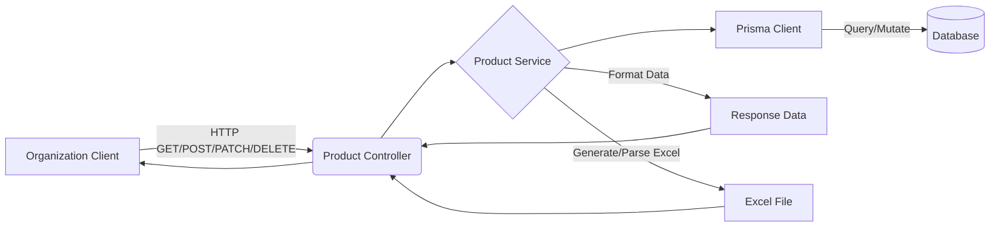

# Product API Documentation

## Tổng quan
Module **Product** quản lý danh mục sản phẩm của từng Tổ chức, bao gồm thông tin chung, SKU, giá bán, giá nhập, đơn vị tính và các thuộc tính liên quan khác. Hỗ trợ đầy đủ các thao tác CRUD và import/export bằng file Excel.

## Kiến trúc



## Xác thực & Phân quyền
- **Xác thực**: Hỗ trợ JWT Token (`Authorization: Bearer <token>`) và API Key (`X-API-Key`) qua `CombinedAuthGuard`.
- **Phân quyền**: Yêu cầu quyền dựa trên tác vụ (`product.create`, `product.list`, `product.update`, `product.delete`, `product.import`, `product.export`).
- **Data Isolation**: Dữ liệu sản phẩm bị cô lập nghiêm ngặt theo `orgId`.

---

## 1. Import/Export Sản phẩm

### Lấy file mẫu import
**Endpoint:** `GET /organizations/:orgId/products/template`
**Quyền:** `product.import`
- **Mô tả:** Tải file Excel mẫu để điền dữ liệu sản phẩm.
- **Response 200:** Trả về file Excel binary (`product-import-template.xlsx`).

### Import sản phẩm
**Endpoint:** `POST /organizations/:orgId/products/import`
**Quyền:** `product.import`
- **Mô tả:** Upload file Excel chứa thông tin sản phẩm để tạo hàng loạt.
- **Request:** FormData (`multipart/form-data`), field `file`.
- **Response 201:**
```json
{
  "code": "product.import_success",
  "message": "Nhập dữ liệu thành công",
  "success": true,
  "data": {
    "success_count": 120,
    "failed_count": 2,
    "errors": [
      "Dòng 5: Thiếu mã SKU",
      "Dòng 12: Giá vốn không hợp lệ"
    ]
  }
}
```

### Export sản phẩm
**Endpoint:** `GET /organizations/:orgId/products/export`
**Quyền:** `product.export`
- **Mô tả:** Tải toàn bộ danh sách sản phẩm của tổ chức ra file Excel.
- **Response 200:** Trả về file Excel binary (`products-{orgId}.xlsx`).

---

## 2. Quản lý Sản phẩm (CRUD)

### Lấy danh sách sản phẩm
**Endpoint:** `GET /organizations/:orgId/products`
**Quyền:** `product.list`
- **Mô tả:** Lấy danh sách sản phẩm với hỗ trợ phân trang và tìm kiếm.
- **Parameters (Query):**
  - `limit`, `offset`: Phân trang.
  - `keywords`: Tìm theo tên hoặc SKU.
  - `category_id`: Lọc theo danh mục.
  - `status`: Lọc theo trạng thái (`ACTIVE`, `INACTIVE`).
- **Response 200:**
```json
{
  "code": "product.list_success",
  "message": "Lấy danh sách sản phẩm thành công",
  "success": true,
  "data": {
    "items": [
      {
        "id": "550e8400-e29b-41d4-a716-446655440020",
        "name": "Iphone 15 Pro Max 256GB",
        "sku": "IP15PM-256",
        "price": 29000000,
        "cost_price": 25000000,
        "status": "ACTIVE",
        "unit": {
          "id": "...",
          "name": "Chiếc"
        }
      }
    ],
    "total": 50,
    "limit": 10,
    "offset": 0,
    "hasMore": true
  }
}
```

### Tạo sản phẩm mới
**Endpoint:** `POST /organizations/:orgId/products`
**Quyền:** `product.create`
- **Mô tả:** Tạo mới một sản phẩm.

### Lấy chi tiết sản phẩm
**Endpoint:** `GET /organizations/:orgId/products/:id`
**Quyền:** `product.read`

### Cập nhật sản phẩm
**Endpoint:** `PATCH /organizations/:orgId/products/:id`
**Quyền:** `product.update`

### Xóa sản phẩm
**Endpoint:** `DELETE /organizations/:orgId/products/:id`
**Quyền:** `product.delete`
- **Mô tả:** Xóa mềm sản phẩm (chuyển trạng thái `is_deleted = true`). Trả về lỗi `409 Conflict` nếu sản phẩm đang có tồn kho.

---

## Error Responses chung
| Status | Code | Message | Description |
|--------|------|---------|-------------|
| 400 | `validation_error` | Bad Request | Dữ liệu không hợp lệ (ví dụ: upload sai file, thiếu field) |
| 401 | `unauthorized` | Unauthorized | Token/API key không hợp lệ |
| 403 | `forbidden` | Forbidden | Không có quyền tương ứng |
| 404 | `not_found` | Not Found | Không tìm thấy sản phẩm hoặc tổ chức |
| 409 | `conflict` | Conflict | Mã SKU đã tồn tại hoặc xóa sản phẩm đang có tồn kho |
