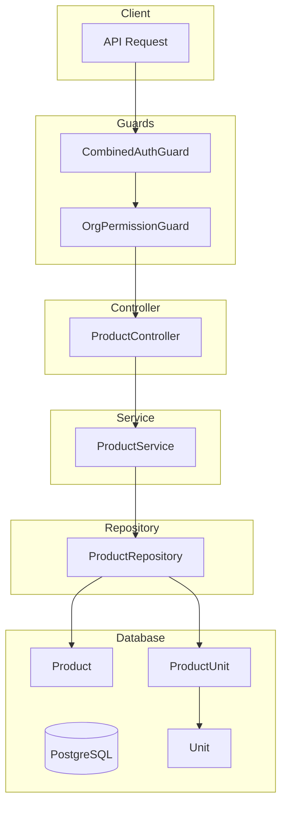

# Product Module Documentation

## Tổng Quan

Module `product` quản lý sản phẩm trong tổ chức. Hỗ trợ đầy đủ thông tin sản phẩm bao gồm:
- Thông tin cơ bản (tên, SKU, mô tả, hình ảnh, barcode)
- Kích thước và trọng lượng
- Giá vốn
- **Đơn vị tính quy đổi** - Hỗ trợ nhiều đơn vị tính với tỷ lệ quy đổi

---

## Kiến Trúc



---

## API Endpoints

> [!TIP]
> Tất cả các API đều hỗ trợ header `Accept-Language` để chọn ngôn ngữ phản hồi.
> - **vi** - Tiếng Việt (mặc định)
> - **en** - English

### Base URL

```
/organizations/:orgId/products
```

### Xác thực

Tất cả API yêu cầu xác thực bằng một trong các phương thức:
- **Bearer Token (JWT)**: Header `Authorization: Bearer <access_token>`
- **API Key**: Header `X-API-Key: <api_key>`

---

### 1. POST /organizations/:orgId/products - Tạo sản phẩm mới

**Mô tả:** Tạo một sản phẩm mới trong tổ chức. Sản phẩm bao gồm thông tin cơ bản, kích thước, trọng lượng và hỗ trợ nhiều đơn vị tính quy đổi. Mã SKU phải duy nhất trong tổ chức.

**Quyền yêu cầu:** `product.create`

**Headers:**
```http
Authorization: Bearer <access_token>
Content-Type: application/json
Accept-Language: vi
```

**Path Parameters:**

| Parameter | Type | Required | Description |
|-----------|------|----------|-------------|
| `orgId` | UUID | Yes | ID của tổ chức |

**Request Body Schema:**

| Field | Type | Required | Description |
|-------|------|----------|-------------|
| `name` | string | Yes | Tên sản phẩm (max 255 ký tự) |
| `sku` | string | Yes | Mã SKU (max 50 ký tự, duy nhất trong tổ chức) |
| `description` | string | No | Mô tả sản phẩm |
| `image_url` | string | No | URL hình ảnh sản phẩm |
| `barcode` | string | No | Barcode sản phẩm |
| `weight` | number | No | Trọng lượng (kg), min: 0 |
| `length` | number | No | Chiều dài (cm), min: 0 |
| `width` | number | No | Chiều rộng (cm), min: 0 |
| `height` | number | No | Chiều cao (cm), min: 0 |
| `max_weight_capacity` | number | No | Sức chịu tải tối đa (kg), min: 0 |
| `cost_price` | number | No | Giá vốn (VND), min: 0, default: 0 |
| `base_unit_id` | UUID | Yes | ID đơn vị tính cơ bản |
| `units` | array | No | Danh sách đơn vị tính quy đổi |
| `units[].unit_id` | UUID | Yes | ID đơn vị tính |
| `units[].conversion_rate` | number | Yes | Tỷ lệ quy đổi (min: 0.0001) |
| `units[].barcode` | string | No | Barcode cho đơn vị này |
| `is_active` | boolean | No | Trạng thái hoạt động (mặc định: true) |

**Request Body Examples:**

<details>
<summary><b>Ví dụ 1: Tạo sản phẩm đầy đủ với đơn vị quy đổi</b></summary>

```json
{
  "name": "Nước suối Aquafina 500ml",
  "sku": "AQUA-500ML",
  "description": "Nước tinh khiết Aquafina chai 500ml",
  "image_url": "https://example.com/images/aquafina-500ml.jpg",
  "barcode": "8934588012345",
  "weight": 0.55,
  "length": 6.5,
  "width": 6.5,
  "height": 21,
  "cost_price": 5000,
  "base_unit_id": "550e8400-e29b-41d4-a716-446655440010",
  "units": [
    {
      "unit_id": "550e8400-e29b-41d4-a716-446655440011",
      "conversion_rate": 24,
      "barcode": "8934588012346"
    },
    {
      "unit_id": "550e8400-e29b-41d4-a716-446655440012",
      "conversion_rate": 48,
      "barcode": "8934588012347"
    }
  ],
  "is_active": true
}
```

> **Giải thích đơn vị quy đổi:**
> - Đơn vị cơ bản: Chai
> - 1 Lốc = 24 Chai (conversion_rate = 24)
> - 1 Thùng = 48 Chai (conversion_rate = 48)

</details>

<details>
<summary><b>Ví dụ 2: Tạo sản phẩm đơn giản</b></summary>

```json
{
  "name": "Bút bi Thiên Long TL-027",
  "sku": "TL-027",
  "base_unit_id": "550e8400-e29b-41d4-a716-446655440010",
  "cost_price": 3500,
  "is_active": true
}
```
</details>

<details>
<summary><b>Ví dụ 3: Sản phẩm có kích thước và sức chịu tải</b></summary>

```json
{
  "name": "Thùng carton 60x40x40",
  "sku": "CARTON-60-40-40",
  "description": "Thùng carton 5 lớp, kích thước 60x40x40cm",
  "weight": 0.8,
  "length": 60,
  "width": 40,
  "height": 40,
  "max_weight_capacity": 30,
  "base_unit_id": "550e8400-e29b-41d4-a716-446655440010",
  "cost_price": 25000
}
```
</details>

**Response (201 Created):**
```json
{
  "code": "product.create_success",
  "message": "Tạo sản phẩm thành công",
  "success": true,
  "data": {
    "id": "550e8400-e29b-41d4-a716-446655440001",
    "organization_id": "550e8400-e29b-41d4-a716-446655440000",
    "name": "Nước suối Aquafina 500ml",
    "sku": "AQUA-500ML",
    "description": "Nước tinh khiết Aquafina chai 500ml",
    "image_url": "https://example.com/images/aquafina-500ml.jpg",
    "barcode": "8934588012345",
    "weight": 0.55,
    "length": 6.5,
    "width": 6.5,
    "height": 21,
    "max_weight_capacity": null,
    "cost_price": 5000,
    "base_unit_id": "550e8400-e29b-41d4-a716-446655440010",
    "base_unit": {
      "id": "550e8400-e29b-41d4-a716-446655440010",
      "name": "Chai"
    },
    "units": [
      {
        "id": "550e8400-e29b-41d4-a716-446655440020",
        "product_id": "550e8400-e29b-41d4-a716-446655440001",
        "unit_id": "550e8400-e29b-41d4-a716-446655440011",
        "conversion_rate": 24,
        "barcode": "8934588012346",
        "is_active": true,
        "unit": {
          "id": "550e8400-e29b-41d4-a716-446655440011",
          "name": "Lốc"
        },
        "created_at": "2026-02-01T09:00:00.000Z",
        "updated_at": null
      }
    ],
    "is_active": true,
    "created_at": "2026-02-01T09:00:00.000Z",
    "updated_at": null,
    "is_deleted": false,
    "created_by": "550e8400-e29b-41d4-a716-446655440099",
    "updated_by": null
  }
}
```

**Error Responses:**

<details>
<summary><b>401 Unauthorized</b></summary>

```json
// Không có token
{
  "code": "error.unauthorized.token_missing",
  "message": "Không có quyền truy cập",
  "success": false
}

// Token hết hạn
{
  "code": "error.unauthorized.token_expired",
  "message": "Token đã hết hạn",
  "success": false
}
```
</details>

<details>
<summary><b>403 Forbidden</b></summary>

```json
{
  "code": "error.forbidden.no_permission",
  "message": "Không có quyền thực hiện thao tác này",
  "success": false
}
```
</details>

<details>
<summary><b>404 Not Found</b></summary>

```json
// Không tìm thấy tổ chức
{
  "code": "product.organization_not_found",
  "message": "Không tìm thấy tổ chức",
  "success": false
}

// Không tìm thấy đơn vị tính cơ bản
{
  "code": "product.base_unit_not_found",
  "message": "Không tìm thấy đơn vị tính cơ bản",
  "success": false
}

// Không tìm thấy đơn vị tính quy đổi
{
  "code": "product.unit_not_found",
  "message": "Không tìm thấy đơn vị tính",
  "success": false
}
```
</details>

<details>
<summary><b>409 Conflict</b></summary>

```json
{
  "code": "product.sku_exists",
  "message": "Mã SKU đã tồn tại trong tổ chức",
  "success": false
}
```
</details>

<details>
<summary><b>422 Unprocessable Entity</b></summary>

```json
{
  "code": "error.validation",
  "message": "Dữ liệu đầu vào không hợp lệ",
  "success": false,
  "errors": [
    { "field": "name", "message": "Tên sản phẩm không được để trống" },
    { "field": "base_unit_id", "message": "ID đơn vị tính cơ bản phải là UUID hợp lệ" }
  ]
}
```
</details>

---

### 2. GET /organizations/:orgId/products - Lấy danh sách sản phẩm

**Mô tả:** Lấy danh sách sản phẩm của tổ chức với hỗ trợ phân trang và tìm kiếm. Có thể tìm theo tên, SKU hoặc barcode.

**Quyền yêu cầu:** `product.list`

**Headers:**
```http
Authorization: Bearer <access_token>
Accept-Language: vi
```

**Path Parameters:**

| Parameter | Type | Required | Description |
|-----------|------|----------|-------------|
| `orgId` | UUID | Yes | ID của tổ chức |

**Query Parameters:**

| Parameter | Type | Required | Default | Description |
|-----------|------|----------|---------|-------------|
| `limit` | number | No | 20 | Số lượng bản ghi tối đa (min: 1) |
| `offset` | number | No | 0 | Vị trí bắt đầu lấy dữ liệu (min: 0) |
| `keywords` | string | No | - | Từ khóa tìm kiếm (tên, SKU, barcode) |
| `is_active` | boolean | No | - | Lọc theo trạng thái hoạt động |

**Request Examples:**

```http
# Lấy 20 sản phẩm đầu tiên
GET /organizations/550e8400-e29b-41d4-a716-446655440000/products

# Tìm kiếm với từ khóa
GET /organizations/550e8400-e29b-41d4-a716-446655440000/products?keywords=Aquafina

# Lọc sản phẩm đang hoạt động
GET /organizations/550e8400-e29b-41d4-a716-446655440000/products?is_active=true

# Phân trang
GET /organizations/550e8400-e29b-41d4-a716-446655440000/products?limit=10&offset=20
```

**Response (200 OK):**
```json
{
  "code": "product.list_success",
  "message": "Lấy danh sách sản phẩm thành công",
  "success": true,
  "data": {
    "items": [
      {
        "id": "550e8400-e29b-41d4-a716-446655440001",
        "organization_id": "550e8400-e29b-41d4-a716-446655440000",
        "name": "Nước suối Aquafina 500ml",
        "sku": "AQUA-500ML",
        "description": "Nước tinh khiết Aquafina chai 500ml",
        "barcode": "8934588012345",
        "weight": 0.55,
        "cost_price": 5000,
        "base_unit": {
          "id": "550e8400-e29b-41d4-a716-446655440010",
          "name": "Chai"
        },
        "is_active": true,
        "created_at": "2026-02-01T09:00:00.000Z"
      }
    ],
    "total": 100,
    "limit": 20,
    "offset": 0
  }
}
```

---

### 3. GET /organizations/:orgId/products/:id - Lấy chi tiết sản phẩm

**Mô tả:** Lấy thông tin chi tiết của một sản phẩm theo ID. Bao gồm thông tin đơn vị tính cơ bản và các đơn vị tính quy đổi.

**Quyền yêu cầu:** `product.read`

**Path Parameters:**

| Parameter | Type | Required | Description |
|-----------|------|----------|-------------|
| `orgId` | UUID | Yes | ID của tổ chức |
| `id` | UUID | Yes | ID của sản phẩm |

**Response (200 OK):** Trả về đầy đủ thông tin sản phẩm (giống response 201 của tạo sản phẩm)

**Error Responses:**

<details>
<summary><b>404 Not Found</b></summary>

```json
{
  "code": "product.not_found",
  "message": "Không tìm thấy sản phẩm",
  "success": false
}
```
</details>

---

### 4. PUT /organizations/:orgId/products/:id - Cập nhật sản phẩm

**Mô tả:** Cập nhật thông tin sản phẩm bao gồm cả đơn vị tính quy đổi. Khi cập nhật danh sách đơn vị tính, danh sách cũ sẽ bị thay thế hoàn toàn.

**Quyền yêu cầu:** `product.update`

**Path Parameters:**

| Parameter | Type | Required | Description |
|-----------|------|----------|-------------|
| `orgId` | UUID | Yes | ID của tổ chức |
| `id` | UUID | Yes | ID của sản phẩm |

**Request Body Examples:**

<details>
<summary><b>Ví dụ 1: Cập nhật thông tin cơ bản</b></summary>

```json
{
  "name": "Nước suối Aquafina 500ml - Mới",
  "description": "Nước tinh khiết Aquafina chai 500ml - Phiên bản mới"
}
```
</details>

<details>
<summary><b>Ví dụ 2: Cập nhật đơn vị tính quy đổi</b></summary>

> **Lưu ý**: Khi gửi `units`, danh sách cũ sẽ bị thay thế hoàn toàn

```json
{
  "units": [
    {
      "unit_id": "550e8400-e29b-41d4-a716-446655440011",
      "conversion_rate": 24,
      "barcode": "8934588012346"
    },
    {
      "unit_id": "550e8400-e29b-41d4-a716-446655440012",
      "conversion_rate": 48,
      "barcode": "8934588012347"
    },
    {
      "unit_id": "550e8400-e29b-41d4-a716-446655440013",
      "conversion_rate": 120,
      "barcode": "8934588012348"
    }
  ]
}
```
</details>

**Response (200 OK):** Trả về đầy đủ thông tin sản phẩm sau khi cập nhật

---

### 5. DELETE /organizations/:orgId/products/delete/many - Xóa nhiều sản phẩm

**Mô tả:** Xóa nhiều sản phẩm cùng lúc. Thao tác này sẽ soft delete các sản phẩm và các đơn vị tính quy đổi liên quan.

**Quyền yêu cầu:** `product.delete`

**Request Body:**

```json
{
  "ids": [
    "550e8400-e29b-41d4-a716-446655440001",
    "550e8400-e29b-41d4-a716-446655440002"
  ]
}
```

**Response (200 OK):**
```json
{
  "code": "product.delete_success",
  "message": "Xóa sản phẩm thành công",
  "success": true,
  "data": null
}
```

---

### 6. DELETE /organizations/:orgId/products/:id - Xóa sản phẩm

**Mô tả:** Xóa một sản phẩm theo ID. Thao tác này sẽ soft delete sản phẩm và các đơn vị tính quy đổi liên quan.

**Quyền yêu cầu:** `product.delete`

**Path Parameters:**

| Parameter | Type | Required | Description |
|-----------|------|----------|-------------|
| `orgId` | UUID | Yes | ID của tổ chức |
| `id` | UUID | Yes | ID của sản phẩm cần xóa |

**Response (200 OK):**
```json
{
  "code": "product.delete_success",
  "message": "Xóa sản phẩm thành công",
  "success": true,
  "data": null
}
```

---

## Validation Rules

### Name
- Bắt buộc
- Phải là chuỗi
- Tối đa 255 ký tự

### SKU
- Bắt buộc
- Phải là chuỗi
- Tối đa 50 ký tự
- Duy nhất trong tổ chức

### Dimensions & Weight
- Tùy chọn
- Phải là số
- Giá trị >= 0

### Cost Price
- Tùy chọn
- Phải là số
- Giá trị >= 0
- Mặc định: 0

### Base Unit ID
- Bắt buộc
- Phải là UUID hợp lệ
- Đơn vị tính phải tồn tại trong hệ thống

### Units (Đơn vị quy đổi)
- Tùy chọn
- Phải là mảng
- Mỗi item trong mảng cần:
  - `unit_id`: UUID bắt buộc
  - `conversion_rate`: Số >= 0.0001, bắt buộc
  - `barcode`: Chuỗi tùy chọn

---

## Permissions Matrix

| Permission | Description |
|------------|-------------|
| `product.create` | Tạo sản phẩm mới |
| `product.list` | Xem danh sách sản phẩm |
| `product.read` | Xem chi tiết sản phẩm |
| `product.update` | Cập nhật sản phẩm |
| `product.delete` | Xóa sản phẩm |

---

## Files Trong Module

| File | Mô tả |
|------|-------|
| `product.controller.ts` | Controller xử lý HTTP requests |
| `product.service.ts` | Business logic layer |
| `product.repository.ts` | Data access layer với Prisma |
| `product.module.ts` | NestJS module definition |
| `dto/create-product.dto.ts` | DTO cho tạo sản phẩm (bao gồm ProductUnitDto) |
| `dto/update-product.dto.ts` | DTO cho cập nhật sản phẩm |
| `dto/query-product.dto.ts` | DTO cho query parameters |
| `interfaces/product.interface.ts` | TypeScript interfaces (IProduct, IProductUnit) |
