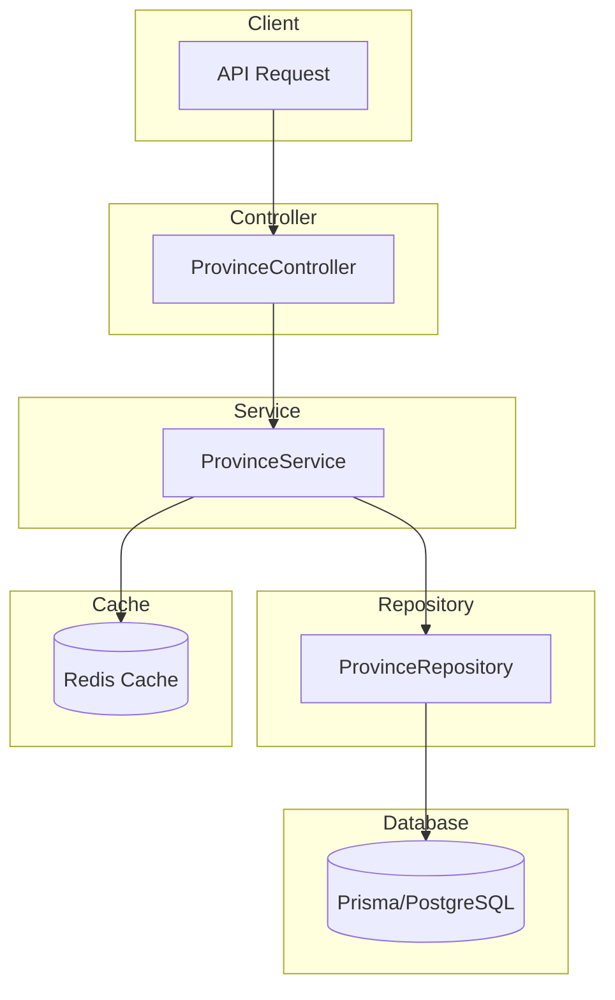
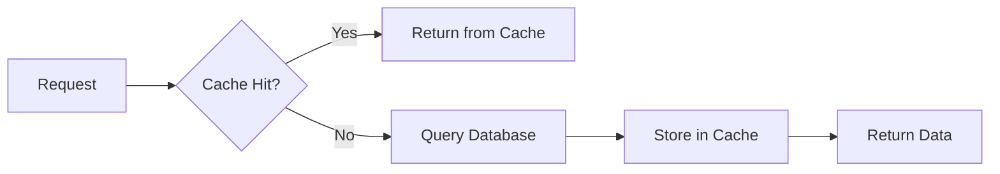

# Province Module Documentation

## Tổng Quan

Module `province` quản lý thông tin tỉnh/thành phố của Việt Nam cho ứng dụng GEN-HUB. Module cung cấp:

1. **Danh sách tỉnh/thành phố** - Lấy danh sách với tìm kiếm và lọc
2. **Chi tiết tỉnh/thành phố** - Lấy thông tin chi tiết bao gồm danh sách phường/xã

---

## Kiến Trúc



---

## API Endpoints

> [!TIP]
> Tất cả các API đều hỗ trợ header `Accept-Language` để chọn ngôn ngữ phản hồi.
> - **vi** - Tiếng Việt (mặc định)
> - **en** - English

### 1. GET /provinces - Lấy danh sách tỉnh/thành phố

**Mô tả:** API công khai để lấy danh sách tỉnh/thành phố. Hỗ trợ tìm kiếm theo từ khóa (tên, mã) và lọc theo loại (PROVINCE/CITY). Dữ liệu được cache để tối ưu hiệu năng.

**Xác thực:** Không yêu cầu (Public)

**Request:**
```http
GET /provinces HTTP/1.1
Host: api.gen-hub.dev
Accept: application/json
Accept-Language: vi
```

**Query Parameters:**

| Parameter | Type | Required | Description |
|-----------|------|----------|-------------|
| `keywords` | string | Optional | Từ khóa tìm kiếm (tên tỉnh/thành phố, mã) |
| `type` | enum | Optional | Loại tỉnh/thành phố: `PROVINCE` (Tỉnh) hoặc `CITY` (Thành phố trực thuộc TW) |

**Request Examples:**

<details>
<summary><b>Lấy tất cả tỉnh/thành phố</b></summary>

```http
GET /provinces HTTP/1.1
Host: api.gen-hub.dev
Accept: application/json
```
</details>

<details>
<summary><b>Tìm kiếm theo từ khóa</b></summary>

```http
GET /provinces?keywords=Hà Nội HTTP/1.1
Host: api.gen-hub.dev
Accept: application/json
```
</details>

<details>
<summary><b>Lọc theo loại (chỉ thành phố trực thuộc TW)</b></summary>

```http
GET /provinces?type=CITY HTTP/1.1
Host: api.gen-hub.dev
Accept: application/json
```
</details>

<details>
<summary><b>Kết hợp tìm kiếm và lọc</b></summary>

```http
GET /provinces?keywords=Thành phố&type=CITY HTTP/1.1
Host: api.gen-hub.dev
Accept: application/json
```
</details>

**Response (200 OK):**

```json
{
  "code": "province.list_success",
  "message": "Lấy danh sách tỉnh/thành phố thành công",
  "success": true,
  "data": [
    {
      "id": "550e8400-e29b-41d4-a716-446655440001",
      "code": "01",
      "name": "Thành phố Hà Nội",
      "slug": "thanh-pho-ha-noi",
      "type": "CITY",
      "is_active": true,
      "created_at": "2024-01-01T00:00:00.000Z",
      "updated_at": "2024-01-01T00:00:00.000Z"
    },
    {
      "id": "550e8400-e29b-41d4-a716-446655440002",
      "code": "79",
      "name": "Thành phố Hồ Chí Minh",
      "slug": "thanh-pho-ho-chi-minh",
      "type": "CITY",
      "is_active": true,
      "created_at": "2024-01-01T00:00:00.000Z",
      "updated_at": "2024-01-01T00:00:00.000Z"
    }
  ]
}
```

**Response Schema:**

| Field | Type | Description |
|-------|------|-------------|
| `id` | string (UUID) | ID của tỉnh/thành phố |
| `code` | string | Mã tỉnh/thành phố (theo chuẩn hành chính) |
| `name` | string | Tên đầy đủ của tỉnh/thành phố |
| `slug` | string | Slug URL-friendly |
| `type` | enum | Loại: `PROVINCE` (Tỉnh) hoặc `CITY` (Thành phố trực thuộc TW) |
| `is_active` | boolean | Trạng thái hoạt động |
| `created_at` | string (ISO 8601) | Ngày tạo |
| `updated_at` | string (ISO 8601) | Ngày cập nhật |

**Error Responses:**

<details>
<summary><b>422 Unprocessable Entity</b></summary>

```json
{
  "code": "error.validation",
  "message": "Dữ liệu đầu vào không hợp lệ",
  "success": false,
  "errors": [
    { "field": "type", "message": "Loại tỉnh/thành phố không hợp lệ" }
  ]
}
```
</details>

---

### 2. GET /provinces/:id - Lấy chi tiết tỉnh/thành phố

**Mô tả:** API công khai để lấy thông tin chi tiết của một tỉnh/thành phố theo ID, bao gồm danh sách các phường/xã thuộc tỉnh/thành phố đó.

**Xác thực:** Không yêu cầu (Public)

**Request:**
```http
GET /provinces/550e8400-e29b-41d4-a716-446655440001 HTTP/1.1
Host: api.gen-hub.dev
Accept: application/json
Accept-Language: vi
```

**Path Parameters:**

| Parameter | Type | Required | Description |
|-----------|------|----------|-------------|
| `id` | string (UUID) | Required | ID của tỉnh/thành phố |

**Response (200 OK):**

```json
{
  "code": "province.get_success",
  "message": "Lấy thông tin tỉnh/thành phố thành công",
  "success": true,
  "data": {
    "id": "550e8400-e29b-41d4-a716-446655440001",
    "code": "01",
    "name": "Thành phố Hà Nội",
    "slug": "thanh-pho-ha-noi",
    "type": "CITY",
    "is_active": true,
    "created_at": "2024-01-01T00:00:00.000Z",
    "updated_at": "2024-01-01T00:00:00.000Z",
    "wards": [
      {
        "id": "550e8400-e29b-41d4-a716-446655440010",
        "code": "00001",
        "name": "Phường Phúc Xá",
        "slug": "phuong-phuc-xa",
        "type": "WARD"
      },
      {
        "id": "550e8400-e29b-41d4-a716-446655440011",
        "code": "00004",
        "name": "Phường Trúc Bạch",
        "slug": "phuong-truc-bach",
        "type": "WARD"
      }
    ]
  }
}
```

**Response Schema:**

| Field | Type | Description |
|-------|------|-------------|
| `id` | string (UUID) | ID của tỉnh/thành phố |
| `code` | string | Mã tỉnh/thành phố |
| `name` | string | Tên đầy đủ |
| `slug` | string | Slug URL-friendly |
| `type` | enum | Loại: `PROVINCE` hoặc `CITY` |
| `is_active` | boolean | Trạng thái hoạt động |
| `created_at` | string (ISO 8601) | Ngày tạo |
| `updated_at` | string (ISO 8601) | Ngày cập nhật |
| `wards` | array | Danh sách phường/xã thuộc tỉnh/thành phố |
| `wards[].id` | string (UUID) | ID của phường/xã |
| `wards[].code` | string | Mã phường/xã |
| `wards[].name` | string | Tên phường/xã |
| `wards[].slug` | string | Slug URL-friendly |
| `wards[].type` | enum | Loại: `WARD`, `COMMUNE`, `TOWNSHIP`, `TOWN`, hoặc `CITY` |

**Error Responses:**

<details>
<summary><b>404 Not Found</b></summary>

```json
{
  "code": "error.not_found",
  "message": "Không tìm thấy tỉnh/thành phố",
  "success": false
}
```
</details>

<details>
<summary><b>422 Unprocessable Entity</b></summary>

```json
{
  "code": "error.validation",
  "message": "Dữ liệu đầu vào không hợp lệ",
  "success": false,
  "errors": [
    { "field": "id", "message": "ID phải là UUID hợp lệ" }
  ]
}
```
</details>

---

## Data Types

### ProvinceType Enum

| Value | Description |
|-------|-------------|
| `PROVINCE` | Tỉnh |
| `CITY` | Thành phố trực thuộc Trung ương |

### WardType Enum (trong response)

| Value | Description |
|-------|-------------|
| `WARD` | Phường |
| `COMMUNE` | Xã |
| `TOWNSHIP` | Thị trấn |
| `TOWN` | Thị xã |
| `CITY` | Thành phố (thuộc tỉnh) |

---

## Caching Strategy

Module sử dụng **Cache Aside Pattern** với Redis để tối ưu hiệu năng:



### Cache Keys

| Key Pattern | TTL | Description |
|-------------|-----|-------------|
| `province:list:{hash}` | Từ config | Cache danh sách tỉnh/thành phố theo query |
| `province:detail:{id}` | Từ config | Cache chi tiết tỉnh/thành phố |

### Environment Variables

| Biến | Mô tả | Mặc định |
|------|-------|----------|
| `REDIS_PROVINCE_CACHE_TTL` | TTL cho province cache (giây) | 3600 |
| `REDIS_PROVINCE_CACHE_PREFIX` | Prefix cho cache keys | province |

---

## Files Trong Module

| File | Mô tả |
|------|-------|
| `province.controller.ts` | Controller xử lý các API endpoints |
| `province.service.ts` | Service chứa business logic |
| `province.repository.ts` | Repository xử lý database queries |
| `province.module.ts` | Module configuration |
| `dto/query-province.dto.ts` | DTO cho query parameters |
| `types/province.type.ts` | TypeScript interfaces |
| `selects/province.select.ts` | Prisma select fields |
| `constants/province-cache-keys.helper.ts` | Cache key helper |

---

## Use Cases

### 1. Form chọn địa chỉ

```typescript
// Lấy danh sách tỉnh/thành phố
const provinces = await fetch('/provinces');

// Khi user chọn tỉnh, lấy danh sách phường/xã
const provinceDetail = await fetch(`/provinces/${selectedProvinceId}`);
const wards = provinceDetail.data.wards;
```

### 2. Tìm kiếm tỉnh/thành phố

```typescript
// Tìm kiếm theo từ khóa
const searchResults = await fetch('/provinces?keywords=Hà');

// Lọc chỉ thành phố trực thuộc TW
const cities = await fetch('/provinces?type=CITY');
```

---

## Related Modules

| Module | Mô tả |
|--------|-------|
| `WardModule` | Quản lý phường/xã |
| `RedisModule` | Caching |
