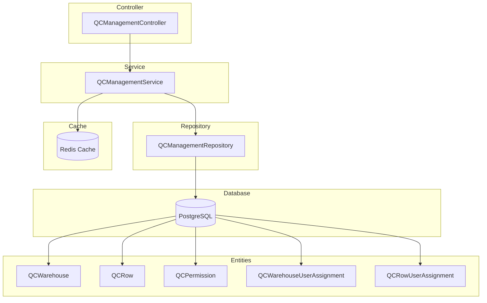
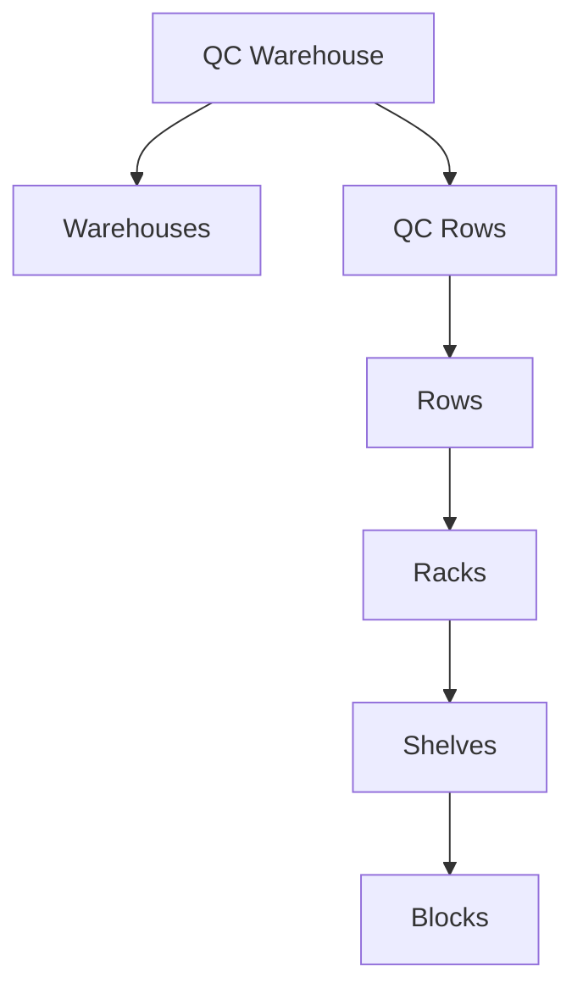

# QC Management Module Documentation

## Tổng Quan

Module `qc-management` quản lý phân quyền QC (Quality Control) cho hệ thống kho hàng GEN-HUB. Module này cho phép phân công user vào các QC Warehouse và QC Row với các permissions cụ thể, đồng thời cung cấp API để duyệt toàn bộ cấu trúc kho từ Warehouse đến Block.

---

## Kiến Trúc



---

## Cấu Trúc Phân Cấp



---

## API Endpoints

> [!TIP]
> Tất cả các API đều hỗ trợ header `Accept-Language` để chọn ngôn ngữ phản hồi.
>
> - **vi** - Tiếng Việt (mặc định)
> - **en** - English

### 1. GET /qc-management/warehouses - Lấy danh sách QC Warehouses

**Mô tả:** Lấy danh sách các QC Warehouse với hỗ trợ phân trang.

**Xác thực:** Bearer Token (JWT)

**Quyền yêu cầu:** `qc-management.list`

**Query Parameters:**

| Parameter | Type   | Required | Default | Description             |
| --------- | ------ | -------- | ------- | ----------------------- |
| `limit`   | number | No       | 20      | Số lượng bản ghi tối đa |
| `offset`  | number | No       | 0       | Số bản ghi bỏ qua       |

**Response (200 OK):**

```json
{
  "code": "qc-management.list.success",
  "message": "Lấy danh sách thành công",
  "success": true,
  "data": {
    "items": [
      {
        "id": "550e8400-e29b-41d4-a716-446655440000",
        "warehouse_template_id": "550e8400-e29b-41d4-a716-446655440001",
        "warehouse_template": {
          "id": "550e8400-e29b-41d4-a716-446655440001",
          "name": "Kho Quận 7"
        },
        "created_at": "2026-01-20T06:00:00.000Z"
      }
    ],
    "total": 50,
    "limit": 20,
    "offset": 0
  }
}
```

---

### 2. GET /qc-management/warehouses/:qcWarehouseId - Lấy chi tiết QC Warehouse

**Mô tả:** Lấy thông tin chi tiết của một QC Warehouse bao gồm các phân công user.

**Xác thực:** Bearer Token (JWT)

**Quyền yêu cầu:** `qc-management.read`

**Path Parameters:**

| Parameter       | Type | Description         |
| --------------- | ---- | ------------------- |
| `qcWarehouseId` | UUID | ID của QC Warehouse |

**Response (200 OK):**

```json
{
  "code": "qc-management.read.success",
  "message": "Lấy chi tiết thành công",
  "success": true,
  "data": {
    "id": "550e8400-e29b-41d4-a716-446655440000",
    "warehouse_template_id": "550e8400-e29b-41d4-a716-446655440001",
    "warehouse_template": {
      "id": "550e8400-e29b-41d4-a716-446655440001",
      "name": "Kho Quận 7",
      "code": "WH-Q7"
    },
    "user_assignments": [
      {
        "id": "550e8400-e29b-41d4-a716-446655440100",
        "user_id": "550e8400-e29b-41d4-a716-446655440200",
        "user": {
          "id": "550e8400-e29b-41d4-a716-446655440200",
          "email": "qc@example.com",
          "full_name": "QC Manager"
        },
        "permissions": []
      }
    ],
    "created_at": "2026-01-20T06:00:00.000Z"
  }
}
```

**Error Response (404):**

```json
{
  "code": "qc-management.errors.warehouse_not_found",
  "message": "Không tìm thấy QC Warehouse",
  "success": false
}
```

---

### 3. GET /qc-management/warehouses/:qcWarehouseId/warehouses - Lấy Warehouses của QC Warehouse

**Mô tả:** Lấy danh sách các Warehouse instance thuộc QC Warehouse.

**Xác thực:** Bearer Token (JWT)

**Quyền yêu cầu:** `qc-management.list`

---

### 4. GET /qc-management/warehouses/:qcWarehouseId/warehouses/:warehouseId - Lấy chi tiết Warehouse

**Mô tả:** Lấy thông tin chi tiết của một Warehouse instance.

**Xác thực:** Bearer Token (JWT)

**Quyền yêu cầu:** `qc-management.read`

---

### 5. GET /qc-management/warehouses/:qcWarehouseId/rows - Lấy QC Rows của warehouse

**Mô tả:** Lấy danh sách các QC Row thuộc QC Warehouse.

**Xác thực:** Bearer Token (JWT)

**Quyền yêu cầu:** `qc-management.list`

---

### 6. GET /qc-management/warehouses/:qcWarehouseId/rows/:qcRowId/rows - Lấy Rows của QC Row

**Mô tả:** Lấy danh sách các Row instance thuộc QC Row.

**Xác thực:** Bearer Token (JWT)

**Quyền yêu cầu:** `qc-management.list`

---

### 7. GET /qc-management/warehouses/:qcWarehouseId/rows/:qcRowId/rows/:rowId - Lấy chi tiết Row

**Mô tả:** Lấy thông tin chi tiết của một Row.

**Xác thực:** Bearer Token (JWT)

**Quyền yêu cầu:** `qc-management.read`

---

### 8. GET /qc-management/.../racks - Lấy Racks của Row

**Mô tả:** Lấy danh sách các Rack thuộc Row.

**Xác thực:** Bearer Token (JWT)

**Quyền yêu cầu:** `qc-management.list`

---

### 9. GET /qc-management/.../racks/:rackId - Lấy chi tiết Rack

**Mô tả:** Lấy thông tin chi tiết của một Rack.

**Xác thực:** Bearer Token (JWT)

**Quyền yêu cầu:** `qc-management.read`

---

### 10. GET /qc-management/.../shelves - Lấy Shelves của Rack

**Mô tả:** Lấy danh sách các Shelf thuộc Rack.

**Xác thực:** Bearer Token (JWT)

**Quyền yêu cầu:** `qc-management.list`

---

### 11. GET /qc-management/.../shelves/:shelfId - Lấy chi tiết Shelf

**Mô tả:** Lấy thông tin chi tiết của một Shelf.

**Xác thực:** Bearer Token (JWT)

**Quyền yêu cầu:** `qc-management.read`

---

### 12. GET /qc-management/.../blocks - Lấy Blocks của Shelf

**Mô tả:** Lấy danh sách các Block thuộc Shelf.

**Xác thực:** Bearer Token (JWT)

**Quyền yêu cầu:** `qc-management.list`

---

### 13. GET /qc-management/.../blocks/:blockId - Lấy chi tiết Block

**Mô tả:** Lấy thông tin chi tiết của một Block.

**Xác thực:** Bearer Token (JWT)

**Quyền yêu cầu:** `qc-management.read`

---

### 14. GET /qc-management/permissions - Lấy danh sách QC Permissions

**Mô tả:** Lấy tất cả các QC Permission có thể gán cho user.

**Xác thực:** Bearer Token (JWT)

**Quyền yêu cầu:** `qc-management.list`

**Response (200 OK):**

```json
{
  "code": "qc-management.permissions.success",
  "message": "Lấy danh sách QC Permissions thành công",
  "success": true,
  "data": [
    {
      "id": "550e8400-e29b-41d4-a716-446655440000",
      "name": "view_inventory",
      "description": "Xem tồn kho"
    },
    {
      "id": "550e8400-e29b-41d4-a716-446655440001",
      "name": "manage_inventory",
      "description": "Quản lý tồn kho"
    }
  ]
}
```

---

### 15. POST /qc-management/warehouses/:id/assignments - Gán user vào QC Warehouse

**Mô tả:** Gán một user vào QC Warehouse với các permissions cụ thể.

**Xác thực:** Bearer Token (JWT)

**Quyền yêu cầu:** `qc-management.assign`

**Request Body:**

| Field            | Type   | Required | Description              |
| ---------------- | ------ | -------- | ------------------------ |
| `user_id`        | UUID   | Yes      | ID của user cần gán      |
| `permission_ids` | UUID[] | No       | Danh sách ID permissions |

**Request Body Examples:**

<details>
<summary><b>Gán user cơ bản</b></summary>

```json
{
  "user_id": "550e8400-e29b-41d4-a716-446655440001"
}
```

</details>

<details>
<summary><b>Gán user với permissions</b></summary>

```json
{
  "user_id": "550e8400-e29b-41d4-a716-446655440001",
  "permission_ids": [
    "550e8400-e29b-41d4-a716-446655440100",
    "550e8400-e29b-41d4-a716-446655440101"
  ]
}
```

</details>

**Response (201 Created):**

```json
{
  "code": "qc-management.assign.success",
  "message": "Gán user thành công",
  "success": true,
  "data": {
    "id": "550e8400-e29b-41d4-a716-446655440200",
    "qc_warehouse_id": "550e8400-e29b-41d4-a716-446655440000",
    "user_id": "550e8400-e29b-41d4-a716-446655440001",
    "permissions": [],
    "created_at": "2026-01-20T06:00:00.000Z"
  }
}
```

---

### 16. DELETE /qc-management/warehouses/assignments/:assignmentId - Xóa phân công warehouse

**Mô tả:** Xóa phân công user khỏi QC Warehouse.

**Xác thực:** Bearer Token (JWT)

**Quyền yêu cầu:** `qc-management.assign`

**Response (200 OK):**

```json
{
  "code": "qc-management.remove.success",
  "message": "Xóa phân công thành công",
  "success": true,
  "data": null
}
```

---

### 17. POST /qc-management/rows/:id/assignments - Gán user vào QC Row

**Mô tả:** Gán một user vào QC Row với các permissions cụ thể.

**Xác thực:** Bearer Token (JWT)

**Quyền yêu cầu:** `qc-management.assign`

---

### 18. DELETE /qc-management/rows/assignments/:assignmentId - Xóa phân công row

**Mô tả:** Xóa phân công user khỏi QC Row.

**Xác thực:** Bearer Token (JWT)

**Quyền yêu cầu:** `qc-management.assign`

---

## Error Responses

<details>
<summary><b>401 Unauthorized</b></summary>

```json
{
  "code": "error.unauthorized.token_missing",
  "message": "Không có quyền truy cập",
  "success": false
}
```

</details>

<details>
<summary><b>403 Forbidden</b></summary>

```json
{
  "code": "error.forbidden.no_permission",
  "message": "Không có quyền thực hiện thao tác này",
  "success": false
}
```

</details>

<details>
<summary><b>404 Not Found</b></summary>

```json
{
  "code": "qc-management.errors.warehouse_not_found",
  "message": "Không tìm thấy QC Warehouse",
  "success": false
}
```

</details>

<details>
<summary><b>422 Unprocessable Entity</b></summary>

```json
{
  "code": "error.validation",
  "message": "Dữ liệu đầu vào không hợp lệ",
  "success": false,
  "errors": [{ "field": "user_id", "message": "ID user không được để trống" }]
}
```

</details>

---

## Files Trong Module

| File                                                                                                                      | Mô tả                     |
| ------------------------------------------------------------------------------------------------------------------------- | ------------------------- |
| [qc-management.module.ts](file:///e:/STUDY/Demo/gen-hub/server/src/modules/qc-management/qc-management.module.ts)         | NestJS module definition  |
| [qc-management.controller.ts](file:///e:/STUDY/Demo/gen-hub/server/src/modules/qc-management/qc-management.controller.ts) | REST API endpoints        |
| [qc-management.service.ts](file:///e:/STUDY/Demo/gen-hub/server/src/modules/qc-management/qc-management.service.ts)       | Business logic và caching |
| [qc-management.repository.ts](file:///e:/STUDY/Demo/gen-hub/server/src/modules/qc-management/qc-management.repository.ts) | Database queries          |
| [dto/index.ts](file:///e:/STUDY/Demo/gen-hub/server/src/modules/qc-management/dto/index.ts)                               | DTOs với validation       |

---

## Permissions

| Permission             | Mô tả                                                        |
| ---------------------- | ------------------------------------------------------------ |
| `qc-management.list`   | Xem danh sách QC Warehouses, Rows, và các entities liên quan |
| `qc-management.read`   | Xem chi tiết QC Warehouse, Row, Rack, Shelf, Block           |
| `qc-management.assign` | Gán/xóa phân công user vào QC Warehouse hoặc QC Row          |

---

## Caching

Module sử dụng Redis để cache dữ liệu với các TTL sau:

| Cache Key Pattern      | TTL (giây) | Mô tả                             |
| ---------------------- | ---------- | --------------------------------- |
| `qc:warehouses:list:*` | 300        | Cache danh sách QC Warehouses     |
| `qc:warehouse:*`       | 300        | Cache chi tiết QC Warehouse       |
| `qc:rows:list:*`       | 300        | Cache danh sách QC Rows           |
| `qc:racks:by-row:*`    | 300        | Cache danh sách Racks theo Row    |
| `qc:shelves:by-rack:*` | 300        | Cache danh sách Shelves theo Rack |
| `qc:blocks:by-shelf:*` | 300        | Cache danh sách Blocks theo Shelf |
| `qc:permissions:all`   | 300        | Cache tất cả QC Permissions       |
