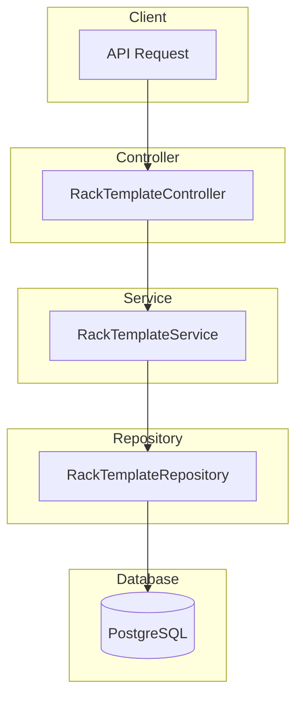

# Rack Template Module Documentation

## Tổng Quan

Module `rack-template` quản lý các kệ (rack) trong một dãy (row) của warehouse template. Mỗi kệ có thể cấu hình các thông số như tên, mã, vị trí, kích thước, khả năng chịu tải và ngưỡng quá tải.

### Đặc điểm chính:

- **Quản lý kệ theo dãy**: Mỗi kệ thuộc về một dãy cụ thể trong warehouse template
- **Cấu hình vị trí**: Hỗ trợ định vị kệ theo tọa độ X, Y và góc xoay
- **Quản lý tải trọng**: Cấu hình khả năng chịu tải mặc định và ngưỡng cảnh báo quá tải
- **Phân quyền chi tiết**: Hỗ trợ các quyền riêng biệt cho từng thao tác CRUD

---

## Kiến Trúc



---

## API Endpoints

> [!TIP]
> Tất cả các API đều hỗ trợ header `Accept-Language` để chọn ngôn ngữ phản hồi.
>
> - **vi** - Tiếng Việt (mặc định)
> - **en** - English

Base URL: `/warehouse-templates/:warehouseTemplateId/rows/:rowId/racks`

### 1. POST / - Tạo kệ mới

**Mô tả:** Tạo một kệ mới trong dãy templates đã chỉ định. Kệ có thể cấu hình các thông số như tên, mã, vị trí, kích thước, khả năng chịu tải và ngưỡng quá tải.

**Xác thực:** Bearer Token (JWT)

**Quyền yêu cầu:** `rack-template.create`

**Path Parameters:**

| Parameter             | Type | Description               |
| --------------------- | ---- | ------------------------- |
| `warehouseTemplateId` | UUID | ID của warehouse template |
| `rowId`               | UUID | ID của dãy chứa kệ        |

**Headers:**

```http
Authorization: Bearer <access_token>
Content-Type: application/json
Accept-Language: vi
```

**Request Body Schema:**

| Field                               | Type    | Required | Description                                     |
| ----------------------------------- | ------- | -------- | ----------------------------------------------- |
| `name`                              | string  | ✅       | Tên kệ (max 255 ký tự)                          |
| `code`                              | string  | ✅       | Mã kệ (max 50 ký tự, unique trong dãy)          |
| `description`                       | string  | ❌       | Mô tả chi tiết                                  |
| `default_block_max_weight_capacity` | number  | ❌       | Khả năng chịu tải mặc định của block (kg, >= 0) |
| `overload_threshold_percent`        | number  | ❌       | Ngưỡng quá tải (%, >= 0)                        |
| `position_x`                        | number  | ❌       | Vị trí X (mét)                                  |
| `position_y`                        | number  | ❌       | Vị trí Y (mét)                                  |
| `position_rotation`                 | number  | ❌       | Góc xoay (độ)                                   |
| `dimensions_width`                  | number  | ❌       | Chiều rộng (mét, >= 0)                          |
| `dimensions_height`                 | number  | ❌       | Chiều cao (mét, >= 0)                           |
| `is_active`                         | boolean | ❌       | Trạng thái hoạt động (mặc định: true)           |

**Request Body Examples:**

<details>
<summary><b>Ví dụ 1: Tạo kệ cơ bản</b></summary>

```json
{
  "name": "Kệ 1",
  "code": "RACK-01",
  "description": "Kệ chứa hàng loại A"
}
```

</details>

<details>
<summary><b>Ví dụ 2: Tạo kệ với vị trí</b></summary>

```json
{
  "name": "Kệ 2",
  "code": "RACK-02",
  "description": "Kệ ở góc kho",
  "position_x": 5.5,
  "position_y": 3.2,
  "position_rotation": 0,
  "dimensions_width": 2.0,
  "dimensions_height": 3.5
}
```

</details>

<details>
<summary><b>Ví dụ 3: Tạo kệ đầy đủ thông tin</b></summary>

```json
{
  "name": "Kệ tải trọng cao",
  "code": "RACK-HW-01",
  "description": "Kệ chứa hàng nặng",
  "default_block_max_weight_capacity": 500,
  "overload_threshold_percent": 90,
  "position_x": 10.0,
  "position_y": 5.0,
  "position_rotation": 90,
  "dimensions_width": 3.0,
  "dimensions_height": 4.0,
  "is_active": true
}
```

</details>

**Response (201 Created):**

```json
{
  "code": "rack-template.success.created",
  "message": "Tạo kệ thành công",
  "success": true,
  "data": {
    "id": "550e8400-e29b-41d4-a716-446655440002",
    "name": "Kệ 1",
    "code": "RACK-01",
    "description": "Kệ chứa hàng loại A",
    "default_block_max_weight_capacity": 500,
    "overload_threshold_percent": 90,
    "position_x": 5.5,
    "position_y": 3.2,
    "position_rotation": 0,
    "dimensions_width": 2.0,
    "dimensions_height": 3.5,
    "is_active": true,
    "row_template_id": "550e8400-e29b-41d4-a716-446655440001",
    "created_at": "2026-01-23T02:00:00.000Z",
    "updated_at": "2026-01-23T02:00:00.000Z"
  }
}
```

**Error Responses:**

<details>
<summary><b>401 Unauthorized</b></summary>

```json
// Không có token
{
  "code": "error.unauthorized.token_missing",
  "message": "Không có quyền truy cập",
  "success": false
}

// Token hết hạn
{
  "code": "error.unauthorized.token_expired",
  "message": "Token đã hết hạn",
  "success": false
}

// Token không hợp lệ
{
  "code": "error.unauthorized.token_invalid",
  "message": "Token không hợp lệ",
  "success": false
}
```

</details>

<details>
<summary><b>403 Forbidden</b></summary>

```json
// Không có quyền thực hiện
{
  "code": "error.forbidden.no_permission",
  "message": "Không có quyền thực hiện thao tác này",
  "success": false
}

// Tài khoản bị khóa
{
  "code": "error.forbidden.account_banned",
  "message": "Tài khoản đã bị khóa",
  "success": false
}
```

</details>

<details>
<summary><b>404 Not Found</b></summary>

```json
{
  "code": "rack-template.errors.row_template_not_found",
  "message": "Không tìm thấy dãy",
  "success": false
}
```

</details>

<details>
<summary><b>409 Conflict</b></summary>

```json
{
  "code": "rack-template.errors.code_exists",
  "message": "Mã kệ đã tồn tại trong dãy này",
  "success": false
}
```

</details>

<details>
<summary><b>422 Unprocessable Entity</b></summary>

```json
{
  "code": "error.validation",
  "message": "Dữ liệu đầu vào không hợp lệ",
  "success": false,
  "errors": [
    { "field": "name", "message": "Tên kệ không được để trống" },
    { "field": "code", "message": "Mã kệ không được để trống" }
  ]
}
```

</details>

---

### 2. GET / - Lấy danh sách kệ

**Mô tả:** Lấy danh sách tất cả các kệ trong một dãy với hỗ trợ phân trang và tìm kiếm. Có thể lọc theo trạng thái active và tìm kiếm theo từ khóa.

**Xác thực:** Bearer Token (JWT)

**Quyền yêu cầu:** `rack-template.list`

**Path Parameters:**

| Parameter             | Type | Description               |
| --------------------- | ---- | ------------------------- |
| `warehouseTemplateId` | UUID | ID của warehouse template |
| `rowId`               | UUID | ID của dãy chứa kệ        |

**Query Parameters:**

| Parameter   | Type    | Required | Description                              |
| ----------- | ------- | -------- | ---------------------------------------- |
| `limit`     | number  | ❌       | Số bản ghi tối đa (mặc định: 10, min: 1) |
| `offset`    | number  | ❌       | Số bản ghi bỏ qua (mặc định: 0, min: 0)  |
| `keywords`  | string  | ❌       | Từ khóa tìm kiếm (theo tên, mã, mô tả)   |
| `is_active` | boolean | ❌       | Lọc theo trạng thái hoạt động            |

**Request:**

```http
GET /warehouse-templates/550e8400-e29b-41d4-a716-446655440000/rows/550e8400-e29b-41d4-a716-446655440001/racks?limit=10&offset=0&keywords=RACK HTTP/1.1
Host: api.gen-hub.dev
Authorization: Bearer <access_token>
Accept-Language: vi
```

**Response (200 OK):**

```json
{
  "code": "rack-template.success.fetched",
  "message": "Lấy dữ liệu kệ thành công",
  "success": true,
  "data": {
    "items": [
      {
        "id": "550e8400-e29b-41d4-a716-446655440002",
        "name": "Kệ 1",
        "code": "RACK-01",
        "description": "Kệ chứa hàng loại A",
        "default_block_max_weight_capacity": 500,
        "overload_threshold_percent": 90,
        "position_x": 5.5,
        "position_y": 3.2,
        "position_rotation": 0,
        "dimensions_width": 2.0,
        "dimensions_height": 3.5,
        "is_active": true,
        "row_template_id": "550e8400-e29b-41d4-a716-446655440001",
        "created_at": "2026-01-23T02:00:00.000Z",
        "updated_at": "2026-01-23T02:00:00.000Z"
      }
    ],
    "total": 50,
    "limit": 10,
    "offset": 0
  }
}
```

**Error Responses:**

<details>
<summary><b>401 Unauthorized</b></summary>

```json
{
  "code": "error.unauthorized.token_missing",
  "message": "Không có quyền truy cập",
  "success": false
}
```

</details>

<details>
<summary><b>403 Forbidden</b></summary>

```json
{
  "code": "error.forbidden.no_permission",
  "message": "Không có quyền thực hiện thao tác này",
  "success": false
}
```

</details>

<details>
<summary><b>404 Not Found</b></summary>

```json
{
  "code": "rack-template.errors.row_template_not_found",
  "message": "Không tìm thấy dãy",
  "success": false
}
```

</details>

---

### 3. GET /:id - Lấy chi tiết kệ

**Mô tả:** Lấy thông tin chi tiết của một kệ theo ID. Bao gồm tất cả thông tin cấu hình của kệ.

**Xác thực:** Bearer Token (JWT)

**Quyền yêu cầu:** `rack-template.read`

**Path Parameters:**

| Parameter             | Type | Description                 |
| --------------------- | ---- | --------------------------- |
| `warehouseTemplateId` | UUID | ID của warehouse template   |
| `rowId`               | UUID | ID của dãy chứa kệ          |
| `id`                  | UUID | ID của kệ cần lấy thông tin |

**Request:**

```http
GET /warehouse-templates/550e8400-e29b-41d4-a716-446655440000/rows/550e8400-e29b-41d4-a716-446655440001/racks/550e8400-e29b-41d4-a716-446655440002 HTTP/1.1
Host: api.gen-hub.dev
Authorization: Bearer <access_token>
Accept-Language: vi
```

**Response (200 OK):**

```json
{
  "code": "rack-template.success.fetched",
  "message": "Lấy dữ liệu kệ thành công",
  "success": true,
  "data": {
    "id": "550e8400-e29b-41d4-a716-446655440002",
    "name": "Kệ 1",
    "code": "RACK-01",
    "description": "Kệ chứa hàng loại A",
    "default_block_max_weight_capacity": 500,
    "overload_threshold_percent": 90,
    "position_x": 5.5,
    "position_y": 3.2,
    "position_rotation": 0,
    "dimensions_width": 2.0,
    "dimensions_height": 3.5,
    "is_active": true,
    "row_template_id": "550e8400-e29b-41d4-a716-446655440001",
    "created_at": "2026-01-23T02:00:00.000Z",
    "updated_at": "2026-01-23T02:00:00.000Z"
  }
}
```

**Error Responses:**

<details>
<summary><b>404 Not Found</b></summary>

```json
{
  "code": "rack-template.errors.not_found",
  "message": "Không tìm thấy kệ",
  "success": false
}
```

</details>

---

### 4. PUT /:id - Cập nhật kệ

**Mô tả:** Cập nhật thông tin của một kệ theo ID. Có thể cập nhật tên, mã, vị trí, kích thước, tải trọng và trạng thái hoạt động.

**Xác thực:** Bearer Token (JWT)

**Quyền yêu cầu:** `rack-template.update`

**Path Parameters:**

| Parameter             | Type | Description               |
| --------------------- | ---- | ------------------------- |
| `warehouseTemplateId` | UUID | ID của warehouse template |
| `rowId`               | UUID | ID của dãy chứa kệ        |
| `id`                  | UUID | ID của kệ cần cập nhật    |

**Request Body Examples:**

<details>
<summary><b>Ví dụ 1: Cập nhật thông tin cơ bản</b></summary>

```json
{
  "name": "Kệ 1 - Đã cập nhật",
  "description": "Kệ chứa hàng loại A - phiên bản mới"
}
```

</details>

<details>
<summary><b>Ví dụ 2: Cập nhật vị trí</b></summary>

```json
{
  "position_x": 8.0,
  "position_y": 4.5,
  "position_rotation": 45
}
```

</details>

<details>
<summary><b>Ví dụ 3: Cập nhật tải trọng</b></summary>

```json
{
  "default_block_max_weight_capacity": 750,
  "overload_threshold_percent": 85
}
```

</details>

<details>
<summary><b>Ví dụ 4: Vô hiệu hóa kệ</b></summary>

```json
{
  "is_active": false
}
```

</details>

**Response (200 OK):**

```json
{
  "code": "rack-template.success.updated",
  "message": "Cập nhật kệ thành công",
  "success": true,
  "data": {
    "id": "550e8400-e29b-41d4-a716-446655440002",
    "name": "Kệ 1 - Đã cập nhật",
    "code": "RACK-01",
    "description": "Kệ chứa hàng loại A - phiên bản mới",
    "default_block_max_weight_capacity": 750,
    "overload_threshold_percent": 85,
    "position_x": 8.0,
    "position_y": 4.5,
    "position_rotation": 45,
    "dimensions_width": 2.0,
    "dimensions_height": 3.5,
    "is_active": true,
    "row_template_id": "550e8400-e29b-41d4-a716-446655440001",
    "created_at": "2026-01-23T02:00:00.000Z",
    "updated_at": "2026-01-23T03:00:00.000Z"
  }
}
```

**Error Responses:**

<details>
<summary><b>404 Not Found</b></summary>

```json
{
  "code": "rack-template.errors.not_found",
  "message": "Không tìm thấy kệ",
  "success": false
}
```

</details>

<details>
<summary><b>409 Conflict</b></summary>

```json
// Mã kệ trùng
{
  "code": "rack-template.errors.code_exists",
  "message": "Mã kệ đã tồn tại trong dãy này",
  "success": false
}

// Kệ bị chồng chéo vị trí
{
  "code": "rack-template.errors.racks_overlap",
  "message": "Kệ 'Kệ 1' bị đè lên kệ 'Kệ 2' trong cùng dãy",
  "success": false
}
```

</details>

---

### 5. DELETE /delete/many - Xóa nhiều kệ

**Mô tả:** Xóa nhiều kệ cùng lúc theo danh sách ID. Thao tác này sẽ xóa vĩnh viễn các kệ được chọn.

**Xác thực:** Bearer Token (JWT)

**Quyền yêu cầu:** `rack-template.delete`

**Path Parameters:**

| Parameter             | Type | Description               |
| --------------------- | ---- | ------------------------- |
| `warehouseTemplateId` | UUID | ID của warehouse template |
| `rowId`               | UUID | ID của dãy chứa kệ        |

**Request Body:**

```json
{
  "ids": [
    "550e8400-e29b-41d4-a716-446655440002",
    "550e8400-e29b-41d4-a716-446655440003",
    "550e8400-e29b-41d4-a716-446655440004"
  ]
}
```

**Response (200 OK):**

```json
{
  "code": "rack-template.success.deleted",
  "message": "Xóa kệ thành công",
  "success": true,
  "data": null
}
```

**Error Responses:**

<details>
<summary><b>404 Not Found</b></summary>

```json
{
  "code": "rack-template.errors.not_found",
  "message": "Không tìm thấy kệ",
  "success": false
}
```

</details>

---

### 6. DELETE /:id - Xóa kệ

**Mô tả:** Xóa một kệ theo ID. Thao tác này sẽ xóa vĩnh viễn kệ và không thể khôi phục.

**Xác thực:** Bearer Token (JWT)

**Quyền yêu cầu:** `rack-template.delete`

**Path Parameters:**

| Parameter             | Type | Description               |
| --------------------- | ---- | ------------------------- |
| `warehouseTemplateId` | UUID | ID của warehouse template |
| `rowId`               | UUID | ID của dãy chứa kệ        |
| `id`                  | UUID | ID của kệ cần xóa         |

**Request:**

```http
DELETE /warehouse-templates/550e8400-e29b-41d4-a716-446655440000/rows/550e8400-e29b-41d4-a716-446655440001/racks/550e8400-e29b-41d4-a716-446655440002 HTTP/1.1
Host: api.gen-hub.dev
Authorization: Bearer <access_token>
Accept-Language: vi
```

**Response (200 OK):**

```json
{
  "code": "rack-template.success.deleted",
  "message": "Xóa kệ thành công",
  "success": true,
  "data": null
}
```

**Error Responses:**

<details>
<summary><b>404 Not Found</b></summary>

```json
{
  "code": "rack-template.errors.not_found",
  "message": "Không tìm thấy kệ",
  "success": false
}
```

</details>

---

## Phân Quyền

| Permission             | Description                |
| ---------------------- | -------------------------- |
| `rack-template.create` | Tạo kệ mới trong dãy       |
| `rack-template.list`   | Xem danh sách kệ trong dãy |
| `rack-template.read`   | Xem chi tiết một kệ        |
| `rack-template.update` | Cập nhật thông tin kệ      |
| `rack-template.delete` | Xóa kệ (một hoặc nhiều)    |

---

## Validation Rules

### Rack Template

| Field                               | Rules                                            |
| ----------------------------------- | ------------------------------------------------ |
| `name`                              | Required, string, max 255 ký tự                  |
| `code`                              | Required, string, max 50 ký tự, unique trong dãy |
| `description`                       | Optional, string                                 |
| `default_block_max_weight_capacity` | Optional, number, >= 0                           |
| `overload_threshold_percent`        | Optional, number, >= 0                           |
| `position_x`                        | Optional, number                                 |
| `position_y`                        | Optional, number                                 |
| `position_rotation`                 | Optional, number                                 |
| `dimensions_width`                  | Optional, number, >= 0                           |
| `dimensions_height`                 | Optional, number, >= 0                           |
| `is_active`                         | Optional, boolean                                |

### Query Parameters

| Field       | Rules                  |
| ----------- | ---------------------- |
| `limit`     | Optional, number, >= 1 |
| `offset`    | Optional, number, >= 0 |
| `keywords`  | Optional, string       |
| `is_active` | Optional, boolean      |

---

## Error Codes

| Code                                          | Description                                 |
| --------------------------------------------- | ------------------------------------------- |
| `rack-template.errors.not_found`              | Không tìm thấy kệ với ID đã cho             |
| `rack-template.errors.row_template_not_found` | Không tìm thấy dãy chứa kệ                  |
| `rack-template.errors.code_exists`            | Mã kệ đã tồn tại trong dãy                  |
| `rack-template.errors.create_failed`          | Không thể tạo kệ do lỗi hệ thống            |
| `rack-template.errors.update_failed`          | Không thể cập nhật kệ do lỗi hệ thống       |
| `rack-template.errors.delete_failed`          | Không thể xóa kệ do lỗi hệ thống            |
| `rack-template.errors.position_out_of_bounds` | Vị trí kệ vượt quá giới hạn của kho         |
| `rack-template.errors.racks_overlap`          | Kệ bị chồng chéo với kệ khác trong cùng dãy |

---

## Files Trong Module

| File                              | Mô tả                                     |
| --------------------------------- | ----------------------------------------- |
| `rack-template.controller.ts`     | Xử lý HTTP requests, định nghĩa endpoints |
| `rack-template.service.ts`        | Business logic xử lý CRUD operations      |
| `rack-template.repository.ts`     | Tương tác với database                    |
| `rack-template.module.ts`         | Module configuration                      |
| `dto/create-rack-template.dto.ts` | DTO tạo mới rack template                 |
| `dto/update-rack-template.dto.ts` | DTO cập nhật rack template                |
| `dto/query-rack-template.dto.ts`  | DTO query với phân trang                  |
| `interfaces/`                     | Interface definitions                     |

---

## I18n Keys

### Success Messages

| Key                             | VI                        | EN                             |
| ------------------------------- | ------------------------- | ------------------------------ |
| `rack-template.success.created` | Tạo kệ thành công         | Rack created successfully      |
| `rack-template.success.updated` | Cập nhật kệ thành công    | Rack updated successfully      |
| `rack-template.success.deleted` | Xóa kệ thành công         | Rack deleted successfully      |
| `rack-template.success.fetched` | Lấy dữ liệu kệ thành công | Rack data fetched successfully |

### Error Messages

| Key                                           | VI                                       | EN                                              |
| --------------------------------------------- | ---------------------------------------- | ----------------------------------------------- |
| `rack-template.errors.not_found`              | Không tìm thấy kệ                        | Rack not found                                  |
| `rack-template.errors.row_template_not_found` | Không tìm thấy dãy                       | Row not found                                   |
| `rack-template.errors.code_exists`            | Mã kệ đã tồn tại trong dãy này           | Rack code already exists in this row            |
| `rack-template.errors.position_out_of_bounds` | Vị trí kệ '{name}' vượt quá giới hạn kho | Rack '{name}' position exceeds warehouse limits |
| `rack-template.errors.racks_overlap`          | Kệ '{name}' bị đè lên kệ '{otherRack}'   | Rack '{name}' overlaps with rack '{otherRack}'  |

### Validation Messages

| Key                                        | VI                              | EN                                       |
| ------------------------------------------ | ------------------------------- | ---------------------------------------- |
| `rack-template.validation.name_required`   | Tên kệ không được để trống      | Rack name is required                    |
| `rack-template.validation.name_max_length` | Tên kệ không được quá 255 ký tự | Rack name must not exceed 255 characters |
| `rack-template.validation.code_required`   | Mã kệ không được để trống       | Rack code is required                    |
| `rack-template.validation.code_max_length` | Mã kệ không được quá 50 ký tự   | Rack code must not exceed 50 characters  |
