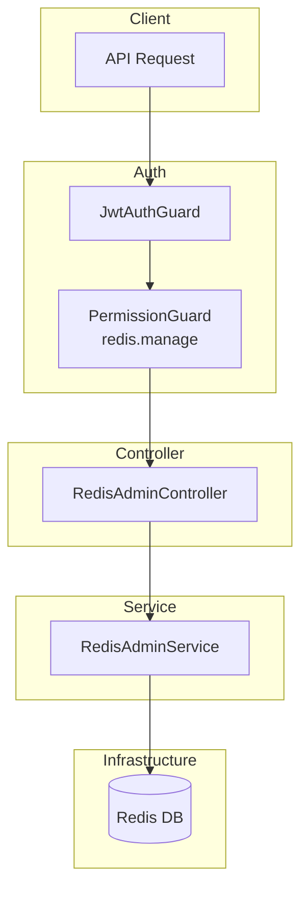

# Redis Admin Module Documentation

## Tổng Quan

Module `redis-admin` cung cấp API để quản lý trực tiếp cache trong Redis. Cho phép admin tạo, cập nhật và xóa cache entries một cách linh hoạt mà không cần thông qua các service khác.

**Tất cả các endpoint đều:**
- Yêu cầu **xác thực JWT** (Bearer Token)
- Yêu cầu **quyền** `redis.manage`
- Chỉ dành cho admin / super admin

> [!CAUTION]
> Module này thao tác trực tiếp trên Redis. Sử dụng sai có thể làm mất dữ liệu cache quan trọng (sessions, OTP, rate limits). Đặc biệt cẩn thận với endpoint **Flush DB**.

---

## Kiến Trúc



---

## API Endpoints

> [!TIP]
> Tất cả các API đều hỗ trợ header `Accept-Language` để chọn ngôn ngữ phản hồi.
> - **vi** - Tiếng Việt (mặc định)
> - **en** - English

### Tóm Tắt Endpoints

| # | Method | Path | Mô tả |
|---|--------|------|-------|
| 1 | `POST` | `/redis-admin/cache` | Thêm 1 cache entry |
| 2 | `POST` | `/redis-admin/cache/bulk` | Thêm nhiều cache entries |
| 3 | `DELETE` | `/redis-admin/cache/all` | ⚠️ Xóa toàn bộ cache (Flush DB) |
| 4 | `DELETE` | `/redis-admin/cache/bulk` | Xóa nhiều cache entries theo keys |
| 5 | `DELETE` | `/redis-admin/cache/:key` | Xóa 1 cache entry theo key |
| 6 | `PATCH` | `/redis-admin/cache/bulk` | Chỉnh sửa nhiều cache entries |
| 7 | `PATCH` | `/redis-admin/cache/:key` | Chỉnh sửa 1 cache entry theo key |

---

### 1. POST /redis-admin/cache — Thêm 1 cache entry

**Mô tả:** Tạo mới một cache entry với key, value và TTL tùy chọn. Nếu key đã tồn tại, giá trị sẽ bị **ghi đè**.

**Xác thực:** Bearer Token (JWT)

**Quyền yêu cầu:** `redis.manage`

**Headers:**
```http
Authorization: Bearer <access_token>
Content-Type: application/json
Accept-Language: vi
```

**Request Body Schema:**

| Field | Type | Required | Mô tả |
|-------|------|----------|-------|
| `key` | string | ✅ Có | Key định danh cache entry (phải là chuỗi, không được rỗng) |
| `value` | string | ✅ Có | Giá trị cần lưu (luôn là string; nếu là object cần `JSON.stringify()`) |
| `ttl` | number | ❌ Không | Thời gian sống (giây). Nếu không truyền, cache tồn tại vĩnh viễn |

**Request Body Examples:**

<details>
<summary><b>Ví dụ 1: Cache chuỗi đơn giản, không TTL</b></summary>

```json
{
  "key": "greeting_message",
  "value": "Xin chào, GEN-HUB!"
}
```
</details>

<details>
<summary><b>Ví dụ 2: Cache phiên đăng nhập với TTL 1 giờ</b></summary>

```json
{
  "key": "user:session:abc123",
  "value": "eyJhbGciOiJIUzI1NiIsInR5cCI6IkpXVCJ9...",
  "ttl": 3600
}
```
</details>

<details>
<summary><b>Ví dụ 3: Cache JSON config với TTL 24 giờ</b></summary>

```json
{
  "key": "config:app:v1",
  "value": "{\"brandName\":\"GEN-HUB\",\"primaryColor\":\"#0F766E\"}",
  "ttl": 86400
}
```
</details>

<details>
<summary><b>Ví dụ 4: Cache rate limit với TTL 60 giây</b></summary>

```json
{
  "key": "rate_limit:ip:192.168.1.1",
  "value": "5",
  "ttl": 60
}
```
</details>

**Request Example (curl):**
```bash
curl -X POST "https://api.gen-hub.dev/redis-admin/cache" \
  -H "Authorization: Bearer YOUR_JWT_TOKEN" \
  -H "Content-Type: application/json" \
  -d '{
    "key": "user:session:abc123",
    "value": "eyJhbGciOiJIUzI1NiIsInR5cCI6IkpXVCJ9...",
    "ttl": 3600
  }'
```

**Response (201 Created):**
```json
{
  "code": "REDIS_ADMIN_CACHE_CREATE_SUCCESS",
  "message": "Thêm cache thành công",
  "success": true,
  "data": {
    "key": "user:session:abc123"
  }
}
```

**Error Responses:**

<details>
<summary><b>401 Unauthorized</b></summary>

```json
// Không có token
{
  "code": "error.unauthorized.token_missing",
  "message": "Không có quyền truy cập",
  "success": false
}

// Token hết hạn
{
  "code": "error.unauthorized.token_expired",
  "message": "Token đã hết hạn",
  "success": false
}

// Token không hợp lệ
{
  "code": "error.unauthorized.token_invalid",
  "message": "Token không hợp lệ",
  "success": false
}
```
</details>

<details>
<summary><b>403 Forbidden</b></summary>

```json
// Không có quyền redis.manage
{
  "code": "error.forbidden.no_permission",
  "message": "Không có quyền thực hiện thao tác này",
  "success": false
}

// Tài khoản bị khóa
{
  "code": "error.forbidden.account_banned",
  "message": "Tài khoản đã bị khóa",
  "success": false
}
```
</details>

<details>
<summary><b>422 Unprocessable Entity</b></summary>

```json
{
  "code": "error.validation",
  "message": "Dữ liệu đầu vào không hợp lệ",
  "success": false,
  "errors": [
    { "field": "key", "message": "Key không được để trống" },
    { "field": "value", "message": "Giá trị phải là chuỗi ký tự" }
  ]
}
```
</details>

---

### 2. POST /redis-admin/cache/bulk — Thêm nhiều cache entries

**Mô tả:** Tạo mới nhiều cache entries đồng thời bằng `Promise.all`. Phù hợp để khởi tạo hàng loạt cache khi deploy hoặc seed dữ liệu.

**Xác thực:** Bearer Token (JWT)

**Quyền yêu cầu:** `redis.manage`

**Headers:**
```http
Authorization: Bearer <access_token>
Content-Type: application/json
Accept-Language: vi
```

**Request Body Schema:**

| Field | Type | Required | Mô tả |
|-------|------|----------|-------|
| `items` | `CreateCacheDto[]` | ✅ Có | Mảng các cache entries cần tạo |
| `items[].key` | string | ✅ Có | Key định danh |
| `items[].value` | string | ✅ Có | Giá trị cần lưu |
| `items[].ttl` | number | ❌ Không | Thời gian sống (giây) |

**Request Body Examples:**

<details>
<summary><b>Ví dụ 1: Tạo feature flags không có TTL</b></summary>

```json
{
  "items": [
    { "key": "feature:dark_mode", "value": "true" },
    { "key": "feature:ai_reply", "value": "false" },
    { "key": "feature:maintenance", "value": "false" }
  ]
}
```
</details>

<details>
<summary><b>Ví dụ 2: Tạo nhiều OTP cache với TTL 5 phút</b></summary>

```json
{
  "items": [
    { "key": "otp:user:001", "value": "123456", "ttl": 300 },
    { "key": "otp:user:002", "value": "789012", "ttl": 300 },
    { "key": "token:refresh:abc", "value": "eyJhbGci...", "ttl": 604800 }
  ]
}
```
</details>

<details>
<summary><b>Ví dụ 3: Seed cấu hình hệ thống vào cache</b></summary>

```json
{
  "items": [
    { "key": "config:max_upload_size", "value": "10485760", "ttl": 86400 },
    { "key": "config:allowed_origins", "value": "https://gen-hub.dev,https://admin.gen-hub.dev", "ttl": 86400 },
    { "key": "config:smtp_host", "value": "smtp.gmail.com", "ttl": 86400 }
  ]
}
```
</details>

**Request Example (curl):**
```bash
curl -X POST "https://api.gen-hub.dev/redis-admin/cache/bulk" \
  -H "Authorization: Bearer YOUR_JWT_TOKEN" \
  -H "Content-Type: application/json" \
  -d '{
    "items": [
      { "key": "feature:dark_mode", "value": "true" },
      { "key": "feature:ai_reply", "value": "false" }
    ]
  }'
```

**Response (201 Created):**
```json
{
  "code": "REDIS_ADMIN_CACHE_BULK_CREATE_SUCCESS",
  "message": "Thêm nhiều cache thành công",
  "success": true,
  "data": {
    "count": 3
  }
}
```

**Error Responses:** Tương tự [Endpoint 1](#1-post-redis-admincache--thêm-1-cache-entry). Thêm 422 nếu `items` không phải array hoặc có entry không hợp lệ.

---

### 3. DELETE /redis-admin/cache/all — Xóa toàn bộ cache (Flush DB)

> [!CAUTION]
> **NGUY HIỂM — KHÔNG THỂ HOÀN TÁC**: API này thực thi lệnh `FLUSHDB` trên Redis. Toàn bộ dữ liệu cache sẽ bị xóa vĩnh viễn bao gồm: sessions, OTP, rate limits, config cache, và mọi key khác. Chỉ sử dụng trong môi trường dev/staging hoặc khi thực sự cần reset hệ thống.

**Mô tả:** Xóa toàn bộ dữ liệu trong Redis database hiện tại bằng lệnh `FLUSHDB`.

**Xác thực:** Bearer Token (JWT)

**Quyền yêu cầu:** `redis.manage`

**Headers:**
```http
Authorization: Bearer <access_token>
Accept-Language: vi
```

**Request:** Không có body

**Request Example (curl):**
```bash
curl -X DELETE "https://api.gen-hub.dev/redis-admin/cache/all" \
  -H "Authorization: Bearer YOUR_JWT_TOKEN"
```

**Response (200 OK):**
```json
{
  "code": "REDIS_ADMIN_CACHE_CLEAR_SUCCESS",
  "message": "Xóa toàn bộ cache thành công",
  "success": true,
  "data": null
}
```

**Error Responses:** Tương tự [Endpoint 1](#1-post-redis-admincache--thêm-1-cache-entry). Không có 422 vì không có body.

---

### 4. DELETE /redis-admin/cache/bulk — Xóa nhiều cache entries theo keys

**Mô tả:** Xóa đồng thời nhiều cache entries theo danh sách keys. Keys không tồn tại sẽ được bỏ qua. Trả về số lượng keys thực sự đã bị xóa.

**Xác thực:** Bearer Token (JWT)

**Quyền yêu cầu:** `redis.manage`

**Headers:**
```http
Authorization: Bearer <access_token>
Content-Type: application/json
Accept-Language: vi
```

**Request Body Schema:**

| Field | Type | Required | Mô tả |
|-------|------|----------|-------|
| `keys` | `string[]` | ✅ Có | Mảng các keys cần xóa |

**Request Body Examples:**

<details>
<summary><b>Ví dụ 1: Force logout nhiều users</b></summary>

```json
{
  "keys": [
    "session:user:550e8400",
    "session:user:661f9511",
    "session:user:772g0622"
  ]
}
```
</details>

<details>
<summary><b>Ví dụ 2: Xóa cache của một module</b></summary>

```json
{
  "keys": [
    "posts:list:page1",
    "posts:list:page2",
    "posts:detail:123",
    "posts:detail:456"
  ]
}
```
</details>

<details>
<summary><b>Ví dụ 3: Dọn dẹp OTP cache đã sử dụng</b></summary>

```json
{
  "keys": [
    "otp:email:user@gen-hub.dev",
    "otp:phone:0783504540"
  ]
}
```
</details>

**Request Example (curl):**
```bash
curl -X DELETE "https://api.gen-hub.dev/redis-admin/cache/bulk" \
  -H "Authorization: Bearer YOUR_JWT_TOKEN" \
  -H "Content-Type: application/json" \
  -d '{
    "keys": [
      "session:user:550e8400",
      "session:user:661f9511"
    ]
  }'
```

**Response (200 OK):**
```json
{
  "code": "REDIS_ADMIN_CACHE_BULK_DELETE_SUCCESS",
  "message": "Xóa nhiều cache thành công",
  "success": true,
  "data": {
    "count": 2
  }
}
```

> [!NOTE]
> `data.count` là số keys **thực sự tồn tại và đã bị xóa**. Keys không tồn tại trong Redis không được tính vào count.

**Error Responses:** Tương tự [Endpoint 1](#1-post-redis-admincache--thêm-1-cache-entry). Thêm 422 nếu `keys` không phải array hoặc không phải mảng string.

---

### 5. DELETE /redis-admin/cache/:key — Xóa 1 cache entry theo key

**Mô tả:** Xóa một cache entry cụ thể khỏi Redis theo key. Thao tác **idempotent** — nếu key không tồn tại vẫn trả về thành công.

**Xác thực:** Bearer Token (JWT)

**Quyền yêu cầu:** `redis.manage`

**Headers:**
```http
Authorization: Bearer <access_token>
Accept-Language: vi
```

**Path Parameters:**

| Tham số | Kiểu | Bắt buộc | Mô tả | Ví dụ |
|---------|------|----------|-------|-------|
| `key` | string | ✅ Có | Key của cache entry cần xóa | `user:session:abc123` |

**Request Example (curl):**
```bash
curl -X DELETE "https://api.gen-hub.dev/redis-admin/cache/user:session:abc123" \
  -H "Authorization: Bearer YOUR_JWT_TOKEN"
```

**Response (200 OK):**
```json
{
  "code": "REDIS_ADMIN_CACHE_DELETE_SUCCESS",
  "message": "Xóa cache thành công",
  "success": true,
  "data": null
}
```

**Error Responses:** Tương tự [Endpoint 1](#1-post-redis-admincache--thêm-1-cache-entry). Không có 422 vì không có body.

---

### 6. PATCH /redis-admin/cache/bulk — Chỉnh sửa nhiều cache entries

**Mô tả:** Cập nhật value và/hoặc TTL của nhiều cache entries đồng thời. Nếu key chưa tồn tại, sẽ **tự động tạo mới** (upsert behavior).

**Xác thực:** Bearer Token (JWT)

**Quyền yêu cầu:** `redis.manage`

**Headers:**
```http
Authorization: Bearer <access_token>
Content-Type: application/json
Accept-Language: vi
```

**Request Body Schema:**

| Field | Type | Required | Mô tả |
|-------|------|----------|-------|
| `items` | `CreateCacheDto[]` | ✅ Có | Mảng các cache entries cần cập nhật |
| `items[].key` | string | ✅ Có | Key của cache entry cần cập nhật |
| `items[].value` | string | ✅ Có | Giá trị mới |
| `items[].ttl` | number | ❌ Không | TTL mới (giây). Không truyền = TTL bị reset về không hết hạn |

**Request Body Examples:**

<details>
<summary><b>Ví dụ 1: Gia hạn TTL cho nhiều sessions</b></summary>

```json
{
  "items": [
    { "key": "session:user:001", "value": "{\"userId\":\"001\",\"role\":\"user\"}", "ttl": 7200 },
    { "key": "session:user:002", "value": "{\"userId\":\"002\",\"role\":\"admin\"}", "ttl": 7200 }
  ]
}
```
</details>

<details>
<summary><b>Ví dụ 2: Cập nhật feature flags</b></summary>

```json
{
  "items": [
    { "key": "feature:dark_mode", "value": "true" },
    { "key": "feature:ai_reply", "value": "true" },
    { "key": "feature:maintenance", "value": "false" }
  ]
}
```
</details>

<details>
<summary><b>Ví dụ 3: Refresh cache cấu hình hệ thống</b></summary>

```json
{
  "items": [
    { "key": "config:max_upload_size", "value": "20971520", "ttl": 86400 },
    { "key": "config:rate_limit_window", "value": "60", "ttl": 86400 }
  ]
}
```
</details>

**Request Example (curl):**
```bash
curl -X PATCH "https://api.gen-hub.dev/redis-admin/cache/bulk" \
  -H "Authorization: Bearer YOUR_JWT_TOKEN" \
  -H "Content-Type: application/json" \
  -d '{
    "items": [
      { "key": "feature:dark_mode", "value": "true" },
      { "key": "feature:ai_reply", "value": "true" }
    ]
  }'
```

**Response (200 OK):**
```json
{
  "code": "REDIS_ADMIN_CACHE_BULK_UPDATE_SUCCESS",
  "message": "Cập nhật nhiều cache thành công",
  "success": true,
  "data": {
    "count": 2
  }
}
```

**Error Responses:** Tương tự [Endpoint 1](#1-post-redis-admincache--thêm-1-cache-entry).

---

### 7. PATCH /redis-admin/cache/:key — Chỉnh sửa 1 cache entry theo key

**Mô tả:** Cập nhật value và/hoặc TTL của một cache entry cụ thể. Nếu key chưa tồn tại sẽ **tự động tạo mới** (upsert behavior).

**Xác thực:** Bearer Token (JWT)

**Quyền yêu cầu:** `redis.manage`

**Headers:**
```http
Authorization: Bearer <access_token>
Content-Type: application/json
Accept-Language: vi
```

**Path Parameters:**

| Tham số | Kiểu | Bắt buộc | Mô tả | Ví dụ |
|---------|------|----------|-------|-------|
| `key` | string | ✅ Có | Key của cache entry cần chỉnh sửa | `user:session:abc123` |

**Request Body Schema:**

| Field | Type | Required | Mô tả |
|-------|------|----------|-------|
| `value` | string | ✅ Có | Giá trị mới của cache (phải là string) |
| `ttl` | number | ❌ Không | TTL mới (giây). Không truyền = không hết hạn |

**Request Body Examples:**

<details>
<summary><b>Ví dụ 1: Chỉ cập nhật value (giữ nguyên TTL)</b></summary>

```json
{
  "value": "new_value_here"
}
```
</details>

<details>
<summary><b>Ví dụ 2: Cập nhật value và gia hạn TTL 1 giờ</b></summary>

```json
{
  "value": "{\"userId\":\"550e8400\",\"role\":\"admin\",\"lastActive\":\"2026-04-27T07:00:00Z\"}",
  "ttl": 3600
}
```
</details>

<details>
<summary><b>Ví dụ 3: Cập nhật JSON config, TTL 24 giờ</b></summary>

```json
{
  "value": "{\"brandName\":\"GEN-HUB Pro\",\"primaryColor\":\"#6366F1\",\"enableAiReply\":true}",
  "ttl": 86400
}
```
</details>

<details>
<summary><b>Ví dụ 4: Gia hạn cache dài hạn 7 ngày</b></summary>

```json
{
  "value": "keep_existing_value",
  "ttl": 604800
}
```
</details>

**Request Example (curl):**
```bash
curl -X PATCH "https://api.gen-hub.dev/redis-admin/cache/user:session:abc123" \
  -H "Authorization: Bearer YOUR_JWT_TOKEN" \
  -H "Content-Type: application/json" \
  -d '{
    "value": "{\"userId\":\"550e8400\",\"role\":\"admin\"}",
    "ttl": 3600
  }'
```

**Response (200 OK):**
```json
{
  "code": "REDIS_ADMIN_CACHE_UPDATE_SUCCESS",
  "message": "Cập nhật cache thành công",
  "success": true,
  "data": {
    "key": "user:session:abc123"
  }
}
```

**Error Responses:**

<details>
<summary><b>401 Unauthorized</b></summary>

```json
// Không có token
{
  "code": "error.unauthorized.token_missing",
  "message": "Không có quyền truy cập",
  "success": false
}

// Token hết hạn
{
  "code": "error.unauthorized.token_expired",
  "message": "Token đã hết hạn",
  "success": false
}
```
</details>

<details>
<summary><b>403 Forbidden</b></summary>

```json
{
  "code": "error.forbidden.no_permission",
  "message": "Không có quyền thực hiện thao tác này",
  "success": false
}
```
</details>

<details>
<summary><b>422 Unprocessable Entity</b></summary>

```json
{
  "code": "error.validation",
  "message": "Dữ liệu đầu vào không hợp lệ",
  "success": false,
  "errors": [
    { "field": "value", "message": "Giá trị không được để trống" }
  ]
}
```
</details>

---

## Permission Matrix

| Endpoint | Quyền yêu cầu | Ghi chú |
|----------|--------------|---------|
| `POST /redis-admin/cache` | `redis.manage` | Tạo mới hoặc ghi đè cache |
| `POST /redis-admin/cache/bulk` | `redis.manage` | Tạo hàng loạt, upsert |
| `DELETE /redis-admin/cache/all` | `redis.manage` | ⚠️ NGUY HIỂM — Flush DB |
| `DELETE /redis-admin/cache/bulk` | `redis.manage` | Xóa theo danh sách keys |
| `DELETE /redis-admin/cache/:key` | `redis.manage` | Idempotent |
| `PATCH /redis-admin/cache/bulk` | `redis.manage` | Upsert hàng loạt |
| `PATCH /redis-admin/cache/:key` | `redis.manage` | Upsert đơn lẻ |

---

## Use Cases

### Khi nào nên dùng từng endpoint?

| Tình huống | Endpoint khuyên dùng |
|-----------|---------------------|
| Tạo cache OTP cho 1 user | `POST /cache` |
| Seed hàng loạt config khi khởi động | `POST /cache/bulk` |
| Reset toàn bộ cache khi debug (dev) | `DELETE /cache/all` |
| Force logout nhiều users cùng lúc | `DELETE /cache/bulk` |
| Xóa cache của 1 user cụ thể | `DELETE /cache/:key` |
| Bật/tắt nhiều feature flags | `PATCH /cache/bulk` |
| Gia hạn session 1 user | `PATCH /cache/:key` |

### Convention đặt tên key

> [!TIP]
> Nên dùng pattern `module:entity:id` để dễ quản lý và bulk delete theo prefix.

```
# Session
session:user:{userId}

# OTP
otp:email:{email}
otp:phone:{phone}

# Rate limit
rate_limit:ip:{ip}
rate_limit:user:{userId}

# Config
config:{module}:{key}

# Feature flags
feature:{feature_name}

# Cache dữ liệu
posts:list:page{n}
posts:detail:{id}
users:detail:{id}
```

---

## Validation Rules

### `CreateCacheDto`
- `key`: string, không được rỗng
- `value`: string, không được rỗng
- `ttl`: number (optional), đơn vị giây

### `UpdateCacheDto`
- `value`: string, không được rỗng
- `ttl`: number (optional), đơn vị giây

### `BulkCacheDto`
- `items`: mảng `CreateCacheDto[]`, không được rỗng
- Mỗi item phải hợp lệ theo `CreateCacheDto`

### `BulkKeysDto`
- `keys`: mảng `string[]`, mỗi phần tử phải là string

---

## Files Trong Module

| File | Mô tả |
|------|-------|
| `redis-admin.controller.ts` | Controller xử lý 7 HTTP endpoints |
| `redis-admin.service.ts` | Service thực thi logic tương tác với Redis |
| `redis-admin.module.ts` | Module declaration, import RedisModule |
| `dto/create-cache.dto.ts` | DTO tạo cache entry (key, value, ttl?) |
| `dto/update-cache.dto.ts` | DTO cập nhật cache entry (value, ttl?) |
| `dto/bulk-cache.dto.ts` | DTO thao tác hàng loạt (items: CreateCacheDto[]) |
| `dto/bulk-keys.dto.ts` | DTO xóa hàng loạt theo keys (keys: string[]) |
