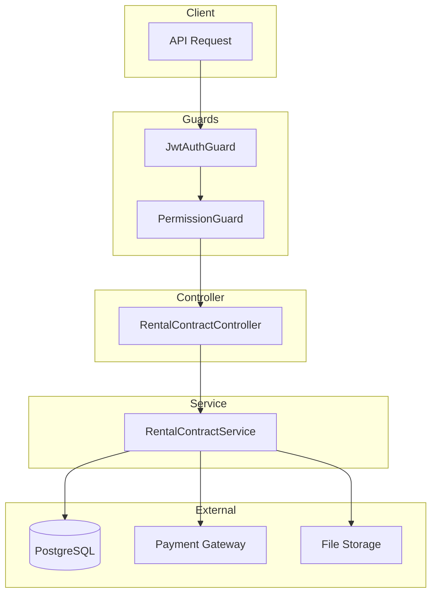
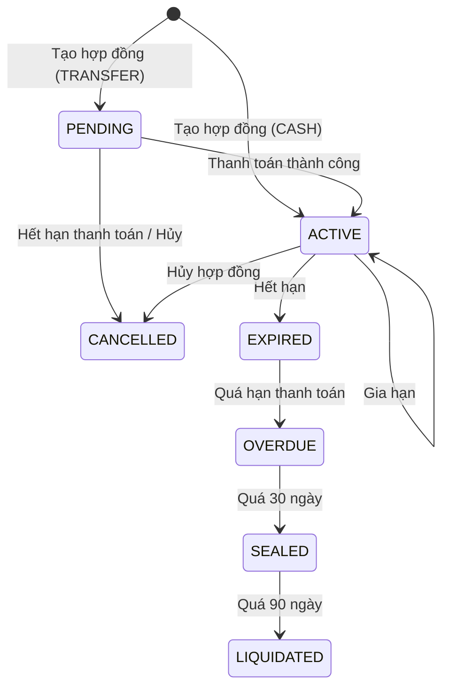

# Rental Contract Module Documentation

## Tổng Quan

Module `rental-contract` quản lý hợp đồng thuê kho trong hệ thống. Hỗ trợ đầy đủ quy trình:
- Tạo hợp đồng với nhiều kho/dãy
- Thanh toán tiền mặt hoặc chuyển khoản
- Gia hạn/rút ngắn thời gian hợp đồng
- Quản lý addon và bảo hiểm
- Áp dụng coupon giảm giá
- Hủy hợp đồng với nhiều loại lý do

---

## Kiến Trúc



---

## Trạng Thái Hợp Đồng



---

## API Endpoints

> [!TIP]
> Tất cả API yêu cầu xác thực bằng JWT Token.
> Header `Accept-Language: vi|en` để chọn ngôn ngữ phản hồi.

### Base URL

```
/rental-contracts
```

### Xác thực

```http
Authorization: Bearer <access_token>
```

---

### 1. POST /rental-contracts - Tạo hợp đồng thuê mới

**Mô tả:** Admin tạo hợp đồng thuê kho mới. Hỗ trợ 2 loại thanh toán:
- **CASH**: Kích hoạt hợp đồng ngay lập tức (đã thanh toán tiền mặt)
- **TRANSFER**: Tạo link thanh toán chuyển khoản, hợp đồng ở trạng thái PENDING

**Quyền yêu cầu:** `rental-contract.create`

**Content-Type:** `multipart/form-data` (hỗ trợ upload file chữ ký)

**Request Body Schema:**

| Field | Type | Required | Description |
|-------|------|----------|-------------|
| `organization_id` | UUID | Yes | ID của tổ chức thuê |
| `type` | enum | Yes | Loại thanh toán: `CASH`, `TRANSFER` |
| `duration_tier_id` | UUID | Yes | ID của gói thời hạn thuê |
| `templates` | array | Yes | Danh sách template kho cần thuê |
| `templates[].template_id` | UUID | Yes | ID template kho |
| `templates[].warehouse_name` | string | Yes | Tên kho (max 255 ký tự) |
| `templates[].warehouse_description` | string | No | Mô tả kho |
| `templates[].contents_description` | string | No | Mô tả nội dung lưu trữ |
| `templates[].row_template_ids` | UUID[] | No | Danh sách ID dãy (bỏ trống = thuê cả kho) |
| `addon_ids` | UUID[] | No | Danh sách ID addon |
| `insurance_ids` | UUID[] | No | Danh sách ID bảo hiểm |
| `coupon_codes` | string[] | No | Danh sách mã coupon |
| `notes` | string | No | Ghi chú |
| `auto_renew` | boolean | No | Tự động gia hạn (mặc định: false) |
| `scheduled_start_at` | datetime | No | Ngày bắt đầu thuê dự kiến |
| `signature` | file | No | File hình ảnh chữ ký (PNG) |

**Request Body Examples:**

<details>
<summary><b>Ví dụ 1: Thanh toán tiền mặt - Kích hoạt ngay</b></summary>

```json
{
  "organization_id": "550e8400-e29b-41d4-a716-446655440001",
  "type": "CASH",
  "duration_tier_id": "550e8400-e29b-41d4-a716-446655440005",
  "templates": [
    {
      "template_id": "550e8400-e29b-41d4-a716-446655440010",
      "warehouse_name": "Kho hàng A1",
      "warehouse_description": "Kho chứa hàng điện tử",
      "contents_description": "Linh kiện máy tính, thiết bị điện tử"
    }
  ],
  "addon_ids": ["550e8400-e29b-41d4-a716-446655440020"],
  "insurance_ids": ["550e8400-e29b-41d4-a716-446655440030"],
  "coupon_codes": ["SUMMER2024"],
  "notes": "Thanh toán tiền mặt tại văn phòng",
  "auto_renew": false
}
```
</details>

<details>
<summary><b>Ví dụ 2: Thanh toán chuyển khoản - Thuê dãy</b></summary>

```json
{
  "organization_id": "550e8400-e29b-41d4-a716-446655440001",
  "type": "TRANSFER",
  "duration_tier_id": "550e8400-e29b-41d4-a716-446655440005",
  "templates": [
    {
      "template_id": "550e8400-e29b-41d4-a716-446655440010",
      "warehouse_name": "Kho B2",
      "row_template_ids": [
        "550e8400-e29b-41d4-a716-446655440011",
        "550e8400-e29b-41d4-a716-446655440012"
      ]
    }
  ],
  "scheduled_start_at": "2026-02-07T00:00:00.000Z"
}
```

> **Lưu ý**: Khi chỉ định `row_template_ids`, hợp đồng sẽ chỉ thuê các dãy cụ thể thay vì cả kho.

</details>

**Response (201 Created):**
```json
{
  "code": "rental-contract.create.success",
  "message": "Tạo hợp đồng thuê thành công",
  "success": true,
  "data": {
    "id": "550e8400-e29b-41d4-a716-446655440100",
    "code": "RC-2026020001",
    "organization_id": "550e8400-e29b-41d4-a716-446655440001",
    "status": "ACTIVE",
    "start_at": "2026-02-01T00:00:00.000Z",
    "end_at": "2026-05-01T00:00:00.000Z",
    "total_amount": 5000000,
    "discount_amount": 500000,
    "final_amount": 4500000,
    "payment_url": null,
    "warehouses": [
      {
        "id": "550e8400-e29b-41d4-a716-446655440110",
        "name": "Kho hàng A1"
      }
    ],
    "created_at": "2026-02-01T09:00:00.000Z"
  }
}
```

**Error Responses:**

<details>
<summary><b>404 Not Found</b></summary>

```json
// Không tìm thấy tổ chức
{ "code": "rental-contract.organization_not_found", "message": "Không tìm thấy tổ chức", "success": false }

// Không tìm thấy template
{ "code": "rental-contract.template_not_found", "message": "Không tìm thấy template kho", "success": false }

// Không tìm thấy gói thời hạn
{ "code": "rental-contract.duration_tier_not_found", "message": "Không tìm thấy gói thời hạn", "success": false }
```
</details>

<details>
<summary><b>409 Conflict</b></summary>

```json
// Kho đang bị khóa
{ "code": "rental-contract.warehouse_lock.locked", "message": "Kho/dãy đang bị khóa bởi giao dịch khác", "success": false }

// Kho đã được thuê
{ "code": "rental-contract.warehouse_lock.conflict", "message": "Hợp đồng bị xung đột do kho/dãy đã được thuê", "success": false }
```
</details>

---

### 2. GET /rental-contracts - Lấy danh sách hợp đồng

**Mô tả:** Lấy danh sách hợp đồng với phân quyền:
- **Có quyền `rental-contract.list.all`**: Xem tất cả hợp đồng
- **Không có quyền list.all**: Chỉ xem hợp đồng của tổ chức mình

**Quyền yêu cầu:** `rental-contract.list`

**Query Parameters:**

| Parameter | Type | Required | Default | Description |
|-----------|------|----------|---------|-------------|
| `limit` | number | No | 10 | Số lượng bản ghi tối đa (min: 1) |
| `offset` | number | No | 0 | Vị trí bắt đầu (min: 0) |
| `keywords` | string | No | - | Từ khóa tìm kiếm (mã HD, tên kho) |
| `status` | enum | No | - | Lọc theo trạng thái |
| `organization_id` | UUID | No | - | Lọc theo tổ chức |

**Trạng thái có thể lọc:**
- `PENDING` - Chờ thanh toán
- `ACTIVE` - Đang hoạt động
- `EXPIRED` - Hết hạn
- `CANCELLED` - Đã hủy
- `OVERDUE` - Quá hạn thanh toán
- `SEALED` - Đã niêm phong
- `LIQUIDATED` - Đã thanh lý

**Response (200 OK):**
```json
{
  "code": "rental-contract.list.success",
  "message": "Lấy danh sách hợp đồng thành công",
  "success": true,
  "data": {
    "items": [
      {
        "id": "550e8400-e29b-41d4-a716-446655440100",
        "code": "RC-2026020001",
        "organization_id": "550e8400-e29b-41d4-a716-446655440001",
        "organization": {
          "id": "550e8400-e29b-41d4-a716-446655440001",
          "name": "Công ty ABC"
        },
        "status": "ACTIVE",
        "start_at": "2026-02-01T00:00:00.000Z",
        "end_at": "2026-05-01T00:00:00.000Z",
        "total_amount": 5000000,
        "final_amount": 4500000,
        "warehouses": [
          { "id": "...", "name": "Kho A1" }
        ],
        "created_at": "2026-02-01T09:00:00.000Z"
      }
    ],
    "total": 50,
    "limit": 10,
    "offset": 0
  }
}
```

---

### 3. GET /rental-contracts/:id - Lấy chi tiết hợp đồng

**Mô tả:** Lấy thông tin chi tiết của một hợp đồng. Bao gồm thông tin kho, dãy, addon, bảo hiểm và lịch sử thanh toán.

**Quyền yêu cầu:** `rental-contract.read`

**Path Parameters:**

| Parameter | Type | Required | Description |
|-----------|------|----------|-------------|
| `id` | UUID | Yes | ID của hợp đồng |

**Response (200 OK):** Trả về đầy đủ thông tin hợp đồng bao gồm:
- Thông tin cơ bản (id, code, status, dates, amounts)
- Tổ chức (organization)
- Danh sách kho và dãy (warehouses, rows)
- Danh sách addon (addons)
- Danh sách bảo hiểm (insurances)
- Lịch sử thanh toán (payments)

---

### 4. PUT /rental-contracts/:id - Cập nhật/gia hạn hợp đồng

**Mô tả:** Cập nhật thông tin hợp đồng. Hỗ trợ các thao tác:
- Đổi tên/ghi chú
- Gia hạn bằng `extend_duration_tier_id`
- Rút ngắn bằng `reduce_months`
- Cập nhật addon/bảo hiểm (logic upsert)

**Quyền yêu cầu:** `rental-contract.update`

**Request Body Examples:**

<details>
<summary><b>Gia hạn hợp đồng</b></summary>

```json
{
  "extend_duration_tier_id": "550e8400-e29b-41d4-a716-446655440005"
}
```
</details>

<details>
<summary><b>Rút ngắn hợp đồng</b></summary>

```json
{
  "reduce_months": 2
}
```
</details>

<details>
<summary><b>Cập nhật addon (upsert)</b></summary>

```json
{
  "addon_ids": [
    "550e8400-e29b-41d4-a716-446655440020",
    "550e8400-e29b-41d4-a716-446655440021"
  ]
}
```

> **Logic**: ID mới → thêm, ID đang có → giữ, ID không có trong list → hủy

</details>

---

### 5. DELETE /rental-contracts/:id - Hủy hợp đồng

**Mô tả:** Hủy một hợp đồng thuê với lý do.

**Quyền yêu cầu:** `rental-contract.delete`

**Request Body:**

```json
{
  "cancel_type": "CLIENT_REQUEST",
  "cancel_reason": "Không còn nhu cầu sử dụng kho"
}
```

**Các loại hủy (cancel_type):**
| Type | Description |
|------|-------------|
| `CLIENT_REQUEST` | Khách hàng yêu cầu hủy |
| `PROVIDER_REQUEST` | Nhà cung cấp yêu cầu hủy |
| `VIOLATION` | Vi phạm hợp đồng |

---

### 6. DELETE /rental-contracts/delete/many - Hủy nhiều hợp đồng

**Mô tả:** Hủy nhiều hợp đồng cùng lúc. Mỗi hợp đồng có cancel_type và cancel_reason riêng.

**Quyền yêu cầu:** `rental-contract.delete`

**Request Body:**
```json
{
  "items": [
    {
      "id": "550e8400-e29b-41d4-a716-446655440001",
      "cancel_type": "CLIENT_REQUEST",
      "cancel_reason": "Không còn nhu cầu"
    },
    {
      "id": "550e8400-e29b-41d4-a716-446655440002",
      "cancel_type": "VIOLATION",
      "cancel_reason": "Vi phạm quy định"
    }
  ]
}
```

---

## Permissions Matrix

| Permission | Description |
|------------|-------------|
| `rental-contract.create` | Tạo hợp đồng mới |
| `rental-contract.list` | Xem danh sách hợp đồng (của mình) |
| `rental-contract.list.all` | Xem tất cả hợp đồng |
| `rental-contract.read` | Xem chi tiết hợp đồng |
| `rental-contract.update` | Cập nhật/gia hạn hợp đồng |
| `rental-contract.delete` | Hủy hợp đồng |

---

## Thông Báo (Notifications)

| Event | Title | Description |
|-------|-------|-------------|
| Sắp hết hạn | Hợp đồng sắp hết hạn | Thông báo trước khi hợp đồng hết hạn |
| Quá hạn | Hợp đồng quá hạn | Thông báo khi hợp đồng quá hạn thanh toán |
| Niêm phong | Kho đã bị niêm phong | Khi kho bị niêm phong do không thanh toán |
| Thanh lý | Kho đã bị thanh lý | Khi kho bị thanh lý |
| Hủy hợp đồng | Hợp đồng đã bị hủy | Khi hợp đồng bị hủy |

---

## Files Trong Module

| File | Mô tả |
|------|-------|
| `rental-contract.controller.ts` | Controller xử lý HTTP requests |
| `rental-contract.service.ts` | Business logic layer |
| `rental-contract.module.ts` | NestJS module definition |
| `dto/index.ts` | DTOs cho tạo, cập nhật, hủy hợp đồng |

### Shared DTOs (rental-contract-shared)

| DTO | Mô tả |
|-----|-------|
| `RentalTemplateItemDto` | Thông tin template kho trong hợp đồng |
| `QueryRentalContractDto` | Query parameters cho danh sách |
