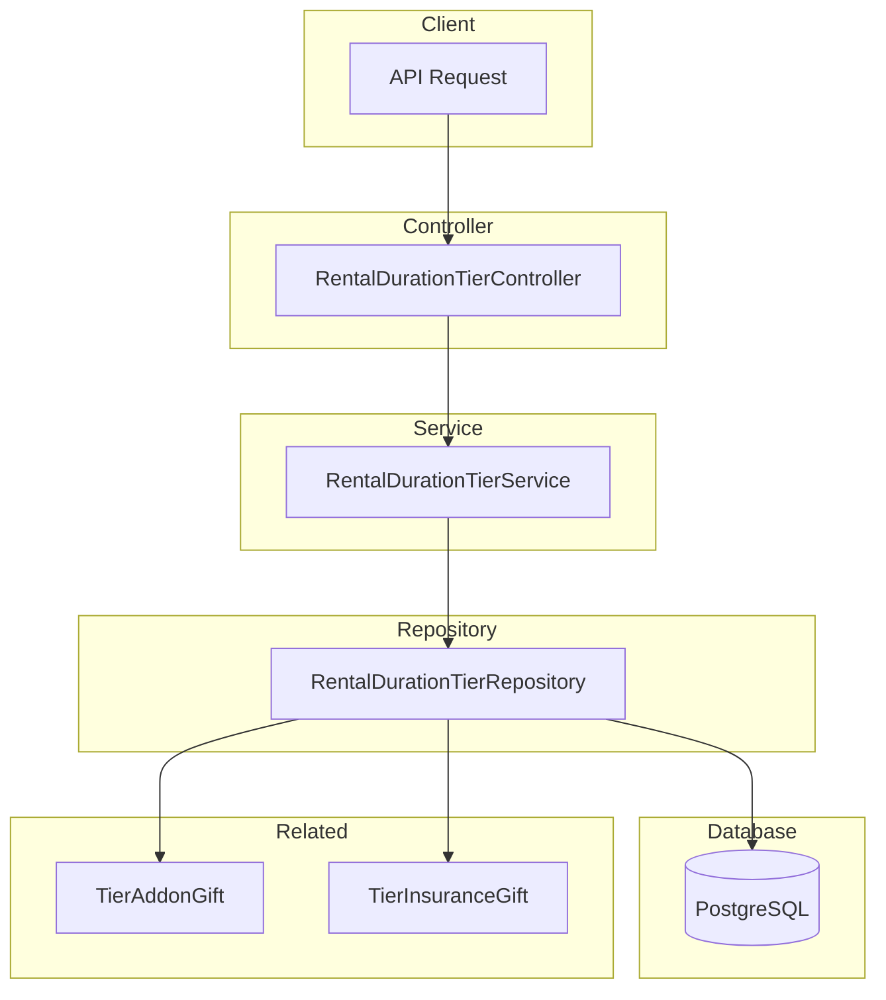

# Rental Duration Tier Module Documentation

## Tổng Quan

Module `rental-duration-tier` quản lý các mốc thời gian thuê trong hệ thống GEN-HUB. Mỗi mốc thời gian thuê định nghĩa một khoảng thời gian cho phép khách hàng thuê dịch vụ (ví dụ: 1 tháng, 6 tháng, 1 năm) và có thể kèm theo các quà tặng như addon hoặc bảo hiểm.

---

## Kiến Trúc



---

## API Endpoints

> [!TIP]
> Tất cả các API đều hỗ trợ header `Accept-Language` để chọn ngôn ngữ phản hồi.
>
> - **vi** - Tiếng Việt (mặc định)
> - **en** - English

### 1. POST /rental-duration-tiers - Tạo mốc thời gian thuê mới

**Mô tả:** Tạo một mốc thời gian thuê mới với thông tin tên, giá trị thời gian, đơn vị và các quà tặng đi kèm (addon, bảo hiểm).

**Xác thực:** Bearer Token (JWT)

**Quyền yêu cầu:** `rental-duration-tier.create`

**Headers:**

```http
Authorization: Bearer <access_token>
Content-Type: application/json
Accept-Language: vi
```

**Request Body Schema:**

| Field             | Type    | Required | Description                                           |
| ----------------- | ------- | -------- | ----------------------------------------------------- |
| `name`            | string  | Required | Tên mốc thời gian (max 255 ký tự)                     |
| `duration_value`  | integer | Required | Giá trị thời gian (>= 1)                              |
| `duration_unit`   | enum    | Optional | Đơn vị thời gian: `MONTH`, `YEAR` (mặc định: `MONTH`) |
| `description`     | string  | Optional | Mô tả chi tiết                                        |
| `order`           | integer | Optional | Thứ tự hiển thị (mặc định: 0)                         |
| `is_active`       | boolean | Optional | Trạng thái hoạt động (mặc định: true)                 |
| `addon_gifts`     | array   | Optional | Danh sách addon tặng kèm                              |
| `insurance_gifts` | array   | Optional | Danh sách bảo hiểm tặng kèm                           |

**TierAddonGift Schema:**

| Field                      | Type    | Required | Description                                |
| -------------------------- | ------- | -------- | ------------------------------------------ |
| `addon_id`                 | UUID    | Required | ID của Addon                               |
| `require_min_order_amount` | boolean | Optional | Yêu cầu đơn hàng tối thiểu                 |
| `min_order_amount`         | number  | Optional | Giá trị đơn hàng tối thiểu                 |
| `require_min_warehouses`   | boolean | Optional | Yêu cầu số kho tối thiểu                   |
| `min_warehouses`           | integer | Optional | Số kho tối thiểu                           |
| `require_min_rows`         | boolean | Optional | Yêu cầu số row tối thiểu                   |
| `min_rows`                 | integer | Optional | Số row tối thiểu                           |
| `is_until_service_end`     | boolean | Optional | Addon có hiệu lực đến khi hết dịch vụ      |
| `gift_duration_value`      | integer | Optional | Thời gian tặng kèm                         |
| `gift_duration_unit`       | enum    | Optional | Đơn vị thời gian tặng kèm: `MONTH`, `YEAR` |
| `is_active`                | boolean | Optional | Trạng thái hoạt động                       |

**TierInsuranceGift Schema:**

| Field                      | Type    | Required | Description                                |
| -------------------------- | ------- | -------- | ------------------------------------------ |
| `insurance_id`             | UUID    | Required | ID của Bảo hiểm                            |
| `require_min_order_amount` | boolean | Optional | Yêu cầu đơn hàng tối thiểu                 |
| `min_order_amount`         | number  | Optional | Giá trị đơn hàng tối thiểu                 |
| `require_min_warehouses`   | boolean | Optional | Yêu cầu số kho tối thiểu                   |
| `min_warehouses`           | integer | Optional | Số kho tối thiểu                           |
| `require_min_rows`         | boolean | Optional | Yêu cầu số row tối thiểu                   |
| `min_rows`                 | integer | Optional | Số row tối thiểu                           |
| `is_until_service_end`     | boolean | Optional | Bảo hiểm có hiệu lực đến khi hết dịch vụ   |
| `gift_duration_value`      | integer | Optional | Thời gian tặng kèm                         |
| `gift_duration_unit`       | enum    | Optional | Đơn vị thời gian tặng kèm: `MONTH`, `YEAR` |
| `is_active`                | boolean | Optional | Trạng thái hoạt động                       |

**Request Body Examples:**

<details>
<summary><b>Ví dụ 1: Tạo mốc 1 tháng đơn giản</b></summary>

```json
{
  "name": "1 Tháng",
  "duration_value": 1,
  "duration_unit": "MONTH",
  "description": "Thuê trong 1 tháng",
  "order": 1,
  "is_active": true
}
```

</details>

<details>
<summary><b>Ví dụ 2: Tạo mốc với addon tặng kèm</b></summary>

```json
{
  "name": "6 Tháng",
  "duration_value": 6,
  "duration_unit": "MONTH",
  "description": "Thuê 6 tháng với addon tặng kèm",
  "order": 2,
  "is_active": true,
  "addon_gifts": [
    {
      "addon_id": "550e8400-e29b-41d4-a716-446655440001",
      "require_min_order_amount": true,
      "min_order_amount": 1000000,
      "is_until_service_end": true,
      "is_active": true
    }
  ]
}
```

</details>

<details>
<summary><b>Ví dụ 3: Tạo mốc đầy đủ với addon và bảo hiểm</b></summary>

```json
{
  "name": "2 Năm",
  "duration_value": 2,
  "duration_unit": "YEAR",
  "description": "Gói thuê 2 năm siêu tiết kiệm với nhiều ưu đãi",
  "order": 4,
  "is_active": true,
  "addon_gifts": [
    {
      "addon_id": "550e8400-e29b-41d4-a716-446655440001",
      "require_min_order_amount": true,
      "min_order_amount": 5000000,
      "require_min_warehouses": true,
      "min_warehouses": 3,
      "is_until_service_end": true,
      "is_active": true
    }
  ],
  "insurance_gifts": [
    {
      "insurance_id": "550e8400-e29b-41d4-a716-446655440002",
      "require_min_rows": true,
      "min_rows": 100,
      "is_until_service_end": true,
      "is_active": true
    }
  ]
}
```

</details>

**Response (201 Created):**

```json
{
  "code": "rental-duration-tier.success.created",
  "message": "Đã tạo mốc thời gian thuê thành công",
  "success": true,
  "data": {
    "id": "550e8400-e29b-41d4-a716-446655440000",
    "name": "1 Tháng",
    "duration_value": 1,
    "duration_unit": "MONTH",
    "description": "Thuê trong 1 tháng",
    "order": 1,
    "is_active": true,
    "created_at": "2026-01-23T00:00:00.000Z",
    "updated_at": "2026-01-23T00:00:00.000Z",
    "created_by": "550e8400-e29b-41d4-a716-446655440099",
    "updated_by": "550e8400-e29b-41d4-a716-446655440099"
  }
}
```

**Error Responses:**

<details>
<summary><b>401 Unauthorized</b></summary>

```json
// Không có token
{
  "code": "error.unauthorized.token_missing",
  "message": "Không có quyền truy cập",
  "success": false
}

// Token hết hạn
{
  "code": "error.unauthorized.token_expired",
  "message": "Token đã hết hạn",
  "success": false
}

// Token không hợp lệ
{
  "code": "error.unauthorized.token_invalid",
  "message": "Token không hợp lệ",
  "success": false
}
```

</details>

<details>
<summary><b>403 Forbidden</b></summary>

```json
// Không có quyền thực hiện
{
  "code": "error.forbidden.no_permission",
  "message": "Không có quyền thực hiện thao tác này",
  "success": false
}

// Tài khoản bị khóa
{
  "code": "error.forbidden.account_banned",
  "message": "Tài khoản đã bị khóa",
  "success": false
}
```

</details>

<details>
<summary><b>409 Conflict</b></summary>

```json
{
  "code": "rental-duration-tier.errors.duration_exists",
  "message": "Mốc thời gian này đã tồn tại (trùng giá trị và đơn vị thời gian)",
  "success": false
}
```

</details>

<details>
<summary><b>422 Unprocessable Entity</b></summary>

```json
{
  "code": "error.validation",
  "message": "Dữ liệu đầu vào không hợp lệ",
  "success": false,
  "errors": [
    {
      "field": "name",
      "message": "Tên mốc thời gian thuê không được để trống"
    },
    {
      "field": "duration_value",
      "message": "Giá trị thời gian phải là số nguyên"
    }
  ]
}
```

</details>

---

### 2. GET /rental-duration-tiers - Lấy danh sách mốc thời gian thuê

**Mô tả:** Lấy danh sách tất cả mốc thời gian thuê với hỗ trợ phân trang, tìm kiếm và lọc theo trạng thái.

**Xác thực:** Bearer Token (JWT)

**Quyền yêu cầu:** `rental-duration-tier.list`

**Headers:**

```http
Authorization: Bearer <access_token>
Accept-Language: vi
```

**Query Parameters:**

| Parameter   | Type    | Required | Description                               |
| ----------- | ------- | -------- | ----------------------------------------- |
| `limit`     | integer | Optional | Số lượng bản ghi mỗi trang (mặc định: 10) |
| `offset`    | integer | Optional | Vị trí bắt đầu (mặc định: 0)              |
| `keywords`  | string  | Optional | Từ khóa tìm kiếm theo tên hoặc mô tả      |
| `is_active` | boolean | Optional | Lọc theo trạng thái hoạt động             |

**Request:**

```http
GET /rental-duration-tiers?limit=10&offset=0&is_active=true HTTP/1.1
Host: api.gen-hub.dev
Authorization: Bearer <access_token>
Accept-Language: vi
```

**Response (200 OK):**

```json
{
  "code": "rental-duration-tier.success.fetched",
  "message": "Lấy dữ liệu mốc thời gian thuê thành công",
  "success": true,
  "data": {
    "items": [
      {
        "id": "550e8400-e29b-41d4-a716-446655440000",
        "name": "1 Tháng",
        "duration_value": 1,
        "duration_unit": "MONTH",
        "description": "Thuê trong 1 tháng",
        "order": 1,
        "is_active": true,
        "created_at": "2026-01-23T00:00:00.000Z",
        "updated_at": "2026-01-23T00:00:00.000Z"
      },
      {
        "id": "550e8400-e29b-41d4-a716-446655440001",
        "name": "6 Tháng",
        "duration_value": 6,
        "duration_unit": "MONTH",
        "description": "Thuê 6 tháng với nhiều ưu đãi",
        "order": 2,
        "is_active": true,
        "created_at": "2026-01-23T00:00:00.000Z",
        "updated_at": "2026-01-23T00:00:00.000Z"
      }
    ],
    "total": 10,
    "limit": 10,
    "offset": 0
  }
}
```

**Error Responses:** Tương tự như API tạo mới (401, 403)

---

### 3. GET /rental-duration-tiers/active - Lấy tất cả mốc thời gian thuê đang active

**Mô tả:** Lấy danh sách tất cả các mốc thời gian thuê đang hoạt động (is_active = true), sắp xếp theo thứ tự order.

**Xác thực:** Bearer Token (JWT)

**Quyền yêu cầu:** Không yêu cầu quyền cụ thể (chỉ cần đăng nhập)

**Headers:**

```http
Authorization: Bearer <access_token>
Accept-Language: vi
```

**Request:**

```http
GET /rental-duration-tiers/active HTTP/1.1
Host: api.gen-hub.dev
Authorization: Bearer <access_token>
Accept-Language: vi
```

**Response (200 OK):**

```json
{
  "code": "rental-duration-tier.success.fetched",
  "message": "Lấy dữ liệu mốc thời gian thuê thành công",
  "success": true,
  "data": [
    {
      "id": "550e8400-e29b-41d4-a716-446655440000",
      "name": "1 Tháng",
      "duration_value": 1,
      "duration_unit": "MONTH",
      "description": "Thuê trong 1 tháng",
      "order": 1,
      "is_active": true,
      "created_at": "2026-01-23T00:00:00.000Z",
      "updated_at": "2026-01-23T00:00:00.000Z"
    },
    {
      "id": "550e8400-e29b-41d4-a716-446655440001",
      "name": "6 Tháng",
      "duration_value": 6,
      "duration_unit": "MONTH",
      "description": "Thuê 6 tháng với nhiều ưu đãi",
      "order": 2,
      "is_active": true,
      "created_at": "2026-01-23T00:00:00.000Z",
      "updated_at": "2026-01-23T00:00:00.000Z"
    }
  ]
}
```

**Error Responses:** 401 Unauthorized

---

### 4. GET /rental-duration-tiers/:id - Lấy chi tiết mốc thời gian thuê

**Mô tả:** Lấy thông tin chi tiết của một mốc thời gian thuê theo ID, bao gồm danh sách addon và bảo hiểm tặng kèm.

**Xác thực:** Bearer Token (JWT)

**Quyền yêu cầu:** `rental-duration-tier.read`

**Headers:**

```http
Authorization: Bearer <access_token>
Accept-Language: vi
```

**Path Parameters:**

| Parameter | Type | Required | Description               |
| --------- | ---- | -------- | ------------------------- |
| `id`      | UUID | Required | ID của mốc thời gian thuê |

**Request:**

```http
GET /rental-duration-tiers/550e8400-e29b-41d4-a716-446655440000 HTTP/1.1
Host: api.gen-hub.dev
Authorization: Bearer <access_token>
Accept-Language: vi
```

**Response (200 OK):**

```json
{
  "code": "rental-duration-tier.success.fetched",
  "message": "Lấy dữ liệu mốc thời gian thuê thành công",
  "success": true,
  "data": {
    "id": "550e8400-e29b-41d4-a716-446655440000",
    "name": "6 Tháng",
    "duration_value": 6,
    "duration_unit": "MONTH",
    "description": "Thuê 6 tháng với nhiều ưu đãi",
    "order": 2,
    "is_active": true,
    "addon_gifts": [
      {
        "id": "550e8400-e29b-41d4-a716-446655440010",
        "addon_id": "550e8400-e29b-41d4-a716-446655440001",
        "require_min_order_amount": true,
        "min_order_amount": 1000000,
        "is_until_service_end": true,
        "is_active": true
      }
    ],
    "insurance_gifts": [
      {
        "id": "550e8400-e29b-41d4-a716-446655440020",
        "insurance_id": "550e8400-e29b-41d4-a716-446655440002",
        "require_min_warehouses": true,
        "min_warehouses": 2,
        "is_until_service_end": false,
        "gift_duration_value": 3,
        "gift_duration_unit": "MONTH",
        "is_active": true
      }
    ],
    "created_at": "2026-01-23T00:00:00.000Z",
    "updated_at": "2026-01-23T00:00:00.000Z",
    "created_by": "550e8400-e29b-41d4-a716-446655440099",
    "updated_by": "550e8400-e29b-41d4-a716-446655440099"
  }
}
```

**Error Responses:**

<details>
<summary><b>404 Not Found</b></summary>

```json
{
  "code": "rental-duration-tier.errors.not_found",
  "message": "Không tìm thấy mốc thời gian thuê",
  "success": false
}
```

</details>

---

### 5. PUT /rental-duration-tiers/:id - Cập nhật mốc thời gian thuê

**Mô tả:** Cập nhật thông tin mốc thời gian thuê theo ID. Chỉ các trường được gửi trong request body mới được cập nhật.

**Xác thực:** Bearer Token (JWT)

**Quyền yêu cầu:** `rental-duration-tier.update`

**Headers:**

```http
Authorization: Bearer <access_token>
Content-Type: application/json
Accept-Language: vi
```

**Path Parameters:**

| Parameter | Type | Required | Description                            |
| --------- | ---- | -------- | -------------------------------------- |
| `id`      | UUID | Required | ID của mốc thời gian thuê cần cập nhật |

**Request Body Examples:**

<details>
<summary><b>Ví dụ 1: Cập nhật tên</b></summary>

```json
{
  "name": "1 Tháng (Khuyến mãi)"
}
```

</details>

<details>
<summary><b>Ví dụ 2: Thay đổi trạng thái</b></summary>

```json
{
  "is_active": false
}
```

</details>

<details>
<summary><b>Ví dụ 3: Cập nhật quà tặng</b></summary>

```json
{
  "addon_gifts": [
    {
      "id": "550e8400-e29b-41d4-a716-446655440010",
      "addon_id": "550e8400-e29b-41d4-a716-446655440001",
      "require_min_order_amount": true,
      "min_order_amount": 2000000,
      "is_until_service_end": true,
      "is_active": true
    }
  ]
}
```

</details>

**Response (200 OK):**

```json
{
  "code": "rental-duration-tier.success.updated",
  "message": "Đã cập nhật mốc thời gian thuê thành công",
  "success": true,
  "data": {
    "id": "550e8400-e29b-41d4-a716-446655440000",
    "name": "1 Tháng (Khuyến mãi)",
    "duration_value": 1,
    "duration_unit": "MONTH",
    "description": "Thuê trong 1 tháng",
    "order": 1,
    "is_active": true,
    "created_at": "2026-01-23T00:00:00.000Z",
    "updated_at": "2026-01-23T01:00:00.000Z",
    "created_by": "550e8400-e29b-41d4-a716-446655440099",
    "updated_by": "550e8400-e29b-41d4-a716-446655440099"
  }
}
```

**Error Responses:** 401, 403, 404, 409, 422

---

### 6. DELETE /rental-duration-tiers/delete/many - Xóa nhiều mốc thời gian thuê

**Mô tả:** Xóa nhiều mốc thời gian thuê cùng lúc theo danh sách ID.

**Xác thực:** Bearer Token (JWT)

**Quyền yêu cầu:** `rental-duration-tier.delete`

**Headers:**

```http
Authorization: Bearer <access_token>
Content-Type: application/json
Accept-Language: vi
```

**Request Body:**

```json
{
  "ids": [
    "550e8400-e29b-41d4-a716-446655440001",
    "550e8400-e29b-41d4-a716-446655440002"
  ]
}
```

**Response (200 OK):**

```json
{
  "code": "rental-duration-tier.success.deleted",
  "message": "Đã xóa mốc thời gian thuê thành công",
  "success": true,
  "data": null
}
```

**Error Responses:** 401, 403, 404, 422

---

### 7. DELETE /rental-duration-tiers/:id - Xóa mốc thời gian thuê

**Mô tả:** Xóa một mốc thời gian thuê theo ID.

**Xác thực:** Bearer Token (JWT)

**Quyền yêu cầu:** `rental-duration-tier.delete`

**Headers:**

```http
Authorization: Bearer <access_token>
Accept-Language: vi
```

**Path Parameters:**

| Parameter | Type | Required | Description                       |
| --------- | ---- | -------- | --------------------------------- |
| `id`      | UUID | Required | ID của mốc thời gian thuê cần xóa |

**Request:**

```http
DELETE /rental-duration-tiers/550e8400-e29b-41d4-a716-446655440000 HTTP/1.1
Host: api.gen-hub.dev
Authorization: Bearer <access_token>
Accept-Language: vi
```

**Response (200 OK):**

```json
{
  "code": "rental-duration-tier.success.deleted",
  "message": "Đã xóa mốc thời gian thuê thành công",
  "success": true,
  "data": null
}
```

**Error Responses:** 401, 403, 404

---

## Validation Rules

### RentalDurationTier

| Field            | Rule                    | Message (vi)                               |
| ---------------- | ----------------------- | ------------------------------------------ |
| `name`           | Required, max 255 chars | Tên mốc thời gian thuê không được để trống |
| `duration_value` | Required, integer >= 1  | Giá trị thời gian phải >= 1                |
| `duration_unit`  | Enum (MONTH, YEAR)      | Đơn vị thời gian phải là MONTH hoặc YEAR   |
| `description`    | Optional, string        | Mô tả phải là chuỗi                        |
| `order`          | Optional, integer >= 0  | Thứ tự hiển thị phải là số nguyên          |
| `is_active`      | Optional, boolean       | Trạng thái phải là boolean                 |

### Query Parameters

| Field       | Rule         | Message (vi)                   |
| ----------- | ------------ | ------------------------------ |
| `limit`     | Integer >= 1 | Limit phải là số dương         |
| `offset`    | Integer >= 0 | Offset phải >= 0               |
| `keywords`  | String       | Từ khóa tìm kiếm phải là chuỗi |
| `is_active` | Boolean      | Trạng thái phải là boolean     |

---

## Files Trong Module

| File                                                                                                                                                               | Mô tả                        |
| ------------------------------------------------------------------------------------------------------------------------------------------------------------------ | ---------------------------- |
| [rental-duration-tier.module.ts](file:///e:/STUDY/Demo/gen-hub/server/src/modules/rental-duration-tier/rental-duration-tier.module.ts)                             | NestJS module definition     |
| [rental-duration-tier.controller.ts](file:///e:/STUDY/Demo/gen-hub/server/src/modules/rental-duration-tier/rental-duration-tier.controller.ts)                     | REST API endpoints           |
| [rental-duration-tier.service.ts](file:///e:/STUDY/Demo/gen-hub/server/src/modules/rental-duration-tier/rental-duration-tier.service.ts)                           | Business logic               |
| [rental-duration-tier.repository.ts](file:///e:/STUDY/Demo/gen-hub/server/src/modules/rental-duration-tier/rental-duration-tier.repository.ts)                     | Database operations          |
| [dto/create-rental-duration-tier.dto.ts](file:///e:/STUDY/Demo/gen-hub/server/src/modules/rental-duration-tier/dto/create-rental-duration-tier.dto.ts)             | Create DTO với validation    |
| [dto/update-rental-duration-tier.dto.ts](file:///e:/STUDY/Demo/gen-hub/server/src/modules/rental-duration-tier/dto/update-rental-duration-tier.dto.ts)             | Update DTO                   |
| [dto/query-rental-duration-tier.dto.ts](file:///e:/STUDY/Demo/gen-hub/server/src/modules/rental-duration-tier/dto/query-rental-duration-tier.dto.ts)               | Query DTO cho phân trang/lọc |
| [dto/tier-addon-gift.dto.ts](file:///e:/STUDY/Demo/gen-hub/server/src/modules/rental-duration-tier/dto/tier-addon-gift.dto.ts)                                     | DTO cho TierAddonGift        |
| [dto/tier-insurance-gift.dto.ts](file:///e:/STUDY/Demo/gen-hub/server/src/modules/rental-duration-tier/dto/tier-insurance-gift.dto.ts)                             | DTO cho TierInsuranceGift    |
| [interfaces/rental-duration-tier.interface.ts](file:///e:/STUDY/Demo/gen-hub/server/src/modules/rental-duration-tier/interfaces/rental-duration-tier.interface.ts) | TypeScript interfaces        |

---

## Permissions

| Permission                    | Mô tả                            |
| ----------------------------- | -------------------------------- |
| `rental-duration-tier.create` | Tạo mốc thời gian thuê mới       |
| `rental-duration-tier.list`   | Xem danh sách mốc thời gian thuê |
| `rental-duration-tier.read`   | Xem chi tiết mốc thời gian thuê  |
| `rental-duration-tier.update` | Cập nhật mốc thời gian thuê      |
| `rental-duration-tier.delete` | Xóa mốc thời gian thuê           |

---

## I18n Keys

### Success Messages

| Key                                    | Vietnamese                                | English                                   |
| -------------------------------------- | ----------------------------------------- | ----------------------------------------- |
| `rental-duration-tier.success.created` | Đã tạo mốc thời gian thuê thành công      | Rental duration tier created successfully |
| `rental-duration-tier.success.updated` | Đã cập nhật mốc thời gian thuê thành công | Rental duration tier updated successfully |
| `rental-duration-tier.success.deleted` | Đã xóa mốc thời gian thuê thành công      | Rental duration tier deleted successfully |
| `rental-duration-tier.success.fetched` | Lấy dữ liệu mốc thời gian thuê thành công | Rental duration tier fetched successfully |

### Error Messages

| Key                                           | Vietnamese                                                       | English                                                      |
| --------------------------------------------- | ---------------------------------------------------------------- | ------------------------------------------------------------ |
| `rental-duration-tier.errors.not_found`       | Không tìm thấy mốc thời gian thuê                                | Rental duration tier not found                               |
| `rental-duration-tier.errors.name_exists`     | Tên mốc thời gian thuê đã tồn tại                                | Rental duration tier name already exists                     |
| `rental-duration-tier.errors.duration_exists` | Mốc thời gian này đã tồn tại (trùng giá trị và đơn vị thời gian) | This duration tier already exists (duplicate value and unit) |
| `rental-duration-tier.errors.create_failed`   | Không thể tạo mốc thời gian thuê                                 | Failed to create rental duration tier                        |
| `rental-duration-tier.errors.update_failed`   | Không thể cập nhật mốc thời gian thuê                            | Failed to update rental duration tier                        |
| `rental-duration-tier.errors.delete_failed`   | Không thể xóa mốc thời gian thuê                                 | Failed to delete rental duration tier                        |
