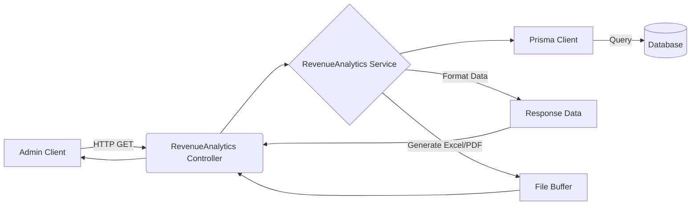

# Revenue Analytics API Documentation

## Tổng quan
Module **Revenue Analytics** cung cấp các báo cáo thống kê, phân tích doanh thu cho hệ thống admin. Dữ liệu có thể được xem dưới dạng KPI tổng hợp, biểu đồ theo thời gian thực, bảng chi tiết theo nhóm (tỉnh/thành, kho) và xuất ra file báo cáo Excel/PDF.

## Kiến trúc



## Xác thực & Phân quyền
- **Xác thực**: Yêu cầu Access Token hợp lệ qua header `Authorization: Bearer <token>`
- **Phân quyền**: Tất cả các API trong module này đều yêu cầu quyền `revenue.analytics.view` (kiểm tra qua `RequirePermission`).

---

## 1. Lấy KPI tổng quan

Lấy các chỉ số KPI doanh thu tổng quan trong khoảng thời gian xác định, so sánh với kỳ trước (nếu chọn `THIS_MONTH`, `THIS_YEAR`...).

**Endpoint:** `GET /admin/revenue-analytics/kpis`
**Quyền:** `revenue.analytics.view`

### Parameters (Query)
| Name | Type | Required | Default | Description |
|------|------|----------|---------|-------------|
| `preset` | Enum | No | `THIS_MONTH` | Preset thời gian: `TODAY`, `THIS_WEEK`, `THIS_MONTH`, `THIS_YEAR`, `CUSTOM` |
| `from_date` | Date | No | - | Ngày bắt đầu (ISO 8601), chỉ áp dụng khi `preset=CUSTOM` |
| `to_date` | Date | No | - | Ngày kết thúc (ISO 8601), chỉ áp dụng khi `preset=CUSTOM` |
| `province_id` | UUID | No | - | Lọc theo tỉnh/thành phố |
| `warehouse_template_id` | UUID | No | - | Lọc theo mẫu kho |

### Response 200 (Success)
```json
{
  "code": "revenue-analytics.kpi_success",
  "message": "Lấy KPI thành công",
  "success": true,
  "data": {
    "total_revenue": 1500000000,
    "revenue_growth": 15.5,
    "total_contracts": 120,
    "contracts_growth": 5.2,
    "average_contract_value": 12500000,
    "value_growth": -2.1,
    "total_refunds": 50000000,
    "refund_growth": 10.0
  }
}
```

---

## 2. Lấy dữ liệu biểu đồ

Lấy dữ liệu chuỗi thời gian (time-series) cho các biểu đồ phân tích doanh thu.

**Endpoint:** `GET /admin/revenue-analytics/charts`
**Quyền:** `revenue.analytics.view`

### Parameters (Query)
Bao gồm các query params như API KPI, cộng thêm:

| Name | Type | Required | Default | Description |
|------|------|----------|---------|-------------|
| `interval` | Enum | No | `DAY` | Nhóm dữ liệu theo: `DAY`, `WEEK`, `MONTH`, `YEAR` |

### Response 200 (Success)
```json
{
  "code": "revenue-analytics.chart_success",
  "message": "Lấy dữ liệu biểu đồ thành công",
  "success": true,
  "data": [
    {
      "date": "2026-03-01T00:00:00.000Z",
      "revenue": 50000000,
      "contracts": 5,
      "refunds": 0
    },
    {
      "date": "2026-03-02T00:00:00.000Z",
      "revenue": 75000000,
      "contracts": 8,
      "refunds": 2000000
    }
  ]
}
```

---

## 3. Lấy dữ liệu bảng chi tiết

Lấy dữ liệu doanh thu được nhóm theo các chiều phân tích cụ thể (ví dụ: theo tỉnh thành, theo mẫu kho).

**Endpoint:** `GET /admin/revenue-analytics/tables`
**Quyền:** `revenue.analytics.view`

### Parameters (Query)
Bao gồm các query params cơ bản, cộng thêm:

| Name | Type | Required | Default | Description |
|------|------|----------|---------|-------------|
| `group_by` | Enum | Yes | - | Nhóm theo: `PROVINCE`, `WAREHOUSE_TEMPLATE`, `PAYMENT_METHOD` |

### Response 200 (Success)
```json
{
  "code": "revenue-analytics.table_success",
  "message": "Lấy dữ liệu bảng thành công",
  "success": true,
  "data": [
    {
      "id": "550e8400-e29b-41d4-a716-446655440001",
      "name": "TP. Hồ Chí Minh",
      "revenue": 850000000,
      "percentage": 56.6,
      "contracts_count": 65
    }
  ]
}
```

---

## 4. Xuất báo cáo Excel/PDF

Xuất dữ liệu báo cáo doanh thu dưới dạng file binary (Excel hoặc PDF).

**Endpoint:** `GET /admin/revenue-analytics/export`
**Quyền:** `revenue.analytics.view`

### Parameters (Query)
Bao gồm các query params cơ bản (`preset`, `from_date`, `to_date`, `province_id`, `warehouse_template_id`), cộng thêm:

| Name | Type | Required | Default | Description |
|------|------|----------|---------|-------------|
| `format` | Enum | No | `excel` | Định dạng file xuất ra (`excel` hoặc `pdf`) |

### Response 200 (Success)
File binary được tải về.
- **Headers:**
  - `Content-Type`: `application/vnd.openxmlformats-officedocument.spreadsheetml.sheet` (cho Excel) hoặc `application/pdf`
  - `Content-Disposition`: `attachment; filename=revenue-report-1710320400000.xlsx`
- **Body:** Binary buffer của file.

## Error Responses chung
| Status | Code | Message | Description |
|--------|------|---------|-------------|
| 400 | `validation_error` | Lỗi xác thực dữ liệu | Gửi sai định dạng ngày hoặc preset không hợp lệ |
| 401 | `unauthorized` | Unauthorized | Token không hợp lệ hoặc hết hạn |
| 403 | `forbidden` | Forbidden | Không có quyền `revenue.analytics.view` |
