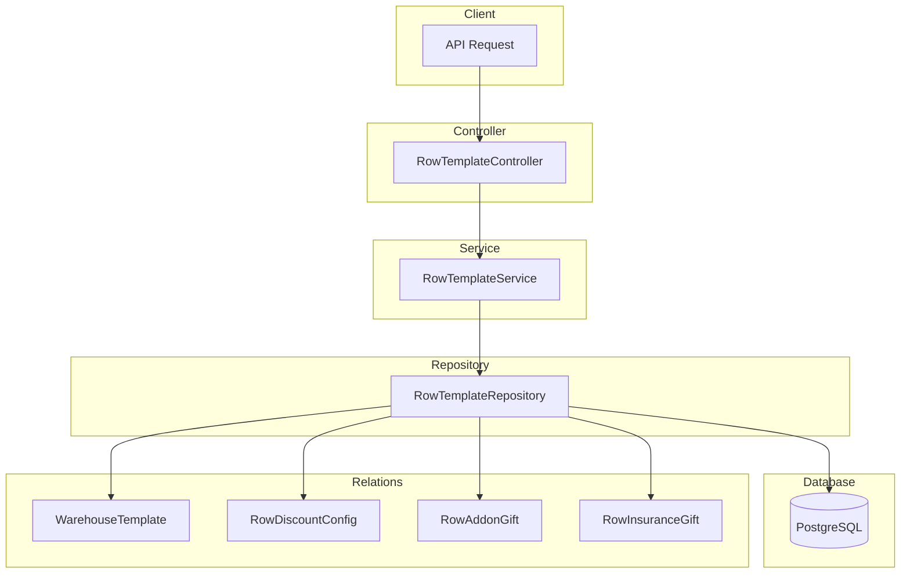

# Row Template Module Documentation

## Tổng Quan

Module `row-template` quản lý các dãy (rows) trong template kho hàng. Dãy là đơn vị cho thuê trong kho shared, với các cấu hình giá, giảm giá theo thời gian, addon tặng kèm và bảo hiểm tặng kèm.

---

## Kiến Trúc



---

## API Endpoints

> [!TIP]
> Tất cả các API đều hỗ trợ header `Accept-Language` để chọn ngôn ngữ phản hồi.
>
> - **vi** - Tiếng Việt (mặc định)
> - **en** - English

Base URL: `/warehouse-templates/:warehouseTemplateId/rows`

### 1. POST / - Tạo dãy mới

**Mô tả:** Tạo mới một dãy trong template kho hàng với đầy đủ thông tin bao gồm vị trí, giá cả, cấu hình giảm giá, addon tặng kèm và bảo hiểm tặng kèm.

**Xác thực:** Bearer Token (JWT)

**Quyền yêu cầu:** `row-template.create`

**Headers:**

```http
Authorization: Bearer <access_token>
Content-Type: application/json
Accept-Language: vi
```

**Request Body Schema:**

| Field               | Type    | Required | Description                                  |
| ------------------- | ------- | -------- | -------------------------------------------- |
| `name`              | string  | ✅       | Tên dãy (max 255 ký tự)                      |
| `code`              | string  | ✅       | Mã dãy (max 50 ký tự, unique trong template) |
| `description`       | string  | Optional | Mô tả dãy                                    |
| `price_per_month`   | number  | ✅       | Giá thuê/tháng (VND)                         |
| `address`           | string  | Optional | Địa chỉ chi tiết                             |
| `latitude`          | number  | Optional | Vĩ độ                                        |
| `longitude`         | number  | Optional | Kinh độ                                      |
| `position_x`        | number  | Optional | Vị trí X trên layout                         |
| `position_y`        | number  | Optional | Vị trí Y trên layout                         |
| `position_rotation` | number  | Optional | Góc xoay (độ)                                |
| `is_active`         | boolean | Optional | Trạng thái hoạt động (default: true)         |
| `discount_configs`  | array   | Optional | Cấu hình giảm giá theo thời gian             |
| `addon_gifts`       | array   | Optional | Danh sách addon tặng kèm                     |
| `insurance_gifts`   | array   | Optional | Danh sách bảo hiểm tặng kèm                  |

**Discount Config Schema:**

| Field              | Type          | Required | Description                |
| ------------------ | ------------- | -------- | -------------------------- |
| `duration_tier_id` | string (UUID) | ✅       | ID mốc thời gian thuê      |
| `discount_percent` | number        | ✅       | Phần trăm giảm giá (0-100) |
| `is_active`        | boolean       | Optional | Trạng thái active          |

**Addon Gift Schema:**

| Field                  | Type          | Required    | Description                    |
| ---------------------- | ------------- | ----------- | ------------------------------ |
| `addon_id`             | string (UUID) | ✅          | ID addon được tặng             |
| `is_until_service_end` | boolean       | Optional    | Tặng đến khi kết thúc dịch vụ  |
| `gift_duration_value`  | number        | Conditional | Giá trị thời gian tặng         |
| `gift_duration_unit`   | enum          | Conditional | Đơn vị: DAY, WEEK, MONTH, YEAR |
| `is_active`            | boolean       | Optional    | Trạng thái active              |

**Request Body Examples:**

<details>
<summary><b>Ví dụ 1: Dãy cơ bản</b></summary>

```json
{
  "name": "Dãy A",
  "code": "ROW-A",
  "price_per_month": 5000000,
  "is_active": true
}
```

</details>

<details>
<summary><b>Ví dụ 2: Dãy với cấu hình giảm giá</b></summary>

```json
{
  "name": "Dãy C",
  "code": "ROW-C",
  "price_per_month": 7000000,
  "discount_configs": [
    {
      "duration_tier_id": "550e8400-e29b-41d4-a716-446655440001",
      "discount_percent": 5
    },
    {
      "duration_tier_id": "550e8400-e29b-41d4-a716-446655440002",
      "discount_percent": 10
    }
  ],
  "is_active": true
}
```

</details>

<details>
<summary><b>Ví dụ 3: Dãy đầy đủ thông tin</b></summary>

```json
{
  "name": "Dãy Premium",
  "code": "ROW-PREM-01",
  "description": "Dãy premium với đầy đủ tiện ích",
  "price_per_month": 10000000,
  "address": "456 Võ Văn Kiệt, Quận 1",
  "latitude": 10.7623,
  "longitude": 106.6602,
  "position_x": 20,
  "position_y": 10,
  "position_rotation": 45,
  "discount_configs": [
    {
      "duration_tier_id": "550e8400-e29b-41d4-a716-446655440001",
      "discount_percent": 5
    },
    {
      "duration_tier_id": "550e8400-e29b-41d4-a716-446655440002",
      "discount_percent": 10
    }
  ],
  "addon_gifts": [
    {
      "addon_id": "550e8400-e29b-41d4-a716-446655440010",
      "is_until_service_end": true
    }
  ],
  "insurance_gifts": [
    {
      "insurance_id": "550e8400-e29b-41d4-a716-446655440020",
      "is_until_service_end": false,
      "gift_duration_value": 3,
      "gift_duration_unit": "MONTH"
    }
  ],
  "is_active": true
}
```

</details>

**Response (201 Created):**

```json
{
  "code": "row-template.success.created",
  "message": "Tạo dãy thành công",
  "success": true,
  "data": {
    "id": "550e8400-e29b-41d4-a716-446655440000",
    "name": "Dãy A",
    "code": "ROW-A",
    "price_per_month": 5000000,
    "is_active": true,
    "is_rented": false,
    "warehouse_template_id": "550e8400-e29b-41d4-a716-446655440099",
    "created_at": "2026-01-23T00:00:00.000Z",
    "updated_at": "2026-01-23T00:00:00.000Z"
  }
}
```

**Error Responses:**

<details>
<summary><b>404 Not Found - Warehouse template không tồn tại</b></summary>

```json
{
  "code": "row-template.errors.warehouse_template_not_found",
  "message": "Không tìm thấy template kho hàng",
  "success": false
}
```

</details>

<details>
<summary><b>409 Conflict - Mã dãy đã tồn tại</b></summary>

```json
{
  "code": "row-template.errors.code_exists",
  "message": "Mã dãy đã tồn tại trong template này",
  "success": false
}
```

</details>

<details>
<summary><b>401 Unauthorized</b></summary>

```json
// Không có token
{
  "code": "error.unauthorized.token_missing",
  "message": "Không có quyền truy cập",
  "success": false
}

// Token hết hạn
{
  "code": "error.unauthorized.token_expired",
  "message": "Token đã hết hạn",
  "success": false
}
```

</details>

<details>
<summary><b>403 Forbidden</b></summary>

```json
{
  "code": "error.forbidden.no_permission",
  "message": "Không có quyền thực hiện thao tác này",
  "success": false
}
```

</details>

<details>
<summary><b>422 Unprocessable Entity</b></summary>

```json
{
  "code": "error.validation",
  "message": "Dữ liệu đầu vào không hợp lệ",
  "success": false,
  "errors": [
    { "field": "name", "message": "Tên dãy không được để trống" },
    { "field": "price_per_month", "message": "Giá thuê/tháng phải >= 0" }
  ]
}
```

</details>

---

### 2. GET / - Lấy danh sách dãy

**Mô tả:** Lấy danh sách các dãy trong template kho hàng có hỗ trợ phân trang và lọc.

**Xác thực:** Bearer Token (JWT)

**Quyền yêu cầu:** `row-template.list`

**Query Parameters:**

| Param       | Type    | Default | Description                       |
| ----------- | ------- | ------- | --------------------------------- |
| `limit`     | number  | 10      | Số lượng bản ghi tối đa           |
| `offset`    | number  | 0       | Số bản ghi bỏ qua                 |
| `keywords`  | string  | -       | Từ khóa tìm kiếm (tên, mã, mô tả) |
| `is_active` | boolean | -       | Lọc theo trạng thái hoạt động     |
| `is_rented` | boolean | -       | Lọc theo trạng thái cho thuê      |

**Request:**

```http
GET /warehouse-templates/550e8400-e29b-41d4-a716-446655440000/rows?limit=10&offset=0&is_active=true HTTP/1.1
Host: api.gen-hub.dev
Authorization: Bearer <access_token>
Accept-Language: vi
```

**Response (200 OK):**

```json
{
  "code": "row-template.success.fetched",
  "message": "Lấy dữ liệu dãy thành công",
  "success": true,
  "data": {
    "items": [
      {
        "id": "550e8400-e29b-41d4-a716-446655440001",
        "name": "Dãy A",
        "code": "ROW-A",
        "description": "Dãy A - khu vực phía Đông",
        "price_per_month": 5000000,
        "is_active": true,
        "is_rented": false
      },
      {
        "id": "550e8400-e29b-41d4-a716-446655440002",
        "name": "Dãy B",
        "code": "ROW-B",
        "description": "Dãy B - khu vực phía Tây",
        "price_per_month": 6000000,
        "is_active": true,
        "is_rented": true
      }
    ],
    "total": 50,
    "limit": 10,
    "offset": 0
  }
}
```

---

### 3. GET /:id - Lấy chi tiết dãy

**Mô tả:** Lấy thông tin chi tiết của một dãy bao gồm cấu hình giảm giá, addon tặng kèm, bảo hiểm tặng kèm.

**Xác thực:** Bearer Token (JWT)

**Quyền yêu cầu:** `row-template.read`

**Request:**

```http
GET /warehouse-templates/550e8400-e29b-41d4-a716-446655440000/rows/550e8400-e29b-41d4-a716-446655440001 HTTP/1.1
Host: api.gen-hub.dev
Authorization: Bearer <access_token>
Accept-Language: vi
```

**Response (200 OK):**

```json
{
  "code": "row-template.success.fetched",
  "message": "Lấy dữ liệu dãy thành công",
  "success": true,
  "data": {
    "id": "550e8400-e29b-41d4-a716-446655440001",
    "name": "Dãy A",
    "code": "ROW-A",
    "description": "Dãy A - khu vực phía Đông",
    "price_per_month": 5000000,
    "address": "123 Nguyễn Văn Linh, Quận 7",
    "latitude": 10.7285,
    "longitude": 106.7218,
    "position_x": 10,
    "position_y": 5,
    "position_rotation": 0,
    "is_active": true,
    "is_rented": false,
    "warehouse_template_id": "550e8400-e29b-41d4-a716-446655440000",
    "discount_configs": [
      {
        "id": "550e8400-e29b-41d4-a716-446655440100",
        "duration_tier_id": "550e8400-e29b-41d4-a716-446655440050",
        "discount_percent": 5,
        "is_active": true,
        "duration_tier": {
          "id": "550e8400-e29b-41d4-a716-446655440050",
          "name": "3 tháng",
          "duration_value": 3,
          "duration_unit": "MONTH"
        }
      },
      {
        "id": "550e8400-e29b-41d4-a716-446655440101",
        "duration_tier_id": "550e8400-e29b-41d4-a716-446655440051",
        "discount_percent": 10,
        "is_active": true,
        "duration_tier": {
          "id": "550e8400-e29b-41d4-a716-446655440051",
          "name": "6 tháng",
          "duration_value": 6,
          "duration_unit": "MONTH"
        }
      }
    ],
    "addon_gifts": [
      {
        "id": "550e8400-e29b-41d4-a716-446655440200",
        "addon_id": "550e8400-e29b-41d4-a716-446655440010",
        "is_until_service_end": true,
        "is_active": true,
        "addon": {
          "id": "550e8400-e29b-41d4-a716-446655440010",
          "name": "Bảo vệ 24/7"
        }
      }
    ],
    "insurance_gifts": [
      {
        "id": "550e8400-e29b-41d4-a716-446655440300",
        "insurance_id": "550e8400-e29b-41d4-a716-446655440020",
        "is_until_service_end": false,
        "gift_duration_value": 3,
        "gift_duration_unit": "MONTH",
        "is_active": true,
        "insurance": {
          "id": "550e8400-e29b-41d4-a716-446655440020",
          "name": "Bảo hiểm hàng hóa cơ bản"
        }
      }
    ],
    "created_at": "2026-01-23T00:00:00.000Z",
    "updated_at": "2026-01-23T00:00:00.000Z"
  }
}
```

---

### 4. PUT /:id - Cập nhật dãy

**Mô tả:** Cập nhật một phần hoặc toàn bộ thông tin của dãy. Hỗ trợ cập nhật cấu hình giảm giá, addon và bảo hiểm tặng kèm.

**Xác thực:** Bearer Token (JWT)

**Quyền yêu cầu:** `row-template.update`

**Lưu ý về discount_configs, addon_gifts, insurance_gifts:**

- Config có `id` sẽ được cập nhật
- Config không có `id` sẽ được tạo mới
- Config hiện có nhưng không trong danh sách sẽ bị xóa

**Request Body Examples:**

<details>
<summary><b>Cập nhật thông tin cơ bản</b></summary>

```json
{
  "name": "Dãy A (Updated)",
  "description": "Mô tả cập nhật",
  "price_per_month": 5500000
}
```

</details>

<details>
<summary><b>Cập nhật cấu hình giảm giá</b></summary>

```json
{
  "discount_configs": [
    {
      "id": "550e8400-e29b-41d4-a716-446655440100",
      "duration_tier_id": "550e8400-e29b-41d4-a716-446655440001",
      "discount_percent": 8
    },
    {
      "duration_tier_id": "550e8400-e29b-41d4-a716-446655440002",
      "discount_percent": 15
    }
  ]
}
```

</details>

**Response (200 OK):**

```json
{
  "code": "row-template.success.updated",
  "message": "Cập nhật dãy thành công",
  "success": true,
  "data": {
    "id": "550e8400-e29b-41d4-a716-446655440001",
    "name": "Dãy A (Updated)",
    "code": "ROW-A",
    "price_per_month": 5500000,
    "is_active": true,
    "updated_at": "2026-01-23T00:00:00.000Z"
  }
}
```

---

### 5. DELETE /delete/many - Xóa nhiều dãy

**Mô tả:** Xóa mềm nhiều dãy cùng lúc.

**Xác thực:** Bearer Token (JWT)

**Quyền yêu cầu:** `row-template.delete`

**Request:**

```http
DELETE /warehouse-templates/550e8400-e29b-41d4-a716-446655440000/rows/delete/many HTTP/1.1
Host: api.gen-hub.dev
Authorization: Bearer <access_token>
Content-Type: application/json
Accept-Language: vi

{
  "ids": [
    "550e8400-e29b-41d4-a716-446655440001",
    "550e8400-e29b-41d4-a716-446655440002"
  ]
}
```

**Response (200 OK):**

```json
{
  "code": "row-template.success.deleted",
  "message": "Xóa dãy thành công",
  "success": true,
  "data": null
}
```

---

### 6. DELETE /:id - Xóa dãy

**Mô tả:** Xóa mềm một dãy.

**Xác thực:** Bearer Token (JWT)

**Quyền yêu cầu:** `row-template.delete`

**Request:**

```http
DELETE /warehouse-templates/550e8400-e29b-41d4-a716-446655440000/rows/550e8400-e29b-41d4-a716-446655440001 HTTP/1.1
Host: api.gen-hub.dev
Authorization: Bearer <access_token>
Accept-Language: vi
```

**Response (200 OK):**

```json
{
  "code": "row-template.success.deleted",
  "message": "Xóa dãy thành công",
  "success": true,
  "data": null
}
```

---

## Quyền (Permissions)

| Permission Key        | Description       |
| --------------------- | ----------------- |
| `row-template.create` | Tạo dãy mới       |
| `row-template.list`   | Xem danh sách dãy |
| `row-template.read`   | Xem chi tiết dãy  |
| `row-template.update` | Cập nhật dãy      |
| `row-template.delete` | Xóa dãy           |

---

## Validation Rules

### Tên dãy (name)

- Bắt buộc
- Phải là chuỗi
- Tối đa 255 ký tự

### Mã dãy (code)

- Bắt buộc
- Phải là chuỗi
- Tối đa 50 ký tự
- Unique trong cùng warehouse template

### Giá thuê/tháng (price_per_month)

- Phải là số
- Giá trị >= 0

### Discount percent

- Phải là số
- Giá trị 0-100

---

## Files Trong Module

| File                             | Mô tả                          |
| -------------------------------- | ------------------------------ |
| `row-template.controller.ts`     | Controller xử lý HTTP requests |
| `row-template.service.ts`        | Business logic                 |
| `row-template.repository.ts`     | Data access layer              |
| `row-template.module.ts`         | Module definition              |
| `dto/create-row-template.dto.ts` | DTO tạo mới dãy                |
| `dto/update-row-template.dto.ts` | DTO cập nhật dãy               |
| `dto/query-row-template.dto.ts`  | DTO query với filters          |
| `dto/row-addon-gift.dto.ts`      | DTO addon tặng kèm             |
| `dto/row-insurance-gift.dto.ts`  | DTO bảo hiểm tặng kèm          |

---

## I18n Keys

### Success Messages

- `row-template.success.created` - Tạo dãy thành công
- `row-template.success.updated` - Cập nhật dãy thành công
- `row-template.success.deleted` - Xóa dãy thành công
- `row-template.success.fetched` - Lấy dữ liệu dãy thành công

### Error Messages

- `row-template.errors.not_found` - Không tìm thấy dãy
- `row-template.errors.warehouse_template_not_found` - Không tìm thấy template kho hàng
- `row-template.errors.code_exists` - Mã dãy đã tồn tại trong template này
- `row-template.errors.create_failed` - Không thể tạo dãy
- `row-template.errors.update_failed` - Không thể cập nhật dãy
- `row-template.errors.delete_failed` - Không thể xóa dãy
- `row-template.errors.position_out_of_bounds` - Vị trí dãy vượt quá giới hạn kho

### Validation Messages

- `row-template.validation.name_required` - Tên dãy không được để trống
- `row-template.validation.name_string` - Tên dãy phải là chuỗi
- `row-template.validation.name_max_length` - Tên dãy không được quá 255 ký tự
- `row-template.validation.code_required` - Mã dãy không được để trống
- `row-template.validation.code_string` - Mã dãy phải là chuỗi
- `row-template.validation.code_max_length` - Mã dãy không được quá 50 ký tự
- `row-template.validation.price_per_month_number` - Giá thuê/tháng phải là số
- `row-template.validation.price_per_month_min` - Giá thuê/tháng phải >= 0
- `row-template.validation.discount_percent_number` - Phần trăm giảm giá phải là số
- `row-template.validation.discount_percent_min` - Phần trăm giảm giá phải >= 0
