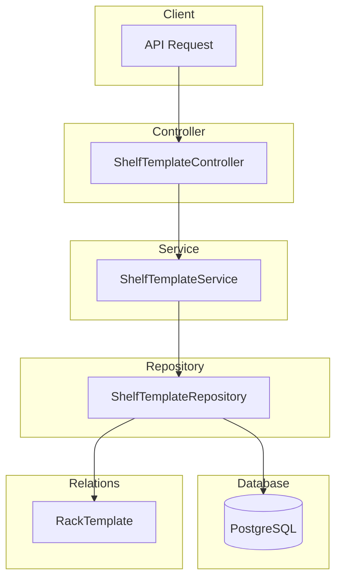

# Shelf Template Module Documentation

## Tổng Quan

Module `shelf-template` quản lý các tầng (shelves) trong kệ (rack) của template kho hàng. Tầng là đơn vị lưu trữ nhỏ nhất trong cấu trúc kho hàng.

---

## Kiến Trúc



---

## API Endpoints

> [!TIP]
> Tất cả các API đều hỗ trợ header `Accept-Language` để chọn ngôn ngữ phản hồi.
>
> - **vi** - Tiếng Việt (mặc định)
> - **en** - English

Base URL: `/warehouse-templates/:warehouseTemplateId/rows/:rowId/racks/:rackId/shelves`

### 1. POST / - Tạo tầng mới

**Mô tả:** Tạo mới một tầng trong kệ của template kho hàng.

**Xác thực:** Bearer Token (JWT)

**Quyền yêu cầu:** `shelf-template.create`

**Headers:**

```http
Authorization: Bearer <access_token>
Content-Type: application/json
Accept-Language: vi
```

**Path Parameters:**

| Param                 | Type | Description               |
| --------------------- | ---- | ------------------------- |
| `warehouseTemplateId` | UUID | ID của warehouse template |
| `rowId`               | UUID | ID của dãy                |
| `rackId`              | UUID | ID của kệ                 |

**Request Body Schema:**

| Field         | Type    | Required | Description                             |
| ------------- | ------- | -------- | --------------------------------------- |
| `name`        | string  | ✅       | Tên tầng (max 255 ký tự)                |
| `code`        | string  | ✅       | Mã tầng (max 50 ký tự, unique trong kệ) |
| `description` | string  | Optional | Mô tả tầng                              |
| `height`      | number  | Optional | Chiều cao tầng (cm, >= 0)               |
| `is_active`   | boolean | Optional | Trạng thái hoạt động (default: true)    |

**Request Body Examples:**

<details>
<summary><b>Ví dụ 1: Tầng cơ bản</b></summary>

```json
{
  "name": "Tầng 1",
  "code": "SHELF-1"
}
```

</details>

<details>
<summary><b>Ví dụ 2: Tầng với mô tả</b></summary>

```json
{
  "name": "Tầng 2",
  "code": "SHELF-2",
  "description": "Tầng thứ 2 từ dưới lên"
}
```

</details>

<details>
<summary><b>Ví dụ 3: Tầng đầy đủ thông tin</b></summary>

```json
{
  "name": "Tầng 3",
  "code": "SHELF-3",
  "description": "Tầng trên cùng, phù hợp hàng nhẹ",
  "height": 50,
  "is_active": true
}
```

</details>

**Response (201 Created):**

```json
{
  "code": "shelf-template.success.created",
  "message": "Tạo tầng thành công",
  "success": true,
  "data": {
    "id": "550e8400-e29b-41d4-a716-446655440003",
    "name": "Tầng 1",
    "code": "SHELF-1",
    "description": null,
    "height": null,
    "is_active": true,
    "rack_template_id": "550e8400-e29b-41d4-a716-446655440002",
    "created_at": "2026-01-24T00:00:00.000Z",
    "updated_at": "2026-01-24T00:00:00.000Z"
  }
}
```

**Error Responses:**

<details>
<summary><b>404 Not Found - Kệ không tồn tại</b></summary>

```json
{
  "code": "shelf-template.errors.rack_template_not_found",
  "message": "Không tìm thấy kệ",
  "success": false
}
```

</details>

<details>
<summary><b>409 Conflict - Mã tầng đã tồn tại</b></summary>

```json
{
  "code": "shelf-template.errors.code_exists",
  "message": "Mã tầng đã tồn tại trong kệ này",
  "success": false
}
```

</details>

<details>
<summary><b>401 Unauthorized</b></summary>

```json
// Không có token
{
  "code": "error.unauthorized.token_missing",
  "message": "Không có quyền truy cập",
  "success": false
}

// Token hết hạn
{
  "code": "error.unauthorized.token_expired",
  "message": "Token đã hết hạn",
  "success": false
}
```

</details>

<details>
<summary><b>403 Forbidden</b></summary>

```json
{
  "code": "error.forbidden.no_permission",
  "message": "Không có quyền thực hiện thao tác này",
  "success": false
}
```

</details>

<details>
<summary><b>422 Unprocessable Entity</b></summary>

```json
{
  "code": "error.validation",
  "message": "Dữ liệu đầu vào không hợp lệ",
  "success": false,
  "errors": [
    { "field": "name", "message": "Tên tầng không được để trống" },
    { "field": "code", "message": "Mã tầng không được để trống" }
  ]
}
```

</details>

---

### 2. GET / - Lấy danh sách tầng

**Mô tả:** Lấy danh sách các tầng trong kệ có hỗ trợ phân trang và lọc.

**Xác thực:** Bearer Token (JWT)

**Quyền yêu cầu:** `shelf-template.list`

**Query Parameters:**

| Param       | Type    | Default | Description                       |
| ----------- | ------- | ------- | --------------------------------- |
| `limit`     | number  | 10      | Số lượng bản ghi tối đa           |
| `offset`    | number  | 0       | Số bản ghi bỏ qua                 |
| `keywords`  | string  | -       | Từ khóa tìm kiếm (tên, mã, mô tả) |
| `is_active` | boolean | -       | Lọc theo trạng thái hoạt động     |

**Request:**

```http
GET /warehouse-templates/550e8400-e29b-41d4-a716-446655440000/rows/550e8400-e29b-41d4-a716-446655440001/racks/550e8400-e29b-41d4-a716-446655440002/shelves?limit=10&offset=0&is_active=true HTTP/1.1
Host: api.gen-hub.dev
Authorization: Bearer <access_token>
Accept-Language: vi
```

**Response (200 OK):**

```json
{
  "code": "shelf-template.success.fetched",
  "message": "Lấy dữ liệu tầng thành công",
  "success": true,
  "data": {
    "items": [
      {
        "id": "550e8400-e29b-41d4-a716-446655440003",
        "name": "Tầng 1",
        "code": "SHELF-1",
        "description": "Tầng đầu tiên",
        "height": 50,
        "is_active": true
      },
      {
        "id": "550e8400-e29b-41d4-a716-446655440004",
        "name": "Tầng 2",
        "code": "SHELF-2",
        "description": "Tầng thứ hai",
        "height": 45,
        "is_active": true
      }
    ],
    "total": 5,
    "limit": 10,
    "offset": 0
  }
}
```

---

### 3. GET /:id - Lấy chi tiết tầng

**Mô tả:** Lấy thông tin chi tiết của một tầng.

**Xác thực:** Bearer Token (JWT)

**Quyền yêu cầu:** `shelf-template.read`

**Request:**

```http
GET /warehouse-templates/550e8400-e29b-41d4-a716-446655440000/rows/550e8400-e29b-41d4-a716-446655440001/racks/550e8400-e29b-41d4-a716-446655440002/shelves/550e8400-e29b-41d4-a716-446655440003 HTTP/1.1
Host: api.gen-hub.dev
Authorization: Bearer <access_token>
Accept-Language: vi
```

**Response (200 OK):**

```json
{
  "code": "shelf-template.success.fetched",
  "message": "Lấy dữ liệu tầng thành công",
  "success": true,
  "data": {
    "id": "550e8400-e29b-41d4-a716-446655440003",
    "name": "Tầng 1",
    "code": "SHELF-1",
    "description": "Tầng đầu tiên",
    "height": 50,
    "is_active": true,
    "rack_template_id": "550e8400-e29b-41d4-a716-446655440002",
    "rack_template": {
      "id": "550e8400-e29b-41d4-a716-446655440002",
      "name": "Kệ A1",
      "code": "RACK-A1"
    },
    "created_at": "2026-01-24T00:00:00.000Z",
    "updated_at": "2026-01-24T00:00:00.000Z"
  }
}
```

**Error Responses:**

<details>
<summary><b>404 Not Found</b></summary>

```json
{
  "code": "shelf-template.errors.not_found",
  "message": "Không tìm thấy tầng",
  "success": false
}
```

</details>

---

### 4. PUT /:id - Cập nhật tầng

**Mô tả:** Cập nhật thông tin của một tầng. Chỉ các trường được gửi trong request body mới được cập nhật.

**Xác thực:** Bearer Token (JWT)

**Quyền yêu cầu:** `shelf-template.update`

**Request Body Examples:**

<details>
<summary><b>Cập nhật tên tầng</b></summary>

```json
{
  "name": "Tầng 1 (Updated)"
}
```

</details>

<details>
<summary><b>Cập nhật chiều cao</b></summary>

```json
{
  "height": 60
}
```

</details>

<details>
<summary><b>Thay đổi trạng thái</b></summary>

```json
{
  "is_active": false
}
```

</details>

<details>
<summary><b>Cập nhật toàn bộ</b></summary>

```json
{
  "name": "Tầng 1 Premium",
  "code": "SHELF-1-PREM",
  "description": "Tầng được nâng cấp với sức chứa cao hơn",
  "height": 75,
  "is_active": true
}
```

</details>

**Response (200 OK):**

```json
{
  "code": "shelf-template.success.updated",
  "message": "Cập nhật tầng thành công",
  "success": true,
  "data": {
    "id": "550e8400-e29b-41d4-a716-446655440003",
    "name": "Tầng 1 (Updated)",
    "code": "SHELF-1",
    "description": "Tầng đầu tiên",
    "height": 60,
    "is_active": true,
    "updated_at": "2026-01-24T00:00:00.000Z"
  }
}
```

---

### 5. DELETE /delete/many - Xóa nhiều tầng

**Mô tả:** Xóa mềm nhiều tầng cùng lúc.

**Xác thực:** Bearer Token (JWT)

**Quyền yêu cầu:** `shelf-template.delete`

**Request:**

```http
DELETE /warehouse-templates/550e8400-e29b-41d4-a716-446655440000/rows/550e8400-e29b-41d4-a716-446655440001/racks/550e8400-e29b-41d4-a716-446655440002/shelves/delete/many HTTP/1.1
Host: api.gen-hub.dev
Authorization: Bearer <access_token>
Content-Type: application/json
Accept-Language: vi

{
  "ids": [
    "550e8400-e29b-41d4-a716-446655440003",
    "550e8400-e29b-41d4-a716-446655440004"
  ]
}
```

**Response (200 OK):**

```json
{
  "code": "shelf-template.success.deleted",
  "message": "Xóa tầng thành công",
  "success": true,
  "data": null
}
```

---

### 6. DELETE /:id - Xóa tầng

**Mô tả:** Xóa mềm một tầng.

**Xác thực:** Bearer Token (JWT)

**Quyền yêu cầu:** `shelf-template.delete`

**Request:**

```http
DELETE /warehouse-templates/550e8400-e29b-41d4-a716-446655440000/rows/550e8400-e29b-41d4-a716-446655440001/racks/550e8400-e29b-41d4-a716-446655440002/shelves/550e8400-e29b-41d4-a716-446655440003 HTTP/1.1
Host: api.gen-hub.dev
Authorization: Bearer <access_token>
Accept-Language: vi
```

**Response (200 OK):**

```json
{
  "code": "shelf-template.success.deleted",
  "message": "Xóa tầng thành công",
  "success": true,
  "data": null
}
```

---

## Quyền (Permissions)

| Permission Key          | Description        |
| ----------------------- | ------------------ |
| `shelf-template.create` | Tạo tầng mới       |
| `shelf-template.list`   | Xem danh sách tầng |
| `shelf-template.read`   | Xem chi tiết tầng  |
| `shelf-template.update` | Cập nhật tầng      |
| `shelf-template.delete` | Xóa tầng           |

---

## Validation Rules

### Tên tầng (name)

- Bắt buộc
- Phải là chuỗi
- Tối đa 255 ký tự

### Mã tầng (code)

- Bắt buộc
- Phải là chuỗi
- Tối đa 50 ký tự
- Unique trong cùng kệ

### Mô tả (description)

- Không bắt buộc
- Phải là chuỗi

### Chiều cao (height)

- Không bắt buộc
- Phải là số
- Giá trị >= 0

### Trạng thái (is_active)

- Không bắt buộc
- Phải là boolean
- Mặc định: true

---

## Files Trong Module

| File                               | Mô tả                          |
| ---------------------------------- | ------------------------------ |
| `shelf-template.controller.ts`     | Controller xử lý HTTP requests |
| `shelf-template.service.ts`        | Business logic                 |
| `shelf-template.repository.ts`     | Data access layer              |
| `shelf-template.module.ts`         | Module definition              |
| `dto/create-shelf-template.dto.ts` | DTO tạo mới tầng               |
| `dto/update-shelf-template.dto.ts` | DTO cập nhật tầng              |
| `dto/query-shelf-template.dto.ts`  | DTO query với filters          |

---

## I18n Keys

### Success Messages

- `shelf-template.success.created` - Tạo tầng thành công
- `shelf-template.success.updated` - Cập nhật tầng thành công
- `shelf-template.success.deleted` - Xóa tầng thành công
- `shelf-template.success.fetched` - Lấy dữ liệu tầng thành công

### Error Messages

- `shelf-template.errors.not_found` - Không tìm thấy tầng
- `shelf-template.errors.rack_template_not_found` - Không tìm thấy kệ
- `shelf-template.errors.code_exists` - Mã tầng đã tồn tại trong kệ này
- `shelf-template.errors.create_failed` - Không thể tạo tầng
- `shelf-template.errors.update_failed` - Không thể cập nhật tầng
- `shelf-template.errors.delete_failed` - Không thể xóa tầng

### Validation Messages

- `shelf-template.validation.name_required` - Tên tầng không được để trống
- `shelf-template.validation.name_string` - Tên tầng phải là chuỗi
- `shelf-template.validation.name_max_length` - Tên tầng không được quá 255 ký tự
- `shelf-template.validation.code_required` - Mã tầng không được để trống
- `shelf-template.validation.code_string` - Mã tầng phải là chuỗi
- `shelf-template.validation.code_max_length` - Mã tầng không được quá 50 ký tự
- `shelf-template.validation.description_string` - Mô tả phải là chuỗi
- `shelf-template.validation.height_number` - Chiều cao phải là số
- `shelf-template.validation.height_min` - Chiều cao phải >= 0
- `shelf-template.validation.is_active_boolean` - Trạng thái active phải là boolean
