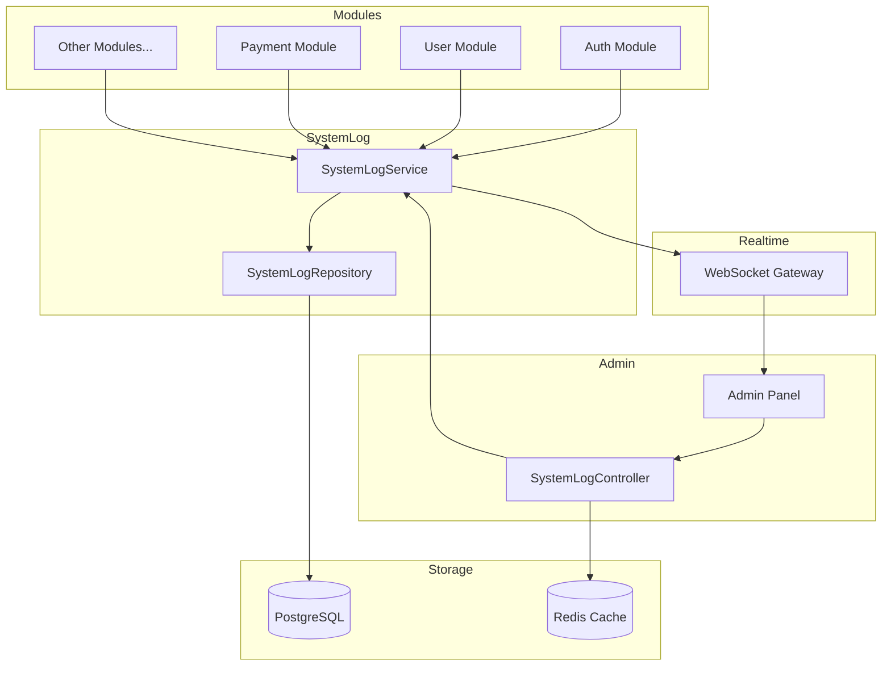

# System Log Module Documentation

## Tổng Quan

Module `system-log` quản lý việc ghi log và xem lịch sử hoạt động của hệ thống GEN-HUB. Logs được lưu trữ trong database PostgreSQL và được cache trong Redis để tăng hiệu suất truy vấn.

### Tính năng chính:
- **Ghi log async** - Fire-and-forget pattern không ảnh hưởng response time
- **Realtime monitoring** - WebSocket emit khi có log mới
- **Redis caching** - Cache-aside pattern với TTL từ biến môi trường
- **Filtering & Pagination** - Lọc theo level, module, thời gian

---

## Kiến Trúc



---

## API Endpoints

> [!TIP]
> Tất cả các API đều hỗ trợ header `Accept-Language` để chọn ngôn ngữ phản hồi.
> - **vi** - Tiếng Việt (mặc định)
> - **en** - English

### 1. GET /admin/system-logs - Lấy danh sách logs

**Mô tả:** Lấy danh sách các system logs với phân trang và bộ lọc.

**Xác thực:** Bearer Token (JWT)

**Quyền yêu cầu:** `systemlogs.admin`

**Headers:**
```http
GET /admin/system-logs?page=1&limit=50&level=ERROR HTTP/1.1
Host: api.gen-hub.dev
Authorization: Bearer <access_token>
Accept: application/json
Accept-Language: vi
```

**Query Parameters:**

| Parameter | Type | Required | Description | Example |
|-----------|------|----------|-------------|---------|
| `page` | number | Optional | Số trang (bắt đầu từ 1) | `1` |
| `limit` | number | Optional | Số items mỗi trang (1-100) | `50` |
| `level` | enum | Optional | Lọc theo log level | `ERROR` |
| `module` | string | Optional | Lọc theo module (case-insensitive) | `auth` |
| `search` | string | Optional | Tìm trong message/action | `login` |
| `startDate` | ISO 8601 | Optional | Ngày bắt đầu | `2026-01-01T00:00:00Z` |
| `endDate` | ISO 8601 | Optional | Ngày kết thúc | `2026-01-31T23:59:59Z` |

**Response (200 OK):**

```json
{
  "code": "system-log.success.list",
  "message": "Lấy danh sách logs thành công",
  "success": true,
  "data": {
    "data": [
      {
        "id": "550e8400-e29b-41d4-a716-446655440000",
        "level": "INFO",
        "module": "auth",
        "action": "login",
        "message": "User logged in successfully",
        "meta_data": {
          "userId": "123",
          "method": "password"
        },
        "user_id": "550e8400-e29b-41d4-a716-446655440001",
        "ip_address": "192.168.1.1",
        "user_agent": "Mozilla/5.0 (Windows NT 10.0; Win64; x64)",
        "created_at": "2026-01-22T08:00:00.000Z",
        "user": {
          "id": "550e8400-e29b-41d4-a716-446655440001",
          "name": "John Doe",
          "email": "john@example.com"
        }
      }
    ],
    "meta": {
      "total": 1250,
      "page": 1,
      "limit": 50,
      "totalPages": 25
    }
  }
}
```

**Error Responses:**

<details>
<summary><b>401 Unauthorized</b></summary>

```json
{
  "code": "error.unauthorized.token_missing",
  "message": "Không có quyền truy cập",
  "success": false
}
```
</details>

<details>
<summary><b>403 Forbidden</b></summary>

```json
{
  "code": "error.forbidden.no_permission",
  "message": "Không có quyền thực hiện thao tác này",
  "success": false
}
```
</details>

<details>
<summary><b>422 Unprocessable Entity</b></summary>

```json
{
  "code": "error.validation",
  "message": "Dữ liệu đầu vào không hợp lệ",
  "success": false,
  "errors": [
    { "field": "page", "message": "Số trang phải là số dương" },
    { "field": "limit", "message": "Số lượng items tối đa là 100" }
  ]
}
```
</details>

---

### 2. GET /admin/system-logs/stats - Lấy thống kê logs

**Mô tả:** Lấy thống kê tổng quan về system logs.

**Xác thực:** Bearer Token (JWT)

**Quyền yêu cầu:** `systemlogs.admin`

**Response (200 OK):**

```json
{
  "code": "system-log.success.stats",
  "message": "Lấy thống kê logs thành công",
  "success": true,
  "data": {
    "total": 15420,
    "recentCount": 523,
    "byLevel": {
      "INFO": 12000,
      "WARN": 2500,
      "ERROR": 800,
      "DEBUG": 120
    }
  }
}
```

| Field | Type | Description |
|-------|------|-------------|
| `total` | number | Tổng số logs trong hệ thống |
| `recentCount` | number | Số logs trong 24 giờ gần nhất |
| `byLevel` | object | Phân bổ số lượng logs theo level |

---

### 3. GET /admin/system-logs/modules - Lấy danh sách modules

**Mô tả:** Lấy danh sách tất cả các module đã tạo logs trong hệ thống.

**Xác thực:** Bearer Token (JWT)

**Quyền yêu cầu:** `systemlogs.admin`

**Response (200 OK):**

```json
{
  "code": "system-log.success.modules",
  "message": "Lấy danh sách modules thành công",
  "success": true,
  "data": [
    "auth",
    "http",
    "organization",
    "payment",
    "rental-contract",
    "server",
    "user",
    "warehouse"
  ]
}
```

---

### 4. GET /admin/system-logs/levels - Lấy danh sách log levels

**Mô tả:** Lấy danh sách tất cả các log level có sẵn trong hệ thống.

**Xác thực:** Bearer Token (JWT)

**Quyền yêu cầu:** `systemlogs.admin`

**Response (200 OK):**

```json
{
  "code": "system-log.success.levels",
  "message": "Lấy danh sách log levels thành công",
  "success": true,
  "data": ["INFO", "WARN", "ERROR", "DEBUG"]
}
```

---

## Log Levels

| Level | Mô tả | Trường hợp sử dụng |
|-------|-------|-------------------|
| `INFO` | Thông tin bình thường | Login thành công, server start, tạo record |
| `WARN` | Cảnh báo | Validation fail nhẹ, deprecation notice |
| `ERROR` | Lỗi | Exception, API call fail, database error |
| `DEBUG` | Debug info | Development logs, performance metrics |

---

## Cách Sử Dụng Service

### Ghi Log Async (Fire-and-forget)

```typescript
this.systemLogService.logAsync({
  level: 'INFO',
  module: 'auth',
  action: 'login',
  message: 'User logged in successfully',
  userId: user.id,
  ipAddress: req.ip,
  metaData: { method: 'password' }
});
```

### Helper Methods

```typescript
// Log INFO
this.systemLogService.info('auth', 'login', 'User logged in', { userId });

// Log WARN
this.systemLogService.warn('payment', 'low_balance', 'Low account balance', { userId });

// Log ERROR
this.systemLogService.error('http', 'exception', 'Request failed', { stack: error.stack });

// Log DEBUG
this.systemLogService.debug('cache', 'miss', 'Cache miss for key', { key });
```

---

## WebSocket Events

### Event Name: `system:log`

```json
{
  "id": "550e8400-e29b-41d4-a716-446655440000",
  "level": "INFO",
  "module": "auth",
  "action": "login",
  "message": "User logged in successfully",
  "created_at": "2026-01-22T08:00:00.000Z"
}
```

---

## Cấu Hình Environment

| Variable | Default | Description |
|----------|---------|-------------|
| `REDIS_SYSTEM_LOG_LIST_CACHE_TTL` | 30 | List cache TTL (seconds) |
| `REDIS_SYSTEM_LOG_STATS_CACHE_TTL` | 60 | Stats cache TTL |
| `REDIS_SYSTEM_LOG_MODULES_CACHE_TTL` | 300 | Modules list TTL |
