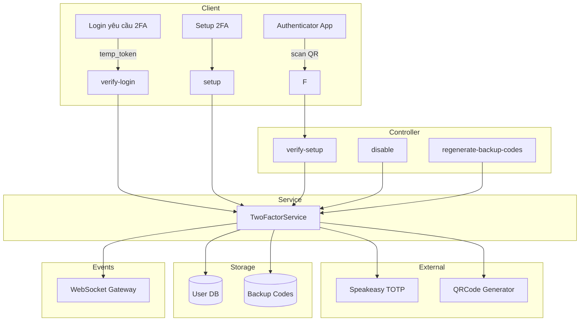
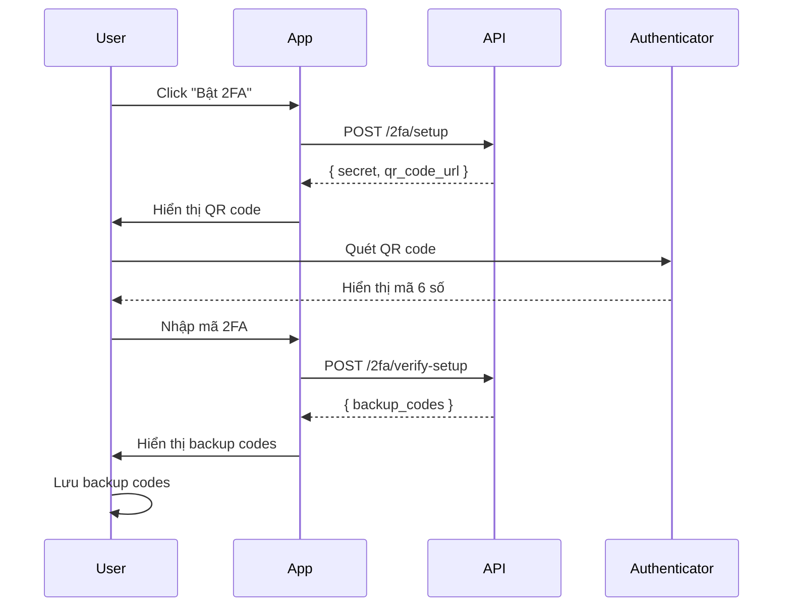
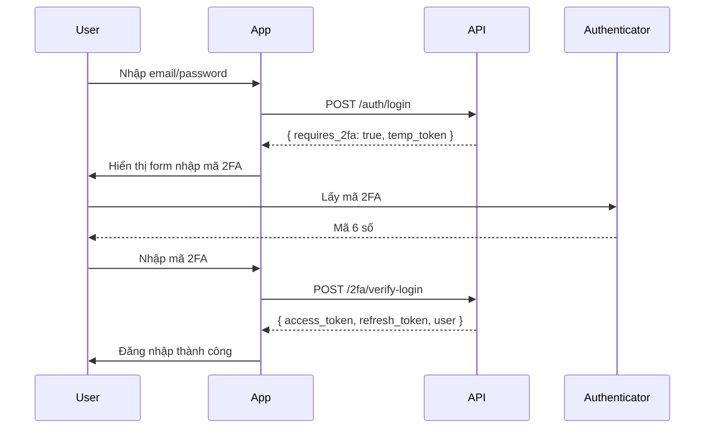

# Two-Factor Module Documentation

## Tổng Quan

Module `two-factor` quản lý xác thực hai yếu tố (2FA) cho ứng dụng GEN-HUB. Module hỗ trợ:

1. **TOTP Authentication** - Time-based One-Time Password sử dụng Google Authenticator, Authy, v.v.
2. **Backup Codes** - Mã dự phòng khi mất thiết bị xác thực

---

## Kiến Trúc



---

## API Endpoints

> [!TIP]
> Tất cả các API đều hỗ trợ header `Accept-Language` để chọn ngôn ngữ phản hồi.
>
> - **vi** - Tiếng Việt (mặc định)
> - **en** - English

### 1. POST /2fa/setup - Thiết lập 2FA

**Mô tả:** Bắt đầu quá trình thiết lập 2FA. API trả về secret key và QR code URL để người dùng quét bằng ứng dụng authenticator (Google Authenticator, Authy, v.v.). Sau khi quét, cần gọi API verify-setup để hoàn tất.

**Xác thực:** Bearer Token (JWT) + Access Verification

**Headers:**

```http
Authorization: Bearer <access_token>
X-Access-Verification-Token: <verification_token>
Accept-Language: vi
```

**Request:** Không có body

**Response (200 OK):**

```json
{
  "code": "two_factor.setup_success",
  "message": "Vui lòng xác minh mã 2FA để hoàn tất thiết lập",
  "success": true,
  "data": {
    "secret": "JBSWY3DPEHPK3PXP",
    "qr_code_url": "data:image/png;base64,iVBORw0KGgo..."
  }
}
```

**Lưu ý:**

- `secret` là khóa bí mật (base32) để nhập thủ công vào authenticator app
- `qr_code_url` là data URI của hình ảnh QR code

**Error Responses:**

<details>
<summary><b>400 Bad Request</b></summary>

```json
// 2FA đã được bật
{
  "code": "error.bad_request",
  "message": "2FA đã được bật",
  "success": false
}

// Người dùng không tồn tại
{
  "code": "error.bad_request",
  "message": "Người dùng không tồn tại",
  "success": false
}
```

</details>

<details>
<summary><b>401 Unauthorized</b></summary>

```json
// Không có token
{
  "code": "error.unauthorized.token_missing",
  "message": "Không có quyền truy cập",
  "success": false
}

// Token hết hạn
{
  "code": "error.unauthorized.token_expired",
  "message": "Token đã hết hạn",
  "success": false
}

// Token không hợp lệ
{
  "code": "error.unauthorized.token_invalid",
  "message": "Token không hợp lệ",
  "success": false
}
```

</details>

<details>
<summary><b>403 Forbidden</b></summary>

```json
// Tài khoản bị khóa
{
  "code": "error.forbidden.account_banned",
  "message": "Tài khoản đã bị khóa",
  "success": false
}

// Tài khoản chưa xác minh
{
  "code": "error.forbidden.account_not_verified",
  "message": "Tài khoản chưa được xác minh. Vui lòng xác minh email để tiếp tục.",
  "success": false
}
```

</details>

---

### 2. POST /2fa/verify-setup - Xác minh và bật 2FA

**Mô tả:** Xác minh mã 2FA từ authenticator app để hoàn tất thiết lập. Sau khi xác minh thành công, 2FA sẽ được bật và hệ thống trả về danh sách backup codes. Backup codes dùng để đăng nhập khi mất thiết bị xác thực.

**Xác thực:** Bearer Token (JWT)

**Headers:**

```http
Authorization: Bearer <access_token>
Content-Type: application/json
Accept-Language: vi
```

**Request Body Schema:**

| Field             | Type   | Required | Description                          |
| ----------------- | ------ | -------- | ------------------------------------ |
| `two_factor_code` | string | Required | Mã 2FA 6 chữ số từ authenticator app |

**Request Body Example:**

```json
{
  "two_factor_code": "123456"
}
```

**Response (200 OK):**

```json
{
  "code": "two_factor.verify_setup_success",
  "message": "Thiết lập 2FA thành công",
  "success": true,
  "data": {
    "backup_codes": [
      "ABCD1234",
      "EFGH5678",
      "IJKL9012",
      "MNOP3456",
      "QRST7890",
      "UVWX1234",
      "YZAB5678",
      "CDEF9012",
      "GHIJ3456",
      "KLMN7890"
    ]
  }
}
```

> [!IMPORTANT]
> **Backup codes chỉ hiển thị một lần!** Người dùng cần lưu trữ các mã này ở nơi an toàn. Mỗi mã chỉ sử dụng được một lần.

**Error Responses:**

<details>
<summary><b>400 Bad Request</b></summary>

```json
// Mã 2FA không chính xác
{
  "code": "error.bad_request",
  "message": "Mã 2FA không chính xác",
  "success": false
}

// Chưa thiết lập 2FA
{
  "code": "error.bad_request",
  "message": "Chưa thiết lập 2FA",
  "success": false
}
```

</details>

<details>
<summary><b>422 Unprocessable Entity</b></summary>

```json
{
  "code": "error.validation",
  "message": "Dữ liệu đầu vào không hợp lệ",
  "success": false,
  "errors": [
    { "field": "two_factor_code", "message": "Mã 2FA phải là 6 chữ số" }
  ]
}
```

</details>

---

### 3. POST /2fa/disable - Tắt 2FA

**Mô tả:** Vô hiệu hóa 2FA cho tài khoản. Tất cả backup codes sẽ bị xóa. Sau khi tắt, người dùng chỉ cần mật khẩu để đăng nhập.

**Xác thực:** Bearer Token (JWT) + Access Verification

**Headers:**

```http
Authorization: Bearer <access_token>
X-Access-Verification-Token: <verification_token>
Accept-Language: vi
```

**Request:** Không có body

**Response (200 OK):**

```json
{
  "code": "two_factor.disable_success",
  "message": "Đã tắt 2FA thành công",
  "success": true,
  "data": null
}
```

**Error Responses:**

<details>
<summary><b>400 Bad Request</b></summary>

```json
// 2FA chưa được bật
{
  "code": "error.bad_request",
  "message": "2FA chưa được bật",
  "success": false
}

// Người dùng không tồn tại
{
  "code": "error.bad_request",
  "message": "Người dùng không tồn tại",
  "success": false
}
```

</details>

<details>
<summary><b>401 Unauthorized</b></summary>

```json
// Không có token
{
  "code": "error.unauthorized.token_missing",
  "message": "Không có quyền truy cập",
  "success": false
}
```

</details>

<details>
<summary><b>403 Forbidden</b></summary>

```json
// Tài khoản bị khóa
{
  "code": "error.forbidden.account_banned",
  "message": "Tài khoản đã bị khóa",
  "success": false
}
```

</details>

---

### 4. POST /2fa/verify-login - Xác minh 2FA khi đăng nhập

**Mô tả:** Xác minh mã 2FA hoặc backup code khi đăng nhập. Sử dụng `temp_token` nhận được từ API login khi tài khoản bật 2FA. Có thể dùng mã 2FA từ authenticator app hoặc backup code (khi mất thiết bị).

**Xác thực:** Không yêu cầu (Public) - sử dụng temp_token

**Rate Limiting:** 5 requests / 60 giây

**Headers:**

```http
Content-Type: application/json
Accept-Language: vi
```

**Request Body Schema:**

| Field             | Type   | Required   | Description                          |
| ----------------- | ------ | ---------- | ------------------------------------ |
| `temp_token`      | string | Required   | Token tạm thời từ API login          |
| `two_factor_code` | string | Optional\* | Mã 2FA 6 chữ số từ authenticator app |
| `backup_code`     | string | Optional\* | Mã backup (8 ký tự)                  |

> [!NOTE]
> \*Phải cung cấp `two_factor_code` HOẶC `backup_code`, không cần cả hai.

**Request Body Examples:**

<details>
<summary><b>Xác minh bằng mã 2FA</b></summary>

```json
{
  "temp_token": "eyJhbGciOiJIUzI1NiIsInR5cCI6IkpXVCJ9...",
  "two_factor_code": "123456"
}
```

</details>

<details>
<summary><b>Xác minh bằng backup code</b></summary>

```json
{
  "temp_token": "eyJhbGciOiJIUzI1NiIsInR5cCI6IkpXVCJ9...",
  "backup_code": "ABCD1234"
}
```

</details>

**Response (200 OK):**

```json
{
  "code": "two_factor.verify_login_success",
  "message": "Xác minh 2FA thành công",
  "success": true,
  "data": {
    "id": "550e8400-e29b-41d4-a716-446655440000",
    "name": "Nguyễn Văn A",
    "email": "user@example.com",
    "email_confirmed": true,
    "is_verified": true,
    "two_factor_enabled": true,
    "language": "vi",
    "created_at": "2024-01-01T00:00:00.000Z"
  },
  "metadata": {
    "access_token": "eyJhbGciOiJIUzI1NiIsInR5cCI6IkpXVCJ9...",
    "refresh_token": "eyJhbGciOiJIUzI1NiIsInR5cCI6IkpXVCJ9..."
  }
}
```

**Error Responses:**

<details>
<summary><b>401 Unauthorized</b></summary>

```json
// Mã 2FA/backup không chính xác
{
  "code": "error.unauthorized",
  "message": "Mã 2FA không chính xác",
  "success": false
}

// Token không hợp lệ hoặc hết hạn
{
  "code": "error.unauthorized",
  "message": "Token không hợp lệ hoặc đã hết hạn",
  "success": false
}

// Tài khoản bị khóa
{
  "code": "error.unauthorized",
  "message": "Tài khoản đã bị khóa",
  "success": false
}
```

</details>

<details>
<summary><b>422 Unprocessable Entity</b></summary>

```json
{
  "code": "error.validation",
  "message": "Dữ liệu đầu vào không hợp lệ",
  "success": false,
  "errors": [
    { "field": "temp_token", "message": "Temp token không được để trống" }
  ]
}
```

</details>

<details>
<summary><b>429 Too Many Requests</b></summary>

```json
{
  "code": "error.rate_limit",
  "message": "Quá nhiều lần thử. Vui lòng thử lại sau",
  "success": false
}
```

</details>

---

### 5. POST /2fa/regenerate-backup-codes - Tạo mới backup codes

**Mô tả:** Tạo lại danh sách backup codes mới. Tất cả backup codes cũ sẽ bị hủy. Chỉ sử dụng khi đã mất hoặc sử dụng hết backup codes cũ.

**Xác thực:** Bearer Token (JWT) + Access Verification

**Headers:**

```http
Authorization: Bearer <access_token>
X-Access-Verification-Token: <verification_token>
Accept-Language: vi
```

**Request:** Không có body

**Response (200 OK):**

```json
{
  "code": "two_factor.regenerate_backup_codes_success",
  "message": "Đã tạo mã backup mới",
  "success": true,
  "data": {
    "backup_codes": [
      "ABCD1234",
      "EFGH5678",
      "IJKL9012",
      "MNOP3456",
      "QRST7890",
      "UVWX1234",
      "YZAB5678",
      "CDEF9012",
      "GHIJ3456",
      "KLMN7890"
    ]
  }
}
```

> [!WARNING]
> Tất cả backup codes cũ sẽ bị vô hiệu hóa ngay khi tạo codes mới!

**Error Responses:**

<details>
<summary><b>400 Bad Request</b></summary>

```json
// 2FA chưa được bật
{
  "code": "error.bad_request",
  "message": "2FA chưa được bật",
  "success": false
}
```

</details>

<details>
<summary><b>401 Unauthorized</b></summary>

```json
{
  "code": "error.unauthorized.token_missing",
  "message": "Không có quyền truy cập",
  "success": false
}
```

</details>

---

## Flow Diagrams

### Setup 2FA Flow



### Login with 2FA Flow



---

## WebSocket Events

Khi trạng thái 2FA thay đổi, server sẽ emit event qua WebSocket để thông báo cho client.

### Event: `2fa:status_changed`

**Payload:**

```typescript
interface TwoFactorStatusChangedEvent {
  /** ID người dùng */
  userId: string;
  /** Trạng thái 2FA mới */
  enabled: boolean;
  /** Message thông báo */
  message: string;
  /** Thời điểm thay đổi */
  timestamp: string;
}
```

**Ví dụ:**

```json
{
  "userId": "550e8400-e29b-41d4-a716-446655440000",
  "enabled": true,
  "message": "Thiết lập 2FA thành công",
  "timestamp": "2026-01-21T06:00:00.000Z"
}
```

---

## Backup Codes

### Đặc điểm

- Mỗi user có **10 backup codes** được tạo khi bật 2FA
- Mỗi code có **8 ký tự** (chữ và số)
- Mỗi code chỉ sử dụng được **một lần**
- Codes được **hash** trước khi lưu vào database
- Có thể **regenerate** toàn bộ codes mới (xóa codes cũ)

### Use Cases

1. **Mất điện thoại** - Sử dụng backup code để đăng nhập
2. **Đổi thiết bị** - Sử dụng backup code trong khi chuyển đổi
3. **Lỗi authenticator app** - Backup code là phương án dự phòng

---

## Security Considerations

> [!CAUTION]
> **Bảo mật quan trọng:**
>
> - Secret key và backup codes chỉ hiển thị **một lần** khi setup
> - Tất cả backup codes được **hash** trước khi lưu vào database
> - API verify-login có **rate limiting** (5 requests/60s) để chống brute force
> - Mọi thay đổi 2FA đều yêu cầu **Access Verification** (xác thực lại mật khẩu)

### Rate Limiting

- `POST /2fa/verify-login`: 5 requests / 60 giây
- Sau 5 lần thất bại liên tiếp, IP sẽ bị block tạm thời

### Brute Force Protection

- Số lần thử sai được ghi nhận vào hệ thống
- Tài khoản có thể bị khóa tự động sau nhiều lần thử sai

---

## Files Trong Module

| File                       | Mô tả                              |
| -------------------------- | ---------------------------------- |
| `two-factor.controller.ts` | Controller xử lý các API endpoints |
| `two-factor.service.ts`    | Service chứa business logic        |
| `two-factor.module.ts`     | Module configuration               |

---

## Dependencies

Module này phụ thuộc vào:

| Module             | Mô tả                   |
| ------------------ | ----------------------- |
| `UserModule`       | Quản lý thông tin user  |
| `BackupCodeModule` | Quản lý backup codes    |
| `AuthModule`       | Xác thực và JWT         |
| `WebsocketModule`  | Real-time notifications |
| `BruteForceModule` | Chống brute force       |
| `EmailModule`      | Gửi email thông báo     |

---

## Environment Variables

| Biến                        | Mô tả                        | Mặc định |
| --------------------------- | ---------------------------- | -------- |
| `TEMP_2FA_TOKEN_SECRET`     | Secret cho temp token        | -        |
| `TEMP_2FA_TOKEN_EXPIRATION` | Thời gian hết hạn temp token | 5m       |
| `JWT_ACCESS_SECRET`         | Secret cho access token      | -        |
| `JWT_REFRESH_SECRET`        | Secret cho refresh token     | -        |
