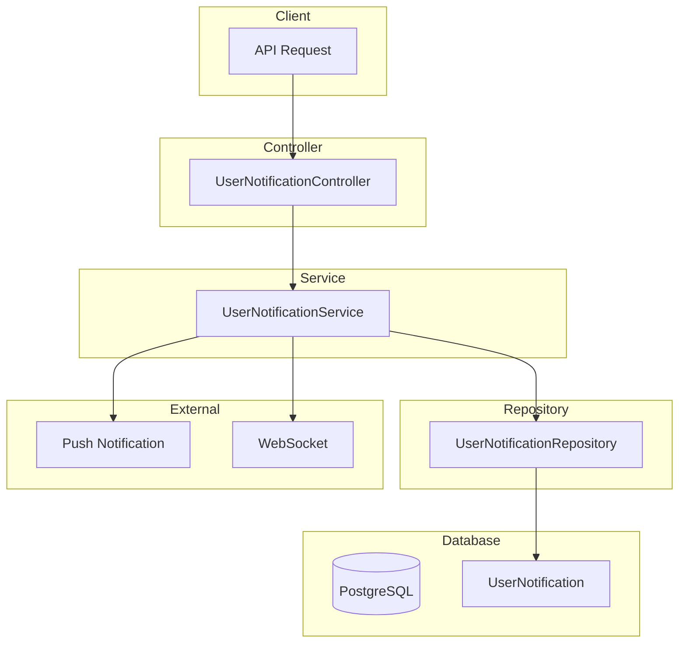

# User Notification Module Documentation

## Tổng Quan

Module `user-notification` quản lý thông báo trong hệ thống cho người dùng. Hỗ trợ:
- Xem danh sách thông báo với phân trang và lọc
- Đếm số thông báo chưa đọc
- Đánh dấu đã đọc (đơn lẻ/tất cả)
- Admin gửi thông báo (đơn lẻ/hàng loạt)
- Phân loại thông báo theo type

---

## Kiến Trúc



---

## Loại Thông Báo (NotificationType)

| Type | Description | Use Case |
|------|-------------|----------|
| `INFO` | Thông tin chung | Thông báo hệ thống, cập nhật tính năng |
| `WARNING` | Cảnh báo | Hợp đồng sắp hết hạn, tài khoản sắp bị khóa |
| `SUCCESS` | Thành công | Thanh toán thành công, gia hạn thành công |
| `ERROR` | Lỗi | Thanh toán thất bại, hợp đồng bị hủy |

---

## API Endpoints

> [!TIP]
> Tất cả API yêu cầu xác thực bằng JWT Token.

### Base URL

```
/user-notifications
```

### Xác thực

```http
Authorization: Bearer <access_token>
```

---

### 1. GET /user-notifications - Lấy danh sách thông báo

**Mô tả:** Lấy danh sách thông báo của user đang đăng nhập với phân trang và lọc.

**Query Parameters:**

| Parameter | Type | Required | Default | Description |
|-----------|------|----------|---------|-------------|
| `limit` | number | No | 10 | Số lượng bản ghi tối đa |
| `offset` | number | No | 0 | Vị trí bắt đầu |
| `keywords` | string | No | - | Tìm theo tiêu đề/nội dung |
| `is_read` | boolean | No | - | Lọc theo trạng thái đã đọc |
| `type` | enum | No | - | Lọc theo loại thông báo |

**Response (200 OK):**
```json
{
  "code": "user-notification.list_success",
  "message": "Lấy danh sách thông báo thành công",
  "success": true,
  "data": {
    "items": [
      {
        "id": "550e8400-e29b-41d4-a716-446655440001",
        "user_id": "550e8400-e29b-41d4-a716-446655440010",
        "title": "Hợp đồng sắp hết hạn",
        "content": "Hợp đồng RC-2026020001 sẽ hết hạn vào ngày 01/03/2026",
        "type": "WARNING",
        "is_read": false,
        "read_at": null,
        "created_at": "2026-02-01T09:00:00.000Z"
      }
    ],
    "total": 25,
    "limit": 10,
    "offset": 0
  }
}
```

---

### 2. GET /user-notifications/unread-count - Đếm thông báo chưa đọc

**Mô tả:** Trả về số lượng thông báo chưa đọc. Thường dùng để hiển thị badge.

**Response (200 OK):**
```json
{
  "code": "user-notification.get_success",
  "message": "Lấy thông tin thành công",
  "success": true,
  "data": {
    "count": 5
  }
}
```

---

### 3. GET /user-notifications/user/:userId - Lấy thông báo của user bất kỳ (Admin)

**Mô tả:** Admin lấy danh sách thông báo của một user cụ thể.

**Quyền yêu cầu:** `user-notification.list.all`

**Path Parameters:**

| Parameter | Type | Required | Description |
|-----------|------|----------|-------------|
| `userId` | UUID | Yes | ID của user cần xem thông báo |

**Query Parameters:** Giống endpoint GET /user-notifications

---

### 4. POST /user-notifications/send - Gửi thông báo cho user (Admin)

**Mô tả:** Admin gửi thông báo cho một user cụ thể.

**Quyền yêu cầu:** `user-notification.send`

**Request Body:**

| Field | Type | Required | Description |
|-------|------|----------|-------------|
| `user_id` | UUID | Yes | ID người nhận |
| `title` | string | Yes | Tiêu đề (max 255 ký tự) |
| `content` | string | Yes | Nội dung thông báo |
| `type` | enum | No | Loại thông báo (mặc định: INFO) |

**Request Body Examples:**

<details>
<summary><b>Thông báo cảnh báo</b></summary>

```json
{
  "user_id": "550e8400-e29b-41d4-a716-446655440001",
  "title": "Hợp đồng sắp hết hạn",
  "content": "Hợp đồng RC-2026020001 của bạn sẽ hết hạn vào ngày 01/03/2026. Vui lòng gia hạn để tiếp tục sử dụng dịch vụ.",
  "type": "WARNING"
}
```
</details>

<details>
<summary><b>Thông báo thành công</b></summary>

```json
{
  "user_id": "550e8400-e29b-41d4-a716-446655440001",
  "title": "Thanh toán thành công",
  "content": "Bạn đã thanh toán thành công đơn hàng #12345. Cảm ơn bạn đã sử dụng dịch vụ.",
  "type": "SUCCESS"
}
```
</details>

**Response (201 Created):**
```json
{
  "code": "user-notification.send_success",
  "message": "Gửi thông báo thành công",
  "success": true,
  "data": {
    "id": "550e8400-e29b-41d4-a716-446655440100",
    "user_id": "550e8400-e29b-41d4-a716-446655440001",
    "title": "Hợp đồng sắp hết hạn",
    "content": "Hợp đồng RC-2026020001...",
    "type": "WARNING",
    "is_read": false,
    "read_at": null,
    "created_at": "2026-02-01T10:00:00.000Z"
  }
}
```

---

### 5. PUT /user-notifications/:id/read - Đánh dấu đã đọc

**Mô tả:** Đánh dấu một thông báo là đã đọc. User chỉ có thể đánh dấu thông báo của chính mình.

**Path Parameters:**

| Parameter | Type | Required | Description |
|-----------|------|----------|-------------|
| `id` | UUID | Yes | ID của thông báo |

**Response (200 OK):**
```json
{
  "code": "user-notification.mark_read_success",
  "message": "Đánh dấu đã đọc thành công",
  "success": true,
  "data": {
    "id": "550e8400-e29b-41d4-a716-446655440001",
    "title": "Hợp đồng sắp hết hạn",
    "is_read": true,
    "read_at": "2026-02-01T09:30:00.000Z"
  }
}
```

**Error Responses:**

| Status | Description |
|--------|-------------|
| 403 | Không có quyền đánh dấu thông báo này |
| 404 | Không tìm thấy thông báo |

---

### 6. PUT /user-notifications/read-all - Đánh dấu tất cả đã đọc

**Mô tả:** Đánh dấu tất cả thông báo chưa đọc thành đã đọc.

**Response (200 OK):**
```json
{
  "code": "user-notification.mark_all_read_success",
  "message": "Đánh dấu tất cả đã đọc thành công",
  "success": true,
  "data": {
    "count": 5
  }
}
```

---

### 7. POST /user-notifications/send-bulk - Gửi thông báo hàng loạt (Admin)

**Mô tả:** Admin gửi thông báo cho nhiều users cùng lúc.

**Quyền yêu cầu:** `user-notification.send.bulk`

**Request Body:**

| Field | Type | Required | Description |
|-------|------|----------|-------------|
| `user_ids` | UUID[] | Yes | Danh sách ID người nhận |
| `title` | string | Yes | Tiêu đề (max 255 ký tự) |
| `content` | string | Yes | Nội dung thông báo |
| `type` | enum | No | Loại thông báo (mặc định: INFO) |

**Request Body Example:**
```json
{
  "user_ids": [
    "550e8400-e29b-41d4-a716-446655440001",
    "550e8400-e29b-41d4-a716-446655440002",
    "550e8400-e29b-41d4-a716-446655440003"
  ],
  "title": "Thông báo bảo trì hệ thống",
  "content": "Hệ thống sẽ bảo trì vào lúc 22:00 ngày 01/02/2026. Thời gian dự kiến 2 giờ.",
  "type": "WARNING"
}
```

**Response (201 Created):**
```json
{
  "code": "user-notification.send_success",
  "message": "Gửi thông báo thành công",
  "success": true,
  "data": {
    "count": 3
  }
}
```

---

## Permissions Matrix

| Permission | Description |
|------------|-------------|
| `user-notification.list.all` | Xem thông báo của user bất kỳ |
| `user-notification.send` | Gửi thông báo cho user |
| `user-notification.send.bulk` | Gửi thông báo hàng loạt |

> [!NOTE]
> Các endpoint `getMyNotifications`, `countUnread`, `markAsRead`, `markAllAsRead` không yêu cầu permission đặc biệt, chỉ cần đăng nhập.

---

## Files Trong Module

| File | Mô tả |
|------|-------|
| `user-notification.controller.ts` | Controller xử lý HTTP requests |
| `user-notification.service.ts` | Business logic layer |
| `user-notification.repository.ts` | Data access layer |
| `user-notification.module.ts` | NestJS module definition |
| `dto/send-user-notification.dto.ts` | DTO gửi thông báo đơn |
| `dto/send-bulk-user-notification.dto.ts` | DTO gửi thông báo hàng loạt |
| `dto/query-user-notification.dto.ts` | DTO query params |
| `interfaces/user-notification.interface.ts` | TypeScript interfaces |
