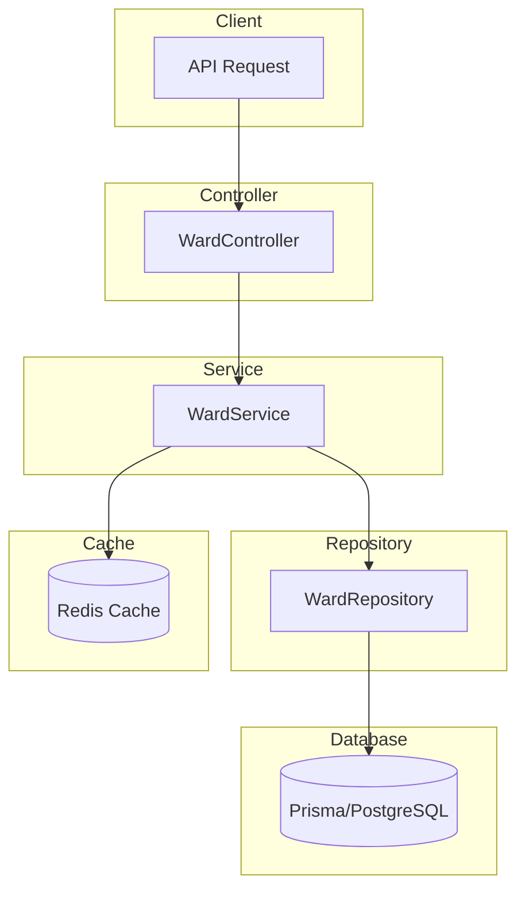
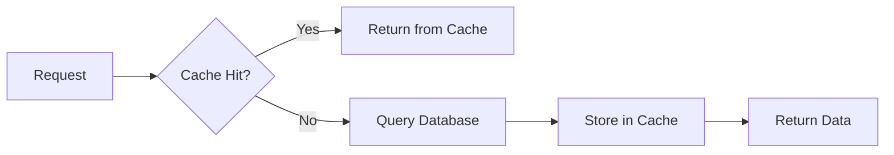
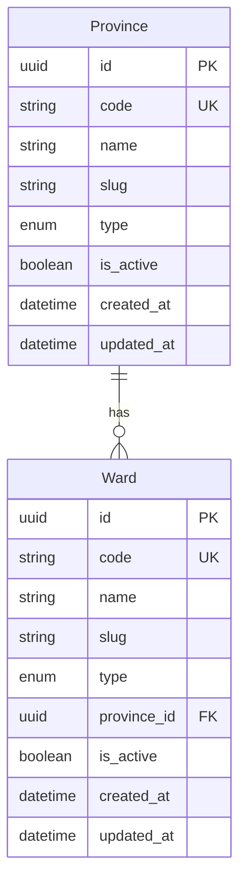

# Ward Module Documentation

## Tổng Quan

Module `ward` quản lý thông tin phường/xã của Việt Nam cho ứng dụng GEN-HUB. Module cung cấp:

1. **Danh sách phường/xã** - Lấy danh sách với tìm kiếm, lọc theo loại và tỉnh/thành phố
2. **Chi tiết phường/xã** - Lấy thông tin chi tiết bao gồm tỉnh/thành phố

---

## Kiến Trúc



---

## API Endpoints

> [!TIP]
> Tất cả các API đều hỗ trợ header `Accept-Language` để chọn ngôn ngữ phản hồi.
> - **vi** - Tiếng Việt (mặc định)
> - **en** - English

### 1. GET /wards - Lấy danh sách phường/xã

**Mô tả:** API công khai để lấy danh sách phường/xã. Hỗ trợ tìm kiếm theo từ khóa (tên, mã), lọc theo loại (WARD/COMMUNE/TOWNSHIP/TOWN/CITY) và lọc theo tỉnh/thành phố. Dữ liệu được cache để tối ưu hiệu năng.

**Xác thực:** Không yêu cầu (Public)

**Request:**
```http
GET /wards HTTP/1.1
Host: api.gen-hub.dev
Accept: application/json
Accept-Language: vi
```

**Query Parameters:**

| Parameter | Type | Required | Description |
|-----------|------|----------|-------------|
| `keywords` | string | Optional | Từ khóa tìm kiếm (tên phường/xã, mã) |
| `type` | enum | Optional | Loại phường/xã: `WARD`, `COMMUNE`, `TOWNSHIP`, `TOWN`, hoặc `CITY` |
| `province_id` | string (UUID) | Optional | ID tỉnh/thành phố để lọc phường/xã thuộc tỉnh/thành phố đó |

**Request Examples:**

<details>
<summary><b>Lấy tất cả phường/xã</b></summary>

```http
GET /wards HTTP/1.1
Host: api.gen-hub.dev
Accept: application/json
```
</details>

<details>
<summary><b>Tìm kiếm theo từ khóa</b></summary>

```http
GET /wards?keywords=Phúc Xá HTTP/1.1
Host: api.gen-hub.dev
Accept: application/json
```
</details>

<details>
<summary><b>Lọc theo loại (chỉ phường)</b></summary>

```http
GET /wards?type=WARD HTTP/1.1
Host: api.gen-hub.dev
Accept: application/json
```
</details>

<details>
<summary><b>Lọc theo tỉnh/thành phố</b></summary>

```http
GET /wards?province_id=550e8400-e29b-41d4-a716-446655440001 HTTP/1.1
Host: api.gen-hub.dev
Accept: application/json
```
</details>

<details>
<summary><b>Kết hợp nhiều điều kiện lọc</b></summary>

```http
GET /wards?province_id=550e8400-e29b-41d4-a716-446655440001&type=WARD&keywords=Trúc HTTP/1.1
Host: api.gen-hub.dev
Accept: application/json
```
</details>

**Response (200 OK):**

```json
{
  "code": "ward.list_success",
  "message": "Lấy danh sách phường/xã thành công",
  "success": true,
  "data": [
    {
      "id": "550e8400-e29b-41d4-a716-446655440010",
      "code": "00001",
      "name": "Phường Phúc Xá",
      "slug": "phuong-phuc-xa",
      "type": "WARD",
      "province_id": "550e8400-e29b-41d4-a716-446655440001",
      "is_active": true,
      "created_at": "2024-01-01T00:00:00.000Z",
      "updated_at": "2024-01-01T00:00:00.000Z"
    },
    {
      "id": "550e8400-e29b-41d4-a716-446655440011",
      "code": "00004",
      "name": "Phường Trúc Bạch",
      "slug": "phuong-truc-bach",
      "type": "WARD",
      "province_id": "550e8400-e29b-41d4-a716-446655440001",
      "is_active": true,
      "created_at": "2024-01-01T00:00:00.000Z",
      "updated_at": "2024-01-01T00:00:00.000Z"
    }
  ]
}
```

**Response Schema:**

| Field | Type | Description |
|-------|------|-------------|
| `id` | string (UUID) | ID của phường/xã |
| `code` | string | Mã phường/xã (theo chuẩn hành chính) |
| `name` | string | Tên đầy đủ của phường/xã |
| `slug` | string | Slug URL-friendly |
| `type` | enum | Loại: `WARD`, `COMMUNE`, `TOWNSHIP`, `TOWN`, hoặc `CITY` |
| `province_id` | string (UUID) | ID của tỉnh/thành phố |
| `is_active` | boolean | Trạng thái hoạt động |
| `created_at` | string (ISO 8601) | Ngày tạo |
| `updated_at` | string (ISO 8601) | Ngày cập nhật |

**Error Responses:**

<details>
<summary><b>422 Unprocessable Entity</b></summary>

```json
{
  "code": "error.validation",
  "message": "Dữ liệu đầu vào không hợp lệ",
  "success": false,
  "errors": [
    { "field": "province_id", "message": "ID tỉnh/thành phố phải là UUID hợp lệ" }
  ]
}
```
</details>

---

### 2. GET /wards/:id - Lấy chi tiết phường/xã

**Mô tả:** API công khai để lấy thông tin chi tiết của một phường/xã theo ID, bao gồm thông tin tỉnh/thành phố mà phường/xã đó thuộc về.

**Xác thực:** Không yêu cầu (Public)

**Request:**
```http
GET /wards/550e8400-e29b-41d4-a716-446655440010 HTTP/1.1
Host: api.gen-hub.dev
Accept: application/json
Accept-Language: vi
```

**Path Parameters:**

| Parameter | Type | Required | Description |
|-----------|------|----------|-------------|
| `id` | string (UUID) | Required | ID của phường/xã |

**Response (200 OK):**

```json
{
  "code": "ward.get_success",
  "message": "Lấy thông tin phường/xã thành công",
  "success": true,
  "data": {
    "id": "550e8400-e29b-41d4-a716-446655440010",
    "code": "00001",
    "name": "Phường Phúc Xá",
    "slug": "phuong-phuc-xa",
    "type": "WARD",
    "province_id": "550e8400-e29b-41d4-a716-446655440001",
    "is_active": true,
    "created_at": "2024-01-01T00:00:00.000Z",
    "updated_at": "2024-01-01T00:00:00.000Z",
    "province": {
      "id": "550e8400-e29b-41d4-a716-446655440001",
      "code": "01",
      "name": "Thành phố Hà Nội"
    }
  }
}
```

**Response Schema:**

| Field | Type | Description |
|-------|------|-------------|
| `id` | string (UUID) | ID của phường/xã |
| `code` | string | Mã phường/xã |
| `name` | string | Tên đầy đủ |
| `slug` | string | Slug URL-friendly |
| `type` | enum | Loại phường/xã |
| `province_id` | string (UUID) | ID của tỉnh/thành phố |
| `is_active` | boolean | Trạng thái hoạt động |
| `created_at` | string (ISO 8601) | Ngày tạo |
| `updated_at` | string (ISO 8601) | Ngày cập nhật |
| `province` | object | Thông tin tỉnh/thành phố |
| `province.id` | string (UUID) | ID của tỉnh/thành phố |
| `province.code` | string | Mã tỉnh/thành phố |
| `province.name` | string | Tên tỉnh/thành phố |

**Error Responses:**

<details>
<summary><b>404 Not Found</b></summary>

```json
{
  "code": "error.not_found",
  "message": "Không tìm thấy phường/xã",
  "success": false
}
```
</details>

<details>
<summary><b>422 Unprocessable Entity</b></summary>

```json
{
  "code": "error.validation",
  "message": "Dữ liệu đầu vào không hợp lệ",
  "success": false,
  "errors": [
    { "field": "id", "message": "ID phải là UUID hợp lệ" }
  ]
}
```
</details>

---

## Data Types

### WardType Enum

| Value | Description |
|-------|-------------|
| `WARD` | Phường |
| `COMMUNE` | Xã |
| `TOWNSHIP` | Thị trấn |
| `TOWN` | Thị xã |
| `CITY` | Thành phố (thuộc tỉnh) |

---

## Caching Strategy

Module sử dụng **Cache Aside Pattern** với Redis để tối ưu hiệu năng:



### Cache Keys

| Key Pattern | TTL | Description |
|-------------|-----|-------------|
| `ward:list:{hash}` | Từ config | Cache danh sách phường/xã theo query |
| `ward:detail:{id}` | Từ config | Cache chi tiết phường/xã |

### Environment Variables

| Biến | Mô tả | Mặc định |
|------|-------|----------|
| `REDIS_WARD_CACHE_TTL` | TTL cho ward cache (giây) | 3600 |
| `REDIS_WARD_CACHE_PREFIX` | Prefix cho cache keys | ward |

---

## Files Trong Module

| File | Mô tả |
|------|-------|
| `ward.controller.ts` | Controller xử lý các API endpoints |
| `ward.service.ts` | Service chứa business logic |
| `ward.repository.ts` | Repository xử lý database queries |
| `ward.module.ts` | Module configuration |
| `dto/query-ward.dto.ts` | DTO cho query parameters |
| `types/ward.type.ts` | TypeScript interfaces |
| `selects/ward.select.ts` | Prisma select fields |
| `constants/ward-cache-keys.helper.ts` | Cache key helper |

---

## Use Cases

### 1. Form chọn địa chỉ (2 cấp)

```typescript
// Bước 1: Lấy danh sách tỉnh/thành phố
const provinces = await fetch('/provinces');

// Bước 2: Khi user chọn tỉnh, lấy danh sách phường/xã
const wards = await fetch(`/wards?province_id=${selectedProvinceId}`);
```

### 2. Tìm kiếm phường/xã

```typescript
// Tìm kiếm theo từ khóa
const searchResults = await fetch('/wards?keywords=Phúc');

// Lọc theo loại
const communes = await fetch('/wards?type=COMMUNE');
```

### 3. Lấy địa chỉ đầy đủ

```typescript
// Lấy thông tin phường/xã bao gồm tỉnh/thành phố
const wardDetail = await fetch(`/wards/${wardId}`);

// Hiển thị địa chỉ đầy đủ
const fullAddress = `${wardDetail.data.name}, ${wardDetail.data.province.name}`;
// Kết quả: "Phường Phúc Xá, Thành phố Hà Nội"
```

---

## Related Modules

| Module | Mô tả |
|--------|-------|
| `ProvinceModule` | Quản lý tỉnh/thành phố |
| `RedisModule` | Caching |

---

## Database Schema


