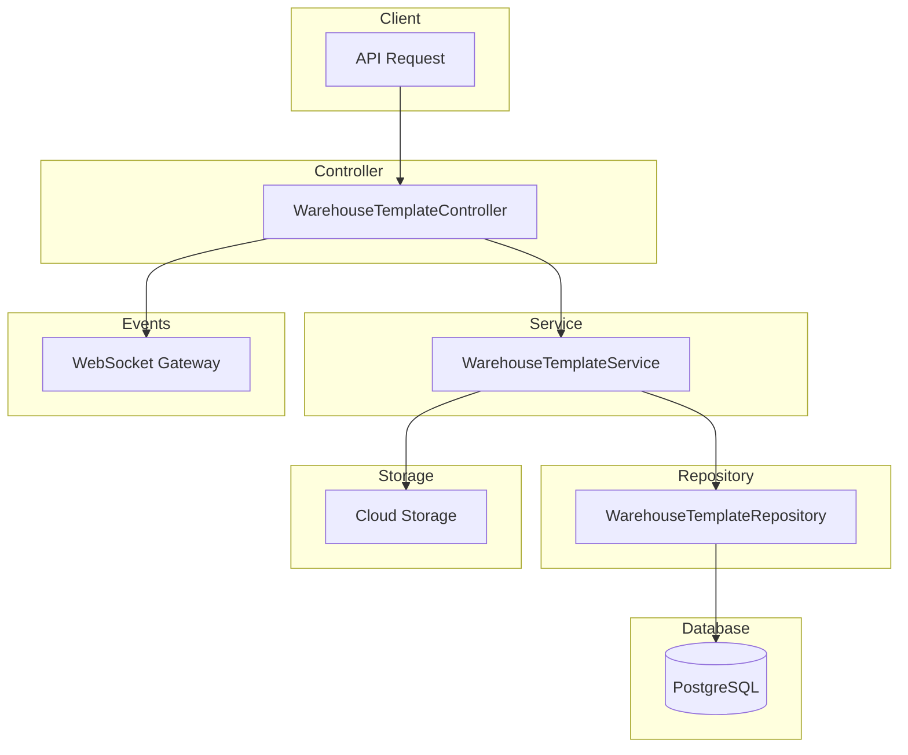

# Warehouse Template Module Documentation

## Tổng Quan

Module `warehouse-template` quản lý các template kho hàng trong hệ thống GEN-HUB. Template định nghĩa cấu trúc và thông số kỹ thuật của kho hàng, bao gồm layout (dãy, kệ, tầng, ô), giá cả, cấu hình giảm giá, và các tiện ích đi kèm.

---

## Kiến Trúc



---

## API Endpoints

> [!TIP]
> Tất cả các API đều hỗ trợ header `Accept-Language` để chọn ngôn ngữ phản hồi.
>
> - **vi** - Tiếng Việt (mặc định)
> - **en** - English

### 1. POST /warehouse-templates - Tạo mới template kho hàng

**Mô tả:** Tạo mới một template kho hàng với đầy đủ thông tin bao gồm kích thước, giá cả, tiện ích, cấu hình giảm giá theo thời gian thuê.

**Xác thực:** Bearer Token (JWT)

**Quyền yêu cầu:** `warehouse-template.create`

**Headers:**

```http
Authorization: Bearer <access_token>
Content-Type: application/json
Accept-Language: vi
```

**Request Body Schema:**

| Field                 | Type          | Required | Description                  |
| --------------------- | ------------- | -------- | ---------------------------- |
| `name`                | string        | ✓        | Tên template (max 255 ký tự) |
| `description`         | string        |          | Mô tả                        |
| `length`              | number        | ✓        | Chiều dài kho (mét)          |
| `width`               | number        | ✓        | Chiều rộng kho (mét)         |
| `price_per_month`     | number        | ✓        | Giá thuê/tháng (VND)         |
| `block_length`        | number        | ✓        | Chiều dài ô (mét)            |
| `block_width`         | number        | ✓        | Chiều rộng ô (mét)           |
| `ceiling_height`      | number        |          | Chiều cao trần (mét)         |
| `is_shared_warehouse` | boolean       |          | Cho phép thuê theo dãy       |
| `is_cold_storage`     | boolean       |          | Đánh dấu kho lạnh            |
| `min_temperature`     | number        |          | Nhiệt độ tối thiểu (°C)      |
| `max_temperature`     | number        |          | Nhiệt độ tối đa (°C)         |
| `min_humidity`        | number        |          | Độ ẩm tối thiểu (%)          |
| `max_humidity`        | number        |          | Độ ẩm tối đa (%)             |
| `address_detail`      | string        |          | Địa chỉ chi tiết             |
| `ward_id`             | string (UUID) |          | ID phường/xã                 |
| `latitude`            | number        |          | Vĩ độ                        |
| `longitude`           | number        |          | Kinh độ                      |
| `manager_name`        | string        |          | Tên người quản lý            |
| `manager_phone`       | string        |          | SĐT quản lý                  |
| `manager_email`       | string        |          | Email quản lý                |
| `amenity_ids`         | string[]      |          | Danh sách ID tiện ích        |
| `discount_configs`    | array         |          | Cấu hình giảm giá            |
| `addon_gifts`         | array         |          | Addon tặng kèm               |
| `insurance_gifts`     | array         |          | Bảo hiểm tặng kèm            |
| `is_active`           | boolean       |          | Trạng thái (mặc định: true)  |

**Request Body Examples:**

<details>
<summary><b>Ví dụ 1: Kho hàng cơ bản</b></summary>

```json
{
  "name": "Kho Quận 7 - A1",
  "description": "Kho hàng tiêu chuẩn tại Quận 7",
  "length": 100,
  "width": 50,
  "price_per_month": 50000000,
  "block_length": 0.5,
  "block_width": 0.5,
  "ceiling_height": 5.5,
  "address_detail": "123 Nguyễn Văn Linh",
  "manager_name": "Nguyễn Văn A",
  "manager_phone": "0901234567",
  "manager_email": "manager@example.com",
  "is_active": true
}
```

</details>

<details>
<summary><b>Ví dụ 2: Kho lạnh</b></summary>

```json
{
  "name": "Kho Lạnh Bình Chánh - 01",
  "description": "Kho lạnh bảo quản thực phẩm",
  "length": 80,
  "width": 40,
  "price_per_month": 80000000,
  "block_length": 0.6,
  "block_width": 0.6,
  "ceiling_height": 4,
  "is_cold_storage": true,
  "min_temperature": -20,
  "max_temperature": 5,
  "min_humidity": 30,
  "max_humidity": 70,
  "is_active": true
}
```

</details>

<details>
<summary><b>Ví dụ 3: Kho chia sẻ với giảm giá</b></summary>

```json
{
  "name": "Kho Shared Thủ Đức - S1",
  "description": "Kho cho thuê theo dãy",
  "length": 120,
  "width": 60,
  "price_per_month": 30000000,
  "block_length": 0.5,
  "block_width": 0.5,
  "is_shared_warehouse": true,
  "discount_configs": [
    { "duration_tier_id": "uuid-tier-1", "discount_percent": 0 },
    { "duration_tier_id": "uuid-tier-2", "discount_percent": 5 },
    { "duration_tier_id": "uuid-tier-3", "discount_percent": 10 }
  ],
  "amenity_ids": ["uuid-amenity-1", "uuid-amenity-2"],
  "is_active": true
}
```

</details>

**Response (201 Created):**

```json
{
  "code": "warehouse-template.create_success",
  "message": "Tạo template kho hàng thành công",
  "success": true,
  "data": {
    "id": "550e8400-e29b-41d4-a716-446655440000",
    "name": "Kho Quận 7 - A1",
    "description": "Kho hàng tiêu chuẩn tại Quận 7",
    "length": 100,
    "width": 50,
    "price_per_month": 50000000,
    "block_length": 0.5,
    "block_width": 0.5,
    "is_active": true,
    "created_at": "2026-01-23T02:00:00.000Z",
    "updated_at": "2026-01-23T02:00:00.000Z"
  }
}
```

**Error Responses:**

<details>
<summary><b>401 Unauthorized</b></summary>

```json
{
  "code": "error.unauthorized.token_missing",
  "message": "Không có quyền truy cập",
  "success": false
}
```

</details>

<details>
<summary><b>403 Forbidden</b></summary>

```json
{
  "code": "error.forbidden.no_permission",
  "message": "Không có quyền thực hiện thao tác này",
  "success": false
}
```

</details>

<details>
<summary><b>409 Conflict</b></summary>

```json
{
  "code": "warehouse-template.name_exists",
  "message": "Tên template đã tồn tại",
  "success": false
}
```

</details>

<details>
<summary><b>422 Unprocessable Entity</b></summary>

```json
{
  "code": "error.validation",
  "message": "Dữ liệu đầu vào không hợp lệ",
  "success": false,
  "errors": [
    { "field": "name", "message": "Tên template không được để trống" },
    { "field": "length", "message": "Chiều dài phải là số dương" }
  ]
}
```

</details>

---

### 2. GET /warehouse-templates - Lấy danh sách template

**Mô tả:** Lấy danh sách template kho hàng có phân trang. API công khai, không yêu cầu xác thực. Nếu có quyền `warehouse-template.list.all` sẽ xem được cả template không hoạt động.

**Xác thực:** Không bắt buộc (Public)

**Query Parameters:**

| Parameter       | Type          | Required | Description                                             |
| --------------- | ------------- | -------- | ------------------------------------------------------- |
| `limit`         | number        |          | Số lượng record (mặc định: 10)                          |
| `offset`        | number        |          | Vị trí bắt đầu (mặc định: 0)                            |
| `keywords`      | string        |          | Từ khóa tìm kiếm theo tên                               |
| `is_active`     | boolean       |          | Lọc theo trạng thái hoạt động                           |
| `rental_status` | enum          |          | Lọc theo trạng thái cho thuê: AVAILABLE, LOCKED, RENTED |
| `province_id`   | string (UUID) |          | Lọc theo tỉnh/thành phố                                 |

**Request:**

```http
GET /warehouse-templates?limit=10&offset=0&keywords=kho&is_active=true HTTP/1.1
Host: api.gen-hub.dev
Accept: application/json
Accept-Language: vi
```

**Response (200 OK):**

```json
{
  "code": "warehouse-template.list_success",
  "message": "Lấy dữ liệu template kho hàng thành công",
  "success": true,
  "data": {
    "items": [
      {
        "id": "550e8400-e29b-41d4-a716-446655440000",
        "name": "Kho Quận 7 - A1",
        "description": "Kho hàng tiêu chuẩn",
        "length": 100,
        "width": 50,
        "price_per_month": 50000000,
        "is_active": true,
        "is_cold_storage": false,
        "is_shared_warehouse": false
      }
    ],
    "total": 100,
    "limit": 10,
    "offset": 0
  }
}
```

---

### 3. GET /warehouse-templates/:id - Lấy chi tiết template

**Mô tả:** Lấy thông tin chi tiết của một template kho hàng bao gồm layout (rows, racks, shelves, blocks), cấu hình giảm giá, và các thông tin liên quan.

**Xác thực:** Không bắt buộc (Public)

**Path Parameters:**

| Parameter | Type          | Description     |
| --------- | ------------- | --------------- |
| `id`      | string (UUID) | ID của template |

**Response (200 OK):**

```json
{
  "code": "warehouse-template.get_success",
  "message": "Lấy dữ liệu template kho hàng thành công",
  "success": true,
  "data": {
    "id": "550e8400-e29b-41d4-a716-446655440000",
    "name": "Kho Quận 7 - A1",
    "description": "Kho hàng tiêu chuẩn",
    "length": 100,
    "width": 50,
    "price_per_month": 50000000,
    "block_length": 0.5,
    "block_width": 0.5,
    "ceiling_height": 5.5,
    "is_cold_storage": false,
    "is_shared_warehouse": false,
    "rows": [
      {
        "id": "uuid-row-1",
        "name": "Dãy A",
        "code": "ROW-A",
        "racks": [
          {
            "id": "uuid-rack-1",
            "name": "Kệ 1",
            "code": "RCK-A1",
            "shelves": [
              {
                "id": "uuid-shelf-1",
                "name": "Tầng 1",
                "code": "SHF-A1-1",
                "blocks": []
              }
            ]
          }
        ]
      }
    ],
    "discount_configs": [
      {
        "id": "uuid-config-1",
        "duration_tier_id": "uuid-tier-1",
        "discount_percent": 5,
        "duration_tier": {
          "id": "uuid-tier-1",
          "name": "3 tháng",
          "min_months": 3,
          "max_months": 5
        }
      }
    ],
    "addon_gifts": [],
    "insurance_gifts": []
  }
}
```

**Error Responses:**

<details>
<summary><b>404 Not Found</b></summary>

```json
{
  "code": "warehouse-template.not_found",
  "message": "Không tìm thấy template kho hàng",
  "success": false
}
```

</details>

---

### 4. PUT /warehouse-templates/:id - Cập nhật template

**Mô tả:** Cập nhật một phần hoặc toàn bộ thông tin template kho hàng. Chỉ các trường được gửi trong request body mới được cập nhật.

**Xác thực:** Bearer Token (JWT)

**Quyền yêu cầu:** `warehouse-template.update`

**Path Parameters:**

| Parameter | Type          | Description     |
| --------- | ------------- | --------------- |
| `id`      | string (UUID) | ID của template |

**Request Body Examples:**

<details>
<summary><b>Ví dụ 1: Cập nhật thông tin cơ bản</b></summary>

```json
{
  "name": "Kho Quận 7 - A1 (Updated)",
  "description": "Mô tả cập nhật",
  "price_per_month": 55000000
}
```

</details>

<details>
<summary><b>Ví dụ 2: Cập nhật cấu hình giảm giá</b></summary>

```json
{
  "discount_configs": [
    {
      "id": "uuid-config-1",
      "duration_tier_id": "uuid-tier-1",
      "discount_percent": 5
    },
    { "duration_tier_id": "uuid-tier-2", "discount_percent": 10 }
  ]
}
```

</details>

**Response (200 OK):**

```json
{
  "code": "warehouse-template.update_success",
  "message": "Cập nhật template kho hàng thành công",
  "success": true,
  "data": { ... }
}
```

---

### 5. DELETE /warehouse-templates/:id - Xóa template

**Mô tả:** Xóa mềm một template kho hàng.

**Xác thực:** Bearer Token (JWT)

**Quyền yêu cầu:** `warehouse-template.delete`

**Response (200 OK):**

```json
{
  "code": "warehouse-template.delete_success",
  "message": "Xóa template kho hàng thành công",
  "success": true,
  "data": null
}
```

---

### 6. DELETE /warehouse-templates/delete/many - Xóa nhiều template

**Mô tả:** Xóa mềm nhiều template kho hàng cùng lúc.

**Xác thực:** Bearer Token (JWT)

**Quyền yêu cầu:** `warehouse-template.delete`

**Request Body:**

```json
{
  "ids": [
    "550e8400-e29b-41d4-a716-446655440001",
    "550e8400-e29b-41d4-a716-446655440002"
  ]
}
```

**Response (200 OK):**

```json
{
  "code": "warehouse-template.delete_success",
  "message": "Xóa template kho hàng thành công",
  "success": true,
  "data": null
}
```

---

### 7. PUT /warehouse-templates/:id/layout - Cập nhật layout

**Mô tả:** Cập nhật toàn bộ layout của template kho hàng bao gồm dãy, kệ, tầng và ô. Hỗ trợ tạo mới, cập nhật và xóa các phần tử.

**Xác thực:** Bearer Token (JWT)

**Quyền yêu cầu:** `warehouse-template.design`

**Request Body:**

```json
{
  "rows": [
    {
      "name": "Dãy A",
      "code": "ROW-A",
      "description": "Dãy đầu tiên",
      "position_x": 0,
      "position_y": 0,
      "racks": [
        {
          "name": "Kệ 1",
          "code": "RCK-A1",
          "position_x": 0,
          "position_y": 0,
          "dimensions_width": 2,
          "dimensions_height": 3,
          "shelves": [
            {
              "name": "Tầng 1",
              "code": "SHF-A1-1",
              "height": 0.5,
              "blocks": [
                {
                  "name": "Ô A1-1-1",
                  "code": "BLK-A1-1-1",
                  "position_x": 0,
                  "position_y": 0
                },
                {
                  "name": "Ô A1-1-2",
                  "code": "BLK-A1-1-2",
                  "position_x": 1,
                  "position_y": 0
                }
              ]
            }
          ]
        }
      ]
    }
  ]
}
```

**Response (200 OK):**

```json
{
  "code": "warehouse-template.layout_update_success",
  "message": "Cập nhật layout template thành công",
  "success": true,
  "data": { ... }
}
```

---

### 8. POST /warehouse-templates/:id/images - Upload ảnh

**Mô tả:** Upload nhiều ảnh cho template kho hàng.

**Xác thực:** Bearer Token (JWT)

**Quyền yêu cầu:** `warehouse-template.update`

**Content-Type:** `multipart/form-data`

**Configuration:**

| Variable                         | Default                                   | Description                |
| -------------------------------- | ----------------------------------------- | -------------------------- |
| `UPLOAD_WAREHOUSE_MAX_FILES`     | 50                                        | Số file tối đa             |
| `UPLOAD_WAREHOUSE_MAX_SIZE`      | 5MB                                       | Kích thước tối đa mỗi file |
| `UPLOAD_WAREHOUSE_ALLOWED_TYPES` | image/jpeg,image/png,image/webp,image/gif | Loại file được phép        |

**Request:**

```http
POST /warehouse-templates/:id/images HTTP/1.1
Content-Type: multipart/form-data
Authorization: Bearer <access_token>

images: [binary files]
```

**Response (201 Created):**

```json
{
  "code": "warehouse-template.image_upload_success",
  "message": "Upload ảnh thành công",
  "success": true,
  "data": [
    {
      "id": "uuid-image-1",
      "url": "https://cdn.example.com/warehouses/abc123.jpg",
      "order": 1
    }
  ]
}
```

---

### 9. GET /warehouse-templates/:id/images - Lấy danh sách ảnh

**Mô tả:** Lấy danh sách tất cả ảnh của một template kho hàng.

**Xác thực:** Không bắt buộc (Public)

**Response (200 OK):**

```json
{
  "code": "warehouse-template.image_list_success",
  "message": "Lấy danh sách ảnh thành công",
  "success": true,
  "data": [
    {
      "id": "uuid-image-1",
      "url": "https://cdn.example.com/warehouses/abc123.jpg",
      "order": 1,
      "created_at": "2026-01-23T02:00:00.000Z"
    }
  ]
}
```

---

### 10. DELETE /warehouse-templates/:id/images/:imageId - Xóa ảnh

**Mô tả:** Xóa một ảnh khỏi template kho hàng.

**Xác thực:** Bearer Token (JWT)

**Quyền yêu cầu:** `warehouse-template.update`

**Response (200 OK):**

```json
{
  "code": "warehouse-template.image_delete_success",
  "message": "Xóa ảnh thành công",
  "success": true,
  "data": null
}
```

---

### 11. DELETE /warehouse-templates/:id/images/delete/many - Xóa nhiều ảnh

**Mô tả:** Xóa nhiều ảnh khỏi template kho hàng cùng lúc.

**Xác thực:** Bearer Token (JWT)

**Quyền yêu cầu:** `warehouse-template.update`

**Request Body:**

```json
{
  "ids": ["uuid-image-1", "uuid-image-2"]
}
```

---

### 12. PUT /warehouse-templates/:id/images/reorder - Sắp xếp lại ảnh

**Mô tả:** Thay đổi thứ tự hiển thị của các ảnh.

**Xác thực:** Bearer Token (JWT)

**Quyền yêu cầu:** `warehouse-template.update`

**Request Body:**

```json
{
  "images": [
    { "id": "uuid-image-1", "order": 1 },
    { "id": "uuid-image-2", "order": 2 },
    { "id": "uuid-image-3", "order": 3 }
  ]
}
```

**Response (200 OK):**

```json
{
  "code": "warehouse-template.image_reorder_success",
  "message": "Sắp xếp ảnh thành công",
  "success": true,
  "data": null
}
```

---

## WebSocket Events

Khi template được thay đổi, server sẽ emit các event qua WebSocket để thông báo cho clients.

### Event Types

| Action | Event Name                          | Mô tả                     |
| ------ | ----------------------------------- | ------------------------- |
| Create | `warehouse-template:created`        | Template mới được tạo     |
| Update | `warehouse-template:updated`        | Template đã được cập nhật |
| Delete | `warehouse-template:deleted`        | Template đã bị xóa        |
| Layout | `warehouse-template:layout-updated` | Layout đã được cập nhật   |

### Event Payload Schema

```typescript
interface WarehouseTemplateCreatedEvent {
  warehouseTemplateId: string;
  name: string;
  createdBy: string;
  timestamp: string;
}

interface WarehouseTemplateUpdatedEvent {
  warehouseTemplateId: string;
  name: string;
  updatedFields: string[];
  updatedBy: string;
  timestamp: string;
}

interface WarehouseTemplateLayoutUpdatedEvent {
  warehouseTemplateId: string;
  name: string;
  updatedBy: string;
  summary: {
    rowsCreated: number;
    rowsUpdated: number;
    rowsDeleted: number;
    racksCreated: number;
    racksUpdated: number;
    racksDeleted: number;
    shelvesCreated: number;
    shelvesUpdated: number;
    shelvesDeleted: number;
    blocksCreated: number;
    blocksUpdated: number;
    blocksDeleted: number;
  };
  timestamp: string;
}
```

---

## Validation Rules

### Kích thước

- `length`, `width`: số dương >= 1
- `block_length`, `block_width`: số dương >= 0.01
- `ceiling_height`: số dương >= 0

### Nhiệt độ & Độ ẩm

- `min_temperature`, `max_temperature`: -100 đến 100 (°C)
- `min_humidity`, `max_humidity`: 0 đến 100 (%)

### Strings

- `name`: max 255 ký tự, bắt buộc
- `manager_name`: max 255 ký tự
- `manager_phone`: max 20 ký tự
- `manager_email`: email hợp lệ

### Discount

- `discount_percent`: 0 đến 100

---

## Permissions

| Permission Key                | Description                            |
| ----------------------------- | -------------------------------------- |
| `warehouse-template.create`   | Tạo mới template                       |
| `warehouse-template.update`   | Cập nhật template                      |
| `warehouse-template.delete`   | Xóa template                           |
| `warehouse-template.design`   | Thiết kế layout                        |
| `warehouse-template.list.all` | Xem tất cả template (bao gồm inactive) |

---

## Files Trong Module

| File                                         | Mô tả                                |
| -------------------------------------------- | ------------------------------------ |
| `warehouse-template.controller.ts`           | Controller xử lý HTTP requests       |
| `warehouse-template.service.ts`              | Business logic                       |
| `warehouse-template.repository.ts`           | Data access layer                    |
| `warehouse-template.module.ts`               | Module definition                    |
| `dto/create-warehouse-template.dto.ts`       | DTO tạo mới                          |
| `dto/update-warehouse-template.dto.ts`       | DTO cập nhật                         |
| `dto/query-warehouse-template.dto.ts`        | DTO query params                     |
| `dto/upsert-layout.dto.ts`                   | DTO layout (Row, Rack, Shelf, Block) |
| `dto/discount-config.dto.ts`                 | DTO cấu hình giảm giá                |
| `interfaces/warehouse-template.interface.ts` | Interface definitions                |
