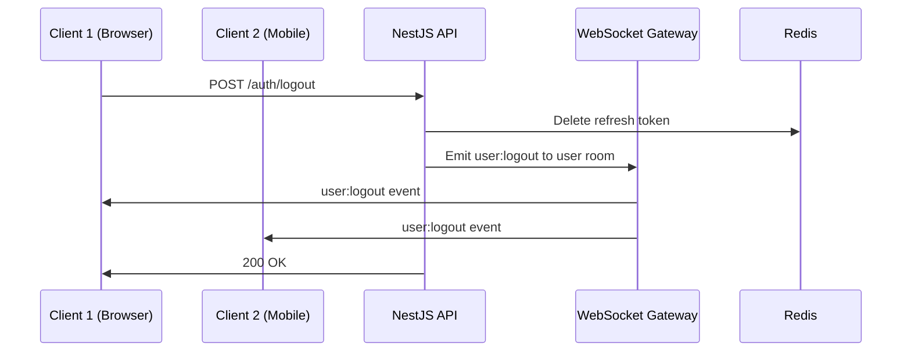
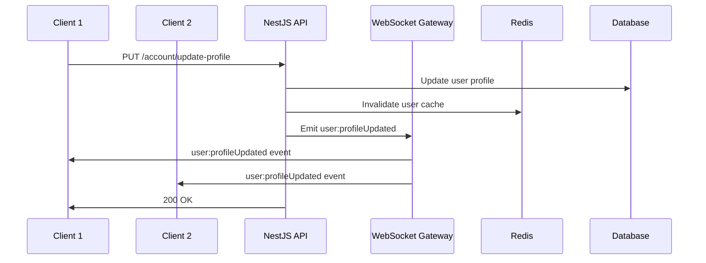

# Realtime Documentation - Socket.io

Tài liệu mô tả chi tiết về các rooms, events và dữ liệu trong hệ thống realtime của GEN-HUB.

## Connection

### Kết nối WebSocket

```javascript
import { io } from 'socket.io-client';

const socket = io('http://localhost:4000', {
  auth: {
    token: 'Bearer <access_token>'
  },
  transports: ['websocket', 'polling']
});
```

### Xác thực

WebSocket gateway sử dụng JWT token để xác thực. Token phải được gửi trong `auth.token` khi kết nối.

**Lỗi xác thực:**
```typescript
{
  event: 'error',
  data: {
    code: 'UNAUTHORIZED',
    message: 'Invalid or expired token'
  }
}
```

---

## Rooms

### User Room

Mỗi user có 1 room riêng để nhận notifications cá nhân.

| Room Name | Format | Description |
|-----------|--------|-------------|
| User Room | `user:{userId}` | Room riêng của mỗi user |

**Ví dụ:** `user:550e8400-e29b-41d4-a716-446655440000`

> [!NOTE]
> User tự động join vào room của mình sau khi kết nối và xác thực thành công.

---

## Events Reference

### Server → Client Events

#### 1. `user:logout`

Được emit khi user logout khỏi 1 thiết bị cụ thể.

| Property | Type | Description |
|----------|------|-------------|
| `userId` | `string` | ID của user bị logout |
| `tokenId` | `string` | ID của refresh token bị hủy |
| `timestamp` | `string` | ISO timestamp |
| `message` | `string` | Message thông báo |

**Payload:**
```typescript
{
  userId: "550e8400-e29b-41d4-a716-446655440000",
  tokenId: "abc123-token-id",
  timestamp: "2025-12-08T12:00:00.000Z",
  message: "Đã đăng xuất thành công"
}
```

**Client Handler:**
```javascript
socket.on('user:logout', (data) => {
  // Kiểm tra nếu tokenId trùng với token hiện tại
  if (data.tokenId === currentRefreshTokenId) {
    // Clear local storage và redirect to login
    localStorage.removeItem('access_token');
    localStorage.removeItem('refresh_token');
    window.location.href = '/login';
  }
});
```

---

#### 2. `user:logoutAll`

Được emit khi user logout khỏi tất cả các thiết bị.

| Property | Type | Description |
|----------|------|-------------|
| `userId` | `string` | ID của user bị logout |
| `timestamp` | `string` | ISO timestamp |
| `message` | `string` | Message thông báo |
| `excludeSocketId` | `string \| null` | Socket ID không bị logout (socket gọi API) |

**Payload:**
```typescript
{
  userId: "550e8400-e29b-41d4-a716-446655440000",
  timestamp: "2025-12-08T12:00:00.000Z",
  message: "Đã đăng xuất khỏi tất cả thiết bị",
  excludeSocketId: "socket-id-of-caller"
}
```

**Client Handler:**
```javascript
socket.on('user:logoutAll', (data) => {
  // Kiểm tra nếu không phải socket hiện tại
  if (data.excludeSocketId !== socket.id) {
    // Clear local storage và redirect to login
    localStorage.removeItem('access_token');
    localStorage.removeItem('refresh_token');
    window.location.href = '/login?reason=logout_all';
  }
});
```

---

#### 3. `user:tokenRevoked`

Được emit khi refresh token bị vô hiệu hóa (password changed với logout_all_devices, admin revoke, etc.).

| Property | Type | Description |
|----------|------|-------------|
| `userId` | `string` | ID của user |
| `reason` | `string` | Lý do token bị revoke |
| `timestamp` | `string` | ISO timestamp |
| `message` | `string` | Message thông báo |

**Payload:**
```typescript
{
  userId: "550e8400-e29b-41d4-a716-446655440000",
  reason: "password_changed",
  timestamp: "2025-12-08T12:00:00.000Z",
  message: "Mật khẩu đã được thay đổi. Vui lòng đăng nhập lại."
}
```

**Reasons:**
| Reason | Description |
|--------|-------------|
| `password_changed` | User đổi mật khẩu với option logout_all_devices |
| `admin_revoke` | Admin vô hiệu hóa session |
| `security_alert` | Phát hiện hoạt động đáng ngờ |

**Client Handler:**
```javascript
socket.on('user:tokenRevoked', (data) => {
  alert(data.message);
  // Force logout
  localStorage.clear();
  window.location.href = '/login?reason=' + data.reason;
});
```

---

#### 4. `user:profileUpdated`

Được emit khi user cập nhật thông tin cá nhân.

| Property | Type | Description |
|----------|------|-------------|
| `userId` | `string` | ID của user |
| `updatedFields` | `string[]` | Danh sách các fields đã được cập nhật |
| `profile` | `object` | Thông tin profile mới |
| `timestamp` | `string` | ISO timestamp |

**Payload:**
```typescript
{
  userId: "550e8400-e29b-41d4-a716-446655440000",
  updatedFields: ["name", "language"],
  profile: {
    id: "550e8400-e29b-41d4-a716-446655440000",
    name: "Nguyễn Văn B",
    email: "user@example.com",
    language: "en"
  },
  timestamp: "2025-12-08T12:00:00.000Z"
}
```

**Client Handler:**
```javascript
socket.on('user:profileUpdated', (data) => {
  // Cập nhật state/store với thông tin mới
  store.dispatch(updateUserProfile(data.profile));
  
  // Hoặc refresh user data
  if (data.updatedFields.includes('language')) {
    i18n.changeLanguage(data.profile.language);
  }
});
```

---

### Client → Server Events

#### 1. `ping`

Client gửi ping để giữ kết nối.

**Emit:**
```javascript
socket.emit('ping');
```

**Response Event:** `pong`
```typescript
{
  timestamp: "2025-12-08T12:00:00.000Z"
}
```

---

#### 2. `subscribe`

Client subscribe vào các rooms bổ sung (nếu cần).

**Emit:**
```javascript
socket.emit('subscribe', { rooms: ['notifications', 'announcements'] });
```

**Response Event:** `subscribed`
```typescript
{
  rooms: ['notifications', 'announcements'],
  success: true
}
```

---

## Error Events

### `error`

Được emit khi có lỗi xảy ra.

**Payload:**
```typescript
{
  code: "ERROR_CODE",
  message: "Human readable error message",
  details?: object
}
```

**Error Codes:**
| Code | Description |
|------|-------------|
| `UNAUTHORIZED` | Token không hợp lệ hoặc hết hạn |
| `FORBIDDEN` | Không có quyền thực hiện action |
| `INVALID_PAYLOAD` | Dữ liệu gửi lên không hợp lệ |
| `INTERNAL_ERROR` | Lỗi server |

---

## Connection Events

### `connect`
Kết nối thành công.

### `disconnect`
Ngắt kết nối.

**Reasons:**
| Reason | Description |
|--------|-------------|
| `io server disconnect` | Server ngắt kết nối |
| `io client disconnect` | Client ngắt kết nối |
| `ping timeout` | Timeout |
| `transport close` | Transport bị đóng |
| `transport error` | Lỗi transport |

---

## Sequence Diagrams

### Logout Flow



### Profile Update Flow



---

## TypeScript Interfaces

```typescript
// Socket Events - Server to Client
interface UserLogoutEvent {
  userId: string;
  tokenId: string;
  timestamp: string;
  message: string;
}

interface UserLogoutAllEvent {
  userId: string;
  timestamp: string;
  message: string;
  excludeSocketId: string | null;
}

interface UserTokenRevokedEvent {
  userId: string;
  reason: 'password_changed' | 'admin_revoke' | 'security_alert';
  timestamp: string;
  message: string;
}

interface UserProfileUpdatedEvent {
  userId: string;
  updatedFields: string[];
  profile: {
    id: string;
    name: string;
    email: string;
    language?: string;
  };
  timestamp: string;
}

// Socket Events - Client to Server
interface SubscribePayload {
  rooms: string[];
}

// Error Event
interface SocketError {
  code: string;
  message: string;
  details?: Record<string, unknown>;
}
```
